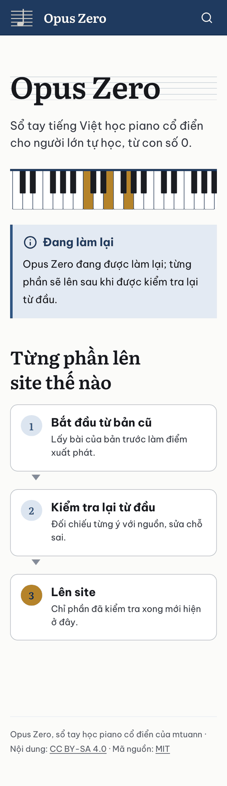
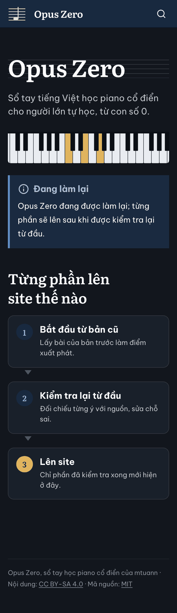
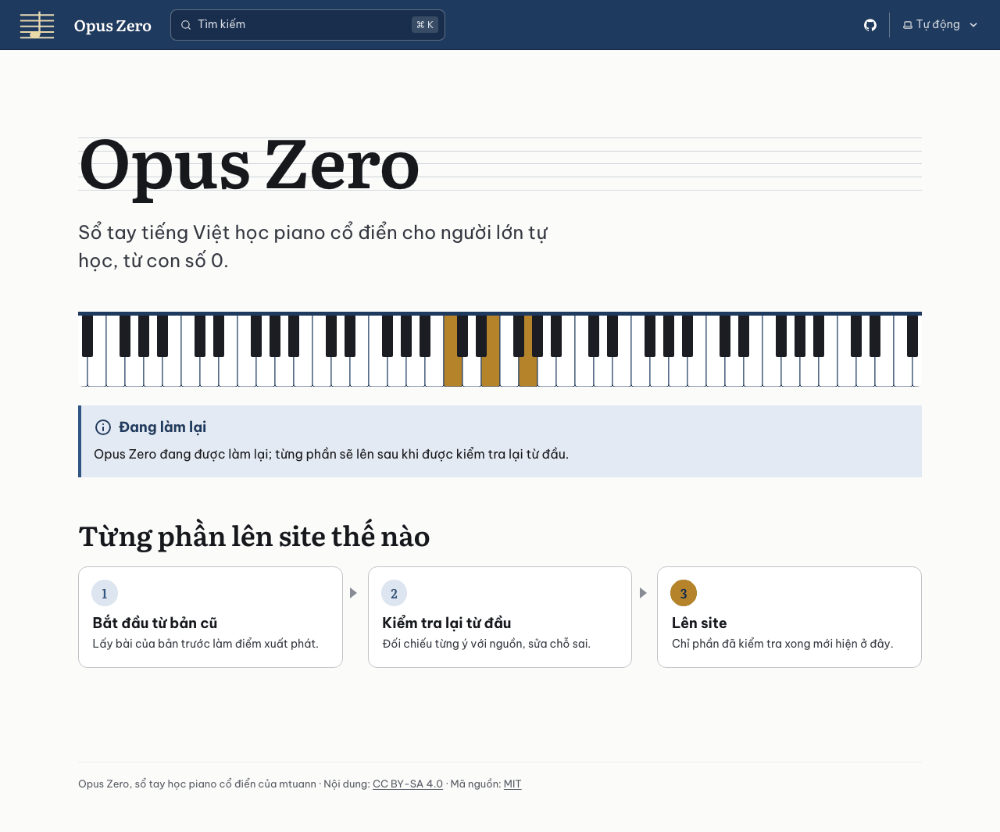

# Báo cáo D1.1: Khởi tạo

Nhánh `moi/d1-1-khoi-tao`, commit `667a88d` (trên `07f0ee9`). Làm ngày 23/10/2026, bằng Claude Code (Claude Opus 5.5). Chưa push.

## Kết quả

- `npm ci`, `npm run build`, `npm test` đạt trên Node 24.22.1 (theo `.nvmrc`) và Node 26.8.2 (máy này), mỗi lần cài lại từ đầu. Kiểm thử: 9/9.
- Bản build có trang chủ tạm ở `/opus/` và trang 404 mặc định của Starlight.
- Lighthouse 13.5.0, chế độ điện thoại, trang chủ tạm, 3 lần, phục vụ qua HTTP/2 như GitHub Pages:

| Hiệu năng | Trợ năng | Thực hành tốt | SEO | FCP | LCP | TBT | CLS | Tổng tải |
|---|---|---|---|---|---|---|---|---|
| 100 (100/100/100) | 100 | 100 | 100 | 1,1 s | 1,4 s | 0 ms | 0 | 110 KiB |

- Ba nhân trình duyệt (Playwright 1.64.1: Chromium 156, WebKit 27.2 của Safari, Firefox 157), ba cỡ màn hình (360, 768, 1280 px), sáng và tối: 18 lần chụp. Không lần nào tràn ngang, không lỗi JavaScript; tiêu đề dùng Literata, chữ thường dùng Be Vietnam Pro.
- Hộp tìm kiếm chạy trên Chromium và WebKit: "làm lại" và "lam lai" đều ra trang chủ; không có kết quả thì báo bằng tiếng Việt.

| Điện thoại 360 px, sáng | Điện thoại 360 px, tối |
|---|---|
|  |  |



## Việc đã làm và file đã chạm

| File | Nội dung |
|---|---|
| `package.json`, `package-lock.json` | `astro` 7.4.2, `@astrojs/starlight` 0.42.7, ghim chính xác; lệnh `dev`, `build`, `preview`, `test` |
| `.nvmrc` | `24` |
| `astro.config.mjs` | `site: 'https://mtuann.github.io'`, `base: '/opus'`, `trailingSlash: 'always'`, `build.format: 'directory'`; Starlight tiếng Việt (`lang: 'vi'`), logo, favicon, link GitHub, nạp trước 4 file font, `theme-color` |
| `tsconfig.json`, `src/content.config.ts` | Cấu hình mặc định của Astro; bộ `docs` và `i18n` của Starlight (D1.2 mở rộng) |
| `public/fonts/` | 15 file `.woff2` và 2 giấy phép OFL, chép nguyên từ `../opus-zero/docs/assets/fonts/` |
| `src/styles/fonts.css` | `@font-face` của site cũ, chỉ đổi đường dẫn sang `/fonts/…` (Vite tự thêm `/opus/`) |
| `src/styles/opus.css` | Màu của site cũ cho Starlight, chế độ sáng và tối; tiêu đề Literata; thanh trên cùng màu mực; viền khi dùng bàn phím màu nhựa thông; sơ đồ các bước |
| `src/components/Hero.astro` | Thay phần đầu trang của Starlight: tên site trên khuông nhạc, dải phím đàn |
| `src/components/Footer.astro` | Chân trang của Starlight thêm dòng giấy phép như site cũ |
| `src/content/docs/index.md` | Trang chủ tạm |
| `src/content/i18n/vi.json` | Chữ tiếng Việt cho hộp tìm kiếm |
| `src/assets/logo.svg`, `public/favicon.svg`, `public/icons/icon-192.png` | Logo (khuông và nốt của favicon cũ, không nền), favicon và icon cũ |
| `tests/khung.test.mjs` | 9 kiểm thử trên `dist/` |
| `AGENTS.md` | Điền mục "Lệnh" |

`.gitignore` đã có `dist/`, `.astro/` từ đợt 0 nên không sửa. Không chạm `../opus-zero/`: `git -C ../opus-zero status --short` chỉ còn `?? _to_delete/`, có từ trước phiên này.

## Chọn gì, vì sao

- **Phiên bản.** Astro 7.4.2 (21/10/2026) cần Node từ 22.23.4. Starlight 0.42.7 (ra ngày 23/10/2026) chỉ khác 0.42.6 ở hai chỗ vá nhỏ (ảnh hero ưu tiên tải, vị trí thanh bên); đã so mã hai bản.
- **Node 24.** Là bản LTS (đang ở giai đoạn bảo trì từ 20/10/2026), hỗ trợ đến 30/4/2028. Node 22 của site cũ hết hỗ trợ 30/4/2027, có thể trước khi làm lại xong. Node 26 thành LTS ngày 28/10/2026 (hỗ trợ đến 30/4/2029); có thể chuyển `.nvmrc` sang 26 ở lần nâng cấp tháng 11. Kiểm thử chấp nhận cả hai.
- **Font trong `public/fonts/`** theo `cong-nghe.md` mục 4. Tên file giữ nguyên, nên thẻ nạp trước trong `astro.config.mjs` trỏ thẳng tới file.
- **Màu.** Chế độ sáng: nền giấy `#fbfbf9`, link và nút mực nhạt `#2f5582`, thanh trên cùng mực `#1f3a5f`, điểm nhấn nhựa thông `#b5832a`. Chế độ tối lấy theo bảng `slate` của site cũ (nền `#12161d`, link `#8fb6e6`, nhựa thông `#e0b45e`). Hộp ghi chú của Starlight vốn màu tím xanh nên đổi theo bảng màu này: ghi chú màu mực, chú ý màu nhựa thông, xanh lá và đỏ lấy `--oz-ok`, `--oz-bad` của site cũ.
- **Ô chọn giao diện.** Starlight đặt cứng độ rộng cho chữ tiếng Anh nên "Tự động" bị cắt; đã nới rộng.
- **Trang chủ tạm** dùng mẫu `splash`: tên site, một dòng giới thiệu (như `README.md`), dải phím đàn, hộp "Đang làm lại" chứa nguyên văn câu của kế hoạch, sơ đồ ba bước. Theo yêu cầu dùng hình cho dễ nhớ, sơ đồ viết bằng HTML và CSS nên chữ đọc được bằng máy đọc màn hình và tìm được. Trên điện thoại sơ đồ xếp dọc, trên màn hình rộng xếp ngang.
- **Bộ xử lý Markdown:** giữ Sätteri, mặc định của Astro 7. Đã chạy được hộp `:::note[…]` và khối HTML; việc so với unified để D1.3, D1.4.

## Số nhận định

Không áp dụng: việc kỹ thuật, không chuyển trang nào. Trang chủ tạm cố ý không có số liệu hay nhận định về âm nhạc, để D1.6 khóa với hồ sơ không có nhận định. Câu thông báo lấy nguyên văn từ kế hoạch; sơ đồ ba bước chỉ tả lại luật 1. Người review xem ba câu trong sơ đồ có được coi là nhận định không. Hình phím đàn tô Đô (C4), Mi (E4), Sol (G4): C4 là phím trắng thứ 24 tính từ A0 (A0, B0, rồi mỗi quãng tám 7 phím: 2 + 7 × 3 + 1).

## Chỗ chưa chắc và việc cho bước sau

1. **Commit đầu của `main`.** `main` chưa có commit nào, nên không tách nhánh được. Tôi tạo commit `07f0ee9` "Đợt 0: dựng repo mới cho site làm lại" với đúng các file đợt 0, không sửa gì. Bạn xem lại trước khi push. Muốn làm lại commit đó: sửa trên `main` bằng `git commit --amend`, rồi `git rebase --onto main 07f0ee9 moi/d1-1-khoi-tao`.
2. **Mục "Quyết định" còn chờ.** D1.1 làm theo hai lựa chọn "khuyên dùng": Astro và Starlight; giữ font, màu, giọng văn. Đồng ý thì đánh `[x]` trong `plans/lam-lai/README.md`.
3. **`cong-nghe.md` ghi Starlight 0.41.** Bản 0.42.0 ra ngày 2/9/2026, nay là 0.42.7. Cần sửa câu đề xuất và mục 3; chưa sửa vì ngoài việc này.
4. **Lệnh build site cũ ghi vào thư mục cũ.** Lệnh trong mục "Quy tắc chung", `mkdocs build -f ../opus-zero/mkdocs.yml -d .cache/site-cu`, ghi ra `../opus-zero/.cache/site-cu`, không phải `opus/.cache/`. Lý do: MkDocs tính đường dẫn tương đối theo thư mục chứa `mkdocs.yml` (`mkdocs/config/config_options.py`, dòng 700–711, trong `../opus-zero/.venv`). Thư mục đó nằm trong `.gitignore` của repo cũ nên `git status` vẫn sạch, nhưng vẫn là ghi vào thư mục cũ. Cách sửa: dùng đường dẫn tuyệt đối, `-d "$PWD/.cache/site-cu"`. Chưa chạy lệnh này.
5. **Id của tiêu đề giữ dấu tiếng Việt,** ví dụ `#từng-phần-lên-site-thế-nào`. Site cũ bỏ dấu và bỏ chữ "đ" (`chang-1-khoi-au`). D1.4, D1.5 cần chọn: giữ kiểu mới và đổi các link `#…` khi chuyển trang, hay đặt bộ tạo id như site cũ để link cũ vẫn đúng.
6. **Khối ```abc.** Expressive Code (bộ tô màu mã của Starlight) báo không biết ngôn ngữ `abc` rồi hiện như chữ thường. D1.3 phải xử lý khối này trước Expressive Code.
7. **Menu trên điện thoại** của Starlight dùng Popover API (Safari và iOS từ bản 17, Chrome từ 114, Firefox từ 125). Trên trình duyệt cũ hơn, nút menu không mở được thanh bên. Trang chủ tạm không có thanh bên nên chưa ảnh hưởng. Nên xem lại khi có trang bài (D1.8, đợt 2).
8. **Trang `splash` trên điện thoại không có nút đổi sáng/tối:** Starlight đặt nút này trong menu, mà trang `splash` không có menu. Trang theo cài đặt của máy.
9. **Ảnh chia sẻ.** `og.png` cũ ghi "26 bài học tác phẩm", không còn đúng, nên không chép; site chưa có `og:image`. Nên làm ảnh mới cùng trang chủ mới ở đợt 2.
10. **Build còn một cảnh báo,** "Entry docs → 404 was not found", vì chưa có trang 404 riêng. Hết ở D1.5.
11. **Tìm kiếm.** Pagefind tự bỏ dấu: "lam lai" ra "làm lại". Chữ "đ" gõ thành "d" để D1.8. Chữ của hộp tìm kiếm phải ghi trong `src/content/i18n/vi.json`: chạy trong Starlight, Pagefind không tự dùng bản dịch tiếng Việt có sẵn của nó. Chưa tìm ra nguyên nhân.
12. **Kiểm kiểu TypeScript (`astro check`) chưa thêm.** `@astrojs/check` 0.9.12 chỉ nhận TypeScript 5 và 6, còn TypeScript mới nhất là 7.0.2. Có thể thêm ở D1.2, khi có schema.
13. **npm 11 không chạy script cài đặt của `fsevents`.** Đây là gói tùy chọn để theo dõi file trên macOS, đã có bản dựng sẵn. Build không bị ảnh hưởng.
14. **Manifest, icon PWA và service worker** để đợt 7. Hiện chỉ có favicon và `apple-touch-icon`.

## Kiểm thử

```text
✔ trang chủ tạm: tiếng Việt, câu thông báo của kế hoạch, thẻ cho điện thoại và máy tìm kiếm
✔ hộp tìm kiếm nói tiếng Việt (src/content/i18n/vi.json), không còn chữ tiếng Anh của Pagefind
✔ mọi trang dạng thư mục (…/index.html), có trang 404.html cho GitHub Pages
✔ sitemap chỉ có địa chỉ dưới https://mtuann.github.io/opus/, kết thúc bằng /
✔ mọi đường dẫn nội bộ có base /opus/ và mọi tài nguyên nạp đều có trong dist/
✔ font tự host: không gọi Google Fonts, mọi font khai báo đều có, không thừa file, có giấy phép OFL
✔ script và stylesheet chỉ từ site, không từ nguồn ngoài
✔ phiên bản gói ghim chính xác trong package.json, khớp package-lock.json
✔ Node trong .nvmrc và Node đang chạy đủ yêu cầu của Astro
ℹ tests 9  ℹ pass 9  ℹ fail 0
```

Đã thử làm hỏng `dist/` có chủ ý: xóa một file font, bỏ base của favicon, sửa câu thông báo. Kiểm thử báo đủ cả ba lỗi.

Ảnh chụp, đo Lighthouse và thử tìm kiếm chạy bằng script tạm, không đưa vào repo: chụp màn hình bằng Playwright; đo bằng hai script `tools/lighthouse/` của site cũ, chép ra ngoài và đổi `/opus-zero/` thành `/opus/`. Đưa các bước này vào CI là việc của D1.7.

## Nguồn đã dùng

- npm registry (`npm view`): phiên bản, ngày phát hành, `engines` của `astro`, `@astrojs/starlight`, `@astrojs/check`, `typescript`, `lighthouse`, `playwright`.
- Lịch phát hành Node.js: https://raw.githubusercontent.com/nodejs/Release/main/schedule.json (Node 22 hết hỗ trợ 30/4/2027; Node 24 LTS đến 30/4/2028; Node 26 thành LTS 28/10/2026, đến 30/4/2029).
- Mã của Starlight 0.42.6 và 0.42.7 (so hai bản), Pagefind UI 1.5.2 (bản dịch tiếng Việt), trong `node_modules/`.
- Site cũ, chỉ đọc: `../opus-zero/docs/assets/fonts/`, `docs/assets/css/opus.css`, `docs/assets/favicon.svg`, `docs/assets/icons/`, `docs/assets/og.png`, `overrides/main.html`, `mkdocs.yml`, `AGENTS.md`, `tools/lighthouse/`; MkDocs 1.6.1 trong `../opus-zero/.venv`.

## Thời gian

Ước lượng lúc nhận việc: 1,5–2,5 giờ. Thực tế: khoảng 40 phút, từ đọc kế hoạch đến commit báo cáo.

## Review

Chủ repo kiểm trên máy (`npm run build`, `npm run preview`, http://localhost:4321/opus/) ngày 23/10/2026: đạt, đồng ý gộp vào `main`. Các chỗ sửa theo mục 2–4 ở trên (hai quyết định, lệnh build site cũ, phiên bản trong `cong-nghe.md`) làm trong commit riêng trên `main` sau khi gộp.
