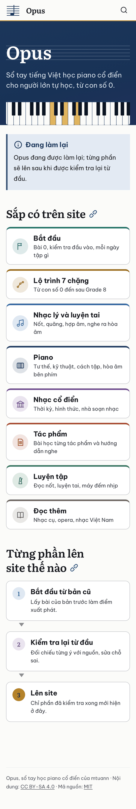
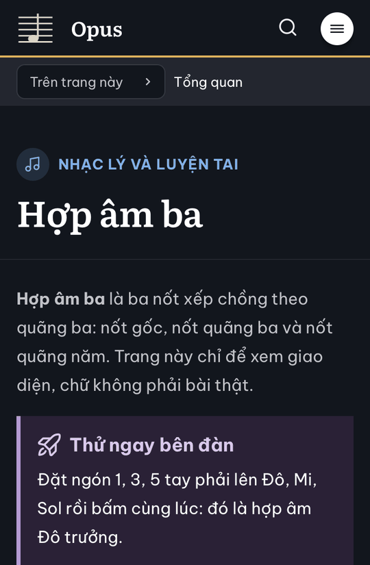
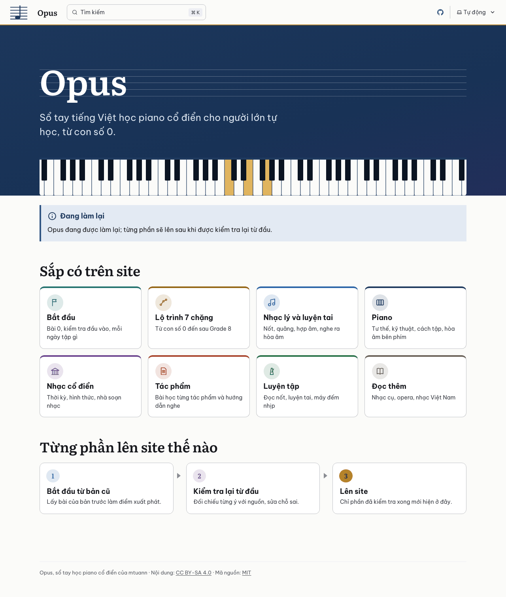
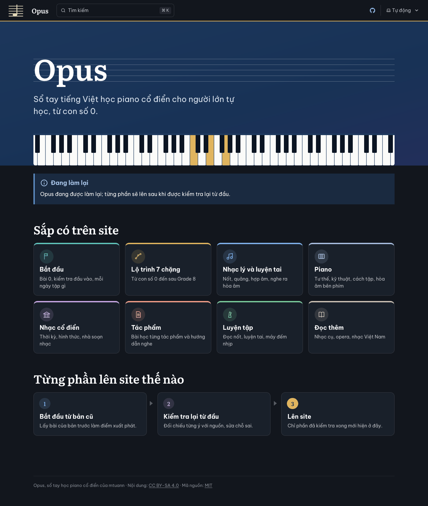
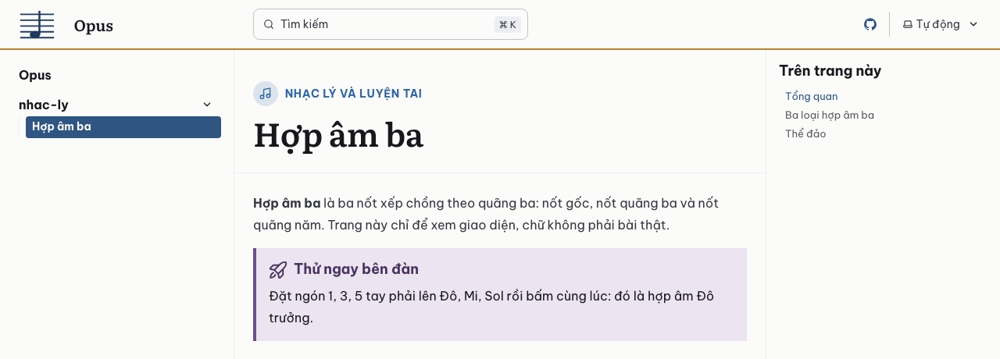

# Báo cáo D1.2b: Giao diện

Nhánh `moi/d1-2b-giao-dien`, commit `b77d03e` (trên `main` `6391fbf`). Làm ngày 23/10/2026, bằng Claude Code (Claude Opus 5.5). Việc thêm vào đợt 1 theo yêu cầu của chủ repo. Sau D1.2, chủ repo thấy giao diện còn giống MkDocs của site cũ. Claude làm ba bản mẫu A, B, C (trang so sánh: https://claude.ai/artifact/HnoDmNPQNqAzu2dUVAe1EU), chủ repo chọn "B, lấy thêm phần đầu trang chủ của C" và đổi tên site thành Opus.

## Kết quả

- `npm ci`, `npm run build`, `npm test` đạt trên Node 24.22.1 (theo `.nvmrc`) và Node 26.8.2. Kiểm thử: 19/19, trong đó 5 kiểm thử mới ở `tests/giao-dien.test.mjs`.
- Lighthouse 13.5.0, chế độ điện thoại, 3 lần mỗi trang, phục vụ qua HTTP/2 như GitHub Pages. Trang bài tạm (một trang mẫu đặt ở `nhac-ly/`, đã xóa trước khi commit) dùng để xem nhãn nhóm:

| Trang | Hiệu năng | Trợ năng | Thực hành tốt | SEO | FCP | LCP | TBT | CLS | Tổng tải |
|---|---|---|---|---|---|---|---|---|---|
| Trang chủ tạm | 100 (100/100/100) | 100 | 100 | 100 | 1,1 s | 1,5 s | 0 ms | 0 | 112 KiB |
| Trang bài tạm | 100 (100/100/100) | 100 | 100 | 100 | 1,1 s | 1,4 s | 0 ms | 0,001 | 114 KiB |

- Playwright 1.64.1, ba trình duyệt (Chromium 156, WebKit 27.2, Firefox 157), ba cỡ màn hình (360, 768, 1280 px), sáng và tối. Trang chủ ở bản build cuối có 18 ảnh, trang bài tạm có 18 ảnh. Không ảnh nào tràn ngang hay có lỗi JavaScript. Tiêu đề dùng Literata, chữ thường dùng Be Vietnam Pro.
- Khi in (Chromium giả lập in), dải mực bị bỏ, chữ màu đen, phím đàn ẩn. Ở chế độ tương phản cao (forced colors), dải mực bị bỏ và chữ theo màu hệ thống.

| Điện thoại 360 px, sáng | Trang bài, 360 px, tối |
|---|---|
|  |  |

## Việc đã làm và file đã chạm

| File | Nội dung |
|---|---|
| `src/styles/opus.css` | Thanh trên nền giấy (tối: nền trang), viền 2 px màu nhựa thông. Bỏ bảng màu trắng riêng cho thanh mực cũ. Thêm màu 8 nhóm (`--oz-c-*`), bản sáng và tối. Thêm nhãn nhóm (`.oz-nhom`), biểu tượng tròn (`.oz-icon`) và lưới thẻ (`.oz-muc`, `.oz-the`): trên điện thoại 1 cột, biểu tượng nằm bên trái; từ 32rem lưới 2 cột; từ 64rem lưới 4 cột. Số bước trong sơ đồ tô màu theo bước. |
| `src/components/Hero.astro` | Dải mực tràn ngang sau tên site, khuông nhạc và phím đàn (bản C). Màu chữ và phím đặt lại cho nền tối. Có cách hiển thị riêng khi in và ở chế độ tương phản cao. |
| `src/components/PageTitle.astro` (mới) | Nhãn nhóm (biểu tượng, tên, màu) trên tiêu đề của mọi trang thuộc một nhóm |
| `src/nhom.mjs` (mới) | 8 nhóm của menu: tên, mô tả, biểu tượng SVG. Trang thuộc nhóm nào thì theo luật `nhom_menu()` của `plans/lam-lai/anh_xa.py`. |
| `src/assets/logo-muc.svg` (mới) | Logo khuông nhạc màu mực cho nền sáng (bản kem cũ vẫn dùng cho nền tối) |
| `astro.config.mjs` | Logo hai bản; đăng ký `PageTitle`; `theme-color` đổi theo nền thanh trên (`#fbfbf9` sáng, `#12161d` tối); tên Opus |
| `src/content/docs/index.md` | Thẻ "Sắp có trên site" cho 8 nhóm; `next: false` (trang chủ không có link "Tiếp"); tên Opus |
| `tests/giao-dien.test.mjs` (mới) | So nhóm của đủ 233 trang cũ với `anh-xa.md`; kiểm id trang mục lục; mỗi nhóm có đủ tên, mô tả, biểu tượng và màu ở hai chế độ, màu chữ đạt 4,5:1; thẻ trang chủ khớp `src/nhom.mjs`; có logo hai bản |
| `tests/khung.test.mjs` | Câu thông báo và `<title>` theo tên mới |
| Đổi tên Opus Zero thành Opus | `README.md`, `AGENTS.md`, `LICENSE-CONTENT`, `package.json`, `src/components/Footer.astro`, `plans/lam-lai/README.md`, `plans/lam-lai/so-do.md` |
| `plans/lam-lai/README.md` | Mục Quyết định ghi bố cục đã chọn; thêm việc D1.2b vào đợt 1; bảng Tiến độ |
| `AGENTS.md`, `plans/lam-lai/cong-nghe.md` | Mục Giao diện ghi bố cục, màu theo nhóm, chỗ dễ sai của bộ nén CSS; thư mục ghi thêm `src/du-lieu.mjs` (sót ở D1.2) và `src/nhom.mjs` |

Không chạm `../opus-zero/`: `git -C ../opus-zero status --short` chỉ còn `?? _to_delete/`, có từ trước; HEAD vẫn `5d08189`.

## Chọn gì, vì sao

- **Thanh trên sáng.** Thanh mực của D1.1 làm site giống Material của site cũ, và bắt phải đổi bảng màu riêng cho từng phần của thanh. Thanh nền giấy với viền nhựa thông chỉ cần màu của trang. Hộp tìm kiếm và nút chọn giao diện giữ màu mặc định của Starlight.
- **Dải mực ở trang chủ** vẽ bằng `border-image`. Phần vẽ ra ngoài khung không tính vào vùng cuộn, nên dải tràn hết bề ngang và lên sát thanh trên mà trang không cuộn ngang. Khung hero có thêm nền mực nằm dưới dải: axe (bộ kiểm trợ năng trong Lighthouse) không coi `border-image` là nền, nên lần đo đầu nó tính chữ khẩu hiệu `#dbe5f2` trên nền giấy (1,22:1) và cho trợ năng 96. Có nền mực thì đạt 100. Tương phản thật trên dải: chữ khẩu hiệu từ 9:1 đến 10,2:1, tên site từ 11,5:1.
- **Bộ nén CSS** của bản build biến `border-image: none` thành `border-image:` rỗng, trình duyệt bỏ qua, nên lúc đầu dải mực vẫn hiện khi in. Đã sửa bằng `border-image-source: none` và ghi vào `AGENTS.md`.
- **Màu theo nhóm.** Mỗi nhóm có một màu ở cả hai chế độ. Kiểm thử đòi chữ màu nhóm đạt từ 4,5:1 trên nền trang. Màu Lộ trình ở chế độ sáng `#9a6c1c` chỉ đạt 4,47:1 nên đổi thành `#946716` (4,81:1). Biểu tượng là nét SVG vẽ tay, 24×24, `aria-hidden`.
- **Nhóm của trang** theo đúng luật của kế hoạch (`nhom_menu()` trong `anh_xa.py`): theo đường dẫn, rồi theo tầng trong `src/data/trang.yml` (trang ngoại vi vào Đọc thêm). Bản đầu chỉ theo đường dẫn và lệch 6 trang: 5 trang ngoại vi trong `lich-su/` (opera, nhạc Việt Nam, đương đại, nữ nhà soạn nhạc, nhạc truyền thống) và `bat-dau/sach-in` (nhóm Thêm). Kiểm thử mới bắt được, giờ khớp đủ 233 trang. Đã build thử với trang tạm `lich-su/opera` (nhãn Đọc thêm) và `nhac-ly/index` (nhãn Nhạc lý và luyện tai), xóa trước khi commit. Nhóm thứ chín, "Thêm" (Cập nhật, blog, tài nguyên, tài liệu tham khảo, sách in), không có nhãn và không có thẻ.
- **Thẻ trên điện thoại** đặt biểu tượng bên trái để thẻ thấp, 8 thẻ đỡ cuộn. Đo ở 360 px trên WebKit: khối 8 thẻ cao 801 px; bản đầu, biểu tượng nằm trên tên, cao 1226 px. Lưới chỉ có 1, 2 hoặc 4 cột: ở 768 px, lưới tự chia ra 3 cột và hàng cuối thừa một ô.
- **Thẻ viết bằng HTML trong `index.md`**, như bản mẫu đã duyệt, vì trang Markdown không gọi được `src/nhom.mjs`. Kiểm thử so thẻ trong bản build với `src/nhom.mjs` (thứ tự, tên, mô tả, màu, biểu tượng), nên hai nơi không lệch được. Khi D1.3 có chỉ thị thành phần, có thể sinh thẻ bằng chỉ thị. Trang chủ thật của đợt 2 sinh từ dữ liệu.
- **`next: false` ở trang chủ.** Khi có trang khác, Starlight tự thêm link "Tiếp" ở trang chủ, trỏ tới trang đầu của menu. Ảnh chụp với trang bài tạm cho thấy link "Tiếp: Hợp âm ba", nên đã bỏ.
- **Đổi tên.** Tên hiển thị, `<title>`, chân trang, giấy phép nội dung (ví dụ ghi nguồn), README và tài liệu đều đổi sang Opus. Giữ nguyên tên repo `mtuann/opus`, địa chỉ `/opus/` và khóa dữ liệu học `opus-zero:v1` trong trình duyệt. Chỗ còn chữ "Opus Zero" đều nói về bản trước: `LICENSE-CONTENT`, `AGENTS.md` và `plans/lam-lai/README.md` ("bản trước tên Opus Zero"); tên hai tài liệu Claude Docs trong `giao-viec.md`, `plans/lam-lai/README.md` và `plans/ben-vung/README.md` dòng 3, chưa đổi. `LICENSE-CONTENT` còn đổi phạm vi: giấy phép nội dung CC BY-SA 4.0 nay ghi rõ phủ cả `src/data/` (dữ liệu tách từ chữ của site cũ, vốn cùng giấy phép), cạnh `src/content/docs/`; đường dẫn file giấy phép font sửa thành `public/fonts/`.

## Số nhận định

Không áp dụng: việc giao diện, không chuyển trang nào. Chữ mới trên trang chủ là tên và một dòng mô tả cho mỗi nhóm, đều tả cấu trúc site, không phải nhận định âm nhạc. Đã đối chiếu: "Từ con số 0 đến sau Grade 8" khớp 7 chặng trong `src/data/cap-do.yml` (chặng 1 Khởi đầu, chặng 7 Sau Grade 8). "Nhạc cụ, opera, nhạc Việt Nam" khớp các trang Đọc thêm trong `anh-xa.md` (`nhac-cu/*`, `lich-su/opera`, `lich-su/viet-nam`, `lich-su/nhac-truyen-thong-viet-nam`). Hai mô tả tóm tắt các trang của nhóm trong `anh-xa.md`: "Nốt, quãng, hợp âm, nghe ra hòa âm" (`nhac-ly/01`–`10`, `luyen-tai/`), "Đọc nốt, luyện tai, máy đếm nhịp" (`luyen-tap/doc-not`, `chep-giai-dieu`, `hat-lai`, `metronome`). Mô tả các nhóm còn lại theo sơ đồ menu ở `so-do.md` mục 5.

## Chỗ chưa chắc và việc cho bước sau

- **D1.8 và đợt 2:** thanh bên của Starlight đang tự sinh, nên ghi tên thư mục (ví dụ "nhac-ly"). Thấy ở trang bài tạm; ba trang thử của D1.8 sẽ hiện như vậy ở bản xem. Đợt 2 chốt menu.
- **D1.3, D1.4:** bảng 4 cột trên điện thoại 360 px xuống dòng nhiều (thấy ở trang bài tạm, ví dụ "Đô – Mi – Sol" thành 3 dòng). Cân nhắc cho bảng cuộn ngang khi chuyển trang có bảng.
- **D1.3:** chưa thêm màu đúng, sai, lệch (`--oz-ok`, `--oz-bad`, `--oz-warn` của site cũ) vì chưa thành phần nào dùng; câu hỏi kiểm tra nhanh của D1.3 sẽ cần.
- **D1.7:** `npm ci` của npm 11.19 báo "1 package has install scripts not yet covered by allowScripts". Gói đó là `fsevents` (chỉ có trên macOS, không cần script để chạy). CI chạy Linux nên không cài gói này.
- Cảnh báo "Entry docs → 404 was not found" khi build có từ D1.1; D1.5 làm trang 404.
- Hai tài liệu Claude Docs còn tên "Opus Zero: …". Đổi được nếu chủ repo muốn; tên trong `giao-viec.md` và `plans/lam-lai/README.md` sửa theo.

## Kiểm thử đã chạy

- `npm ci && npm run build && npm test` trên Node 24.22.1; `npm run build && npm test` trên Node 26.8.2: 19/19.
- Ảnh chụp: script Playwright chụp ba trình duyệt, ba cỡ màn hình, sáng và tối; đo tràn ngang (`scrollWidth > clientWidth`), lỗi JavaScript, font đã nạp.
- Lighthouse: bản build cuối, máy chủ HTTP/2 có gzip, như D1.1.
- In và tương phản cao: Playwright `emulateMedia({ media: 'print' })` và `emulateMedia({ forcedColors: 'active' })`. Đã đọc CSS trong `dist/_astro/` để chắc dòng `border-image-source: none` còn sau khi nén.

## Nguồn

- Bản mẫu A, B, C và trang so sánh: https://claude.ai/artifact/HnoDmNPQNqAzu2dUVAe1EU.
- Màu gốc: `../opus-zero/docs/assets/css/opus.css`. Nhóm menu: `plans/lam-lai/so-do.md` mục 5, `plans/lam-lai/anh_xa.py`, `plans/lam-lai/anh-xa.md`.
- Công thức tương phản WCAG 2.2 (độ chói tương đối): https://www.w3.org/TR/WCAG22/#dfn-contrast-ratio.
- Phần `border-image` vẽ ra ngoài khung là ink overflow, không tạo vùng cuộn: CSS Backgrounds and Borders Level 3, https://www.w3.org/TR/css-backgrounds-3/ (phần border-image). Đã thử trên cả ba trình duyệt: không tràn ngang.

## Review

Claude Code (Claude Opus 5.5), ngày 23/10/2026, nhánh `moi/d1-2b-giao-dien` ở commit `d9e770e`. Người review không làm D1.2b. Ảnh chụp, số đo và script của người review để ở thư mục tạm, không commit.

### Phải sửa

1. **`src/components/PageTitle.astro` dòng 11: mỗi trang mục lục làm build in một cảnh báo.**
   - Id của Starlight cho trang mục lục không có đuôi `/index` (`nhac-ly`), nên `getEntry('trang', id)` không thấy bản ghi. Astro in `[WARN] [content] Entry trang → nhac-ly was not found.`, rồi code mới thử `nhac-ly/index`. Nhãn vẫn đúng, nhưng build với 12 trang tạm in thêm 6 cảnh báo: `luyen-tap`, `nhac-cu`, `nhac-ly`, `piano/tac-pham` (trang mục lục), `nhac-ly/x` và `nhac-ly/x/index` (trang không có trong `trang.yml`). Khi đủ trang, mỗi lần build có tới 13 cảnh báo loại này (13 bản ghi `…/index` trong `trang.yml`), lấp mất cảnh báo thật.
   - Báo cáo (dòng 69) chỉ nói tới cảnh báo 404, dù đã build thử với `nhac-ly/index` (dòng 53).
   - Gợi ý: lấy khóa từ đường dẫn file (`entry.filePath`, bỏ `src/content/docs/` và đuôi `.md`/`.mdx`, ra `nhac-ly/index`), hoặc đọc `getCollection('trang')` một lần thành `Map` rồi tra cả hai dạng. Build lại với một trang mục lục tạm để chắc hết cảnh báo.
2. **Tên site trên thanh trên khác bản B mà chủ repo đã chọn.** `src/styles/opus.css` dòng 137 thêm `color: var(--sl-color-white)` cho `.site-title`, nên chữ "Opus" thành `#17181c` (sáng) và `#fff` (tối). Bản B để màu mặc định của Starlight: `#2f5582` (sáng) và `#8fb6e6` (tối), cùng tông với logo mực. Số đo bằng `getComputedStyle` trên bản build của bản mẫu B và của nhánh này. Báo cáo không nhắc thay đổi này. Bỏ dòng 137 để khớp bản B, hoặc giữ và ghi vào báo cáo để chủ repo duyệt.
3. **`LICENSE-CONTENT` mới sửa một nửa.**
   - Dòng 4–5 đổi phạm vi giấy phép thành "trong src/content/docs/ và src/data/", tức thêm `src/data/`. Bản tóm tắt tiếng Anh ở dòng 22 vẫn ghi "in docs/". Hai đoạn của cùng một giấy phép nói hai phạm vi khác nhau.
   - Báo cáo (dòng 57) chỉ nói đổi tên và ví dụ ghi nguồn, không nói đổi phạm vi.
   - Sửa dòng 22 cho khớp dòng 4–5, và ghi việc thêm `src/data/` vào báo cáo để chủ repo biết. Nên sửa luôn các đường dẫn cũ còn sót: dòng 16 (`docs/assets/fonts/OFL-*.txt`, nay ở `public/fonts/`) và dòng 20 (`hooks/` không còn). Dòng 14 và 17 (âm thanh, abcjs) sửa khi D1.3 và đợt 6 chép các file đó sang.

Sửa xong thì cập nhật báo cáo. Sau đó chỉ cần kiểm lại ba chỗ này.

### Nên sửa

1. **Nhãn nhóm vào chỉ mục tìm kiếm.** `
` (`PageTitle.astro` dòng 17) nằm trong `<main data-pagefind-body>`. Trên bản build có trang tạm, tìm "luyện tai" ra `nhac-ly/` và `nhac-ly/x/` chỉ nhờ nhãn, và đoạn trích của hai trang mở đầu bằng "Nhạc lý và luyện tai.". Khi đủ trang, tìm tên nhóm sẽ ra cả nhóm (45 trang nhạc lý, 81 trang tác phẩm), đoạn trích bị nhiễu. Thêm `data-pagefind-ignore`, hoặc dùng nhãn làm bộ lọc (`data-pagefind-filter`). Dòng giấy phép ở chân trang (`src/components/Footer.astro`, có từ D1.1) cũng vào chỉ mục, nên mọi trang khớp "piano", "cổ điển". Nên xử lý cả hai cùng lúc, chậm nhất ở D1.8, khi chạy bộ truy vấn tìm kiếm.
2. **Nút ở phần đầu trang chủ không đọc được ở chế độ sáng.** `Hero.astro` dòng 4 ghi là đọc `hero.actions`, nhưng nút vẫn giữ màu chế độ sáng của Starlight dù nằm trên dải mực. Thử tạm ba nút: nút `secondary` và `minimal` có chữ `#17181c` trên nền `#1f3a5f` (1,54:1); nút `primary` nền `#2f5582` gần như lẫn vào dải (1,50:1). Ở chế độ tối thì đọc được. Nếu trang chủ thật ở đợt 2 có nút, đặt lại `--sl-color-white`, `--sl-color-black`, `--sl-color-text-accent` (và `--oz-focus`) trong `.oz-hero`. Không thì ghi thành việc cho đợt 2.
3. **In từ chế độ tối** (Chromium, WebKit; Firefox tự in theo chế độ sáng): `--oz-c-*` giữ màu của chế độ tối. Nhãn nhóm, số bước 1–2, viền và biểu tượng của thẻ in nhạt trên giấy trắng; chữ nhãn chỉ đạt 1,81–2,26:1. Khi in, Starlight đưa `--sl-color-*` về bảng màu sáng. Nhưng `opus.css` nằm sau `print.css` (hai thẻ `<link>` trong `<head>`), nên `--sl-color-black: #12161d` của chế độ tối vẫn thắng: bật "in nền" thì ra trang tối, chữ tối (có từ D1.1). Thêm khối `@media print` đặt lại màu sáng cho `--oz-c-*`, `--oz-card`, `--sl-color-black`.
4. **Số "3" của sơ đồ các bước** (`opus.css` dòng 186–189, có từ D1.1): `#142843` trên `#b5832a` chỉ đạt 4,42:1, dưới mức 4,5:1 cho chữ 16 px đậm 600. axe và Lighthouse không đo chữ trong `::before`, nên không thấy. Đổi chữ sang `#0b1422` (5,49:1) là đủ. Số 1 và 2 (màu mới) đạt 4,81 và 5,65:1 ở chế độ sáng, 5,49 và 5,68:1 ở chế độ tối.
5. **Biến CSS không còn dùng:** `--oz-staff`, `--oz-key-white`, `--oz-key-black`, `--oz-key-line` ở `opus.css` dòng 21–24 và 64–67. Chỉ phần đầu trang chủ dùng bốn biến này, mà `.oz-hero` (`Hero.astro` dòng 55–58) đã đặt lại cả bốn.
6. **Kiểm thử còn hở** (`tests/giao-dien.test.mjs`):
   - Đổi luật Lộ trình về khớp đúng một trang như `nhom_menu()` thì 7 trang chặng `piano/lo-trinh/chang-N` của đợt 2 sang nhóm Piano, mà cả 5 kiểm thử vẫn đạt (đã thử). Thêm `piano/lo-trinh/chang-1` vào kiểm thử ở dòng 53.
   - Danh mục `tac-pham` (đợt 6; `so-do.md` mục 5 xếp vào nhóm Tác phẩm) sẽ không có nhãn: `nhomCuaTrang('tac-pham')` ra `undefined`. Thêm `['tac-pham', 'tac-pham']` vào `THEO_DUONG_DAN` (`src/nhom.mjs` dòng 35–44) kèm kiểm thử, hoặc ghi thành việc cho đợt 6.
   - Chưa kiểm thử nhãn có hiện trên trang không, vì bản build chưa có trang bài. Thêm khi D1.8 có trang thử ở bản xem.
   - Chưa có kiểm thử chặn lỗi của bộ nén CSS mà `AGENTS.md` dòng 50 cảnh báo. Có thể tìm `border-image:` rỗng (`border-image:}`, `border-image:;`) trong `dist/_astro/*.css`.
   - Nhánh `id === t + '/index'` ở `src/nhom.mjs` dòng 55 không dùng tới, vì không trang nào của nhóm Thêm là trang mục lục. Bỏ nhánh này thì kiểm thử vẫn đạt.
7. **Chú thích và tài liệu chưa đúng hẳn:**
   - Trang 404 mặc định của Starlight cũng có `hero`, nên cũng có dải mực (đã chụp, hiển thị tốt). Sửa "hiện chỉ trang chủ" ở `Hero.astro` dòng 2 và "dải màu mực chỉ ở phần đầu trang chủ" ở `AGENTS.md` dòng 48.
   - `src/nhom.mjs` dòng 4 ghi "đúng luật nhom_menu()". Điều này đúng với 233 trang cũ. Với trang mới thì khác: trang chặng vào Lộ trình (Python cho vào Piano), trang ngoài mọi mục không có nhãn (Python cho vào Nhạc cổ điển). Ghi rõ hai chỗ khác này.
8. **Vùng bấm trên thanh trên ở 360 px:** nút tìm kiếm 32×40 px (Firefox 28×40), link tên site 103×35 px, dưới mức 44 px của `AGENTS.md` dòng 46. Đây là cỡ mặc định của Starlight, có từ D1.1. D1.2b đã làm lại thanh trên nên có thể nới luôn, ví dụ trong `@media (pointer: coarse)`. Không thì ghi cho D1.3.
9. **Báo cáo:**
   - Dòng 53: nhóm Thêm còn có "tài liệu tham khảo" (`src/nhom.mjs` dòng 32, `so-do.md` mục 5).
   - Dòng 57: chữ "Opus Zero" còn ở `plans/ben-vung/README.md` dòng 3 (tên tài liệu Claude Docs), báo cáo chưa liệt kê.
   - Dòng 61: hai mô tả "Nốt, quãng, hợp âm, nghe ra hòa âm" và "Đọc nốt, luyện tai, máy đếm nhịp" không có trong `so-do.md` mục 5 (sơ đồ ghi "bài theo nhóm, ôn tập, Từ điển, luyện tai" và "17 công cụ"). Hai mô tả này đúng với các trang trong `anh-xa.md`; chỉ cần sửa câu nói nguồn.
   - Hai thay đổi chưa báo: màu tên site (Phải sửa 2) và phạm vi giấy phép (Phải sửa 3).
   - Bảng Tiến độ (`plans/lam-lai/README.md` dòng 42) đã ghi "D1.2b xong" trước review, trong khi dòng 52 giao việc cập nhật bảng cho người review, vào cuối đợt. Gộp thì để nguyên được.

### Đã đối chiếu

- **Lựa chọn của chủ repo.** So mã và ảnh của bản mẫu B, C (ảnh `B-*.png`, `C-*.png` chủ repo đã xem) với bản build của nhánh:
  - Thanh trên: nền `#fbfbf9`/`#12161d`, viền 2 px `#b5832a`/`#e0b45e`, logo mực/kem, giống bản B (đo bằng `getComputedStyle` trên cả hai bản build). Chỉ khác màu tên site (Phải sửa 2).
  - Màu tám nhóm giống bản B. Riêng Lộ trình ở chế độ sáng đổi từ `#9a6c1c` sang `#946716`; báo cáo có lý do, tính lại ra 4,47 và 4,81:1, khớp.
  - Nhãn nhóm giống bản B (chữ hoa, đậm 700, vòng tròn 2 rem). Thẻ giống bản B ở 1280 px. Trên điện thoại, biểu tượng nằm bên trái và lưới có 1, 2 hay 4 cột thay cho `auto-fill`: khác bản mẫu, nhưng báo cáo đã nêu lý do. Đo lại khối thẻ ở 360 px: cao 801 px, đúng như báo cáo.
  - Phần đầu trang chủ: gradient, `border-image … fill 0 / / 1.5rem 100vmax 0`, màu chữ và màu phím giống hệt CSS của bản C.
- **Đổi tên.** `dist/` không còn "Opus Zero" hay "opus-zero". `<title>` ("Opus", "404 | Opus"), `og:site_name`, chân trang và câu thông báo đều đã đổi. Repo `mtuann/opus`, `base: '/opus'` và khóa `opus-zero:v1` (hiện chỉ có trong kế hoạch) giữ nguyên. Những chỗ còn chữ "Opus Zero" trong repo đều nói về bản trước hay là tên tài liệu Claude Docs.
- **Hiển thị.** Playwright 1.64.1 (Chromium 156, WebKit 27.2, Firefox 157), ở 360, 768 và 1280 px, cả sáng lẫn tối:
  - Trang chủ 18 ảnh; ba trang tạm (`nhac-ly/x`, `lich-su/opera`, `nhac-ly/`) 54 ảnh. Không tràn ngang: `scrollWidth` bằng `clientWidth`, và sau `scrollTo(5000, 0)` thì `scrollX` vẫn là 0. Không lỗi JavaScript, các thẻ không chồng nhau, font đúng.
  - Dò điểm ảnh ở cột sát mép trái và mép phải: ngay dưới viền 2 px của thanh trên là dải mực, không có khe, ở cả 18 tổ hợp. Dải cao 275, 377 và 431 px ở 360, 768 và 1280 px. Thanh trên cao 56 px (64 px từ 50em), đã tính viền. Lưới thẻ 1, 2, 4 cột; sơ đồ các bước 1 cột, từ 50rem thì 3 cột.
  - 12 trang tạm: 11 trang có nhãn đúng nhóm, kể cả trang mục lục (`nhac-ly/`, `nhac-cu/`, `luyen-tap/`, `piano/tac-pham/`), `lich-su/opera` (tầng ngoại vi) ra Đọc thêm, `lich-su/thoi-ky/baroque` ra Nhạc cổ điển. `bat-dau/sach-in` (nhóm Thêm) không có nhãn. Trang chủ không có link "Tiếp".
- **Trợ năng.**
  - axe-core 4.14 ở cả hai chế độ, 360 và 1280 px, trên ba trình duyệt, cho trang chủ và 9 trang tạm: không lỗi tương phản. Chữ nhãn nhóm đạt từ 4,81:1 (sáng) và từ 8,03:1 (tối). Tính lại số của báo cáo: khẩu hiệu 9,02–10,22:1, tên site từ 11,48:1, `#dbe5f2` trên nền giấy 1,228:1 (axe cắt còn 1,22), đều khớp. axe chỉ báo `label-content-name-mismatch` ở nút tìm kiếm của Starlight: luật thử nghiệm, có từ trước, Lighthouse không dùng.
  - Viền focus khi dùng bàn phím trên thanh trên sáng: thấy rõ ở mọi phần tử (tên site, tìm kiếm, GitHub, chọn giao diện) trên ba trình duyệt. `#b5832a` trên `#fbfbf9` đạt 3,25:1, trên mức 3:1; chế độ tối 9,38:1.
  - Thẻ là `ul role="list"`; biểu tượng và phím đàn có `aria-hidden`, `focusable="false"`.
  - In ở chế độ sáng (PDF của Chromium, giả lập in trên ba trình duyệt): dải mực bị bỏ, chữ đen, phím đàn ẩn, màu nhóm đậm, đọc rõ. In từ chế độ tối: Nên sửa 3.
  - Tương phản cao: Chromium và Firefox bỏ dải mực, chữ và nền theo màu hệ thống. WebKit chỉ giả lập media query mà không ép màu, nên còn nền mực với chữ đen. Safari không có chế độ forced colors, nên đây không phải lỗi thật.
- **Mã.** `nhomCuaTrang` cho cùng kết quả với `nhom_menu()` ở cả 233 trang. Bộ nén CSS là lightningcss 1.33.0 (Vite 8.3.5): thử nén `.a{border-image:none}` ra `.a{border-image:}`, đúng như `AGENTS.md` dòng 50. Trong `dist/_astro/common.*.css` vẫn còn đủ `border-image-source:none` ở khối in và khối tương phản cao, và còn dòng `background` dự phòng trước `color-mix`.
- **Tài liệu.** Mục Quyết định, mục D1.2b, `AGENTS.md` mục Giao diện và `cong-nghe.md` mục 4 khớp mã, trừ các chỗ ở Nên sửa 7. Đã đối chiếu từng số liệu của báo cáo: Lighthouse, số kiểm thử, phiên bản trình duyệt, 801 px, các tỉ lệ tương phản, 6 trang lệch khi chỉ xét đường dẫn (5 trang ngoại vi trong `lich-su/` và `bat-dau/sach-in`), cảnh báo cài đặt của `fsevents`. Tất cả đều khớp.
- **Phạm vi.** 23 file trong diff đều thuộc việc này (giao diện, đổi tên, tài liệu). `git -C ../opus-zero status --short` chỉ còn `?? _to_delete/`, HEAD vẫn là `5d08189`.

### Kết quả kiểm thử

- `npm ci`, `npm run build`, `npm test` trên Node 24.22.1, và `npm run build`, `npm test` trên Node 26.8.2: đạt, 19/19. Khi chưa có trang nào, build chỉ có cảnh báo 404 cũ.
- Lighthouse 13.5.0, chế độ điện thoại, 3 lần mỗi trang, máy chủ HTTP/2:

| Trang | Hiệu năng | Trợ năng | Thực hành tốt | SEO | FCP | LCP | TBT | CLS | Tổng tải |
|---|---|---|---|---|---|---|---|---|---|
| Trang chủ tạm (bản build cuối) | 100 (100/100/100) | 100 | 100 | 100 | 1,1 s | 1,5 s | 0 ms | 0 | 112 KiB |
| Trang bài tạm `nhac-ly/x` | 100 (100/100/100) | 100 | 100 | 100 | 1,1 s | 1,4 s | 0 ms | 0 | 115 KiB |
| Trang mục lục tạm `nhac-ly/` | 100 (100/100/100) | 100 | 100 | 100 | 1,1 s | 1,4 s | 0 ms | 0 | 113 KiB |

- Cài thử 13 lỗi vào `src/nhom.mjs`, `src/styles/opus.css` và `dist/index.html`, rồi chạy `tests/giao-dien.test.mjs`: bắt được 11. Các lỗi bị bắt: bỏ `luyen-tai`, sai tên tầng `ngoai-vi`, `thuoc()` không nhận trang mục lục không đuôi `/index`, màu Lộ trình về `#9a6c1c`, xóa một màu chế độ tối, màu chế độ tối tương phản thấp, đổi mô tả trong `nhom.mjs`, đổi thứ tự thẻ, đổi biểu tượng, xóa một thẻ trong bản build, đổi đầu đường dẫn của Lộ trình. Hai lỗi không bị bắt: bỏ nhánh `/index` của nhóm Thêm (mã không dùng tới) và luật Lộ trình chỉ khớp đúng một trang (Nên sửa 6).
- Đã xóa 12 trang tạm và trả lại phần `hero.actions` thử tạm trong `index.md`. `dist/` là bản build cuối, chỉ có trang chủ và trang 404; `git status` sạch.

### Kết luận

**Chưa gộp được.**

- Giao diện đúng lựa chọn của chủ repo ở gần như mọi điểm: thanh trên của bản B; dải mực của bản C sát thanh trên, tràn hai bên mà không gây cuộn ngang trên cả ba trình duyệt; nhãn và thẻ theo nhóm; tên mới đủ ở mọi chỗ người đọc thấy. Lighthouse đạt 100 ở cả bốn mục, axe không báo lỗi tương phản ở cả hai chế độ, nhóm của 233 trang khớp kế hoạch.
- Cần sửa ba chỗ nhỏ ở mục Phải sửa: cảnh báo build ở trang mục lục, màu tên site khác bản B (hoặc xin chủ repo duyệt), giấy phép tự mâu thuẫn. Sau đó chỉ cần kiểm lại ba chỗ này.
- Phần Nên sửa phần lớn chỉ vài dòng, làm luôn trong D1.2b được, hoặc ghi thành việc cho D1.3, D1.8, đợt 2 và đợt 6.

## Sửa theo review

Claude Code (Claude Opus 5.5), cùng ngày, trên nhánh `moi/d1-2b-giao-dien`.

**Phải sửa:**

1. **Cảnh báo build ở trang mục lục.** `src/components/PageTitle.astro` lấy đường dẫn trang từ file nguồn (`entry.filePath`, bỏ `src/content/docs/` và đuôi `.md`), nên trang mục lục ra `nhac-ly/index` như trong `trang.yml`. Tầng đọc từ `getCollection('trang')` một lần thành `Map`, không gọi `getEntry` nữa, nên trang không có bản ghi cũng không làm Astro in cảnh báo. Build thử với ba trang tạm (`nhac-ly/index`, `lich-su/opera`, một trang không có trong `trang.yml`): không còn cảnh báo `Entry trang → … was not found`, nhãn vẫn đúng (Nhạc lý và luyện tai, Đọc thêm, Nhạc lý và luyện tai).
2. **Màu tên site.** Bỏ dòng `color` ở `.site-title`, trả về màu nhấn mặc định của Starlight như bản B: `#2f5582` (sáng), `#8fb6e6` (tối), đo bằng `getComputedStyle` trên ba trình duyệt.
3. **`LICENSE-CONTENT`.** Bản tóm tắt tiếng Anh ghi cùng phạm vi với phần tiếng Việt (`src/content/docs/` và `src/data/`); đường dẫn giấy phép font sửa thành `public/fonts/OFL-*.txt`; bỏ `hooks/` khỏi danh sách mã nguồn. Dòng về bản thu (`docs/assets/audio/NGUON.txt`) và abcjs sửa khi D1.3 và đợt 6 chép các file đó sang. Đổi phạm vi đã ghi vào mục "Chọn gì, vì sao" ở trên.

**Nên sửa, đã làm luôn:**

- Nhãn nhóm và dòng giấy phép ở chân trang có `data-pagefind-ignore`, không vào chỉ mục tìm kiếm.
- Phần đầu trang có `hero` đặt lại `--sl-color-white`, `--sl-color-black`, `--sl-color-text-accent` và `--oz-focus` cho nền mực (khi in thì đặt về màu chữ thường). Thử tạm ba nút `primary`, `secondary`, `minimal` trên trang chủ: axe không báo lỗi ở cả hai chế độ, trên ba trình duyệt; nút chính màu nhựa thông, chữ mực.
- `opus.css` có khối `@media print` chép đúng khối `:root[data-theme='light']`, nên in từ chế độ tối vẫn ra màu sáng: nhãn nhóm `#2b65a8`, viền thẻ và số bước theo màu sáng (giả lập in trên Chromium). Kiểm thử mới đòi hai khối khớp nhau.
- Số của bước cuối trên sơ đồ các bước đổi sang `#0b1422` (5,5:1 trên nhựa thông).
- Bỏ bốn biến `--oz-staff`, `--oz-key-*` không còn dùng ở `opus.css`; `Hero.astro` tự đặt chúng.
- Màn hình cảm ứng: tên site, nút tìm kiếm và nút menu (thêm, review chưa nêu: Starlight để 32×32 px ở trang có thanh bên) có vùng bấm 44 px; thanh trên vẫn cao 56 px, biểu tượng menu nằm giữa vòng tròn.
- Kiểm thử: thêm trang chặng `piano/lo-trinh/chang-1`; kiểm CSS đã nén không có khai báo rỗng như `border-image:`; kiểm khối in. Bỏ nhánh `/index` không dùng tới của nhóm Thêm.
- Chú thích: dải mực có ở trang chủ và trang 404 mặc định (`Hero.astro`, `AGENTS.md`); `src/nhom.mjs` ghi rõ hai chỗ khác `nhom_menu()` với trang mới.

**Để lại, ghi cho bước sau:** kiểm thử nhãn hiện trên trang thật (D1.8, khi có trang thử); danh mục tác phẩm của đợt 6 chưa chốt đường dẫn nên chưa có nhãn (đợt 6 thêm vào `src/nhom.mjs`). Bảng Tiến độ để nguyên như review cho phép.

**Kiểm thử sau khi sửa:** `npm run build`, `npm test` đạt 21/21 trên Node 26.8.2 và Node 24.22.1. Build chỉ còn cảnh báo 404 cũ. Lighthouse trang chủ (điện thoại, 3 lần): 100 (100/100/100), trợ năng 100, thực hành tốt 100, SEO 100, CLS 0.

### Kiểm lại

Claude Code (Claude Opus 5.5), người review ở trên, ngày 23/10/2026, ở commit `dde5035`.

**Ba chỗ phải sửa: đã sửa đúng.**

1. **Cảnh báo build.** `PageTitle.astro` lấy đường dẫn trang từ `entry.filePath` và đọc tầng qua `getCollection('trang')`. Build với 14 trang tạm: 4 trang mục lục (`nhac-ly/`, `nhac-cu/`, `luyen-tap/`, `piano/tac-pham/`), 2 trang không có trong `trang.yml` (`nhac-ly/x`, `piano/lo-trinh/chang-1`), `lich-su/opera` (tầng ngoại vi), `bat-dau/sach-in` và `cap-nhat` (nhóm Thêm) cùng 5 trang thường. Build chỉ còn cảnh báo 404 cũ, không còn `Entry trang → … was not found`. Nhãn đúng ở cả 14 trang: `lich-su/opera` ra Đọc thêm (tầng vẫn đọc đúng từ `trang.yml`), `piano/lo-trinh/chang-1` ra Lộ trình 7 chặng, `bat-dau/sach-in` và `cap-nhat` không có nhãn.
2. **Màu tên site.** Đo bằng `getComputedStyle` ở 360, 768 và 1280 px, trên ba trình duyệt: `#2f5582` (sáng) và `#8fb6e6` (tối), đúng bằng số đo trên bản B.
3. **`LICENSE-CONTENT`.** Đoạn tiếng Việt (dòng 4–6) và bản tóm tắt tiếng Anh (dòng 22–23) cùng ghi `src/content/docs/` và `src/data/`. Giấy phép font trỏ tới `public/fonts/OFL-*.txt`, đúng chỗ của file. Danh sách mã nguồn không còn `hooks/`. Báo cáo đã ghi việc đổi phạm vi ở mục "Chọn gì, vì sao". Hai đường dẫn cũ còn lại (bản thu, abcjs) để D1.3 và đợt 6 sửa, như đã nêu trong review.

**Các mục nên sửa đã làm: không làm hỏng gì.**

- **Tìm kiếm.** Tìm "luyện tai", "đọc thêm", "nhạc cổ điển" không còn ra trang tạm chỉ nhờ nhãn. Tìm "piano" không còn ra mọi trang nhờ dòng giấy phép ở chân trang.
- **Nút trên dải mực.** Thử tạm ba nút:
  - nút chính: chữ `#142843` trên nền `#e0b45e` (7,68:1);
  - hai nút còn lại: chữ trắng (từ 11,48:1);
  - viền focus khi dùng bàn phím: `#e0b45e` trên dải (5,94:1);
  - màu nút như nhau ở hai chế độ; axe không báo lỗi trên ba trình duyệt;
  - khi in, nút có viền và chữ màu đen.
- **In từ chế độ tối** (giả lập in trên Chromium, WebKit và Firefox): nhãn `#2b65a8` và `#946716`, thẻ nền trắng, viền thẻ theo màu sáng. Ảnh giả lập in cho nền giấy, chữ mực. Khối `@media print` vẫn còn đủ sau khi nén CSS.
- **Số của bước cuối** (`#0b1422`): 5,49:1 ở chế độ sáng, 9,55:1 ở chế độ tối.
- **Vùng bấm khi `pointer: coarse`.** Cả ba trình duyệt nhận `pointer: coarse` ở 360 và 768 px.
  - Tên site 103×44 px; nút tìm kiếm 44×44 px; nút menu 44×44 px, nằm gọn trong thanh 56 px (từ 6 đến 50 px), biểu tượng ở đúng giữa.
  - Giữa nút tìm kiếm và nút menu còn khe 16 px ở 320, 360 và 768 px, không tràn ngang.
  - Ở 1280 px, các nút giữ cỡ cũ.
  - Ảnh chụp cả trang của Chromium cho thấy nút menu 32 px, vì Playwright tạm tắt giả lập cảm ứng trong lúc chụp. Ảnh chụp khung nhìn và số đo đều ra 44 px.
- **Biến CSS đã bỏ** không còn chỗ nào dùng; `Hero.astro` tự đặt các biến đó. Chú thích ở `Hero.astro`, `AGENTS.md` dòng 48 và `src/nhom.mjs` dòng 4–7 đã khớp mã.
- **Kiểm thử mới.** Cài thử 5 lỗi, bắt được cả 5:
  - một màu ở khối in lệch khối sáng;
  - thêm biến vào khối sáng mà quên khối in;
  - bỏ khối in;
  - `border-image:` rỗng trong CSS đã nén;
  - luật Lộ trình chỉ khớp đúng một trang.
- **Hiển thị.** Trang chủ và 4 trang tạm, ba trình duyệt, 360, 768 và 1280 px, sáng và tối (90 lượt):
  - không tràn ngang (sau `scrollTo(5000, 0)` thì `scrollX` vẫn bằng 0), không lỗi JavaScript;
  - axe không báo lỗi, trừ luật thử nghiệm ở nút tìm kiếm của Starlight đã nói ở trên;
  - dò điểm ảnh ở hai mép: dải mực vẫn nằm ngay dưới viền 2 px của thanh trên, ở cả 18 tổ hợp.

**Kiểm thử:**

- `npm run build`, `npm test` đạt 21/21 trên Node 24.22.1 và Node 26.8.2. Hai lần build cho `dist/` giống hệt nhau.
- Lighthouse trên điện thoại, 3 lần mỗi trang, đạt 100 ở cả bốn mục:
  - trang chủ: hiệu năng 100/100/100, FCP 1,1 s, LCP 1,5 s, CLS 0, tổng tải 112 KiB;
  - trang bài tạm `nhac-ly/x`: FCP 1,1 s, LCP 1,4 s, CLS 0, tổng tải 115 KiB.
- Các trang tạm và ba nút thử đã xóa. `dist/` là bản build cuối, chỉ có trang chủ và trang 404. `git status` sạch. `git -C ../opus-zero status --short` chỉ còn `?? _to_delete/`; HEAD vẫn ở `5d08189`.

**Kết luận: gộp được.** Ba chỗ phải sửa đã sửa đúng; các mục nên sửa đã làm không gây lỗi mới. Còn để lại hai việc, đã ghi trong báo cáo:

- kiểm thử nhãn trên trang thật, làm ở D1.8;
- nhãn cho danh mục tác phẩm, làm ở đợt 6.
