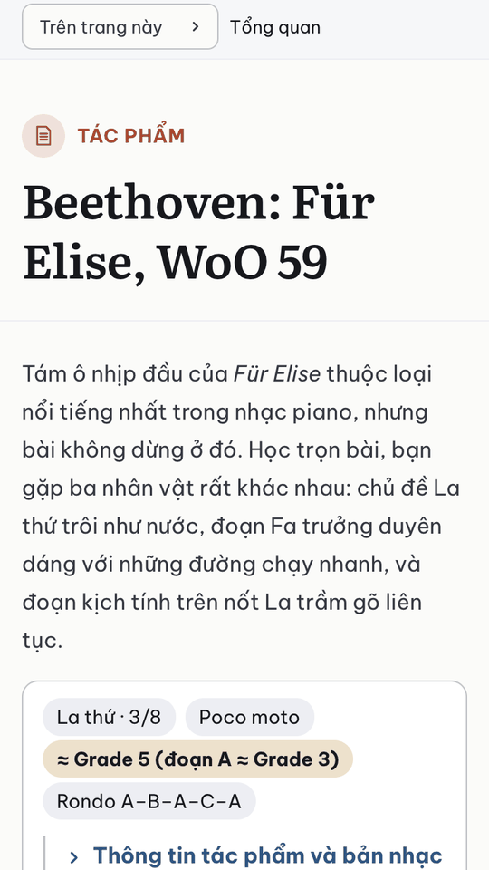
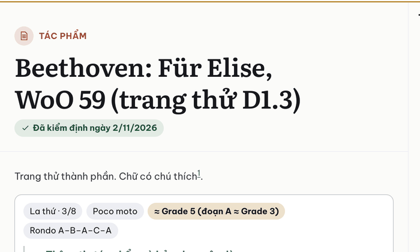
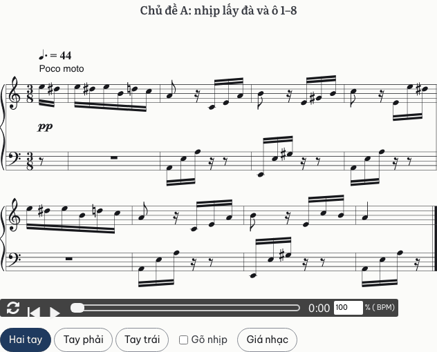
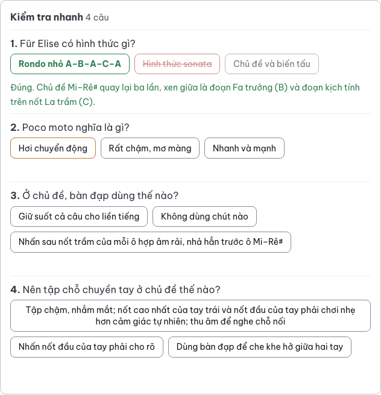
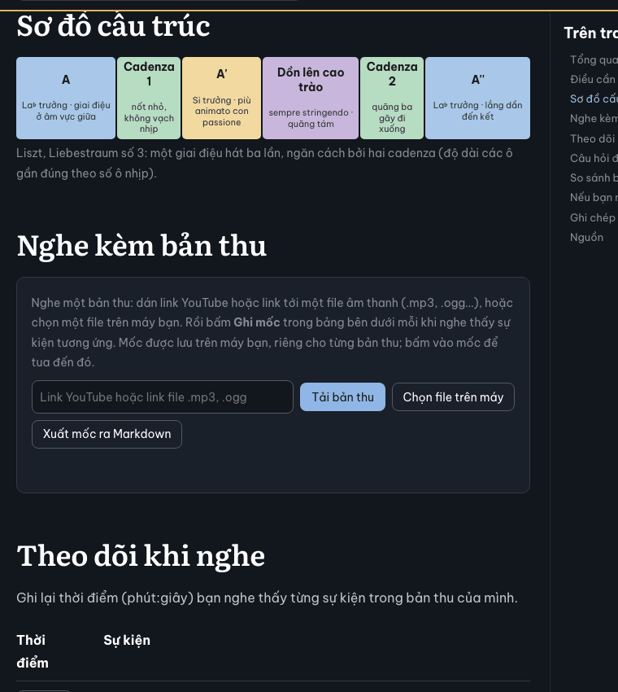

# Báo cáo D1.3: Thành phần tối thiểu

Nhánh `moi/d1-3-thanh-phan`, commit `8226332` (trên `main` `a19f879`). Làm ngày 23/10/2026, bằng Claude Code (Claude Opus 5.5). Phần lớn làm song song lúc D1.2b đang review, trong một git worktree riêng; sau khi D1.2b gộp, nhánh được đưa lên trên `main`.

## Kết quả

- `npm ci`, `npm run build`, `npm test` đạt trên Node 24.22.1 và Node 26.8.2. Kiểm thử: 30/30. Trong đó có 9 kiểm thử mới: 8 ở `tests/thanh-phan.test.mjs`, 1 ở `tests/du-lieu.test.mjs`. Bộ dữ liệu hỏng mẫu có thêm 2 lỗi. Sau khi sửa theo review: 37/37 (mục "Sửa theo review" ở cuối).
- Chưa có trang thật nào; D1.8 mới chuyển trang. Để thử, tôi dựng hai trang tạm, chuyển tay từ trang cũ và không commit: `piano/tac-pham/fur-elise` (4 khuông nhạc, 1 bộ câu hỏi) và `nghe-nhac/liszt-liebestraum`. Script tạo hai trang này ở thư mục tạm, xem mục "Kiểm thử đã chạy".
- Lighthouse 13.5.0, chế độ điện thoại, 3 lần mỗi trang, máy chủ HTTP/2:

| Trang | Hiệu năng | Trợ năng | Thực hành tốt | SEO | FCP | LCP | TBT | CLS | Tổng tải |
|---|---|---|---|---|---|---|---|---|---|
| Trang chủ tạm | 100 (100/100/100) | 100 | 100 | 100 | 1,1 s | 1,4 s | 0 ms | 0 | 114 KiB |
| Bài học thử (Für Elise) | 100 (100/100/100) | 100 | 100 | 100 | 0,9 s | 1,5 s | 0 ms | 0,001 | 145 KiB |
| Hướng dẫn nghe thử (Liebestraum) | 100 (100/100/100) | 100 | 100 | 100 | 1,2 s | 1,5 s | 0 ms | 0,001 | 152 KiB |

- Playwright 1.64.1, ba trình duyệt (Chromium 156, WebKit 27.2, Firefox 157), ba cỡ màn hình (360, 768, 1280 px), sáng và tối, hai trang thử: 36 lượt. Mỗi lượt cuộn hết trang để các khối khởi tạo. Không lượt nào tràn ngang hay có lỗi JavaScript. Cả 4 khuông nhạc đều vẽ được và có trình phát. Bấm đáp án đúng thì câu hỏi báo "Đúng." kèm giải thích. Bảng "Theo dõi khi nghe" có nút "Ghi mốc" ở mọi dòng (10 và 9 dòng). Trên màn hình cảm ứng, không nút nào nhỏ hơn 44 px. Phép đo lần đầu chỉ tính nút, nên bỏ sót hai chỗ dưới 44 px; review bắt được và đã sửa. Các nút cùng hàng thẳng hàng (lệch 0 px).
- axe-core 4.13 ở cả hai chế độ, 360 và 1280 px, trên hai trang thử, sau khi đã bấm câu hỏi: không vi phạm.
- **In:** mở trang ở khung nhìn thấp để khuông nhạc ở xa chưa được vẽ, rồi in ra PDF (Chromium). Khuông đó được vẽ trước khi in. Hộp thông tin tác phẩm tự mở khi in và thu lại sau khi in. Khối nghe và các nút bị ẩn, nốt nhạc in màu đen.
- **Huy hiệu "Đã kiểm định":** build với một `kiem-dinh/khoa.json` và một hồ sơ tạm cho trang Für Elise thì hiện "Đã kiểm định ngày 2/11/2026", đạt 4,5:1 ở cả hai chế độ. Không có hồ sơ thì không hiện.

| Đầu bài học, 360 px, sáng | Huy hiệu "Đã kiểm định" (hồ sơ tạm) |
|---|---|
|  |  |







## Việc đã làm và file đã chạm

| File | Nội dung |
|---|---|
| `astro.config.mjs` | `markdown.processor`: Sätteri với plugin của dự án. Bật `smartPunctuation: false` (giữ dấu như chữ cũ), `headingAttributes`, `definitionList`, chú thích cuối trang bằng tiếng Việt. Thêm CSS thành phần; ghi đè `MarkdownContent` |
| `package.json`, `package-lock.json` | `@astrojs/markdown-satteri` 0.4.5 và `satteri` 0.10.5 thành phụ thuộc trực tiếp, ghim chính xác. Trước đây hai gói này chỉ được Astro kéo theo, cùng phiên bản, nên lock file chỉ thêm 2 dòng |
| `src/plugins/opus-markdown.mjs` (mới) | Plugin mdast: khối ```abc, ```quiz; bốn chỉ thị `::hop-tac-pham`, `::hinh-cau-truc`, `::khoi-nghe`, `::hoc-tiep`; báo lỗi kèm tên file |
| `src/plugins/thanh-phan.mjs` (mới) | Dựng HTML cho từng khối; chữ trong dữ liệu có Markdown trong dòng được dựng bằng chính Sätteri |
| `src/scripts/` (mới) | `tai.js` (bộ tải theo nhu cầu, như `loader.js` cũ), `abc.js`, `quiz.js`, `nghe.js`, `tien-do.js`, chuyển từ module cùng tên ở `../opus-zero/docs/assets/js/` |
| `src/components/MarkdownContent.astro`, `TaiThanhPhan.astro` (mới) | Chỉ trang có khuông nhạc, câu hỏi hay khối nghe mới tải script |
| `src/components/PageTitle.astro` | Thêm huy hiệu "Đã kiểm định" dưới tiêu đề |
| `src/kiem-dinh.mjs` (mới) | Trạng thái kiểm định của trang, từ `kiem-dinh/khoa.json` và hồ sơ (hàm thuần, có kiểm thử) |
| `src/styles/thanh-phan.css` (mới), `src/styles/opus.css` | Kiểu của các thành phần; màu đúng, sai, lệch (`--oz-ok`, `--oz-bad`, `--oz-warn`) như site cũ, có cả trong khối in |
| `public/vendor/` (mới) | abcjs 6.7.1: `abcjs-basic-min.js`, `abcjs-audio.css` chép nguyên từ site cũ (giống hệt gói npm 6.7.1), `abcjs-LICENSE.txt` (MIT) |
| `src/du-lieu.mjs`, `src/content.config.ts` | Schema của `hinh` (thay chỗ để trống của D1.2), kiểm chéo hình theo loại trang, `duLieuDaKiem()` cho plugin, `dungLaiKhiDoi()` bọc bộ nạp trang |
| `tools/du_lieu/tach.py`, `src/data/tac-pham.yml` | Tách `hinh` từ `form_map` của `../opus-zero/tools/figures.py` (đọc bằng `ast`, không chạy mã cũ). Chạy lại với `--ghi-de`: chỉ thêm 669 dòng `hinh` và một dòng chú thích đầu file, các trường khác giống hệt |
| `tests/thanh-phan.test.mjs` (mới), `tests/du-lieu.test.mjs`, `tests/du-lieu-hong/tac-pham.yml` | Kiểm thử các khối, huy hiệu, bộ nạp trang; 2 lỗi hình mẫu |
| `AGENTS.md` | Mục "Mẫu trang và khối đặc biệt"; mục Lệnh thêm ghi chú về chỉ thị và `npm run dev` |
| `plans/lam-lai/cong-nghe.md` | Mục 2: kết quả thử bộ xử lý Markdown (chọn Sätteri); mục 4 thêm `src/kiem-dinh.mjs` |
| `LICENSE-CONTENT` | Đường dẫn abcjs mới (`public/vendor/`) |

Không chạm `../opus-zero/` (chỉ đọc). `git -C ../opus-zero status --short` chỉ còn `?? _to_delete/`, HEAD vẫn là `5d08189`.

## Chọn gì, vì sao

- **Sätteri, không dùng unified** (`cong-nghe.md` mục 2). Một plugin mdast làm được hết các khối, cùng với aside của Starlight, chú thích, id tiêu đề và danh sách định nghĩa. Có ba điều phải tự tìm ra khi viết plugin:
  - Astro tách frontmatter trước khi gọi Sätteri, nên plugin đọc `tac_pham` ở `ctx.data.astro.frontmatter`. Lần build đầu báo lỗi "cần trường tac_pham" vì chỗ này.
  - Plugin của dự án chạy trước plugin của Starlight.
  - Astro giữ HTML đã dựng của trang giữa các lần build. Đã thử: đổi chip của Für Elise trong `tac-pham.yml` rồi `npm run build`, trang vẫn chữ cũ; phải `--force` mới đổi. Vì vậy `dungLaiKhiDoi()` bọc bộ nạp trang. Khi dấu vết (SHA-256 của năm file dữ liệu, `src/du-lieu.mjs` và hai file plugin) khác lần trước, nó xóa bộ nhớ đệm của trang và dựng lại hết. Thử lại: đổi dữ liệu thì trang đổi ngay ở lần build sau, trả lại thì trang về như cũ. Build không đổi gì vẫn nhanh như trước. Riêng `npm run dev` phải khởi động lại, đã ghi vào `AGENTS.md`.
- **Chỉ thị dựng lúc build từ dữ liệu.** Trang chỉ ghi `::hop-tac-pham`…, còn chữ lấy từ bản ghi. Mã băm của trang khóa vì thế không đổi khi dữ liệu đổi (`chuan-kiem-dinh.md` mục 6).
- **Hình cấu trúc theo loại trang** (`hinh.bai-hoc`, `hinh.nghe`), vì ba bản ghi dùng chung cho bài học và hướng dẫn nghe. Hai trong ba bản ghi đó (Liebestraum, Impromptu Sol giáng) có hình riêng cho mỗi trang. Hình thuộc trang chứa vùng `<!-- fig:… -->` của nó, kể cả hai hình tên `g-…` nằm ở trang bài học (`bach-prelude-do`, `debussy-clair-de-lune`). Kết quả:
  - Tách đủ 61 hình (63 sơ đồ), không thừa, không thiếu.
  - 34/34 bài học có `hinh.bai-hoc`; 27 bản ghi có `hinh.nghe`.
  - 14 hướng dẫn nghe cũ không có hình cấu trúc nên không có `hinh`.
  - `ravel-bolero` dùng hình `bolero`, không phải sơ đồ các đoạn; hình loại khác là việc của D1.4.
- **Script chỉ tải khi cần.** Trang chủ và trang 404 không tải gì thêm. Trang có khối thì tải `tai.js` (dưới 2 KiB), rồi tải từng module khi khối tới gần màn hình. abcjs (500 KiB) tải sẵn lúc trình duyệt rảnh, để in (Ctrl+P) có đủ khuông nhạc. Bản đầu chờ thêm 3 giây sau khi trang hiện xong. Vì vậy in trong vài giây đầu thì khuông ở xa ra trống, khác site cũ; review bắt được. Nay tải ngay khi rảnh, như site cũ.
- **Vùng bấm 44 px trên màn hình cảm ứng.** Trình phát của abcjs mặc định có nút 28×34 px (site cũ cũng vậy). CSS nới nút lên 44 px; thanh tiến độ cao 44 px nhưng chỉ hiện dải giữa 20 px. Nút ghi mốc, nút xóa mốc và ô "Gõ nhịp" cũng đủ 44 px. Dòng "Thông tin tác phẩm…" và ô "Hiện mốc tham khảo" được nới lên 44 px sau review.
- **Ba lỗi do kiểm tra tự động bắt được, đã sửa:**
  - Ở chế độ tối, nút chính ("Tải bản thu") và nút đang chọn ("Hai tay") có chữ tối trên nền `#4f7fb8`, chỉ đạt 4,36:1 (axe báo). Nay nền dùng màu nhấn đậm, đạt 11,08:1 ở chế độ sáng và 8,64:1 ở chế độ tối.
  - Huy hiệu "Đã kiểm định" ở chế độ sáng chỉ đạt 4,17:1; nay chữ xanh đậm hơn.
  - Starlight cách phần tử liền sau phần tử khác trong bài 1rem, không chừa thẻ `button`, nên các nút trong một hàng lệch nhau theo chiều dọc. Thấy trên ảnh chụp, đo được và đã sửa.
- **Khối nghe:** `nghe.js` giữ gần nguyên mã của `listen.js` cũ, chỉ khác khoảng 35 dòng: module, lưu qua `tien-do.js`, tìm bảng trong bài của Starlight, đọc được mốc đã lưu ở site cũ. Mục đích là dễ đối chiếu với bản cũ, nên cách viết khác phần còn lại của repo. Bản thu gợi ý đọc từ `ban_thu` của bản ghi, cùng dạng `data-rec` cũ. Đã thử bằng cách tạm thêm `ban_thu` cho Für Elise (lấy từ `data-rec` cũ), rồi trả lại: khối hiện người chơi, giấy phép, link Wikimedia Commons; có mốc tham khảo trong bảng; bấm "Nghe bản này" thì nạp bản thu.
- **Tiến độ người học** lưu ở khóa `opus-zero:v1` như site cũ, cùng tên miền nên đọc được dữ liệu cũ. Mốc nghe và bài đã học lưu theo đường dẫn; code đọc cả đường dẫn cũ `/opus-zero/…`.
- **Huy hiệu** đọc `kiem-dinh/` bằng `import.meta.glob` lúc build, nên không phụ thuộc thư mục đang chạy. Chưa có `kiem-dinh/` (D1.6) thì không hiện gì.

## Số nhận định

Không áp dụng: việc kỹ thuật, không chuyển trang nào. `hinh` là thông số của site cũ chép nguyên, chưa kiểm định: đợt 6 kiểm cùng trang tác phẩm. Có một chỗ site cũ không khớp với chính nó, đã ghi lại, chưa chọn bên nào. Hai hình của Liebestraum số 3 chia đoạn khác nhau, dù cùng tổng 85 ô nhịp:
- Bài học: A' 10 ô (ô 27–36), cadenza 1 dài 3 ô, đoạn dồn lên 24 ô (gồm cadenza 2).
- Hướng dẫn nghe: A' 11 ô, cadenza 1 dài 2 ô, đoạn dồn lên 21 ô và cadenza 2 tách riêng (2 ô).

## Chỗ chưa chắc và việc cho bước sau

- **D1.4:**
  - Chuyển `data-rec` của trang cũ thành `ban_thu` của bản ghi. Schema của `ban_thu` hiện vẫn là chỗ để trống của D1.2 (`z.array(z.unknown())`). D1.4 đặt schema theo dạng `data-rec`:
    - các trường `by`, `lic`, `licUrl`, `note`, `page`, `parts[{mp3, src, d, t, link}]`;
    - không có `ref`: mốc tham khảo đi theo bảng của từng trang, nên nằm ở trang (`::khoi-nghe{moc="…"}`, chốt sau review);
    - `mp3` của file trên site viết đường dẫn tính từ gốc site (`audio/<file>.mp3`), vì `khoiNghe` tự thêm `base`. Site cũ có 13 phần viết tương đối (`../../../assets/audio/<file>.mp3`).
  - "Học tiếp" đã chốt sau review (mục "Sửa theo review"): bài chọn lọc viết tay như trang cũ, rồi `::hoc-tiep`. D1.4 giữ nguyên danh sách viết tay khi chuyển.
  - Hình không phải sơ đồ các đoạn (`bolero` và các hình ở trang lõi) cần thành phần riêng.
- **D1.6:** huy hiệu giả định `kiem-dinh/khoa.json` có dạng `{ "trang": { "<đường dẫn>": "sha256:…" } }`. D1.6 giữ dạng này hoặc sửa `src/kiem-dinh.mjs` cho khớp.
- **D1.8:** đo CLS trên trang thật.
  - Trên một trang thử nhân tạo có hình cấu trúc và khối nghe ngay đầu trang, Lighthouse đo CLS 0,197 (hiệu năng 91). Nguyên nhân: font Be Vietnam Pro đậm tải xong sau lần vẽ đầu nên chữ trong ô đổi dòng (0,15); khối nghe chèn giao diện khi khởi tạo (0,03).
  - Với bố cục thật (bảng thông tin, đoạn mở đầu rồi mới đến hình), CLS chỉ 0,001.
  - Nếu trang thật nào có các khối này trong màn hình đầu, có thể dựng sẵn khung của khối nghe lúc build.
- **Mất mạng:** abcjs vẽ khuông không cần mạng, nhưng âm thanh lấy mẫu nhạc cụ từ `paulrosen.github.io` (mặc định của abcjs), như site cũ. Đợt 7 (dùng khi mất mạng) cân nhắc tự lưu mẫu âm.
- Thanh bên tự sinh của Starlight ghi tên thư mục ("piano", "tac-pham"); đợt 2 chốt menu. Bảng 4 cột vẫn chật ở 360 px (đã ghi ở D1.2b).

## Kiểm thử đã chạy

- `npm ci && npm run build && npm test` trên Node 24.22.1; `npm run build && npm test` trên Node 26.8.2: 30/30.
- `tests/thanh-phan.test.mjs` chạy thẳng Sätteri với plugin trên đoạn Markdown mẫu và dữ liệu thật:
  - khuông ABC, câu hỏi (cả lỗi khi viết sai);
  - hộp thông tin đúng số chip và số hàng của bản ghi;
  - hình theo loại trang;
  - học tiếp: cùng chặng, chặng sau, trang nghe kèm, không link tới chính nó;
  - khối nghe: có và không có bản thu;
  - lỗi chỉ thị kèm tên file; huy hiệu.
- `tests/du-lieu.test.mjs`: hai lỗi hình mẫu bị bắt (loại đoạn lạ; `hinh.nghe` ở bản ghi không có trang nghe); `dungLaiKhiDoi` dựng lại khi dữ liệu đổi, giữ nguyên khi không đổi.
- Script thử (ở thư mục tạm của phiên, không commit):
  - tạo hai trang thử từ trang cũ;
  - chạy Playwright trên ba trình duyệt và đo vùng bấm, độ thẳng hàng;
  - chạy axe;
  - in ra PDF;
  - đo layout shift bằng `PerformanceObserver` khi mạng và CPU chậm như Lighthouse.

## Nguồn

- Module cũ: `../opus-zero/docs/assets/js/` (`loader.js`, `abc.js`, `quiz.js`, `listen.js`, `progress.js`), `../opus-zero/docs/assets/css/opus.css`, `../opus-zero/tools/figures.py` (`form_map`).
- abcjs 6.7.1: https://abcjs.net, giấy phép MIT (`../opus-zero/node_modules/abcjs/LICENSE.md`).
- API plugin của Sätteri và cách Astro gọi nó: mã của `satteri` 0.10.5 (`dist/plugin.d.ts`, `dist/compile.d.ts`) và `@astrojs/markdown-satteri` 0.4.5 (`dist/satteri-processor.js`) trong `node_modules/`.
- Bộ nạp nội dung của Astro (`LoaderContext`: `store`, `meta`): `node_modules/astro/dist/content/loaders/types.d.ts`.

## Review

Claude Code (Claude Opus 5.5), ngày 23/10/2026, nhánh `moi/d1-3-thanh-phan` ở commit `33c07e1` (mã ở `8226332`). Người review không làm D1.3. Trang thử dựng bằng script của người làm. Phép thử phải đổi dữ liệu, cài lỗi hay thêm hồ sơ tạm thì chạy trên một bản chép của nhánh (`git archive`) trong thư mục tạm, không đụng `src/` của repo. Để so với site cũ, người review dùng một bản build cũ có sẵn trong thư mục tạm, phục vụ bằng máy chủ tĩnh ở cổng riêng. Script, ảnh chụp và số đo để ở thư mục tạm, không commit.

### Phải sửa

1. **Chế độ giá nhạc: thanh trên của site che nút "Thoát giá nhạc"; trên điện thoại không thoát ra được.**
   - `.main-pane` của Starlight có `isolation: isolate`. Vì vậy khung `.oz-abc.oz-stand` (`src/styles/thanh-phan.css` dòng 250–278: `position: fixed; z-index: 50`) chỉ nổi lên trong lớp xếp chồng của `.main-pane`. Nó vẫn nằm dưới thanh trên (`header.header`: `position: fixed; z-index: 10`) và dưới thanh "Trên trang này".
   - Đo bằng `elementFromPoint` ở góc trên, tâm và góc dưới của nút, trên cả ba trình duyệt, ở 360 và 1280 px: không điểm nào rơi vào nút. Các điểm rơi vào thanh trên, hoặc (ở 360 px) vào thanh "Trên trang này". Chạm vào giữa nút ở 360 và 768 px (Chromium, WebKit, giả lập cảm ứng) thì vẫn ở giá nhạc.
   - Điện thoại không có phím Esc, nên người học bị kẹt cho tới khi tải lại trang. Trên máy tính, Esc vẫn thoát được, nhưng nút đang được focus bị che hết (WCAG 2.2, tiêu chí 2.4.11).
   - Site cũ (Chromium, 360 và 1280 px): điểm giữa nút rơi đúng vào nút.
   - Phép thử của người làm không bấm "Giá nhạc"; báo cáo chỉ có ảnh ở chế độ thường.
   - Có ba cách sửa:
     - Khi mở giá nhạc, đặt `html.oz-stand-open .main-pane { isolation: auto; }`. Người review đã thử trên bản chép: chạm giữa nút thì thoát được, ở 360 và 768 px, trên Chromium và WebKit.
     - Dùng `<dialog>` mở bằng `showModal()`: hộp thoại nằm ở lớp trên cùng, không bị lớp xếp chồng nào giữ lại.
     - Chuyển khung sang `document.body` lúc mở.

     Sửa cách nào cũng nên thêm một phép thử chạm vào nút thoát.

2. **Mở link `#mục` trên máy tính: đích bị đẩy xuống; cuộn ngược lên thì nội dung bị xô. Site cũ không bị cả hai.**
   - `src/scripts/tai.js` khởi tạo ngay các khối nằm phía trên đích, như bộ tải cũ. Nhưng hai phần của `../opus-zero/docs/assets/js/loader.js` không được chép sang:
     - `keep()`: cuộn lại về đích sau khi các khối đó vẽ xong (dòng 131–134, 146–148);
     - xử lý sự kiện `hashchange` (dòng 162–168).
   - Lúc khởi tạo, các khối cao thêm:
     - khối nghe: từ 0 lên 267 px;
     - mỗi khuông: khoảng 86 px, vì thêm thanh phát và hàng nút;
     - mỗi hàng của bảng mốc: thêm chiều cao của nút "Ghi mốc".
   - Mở thẳng trang có `#mục` ở 1280 px:
     - `…/fur-elise/#kiểm-tra-nhanh`: Chromium và WebKit để đích ở 558 px, đáng lẽ ở 88 px (lệch 470 px);
     - `#cấu-trúc`: Chromium lệch 283 px;
     - Firefox tự cuộn lại đúng chỗ;
     - ở 360 và 768 px, cả ba trình duyệt đều giữ đích đúng chỗ.

     Trang có nhiều khuông phía trên đích thì đích còn lệch xa hơn. Site cũ, cùng trang (`#kiem-tra-nhanh`, `#cau-truc`): đích luôn ở 68 px, trên Chromium (360 và 1280 px) và WebKit (1280 px).
   - Nhảy tới `#kiểm-tra-nhanh` rồi cuộn ngược lên, mỗi lần 250 px, ở 1280 px:
     - Chromium và WebKit: phần đang đọc xô 34–39 px ở khuông 2–4, 74 px ở khuông đầu, 283 px ở khối nghe và bảng mốc. Mỗi lần xô bằng phần khối cao thêm, trừ đi phần giữ chỗ dư;
     - Firefox: xô 35–74 px ở các khuông;
     - site cũ: không xô.
   - Nguyên nhân gốc: từ 72rem, Starlight chia trang thành hai cột, và trình duyệt chọn `.right-sidebar-container` làm mốc để giữ chỗ khi cuộn (scroll anchor). Khi phần trong bài cao lên, chỗ đọc vì thế không được bù.
   - Thử trên bản chép, thêm `.right-sidebar-container { overflow-anchor: none; }`:
     - đích đứng yên ở 88–89 px: trên Chromium với cả `#kiểm-tra-nhanh` lẫn `#cấu-trúc`, trên WebKit với `#kiểm-tra-nhanh`;
     - khi cuộn ngược, Chromium không còn xô; WebKit và Firefox còn một lần xô 39 px.
   - Cách sửa: thêm dòng CSS trên, hoặc chép lại `keep()` và phần `hashchange` của bộ tải cũ, hoặc làm cả hai. Thêm một phép thử trình duyệt: mở trang có `#mục`, khung nhìn 1280 px.

3. **Vùng bấm dưới 44 px trên màn hình cảm ứng** (`AGENTS.md`, mục Giao diện):
   - Dòng `<summary>` "Thông tin tác phẩm và bản nhạc nên dùng" cao 28 px ở 768 px, trên cả ba trình duyệt. Ở 360 px dòng chữ xuống hai hàng nên đủ cao. `thanh-phan.css` dòng 126–130 chưa có luật cho màn hình cảm ứng.
   - Ô "Hiện mốc tham khảo trong bảng" (`label.oz-ref-toggle`, dòng 374–381) cao 25 px ở 360 và 768 px, trên cả ba trình duyệt. Ô này chỉ hiện khi bản thu gợi ý có `ref`; người review thử bằng `ban_thu` tạm trên bản chép.
   - Báo cáo (dòng 17 và 68) nói đã đủ 44 px, vì phép đo chỉ tính nút (`.oz-btn`, `.oz-abc-tools button`, `.abcjs-btn`).
   - Cách sửa: thêm hai phần tử này vào khối `@media (pointer: coarse)`, rồi đo lại mọi phần tử bấm được, kể cả `summary`, `label`, `select`, `input`.

4. **Khối nghe lấy `ban_thu[0]` cho mọi trang dùng chung một bản ghi.**
   - Ba bản ghi dùng chung cho bài học và hướng dẫn nghe có hai `data-rec` khác nhau ở site cũ. Bản thu là một, nhưng `ref` đi theo bảng "Theo dõi khi nghe" riêng của từng trang:

     | Bản ghi | Mốc ở bài học | Mốc ở hướng dẫn nghe |
     |---|---|---|
     | `liszt-liebestraum` | 8 | 9 |
     | `schubert-impromptu-sol-giang` | 10 | 8 |
     | `beethoven-anh-trang` (`nghe-nhac/beethoven-moonlight`) | 8 | 6 |

   - `khoiNghe(rec, base)` (`src/plugins/thanh-phan.mjs` dòng 152–157) không biết đang dựng loại trang nào: `opus-markdown.mjs` dòng 24 không truyền loại trang vào. Vì vậy, dù D1.4 ghi dữ liệu thế nào, một trong hai trang cũng sẽ hiện mốc tham khảo lệch dòng.
   - `hinh` đã giải đúng chuyện này bằng khóa `bai-hoc`/`nghe`; `ban_thu` cần một cách chọn tương tự. Ví dụ `ban_thu: { bai-hoc: …, nghe: … }`, hoặc mỗi bản thu có một trường ghi trang.
   - Cần chốt ngay ở việc này, vì cú pháp và chỗ đọc dữ liệu là phần của D1.3. Ghi vào `AGENTS.md` dòng 92 và vào mục D1.4 của báo cáo.

Sửa xong thì cập nhật báo cáo. Sau đó chỉ cần kiểm lại bốn chỗ này, cộng các mục nên sửa đã làm.

### Nên sửa

1. **In ngay sau khi mở trang thì khuông ở xa in ra trống.**
   - `tai.js` dòng 61–63 chờ 3 giây sau `load` rồi mới tải abcjs lúc trình duyệt rảnh.
   - Đo bằng `page.pdf` trên Chromium, khung nhìn 1280×300:
     - in lúc 0 ms và 1000 ms sau `load`: 0/4 khuông được vẽ; PDF có tiêu đề khuông và một khoảng trống;
     - in lúc 4500 ms: 4/4 khuông.
   - Site cũ gọi `requestIdleCallback(…, { timeout: 5000 })` ngay khi `load` (`loader.js` dòng 153–158), nên khoảng thời gian in ra trống ngắn hơn nhiều. Vì thế câu "như site cũ" ở báo cáo dòng 67 chưa đúng.
   - Cách sửa:
     - nếu Lighthouse vẫn đạt, bỏ 3 giây chờ;
     - nếu không, khi in thì hiện một dòng chữ ở chỗ khuông chưa vẽ (`@media print`);
     - ghi giới hạn này cạnh câu "trước khi in thì vẽ hết" ở `AGENTS.md` dòng 88.
2. **Hộp thông tin quá cao trên điện thoại.**
   - `th[scope='row'] { white-space: nowrap }` (`thanh-phan.css` dòng 134–137) giữ cột tên mục rộng 176 px. Ở 360 px, cột "Thông tin" chỉ còn 103 px, và bảng của Für Elise cao 2785 px (ở 768 px: 685 px).
   - Site cũ ở 360 px: cột thông tin rộng 195 px, bảng cao 1096 px.
   - Cách sửa: cho tên mục xuống dòng khi màn hình hẹp, hoặc đặt tên mục lên trên nội dung.
3. **Huy hiệu "Đã kiểm định".**
   - Huy hiệu (`PageTitle.astro` dòng 35) bị đưa vào chỉ mục tìm kiếm. Trên bản chép có hồ sơ tạm, nội dung Pagefind ghi cho trang Für Elise mở đầu bằng "Beethoven: Für Elise, WoO 59. Đã kiểm định ngày 2/11/2026.". Khi mọi trang đã khóa, tìm "kiểm định" sẽ ra mọi trang, và đoạn trích bị nhiễu. Cách sửa: thêm `data-pagefind-ignore`, như đã làm với nhãn nhóm ở D1.2b.
   - Dòng `title` (dòng 37) khẳng định trang đã qua "hai lượt kiểm độc lập và một lần review". Nhưng mức kiểm định vẫn đang chờ chủ repo chọn (`plans/lam-lai/README.md` dòng 33). Nên viết chung hơn, hoặc đọc từ trường `nguoi` của hồ sơ.
4. **Link hỏng trong dữ liệu và link do chỉ thị sinh ra.**
   - Trong `thong_tin`:
     - `bach-prelude-fugue-do-thu` có `[Prelude Đô trưởng BWV 846](bach-prelude-do.md)` và `[lộ trình](../lo-trinh.md)`;
     - `liszt-liebestraum` có `[lộ trình](../lo-trinh.md)`.

     `md()` dựng nguyên văn thành `href="bach-prelude-do.md"` và `href="../lo-trinh.md"`, là link hỏng trên site mới.
   - `::hoc-tiep` sinh `<a href>` bằng HTML thô, trỏ tới mọi bài học, kể cả bài chưa lên site.
   - Ghi việc cho D1.4 và D1.5: đổi link trong `src/data/`, và để cơ chế link "sắp có" xử lý cả link do chỉ thị sinh ra.
5. **"Học tiếp": `AGENTS.md` đã chốt, báo cáo thì chưa.**
   - `AGENTS.md` dòng 78 ghi mục `## Học tiếp` dùng `::hoc-tiep`. Báo cáo dòng 87 lại để D1.4 hay đợt 6 chọn.
   - Chỉ thị liệt kê mọi bài cùng chặng và mọi bài chặng sau: mỗi bài học có từ 2 đến 12 link, Für Elise có 12. Mẫu cũ chỉ có 2–5 bài chọn lọc (`../opus-zero/AGENTS.md`, mục "Mẫu trang", điểm 13).
   - Cần chọn một cách và ghi ở một chỗ duy nhất. Có thể dùng trường `goi_y` của bản ghi để rút gọn danh sách.
6. **Gõ sai tên chỉ thị mà build vẫn qua.** `::hop-tac-phamm` và `::khoi-ngh` vẫn build được, và trang hiện nguyên dòng chữ "::hop-tac-phamm" (đã thử trên bản chép). Starlight chỉ dùng chỉ thị khối (`:::note`), nên plugin có thể báo lỗi cho mọi chỉ thị một dòng không có trong `CHI_THI` (`opus-markdown.mjs` dòng 53–54).
7. **Chỗ quyết định tải script không khớp với plugin.**
   - `MarkdownContent.astro` dòng 7 dò bằng regex trên Markdown thô. Còn plugin thì dựng mọi khối mã có `lang` là `abc` hay `quiz`.
   - Kết quả: khối `~~~abc`, hay khối ```` ```quiz ```` nằm trong trích dẫn (`> `), vẫn được dựng thành thành phần, nhưng trang không tải script. Khuông không bao giờ được vẽ, câu hỏi không bấm được (đã thử trên bản chép).
   - Cách sửa: cho plugin đánh dấu trang cần script, ví dụ ghi vào `data.astro.frontmatter`; hoặc dò trên HTML đã dựng.
8. **Thoát chữ (escape).**
   - Người review chèn `<`, `"`, `&` vào dữ liệu và vào các khối (trên bản chép).
   - Thoát đúng: nhãn và chú thích của hình, tiêu đề khuông (`T:`), `data-abc`, `data-quiz`, `data-rec`.
   - Không thoát thẻ HTML: chip, `thong_tin`, tên tác phẩm trong "Học tiếp" và chữ trong câu hỏi đều đi qua `md()`. `&` và dấu `<` có khoảng trắng phía sau được thoát. Nhưng thẻ HTML thô đi thẳng vào trang (`<b>`, ``, `<script>`). Thêm vào đó, `quiz.js` gán chữ bằng `innerHTML`.
   - Dữ liệu nằm trong repo nên đây không phải lỗ hổng bảo mật. Nhưng cách hiểu chữ đã đổi: câu hỏi ở site cũ là chữ thường (qua `esc()`), còn site mới hiểu cả Markdown lẫn HTML. Với 112 khối quiz cũ, chỉ 4 dòng đổi nghĩa (chữ trong `*…*` nay in nghiêng) và 1 dòng có `&` (vẫn hiện đúng).
   - Cách sửa: ghi vào `AGENTS.md` trường nào là Markdown trong dòng, trường nào là chữ thường; hoặc cho `md()` thoát HTML thô.
   - `chuTho` (`thanh-phan.mjs` dòng 16) không được dùng ở đâu.
9. **`tai.js` dòng 62 thiếu xử lý lỗi.** Theo mã, `lay().then((m) => m.taiSan?.())` không có `.catch`. Nếu module không tải được (mất mạng, hay trang mở từ trước một lần deploy làm đổi tên file), trình duyệt sẽ báo lỗi "Uncaught (in promise)". Promise hỏng còn được giữ lại mãi, nên khối không thử tải lại. Site cũ cũng không thử lại.
10. **Hành vi khác site cũ hoặc bị mất, báo cáo chưa ghi:**
    - Hộp `.oz-piece` chưa có các nút "Tôi đang tập bài này", "Hôm nay đã tập bài này", "Đã chơi được trọn bài" (`practice.js`, lưu ở `store.repertoire`). Nên ghi là việc của đợt 7, hoặc đợt 6 khi bài học lên site.
    - Hai phần chưa chuyển, cần từ đợt 3:
      - `.oz-lesson-status`: trạng thái "đã học" ở trang mục lục, nằm trong `quiz.js` cũ;
      - `print.js`: nút "In bài này" ở bài nhạc lý.
    - Lựa chọn bật mốc tham khảo (`opus-zero:listen-ref`, `nghe.js` dòng 142–151) chỉ được đọc theo đường dẫn mới, nên lựa chọn đã lưu ở site cũ bị mất. Việc nhỏ.
    - Khi in, site cũ ẩn tiêu đề "Nghe kèm bản thu", cùng hàng nút và dòng số câu của câu hỏi (`.oz-tool .oz-row`, `.oz-stats`). Site mới in cả hai.
    - Chiều cao giữ chỗ của khuông chưa tính tới màn hình hẹp như hàm `guess()` cũ:
      - ở 360 px: giữ chỗ 390, 243, 170, 243 px, vẽ xong thành 802, 656, 353, 473 px;
      - ở 1280 px: vẽ xong 379, 196, 118, 196 px, sát với giữ chỗ.

      Thanh phát, hàng nút và khối nghe không được giữ chỗ. Mục này gắn với Phải sửa 2.
11. **Kiểm thử còn hở.**
    - Chưa có kiểm thử nào cho:
      - mã chạy trên trình duyệt (`src/scripts/`);
      - CSS của thành phần (44 px, khi in);
      - việc chỉ tải script ở trang có khối;
      - huy hiệu hiện trên trang (mới có kiểm thử cho hàm thuần `kiemDinh`).
    - Site cũ có hai loại kiểm thử cho phần này:
      - kiểm thử đơn vị cho các hàm thuần của `listen.js` (`../opus-zero/tests/unit.mjs` dòng 115–155 và 188–194: `audioUrl`, `switchSource`, `partAt`, `compare`, `tally`, `readRec`, `activeRow`);
      - kiểm thử trình duyệt cho bộ tải (`tests/browser.mjs` dòng 312–332: khuông ở xa chưa vẽ, tải sẵn abcjs, `beforeprint`, link `#mục`).
    - `nghe.js` giữ nguyên các hàm thuần đó, nhưng bỏ `window.OZListen` mà không `export` chúng, nên chúng không còn được kiểm thử.
    - Nên làm:
      - `export` các hàm thuần và chép lại kiểm thử cũ;
      - thêm một kiểm thử giữ khóa `opus-zero:v1` (`tien-do.js` dòng 4);
      - kiểm thử trình duyệt có thể chờ D1.7, nhưng ghi lại thành việc.
    - Người review cài thử 14 lỗi vào plugin và dữ liệu, rồi chạy `tests/thanh-phan.test.mjs` và `tests/du-lieu.test.mjs`. Bắt được 9 lỗi:
      - đảo loại trang của hình;
      - bỏ `base` trước đường dẫn mp3;
      - không thoát `data-quiz`;
      - huy hiệu không đếm khuông nhạc;
      - bỏ phần kiểm thuộc tính của chỉ thị;
      - quiz nhận dòng lạ;
      - chip cấp độ dựng như chip thường;
      - bỏ dòng "Nghe kèm";
      - bỏ kiểm chéo hình theo trang.

      Không bắt được 5 lỗi:
      - bỏ `esc()` ở nhãn hình;
      - mục "Chặng sau" lấy nhầm chặng +2 (kiểm thử chỉ xem nhãn);
      - dấu vết của `dungLaiKhiDoi` không còn tính hai file plugin (kiểm thử chỉ đổi dữ liệu);
      - bỏ `ghi_chu` của hình;
      - dòng `T:` nằm sau `K:` cũng bị lấy làm tiêu đề.
12. **Báo cáo.**
    - Dòng 70: nút chính ở chế độ tối đạt 8,64:1 (`#12161d` trên `#8fb6e6`), chưa tới mức "từ 9:1" như báo cáo ghi. Chế độ sáng đạt 11,08:1.
    - Dòng 17 và 68: xem Phải sửa 3. Dòng 67: xem Nên sửa 1.
    - Dòng 86 (việc cho D1.4) liệt kê thiếu các trường của `data-rec`. Theo `../opus-zero/AGENTS.md`, mục "Khối đặc biệt", và 52 khối cũ, còn có:
      - `note` (14/52 khối);
      - `licUrl` (30/52 khối);
      - `parts[].t` (83/122 phần);
      - `parts[].link` (17 phần, ở bản thu chỉ dẫn link).
    - Có 13 phần dùng `mp3` tương đối (`../../../assets/audio/<file>.mp3`). Chúng phải đổi thành đường dẫn tính từ gốc site (`audio/<file>.mp3`), vì `khoiNghe` tự thêm `base` vào trước. Quy ước này cần ghi vào `AGENTS.md`.

### Đã đối chiếu

- **Yêu cầu D1.3.**
  - Có đủ tám thành phần. Cú pháp đã được chốt trong `AGENTS.md`, mục "Mẫu trang và khối đặc biệt".
  - Người review dựng thử trên bản chép một trang có đủ: aside (`:::tip[…]`, `:::note`, `:::caution`, `:::danger`), `<details>` chứa Markdown, `{ #id }`, danh sách định nghĩa, chú thích. HTML ra đúng như bảng trong `AGENTS.md`.
  - `smartPunctuation: false` khớp site cũ: site cũ không dùng smarty, dấu nháy vẫn là nháy thẳng.
- **So với module cũ.**
  - `nghe.js` khác `listen.js` 36 dòng (so bằng diff, bỏ qua thụt lề), đúng các chỗ báo cáo nêu.
  - `abc.js`, `quiz.js`, `tien-do.js` giữ logic cũ:
    - khuông: tốc độ, lặp, nghe từng tay, gõ nhịp, giá nhạc, giữ màn hình sáng (wake lock), vẽ lại khi đổi sáng/tối và khi đổi cỡ;
    - câu hỏi: trộn đáp án, đếm câu đúng ngay lần đầu;
    - tiến độ: `store.lessons`, `days[].quizzes`.
  - Chỗ khác có chủ ý: câu hỏi dựng sẵn lúc build; bộ đọc quiz chặt hơn, viết sai thì build hỏng. 112 khối quiz cũ không có câu nào thiếu đáp án đúng hay có dòng lạ.
  - `tai.js` giữ được: khởi tạo khi khối cách màn hình 600 px; khối phía trên đích khởi tạo ngay; câu hỏi khởi tạo ngay; `beforeprint` vẽ hết. Phần thiếu: Phải sửa 2 và Nên sửa 1.
- **Tiến độ người học.**
  - Người review gài vào `opus-zero:v1` dữ liệu theo dạng site cũ (bài đã học và mốc nghe theo đường dẫn `/opus-zero/…`, cùng `repertoire`), rồi thử trên ba trình duyệt ở 360 và 1280 px.
  - Đọc dữ liệu cũ:
    - câu hỏi hiện "đã hoàn thành ngày 2026-10-01";
    - bảng hiện hai mốc cũ 0:12 và 1:35, và nhắc chọn lại đúng file cũ.
  - Ghi dữ liệu mới:
    - làm hết câu hỏi thì ghi `/opus/…` với ngày hôm nay và `quizzes: 1`;
    - ghi mốc mới thì mốc của file cũ được cất vào `byUrl`.
  - Dữ liệu cũ (bài đã học, mốc nghe, `repertoire`) giữ nguyên.
- **Dữ liệu `hinh`.**
  - Người review viết script riêng: đọc `figures.py` bằng `ast` và đọc các vùng `<!-- fig: -->` của mọi trang cũ.
    - Có 61 hình `p-`/`g-` (63 sơ đồ). Mỗi hình nằm ở đúng một trang, và đều là trang tác phẩm.
    - `hinh` trong `tac-pham.yml` khớp từng giá trị, đúng khóa `bai-hoc`/`nghe`, không lệch chỗ nào.
    - 34/34 bài học có `hinh.bai-hoc`; 27 bản ghi có `hinh.nghe`; 2 bản ghi có cả hai.
    - 42 hướng dẫn nghe cũ: 27 có sơ đồ, `ravel-bolero` có hình `bolero`, 14 không có hình.
  - Chạy lại `tach.py --ghi-de` trên bản chép (có symlink `opus-zero`): năm file ra giống hệt bản đã commit; phần báo của script không có mục "Hình" nào; diff của `tac-pham.yml` chỉ thêm 670 dòng.
  - Cài 10 lỗi vào `hinh`: trọng số 0, âm, hay là chữ; thiếu hoặc thừa phần tử; khóa `bai_hoc`; trường lạ; thiếu `chu_thich`; `ghi_chu` rỗng; `hinh.nghe` ở bản ghi không có trang nghe. `kiemTra` bắt cả 10. Chỉ `hinh: {}` lọt qua, nhưng vô hại.
- **Plugin và build.**
  - Tám cách viết sai đều làm build hỏng, và thông báo có tên file (`src/content/docs/…: …`): quiz thiếu đáp án đúng; quiz có dòng lạ; chỉ thị thiếu `tac_pham`; hình đặt ở trang không phải bài học hay hướng dẫn nghe; hình chưa có dữ liệu; chỉ thị có thuộc tính; chỉ thị có chữ; `tac_pham` sai slug (lỗi schema kèm tên trang).
  - `dungLaiKhiDoi`, thử trên bản chép:
    - thêm `ban_thu` vào bản ghi Liszt rồi chạy `npm run build` thường: trang đổi ngay (mã băm HTML khác, có `data-rec`);
    - trả dữ liệu như cũ: trang về đúng mã băm ban đầu;
    - bỏ `dungLaiKhiDoi` rồi đổi dữ liệu: trang giữ chữ cũ, đúng như lý do báo cáo nêu.
  - Đổi `astro.config.mjs` cũng làm trang được dựng lại; Astro tự lo việc này.
  - `OPUS_DU_LIEU=tests/du-lieu-hong`: build hỏng với 27 lỗi, trong đó có hai lỗi hình mới.
  - Trang chủ và trang 404 không có `TaiThanhPhan`; hai trang thử có. Chuỗi tải: `TaiThanhPhan` (1,8 KB), rồi `quiz.js` và `tien-do.js` ngay sau đó; `abc.js`, abcjs và `nghe.js` khoảng 3 giây sau `load`, hoặc khi cuộn tới gần.
- **Hiển thị.** 36 lượt (3 trình duyệt × 360/768/1280 px × sáng/tối × 2 trang):
  - không tràn ngang: `scrollWidth` bằng `clientWidth`, sau `scrollTo(5000)` thì `scrollX` vẫn là 0;
  - không lỗi JavaScript;
  - 4/4 khuông có SVG và trình phát; có 10 và 9 ô "Ghi mốc"; hình có 6 ô;
  - các nút cùng hàng lệch tâm 0 px.

  Đổi sáng/tối bằng ô chọn của Starlight thì nốt đổi màu (`#17181c` thành `#fff`) trên cả ba trình duyệt. Trên WebKit có một lỗi "Importing a module script failed", nhưng lỗi này đến từ ô tìm kiếm của Starlight khi rời trang chủ nhanh, không phải từ D1.3.
- **Tương tác** (ba trình duyệt, 360 và 1280 px):
  - câu hỏi: chọn đáp án sai thì nút bị gạch và khóa, hiện "Chưa đúng, thử lại."; chọn đúng thì hiện "Đúng." kèm giải thích, các nút khác bị khóa; làm hết thì hiện "Hoàn thành! …";
  - khuông: nút tay (`aria-pressed` đúng), gõ nhịp, bấm phát (nốt được tô màu), mở giá nhạc và thoát bằng Esc (trừ lỗi ở Phải sửa 1);
  - khối nghe: ghi mốc khi chưa có bản thu thì được nhắc; chọn file trên máy; ghi mốc 0:07; bấm mốc để tua; xóa mốc.

  Trên màn hình cảm ứng, nút mốc 47×44 px, nút × 44×44 px.
- **Khối nghe có bản thu gợi ý** (bản chép, `ban_thu` của Liebestraum lấy từ `data-rec` cũ): hiện người chơi, ghi chú, giấy phép, link Commons; "Nghe bản này" nạp bản thu; có 9 mốc tham khảo. axe không báo lỗi, ở hai chế độ, trên ba trình duyệt.
- **In.**
  - `page.pdf` thật trên Chromium có phát `beforeprint` và `afterprint`. PDF có bảng thông tin; khối nghe và các nút bị ẩn; nốt in màu đen. Khuông ở xa: xem Nên sửa 1.
  - Phát `beforeprint` giả trên WebKit và Firefox: 4/4 khuông được vẽ ngay trong lúc xử lý sự kiện, hộp thông tin mở; `afterprint` thu hộp lại.
- **Trợ năng.**
  - axe-core 4.13 (bản trong `../opus-zero/node_modules/`), ở 360 và 1280 px, sáng và tối, ba trình duyệt, sau khi bấm câu hỏi, mở hộp, ghi mốc: không vi phạm.
  - Huy hiệu (bản chép, có `khoa.json` và hồ sơ tạm): "Đã kiểm định ngày 2/11/2026" chỉ hiện ở trang có hồ sơ có nhận định. Trang có hồ sơ không có nhận định và trang chủ thì không hiện. Tương phản 7,27:1 (sáng) và 9,77:1 (tối).
  - Nút chính và nút đang chọn: 11,08:1 (sáng) và 8,64:1 (tối). Chip cấp độ: 13,72:1 và 9,82:1.
- **Phạm vi.**
  - 35 file trong diff, đều thuộc việc này.
  - `package.json` thêm đúng hai gói, ghim chính xác: `@astrojs/markdown-satteri` 0.4.5 và `satteri` 0.10.5. Lock file chỉ thêm 2 dòng, vì Astro 7.4.2 đã kéo theo hai gói này ở cùng phiên bản.
  - `public/vendor/abcjs-basic-min.js` và `abcjs-audio.css` giống hệt site cũ và gói npm abcjs 6.7.1. `abcjs-LICENSE.txt` là `LICENSE.md` của gói, thêm 3 dòng ghi nguồn. `LICENSE-CONTENT` dòng 17 trỏ đúng chỗ.
  - `git -C ../opus-zero status --short` chỉ còn `?? _to_delete/`; HEAD vẫn là `5d08189`.
- **Số liệu của báo cáo.** Đã đối chiếu từng số:
  - 30/30 kiểm thử (9 mới: 8 + 1), 36 lượt chạy, phiên bản trình duyệt;
  - kết quả Lighthouse;
  - 61 hình, 63 sơ đồ, 34/34 bài học, 27 bản ghi có `hinh.nghe`, 14 hướng dẫn nghe không có hình;
  - 670 dòng thêm vào `tac-pham.yml`, 36 dòng khác nhau giữa `nghe.js` và `listen.js`.

  Tất cả đều khớp, trừ các chỗ ở Nên sửa 12.

### Kết quả kiểm thử

- `npm run build`, `npm test`: đạt 30/30 trên Node 24.22.1 và Node 26.8.2, với bản build cuối (không có trang thử). Build chỉ còn cảnh báo 404 cũ.
- Lighthouse 13.5.0, chế độ điện thoại, 3 lần mỗi trang, máy chủ HTTP/2, trên bản build có hai trang thử:

| Trang | Hiệu năng | Trợ năng | Thực hành tốt | SEO | FCP | LCP | TBT | CLS | Tổng tải |
|---|---|---|---|---|---|---|---|---|---|
| Trang chủ tạm | 100 (100/100/100) | 100 | 100 | 100 | 1,1 s | 1,5 s | 0 ms | 0 | 114 KiB |
| Bài học thử (Für Elise) | 100 (100/100/100) | 100 | 100 | 100 | 0,9 s | 1,5 s | 0 ms | 0,001 | 145 KiB |
| Hướng dẫn nghe thử (Liebestraum) | 100 (100/100/100) | 100 | 100 | 100 | 1,2 s | 1,5 s | 0 ms | 0,001 | 152 KiB |

- Đã xóa hai trang thử, bản chép, hồ sơ tạm, và dừng máy chủ tạm. `dist/` là bản build cuối, chỉ có trang chủ và trang 404. Máy chủ xem thử ở cổng 4321 đã chạy lại trên bản build này. `git status` sạch.

### Kết luận

**Chưa gộp được.**

- Phần lớn việc làm tốt:
  - Plugin Sätteri dựng đủ tám thành phần từ dữ liệu, và báo lỗi rõ, kèm tên file.
  - `dungLaiKhiDoi` giải đúng chuyện HTML cũ bị giữ lại giữa các lần build.
  - Dữ liệu `hinh` khớp tuyệt đối với `figures.py` và các trang cũ.
  - Tiến độ người học đọc được dữ liệu của site cũ.
  - Không tràn ngang, không lỗi JavaScript trên 36 lượt; axe sạch; Lighthouse đạt 100 ở cả bốn mục.
- Bốn chỗ phải sửa:
  - giá nhạc không thoát được trên điện thoại;
  - link `#mục` lệch đích và nội dung bị xô trên máy tính;
  - hai vùng bấm dưới 44 px;
  - khối nghe chưa chọn bản thu theo loại trang.

  Ba chỗ đầu là lỗi người học gặp ngay khi trang lên site. Chỗ thứ tư là cú pháp mà D1.4 sẽ dựa vào.
- Các mục nên sửa phần lớn chỉ vài dòng. Nên làm luôn mục 1 (in), 3 (huy hiệu), 6 (gõ sai chỉ thị), 7 (tải script) và các chỗ sai trong báo cáo. Các mục còn lại ghi thành việc cho D1.4, D1.5, D1.7, đợt 3 và đợt 7.

## Sửa theo review

Claude Code (Claude Opus 5.5), ngày 23/10/2026, người làm D1.3. Sửa trên `f441829`. Để thử, dựng lại hai trang thử như lần đầu (không commit). Script, ảnh và số đo để ở thư mục tạm của phiên.

### Phải sửa

1. **Giá nhạc thoát được.**
   - Khi mở giá nhạc, đặt `html.oz-stand-open .main-pane { isolation: auto; }` (`thanh-phan.css`), như người review đề xuất.
   - Đã kiểm trên ba trình duyệt: 360 và 768 px có cảm ứng, 1280 px dùng chuột. Điểm giữa nút "Thoát giá nhạc" và điểm giữa bốn cạnh của nút đều rơi vào nút. Chạm (hay bấm) vào giữa nút thì thoát.
   - Bốn góc của nút không trúng chỉ vì nút bo tròn (`border-radius: 999px`).
2. **Link `#mục` và cuộn ngược.** Ba thay đổi:
   - **CSS:** `.right-sidebar-container { overflow-anchor: none; }`.
   - **`tai.js`:**
     - chép `keep()` và phần `hashchange` của `loader.js` cũ: khởi tạo các khối phía trên đích rồi đưa đích về đúng chỗ;
     - chép phần tự cuộn bù cho trình duyệt không có `overflow-anchor` (như `run()` cũ);
     - không kéo về đích nếu người đọc đã tự cuộn trong lúc chờ.
   - **Chỗ giữ của khuông:**
     - tính cả thanh phát và hàng nút;
     - màn hình cảm ứng được giữ chỗ cao hơn;
     - khung hẹp hơn 620 px dùng ước lượng riêng (`--he-hep`, như hàm `guess()` cũ, chọn bằng container query);
     - khối nghe chưa khởi tạo cũng được giữ chỗ.

   Đo trên trang Für Elise, ba trình duyệt:
   - Mở thẳng `#kiểm-tra-nhanh`, `#cấu-trúc`, `#học-tiếp`: đích ở 88–89 px ở 1280 px, và ở 128–129 px ở 360 và 768 px (dưới thanh "Trên trang này").
   - Từ `#kiểm-tra-nhanh` cuộn ngược, mỗi lần 250 px, tới đầu trang: không lần nào xô, ở cả ba cỡ màn hình.
   - Chiều cao khuông lúc giữ chỗ so với lúc vẽ xong (Chromium; WebKit và Firefox như nhau):

     | Cỡ | Giữ chỗ (px) | Vẽ xong (px) | Lệch |
     |---|---|---|---|
     | 1280, chuột | 506, 330, 242, 330 | 509, 326, 248, 326 | ±6 |
     | 768, cảm ứng | 606, 406, 306, 406 | 609, 401, 312, 400 | ±6 |
     | 360, cảm ứng | 1097, 912, 699, 699 | 1074, 956, 602, 773 | −97 đến +74 |

     Trước khi sửa, ở 360 px khuông vẽ xong cao hơn chỗ giữ 168–353 px.
3. **Vùng bấm 44 px.** Dòng `summary` của hộp thông tin và ô "Hiện mốc tham khảo" đã vào khối `@media (pointer: coarse)`. Đo lại ở 360 và 768 px có cảm ứng, ba trình duyệt, mọi phần tử bấm được trong bài (nút, `summary`, `label`, `select`, `input`, nút và thanh tiến độ của abcjs): không phần tử nào dưới 44 px. Ô "Hiện mốc tham khảo" đo với một `ban_thu` tạm, rồi trả dữ liệu như cũ: cao 44 px, chạm thì bật, hiện 9 mốc.
4. **Khối nghe: mốc tham khảo nằm ở trang.**
   - Cú pháp chốt: `::khoi-nghe{moc="3 61 - 73"}` (số giây cho từng dòng của bảng "Theo dõi khi nghe"; `-` là dòng chưa có mốc).
   - `ban_thu` của bản ghi chỉ giữ bản thu, dùng chung cho bài học và hướng dẫn nghe. Vì vậy Liebestraum, Impromptu Sol giáng và *Ánh trăng* mỗi trang có mốc riêng.
   - Mã giống hệt cách D1.4 đã làm (`docMoc`, khai báo thuộc tính của chỉ thị), để gộp nhánh D1.4 không vướng.
   - `moc` mà bản ghi không có `ban_thu`, hay mốc không phải số giây, thì build hỏng.
   - Đã ghi vào `AGENTS.md` (bảng khối đặc biệt) và vào mục D1.4 của báo cáo này.

### Nên sửa: đã làm

1. **In.**
   - abcjs tải sẵn ngay khi trình duyệt rảnh, như site cũ (`requestIdleCallback`, chờ tối đa 5 giây).
   - `page.pdf` của Chromium: in lúc 1000 ms sau `load` có 4/4 khuông (trước: 0/4). In ngay lúc `load` thì mỗi chỗ khuông chưa vẽ in dòng nhắc "Khuông nhạc chưa vẽ xong: đợi vài giây sau khi mở trang rồi in lại." thay cho khoảng trống. Đã ghi giới hạn này vào `AGENTS.md`.
   - Lighthouse vẫn đạt (bảng dưới). Bài học thử tải 300 KiB thay vì 145 KiB, vì abcjs nay tải trong lúc đo.
2. **Hộp thông tin ở 360 px.** Dưới 40rem, tên mục xuống dòng (cột rộng 5,5rem), ô bớt đệm ngang. Kết quả:
   - cột thông tin rộng 191 px (site cũ 195 px);
   - bảng của Für Elise cao 1469 px (trước 2785 px, site cũ 1096 px). Phần còn cao hơn là do cỡ chữ của site mới lớn hơn.
3. **Huy hiệu:**
   - có `data-pagefind-ignore`;
   - dòng `title` không nói về mức kiểm định chưa chọn: "Mọi nhận định trên trang đã được đối chiếu với nguồn."
4. **Link trong dữ liệu.**
   - `tools/du_lieu/tach.py` đổi link tới file `.md` cũ thành địa chỉ trên site mới (`link_moi`). Chạy lại với `--ghi-de`: chỉ 7 dòng đổi, 3 ở `tac-pham.yml` và 4 ở `thuat-ngu.yml`.
   - Kiểm thử mới: `src/data/` không còn link `.md`.
   - Link do chỉ thị sinh ra (`::hoc-tiep`, link trong `thong_tin`) là HTML thô. Chúng chưa đi qua cơ chế "sắp có": đó là việc của D1.5.
5. **"Học tiếp": chốt một cách, ghi một chỗ (`AGENTS.md`).**
   - Mục `## Học tiếp` giữ 2–5 bài chọn lọc viết tay như mẫu cũ. Đây là chữ có chọn lọc và nhận định, nên được kiểm định như phần còn lại.
   - Sau đó là `::hoc-tiep`, sinh từ dữ liệu, chỉ gồm trang chặng hiện tại, trang chặng sau (nếu có) và trang cùng tác phẩm: nhiều nhất 3 link.
   - Danh sách mọi bài của chặng nằm ở trang chặng (đợt 2), không chép vào từng bài.
6. **Gõ sai tên chỉ thị thì build hỏng**, kèm danh sách tên đúng.
7. **Quyết định tải script trên HTML đã dựng.**
   - `MarkdownContent.astro` dựng nội dung trước, rồi dò lớp do plugin đặt (`canTaiScript`).
   - Kiểm thử bao gồm: khối `~~~abc`, câu hỏi trong trích dẫn, khối nghe; chữ nhắc tới tên lớp trong mã thì không tính.
8. **Thoát chữ.**
   - `md()` thoát `<` trước khi dựng Markdown, nên thẻ HTML thô trong dữ liệu và câu hỏi hiện thành chữ.
   - `AGENTS.md` ghi trường nào là Markdown trong dòng.
   - Bỏ `chuTho` vì không dùng.
9. **Lỗi khi tải module:** `tai.js` bắt lỗi của lần tải sẵn. Tải hỏng thì lần sau thử lại, không giữ promise hỏng.
10. **Khớp với site cũ:**
    - khi in, ẩn hàng nút và dòng số câu của câu hỏi, cùng tiêu đề đứng ngay trước khối nghe ("Nghe kèm bản thu");
    - lựa chọn bật mốc tham khảo lưu ở site cũ (`opus-zero:listen-ref`, theo đường dẫn `/opus-zero/…`) đọc được;
    - chỗ giữ cho khung hẹp: xem Phải sửa 2.
11. **Kiểm thử.**
    - `nghe.js` xuất các hàm thuần. `tests/nghe.test.mjs` (mới) chép kiểm thử đơn vị cũ của `listen.js` và thêm kiểm thử khóa `opus-zero:v1`: ghi thêm không làm mất dữ liệu cũ.
    - Năm lỗi cài mà kiểm thử chưa bắt, nay đều có kiểm thử:
      - thoát chữ ở nhãn hình;
      - link chặng đúng số (so cả chuỗi HTML);
      - dấu vết dựng lại tính mọi file plugin: danh sách file lấy từ thư mục, `tepDauVet`;
      - `ghi_chu` của hình;
      - `T:` sau `K:` không thành tiêu đề.
    - Kiểm thử trình duyệt chờ D1.7 (CI). Các phép thử ở trên (thoát giá nhạc, đích `#mục`, cuộn ngược, 44 px, in sớm) là việc cho D1.7.
12. **Số liệu của báo cáo:** đã sửa ở phần trên (tương phản 8,64:1, vùng bấm, in, trường của `data-rec`, đường dẫn `mp3`).

### Nên sửa: ghi thành việc

- Hộp `.oz-piece` chưa có các nút "Tôi đang tập bài này", "Hôm nay đã tập bài này", "Đã chơi được trọn bài" (`practice.js`): đợt 6, khi bài học lên site, hay đợt 7.
- `.oz-lesson-status` (trạng thái "đã học" ở trang mục lục) và `print.js` (nút "In bài này" ở bài nhạc lý): đợt 3.
- Link do chỉ thị sinh ra và link trong dữ liệu đi qua cơ chế "sắp có": D1.5.

### Kết quả sau khi sửa

- `npm ci`, `npm run build`, `npm test`: 37/37 trên Node 24.22.1 và Node 26.8.2.
- Có hai trang thử, Playwright trên ba trình duyệt × 360, 768, 1280 px × sáng, tối: không tràn ngang, không lỗi JavaScript, 4/4 khuông vẽ được, câu hỏi chạy, đủ ô ghi mốc. axe (360 và 1280 px, hai chế độ): không vi phạm.
- Lighthouse 13.5.0, điện thoại, 3 lần:

| Trang | Hiệu năng | Trợ năng | Thực hành tốt | SEO | FCP | LCP | TBT | CLS | Tổng tải |
|---|---|---|---|---|---|---|---|---|---|
| Trang chủ tạm | 100 (100/100/100) | 100 | 100 | 100 | 1,1 s | 1,5 s | 0 ms | 0 | 114 KiB |
| Bài học thử (Für Elise) | 100 (100/100/100) | 100 | 100 | 100 | 0,9 s | 1,5 s | 0 ms | 0,001 | 300 KiB |
| Hướng dẫn nghe thử (Liebestraum) | 100 (100/100/100) | 100 | 100 | 100 | 1,2 s | 1,5 s | 0 ms | 0,001 | 159 KiB |

- Đã xóa trang thử; `dist/` là bản build cuối. `../opus-zero` còn nguyên: HEAD `5d08189`, chỉ có `?? _to_delete/` như trước.

### Kiểm lại

Claude Code (Claude Opus 5.5), người review ở trên, ngày 23/10/2026, ở commit `ed1c279`. Dùng lại đúng các phép thử của lần review, thêm vài phép mới cho mã mới. Phép thử phải đổi dữ liệu hay thêm hồ sơ tạm (`ban_thu`, `moc`, huy hiệu, thoát chữ, cài lỗi) chạy trên một bản chép của nhánh trong thư mục tạm. Người review không mở worktree D1.4, nên chưa so `docMoc` với mã của D1.4.

**Bốn chỗ phải sửa: đã sửa đúng.**

1. **Giá nhạc.** Thử trên ba trình duyệt, ở 360 và 768 px có cảm ứng và 1280 px dùng chuột, với cả 4 khuông của trang Für Elise:
   - năm điểm của nút "Thoát giá nhạc" (tâm và giữa bốn cạnh) đều rơi vào nút;
   - góc trên màn hình thuộc lớp phủ: thanh trên đã bị che;
   - nút có focus;
   - chạm hay bấm vào giữa nút thì thoát; ở 1280 px, Esc cũng thoát;
   - thoát xong, `.main-pane` trở lại `isolation: isolate`.

   Ảnh chụp: thanh nút ở trên cùng, không còn gì che.
2. **Link `#mục` và cuộn ngược.** Trang Für Elise, ba trình duyệt, 360 và 768 px có cảm ứng, 1280 px dùng chuột:
   - Mở thẳng năm đích (`#kiểm-tra-nhanh`, `#cấu-trúc`, `#học-tiếp`, `#theo-dõi-khi-nghe`, `#bài-tập-chuẩn-bị`): sau 4 giây, đích ở 88–89 px (1280) và 128–129 px (360, 768). Trên WebKit 360 px, có lúc đích bị đẩy tới 286 hay 507 px, rồi `keep()` kéo về 128–129 px.
   - Đổi `#mục` sau khi mở trang: ba đích, đều đúng chỗ.
   - Từ `#kiểm-tra-nhanh` cuộn ngược tới đầu trang, mỗi lần 250 px: không lần nào xô. Lần review trước, ở 1280 px có những lần xô 34–283 px.
   - Trên bản chép, khối nghe có bản thu gợi ý nên cao hơn chỗ giữ tới 249 px: kết quả vẫn như trên.
   - Trang hướng dẫn nghe Liebestraum cũng đúng. `#nguồn` dừng ở 279–289 px vì đã hết trang.
   - Chiều cao giữ chỗ và chiều cao vẽ xong của khuông khớp từng số với bảng của người làm, trên cả ba trình duyệt.
3. **Vùng bấm 44 px.**
   - Chạy lại phép khảo sát 36 lượt: 24 lượt có cảm ứng, không phần tử bấm được nào dưới 44 px (nút, `summary`, `label`, `select`, `input`, nút và thanh của abcjs).
   - Dòng `summary` của hộp thông tin cao 56 px ở 360 px, vẫn có dấu mũi tên, chạm thì mở.
   - Ô "Hiện mốc tham khảo" (bản chép có `ban_thu`): không dưới 44 px ở 360 và 768 px, trên ba trình duyệt.
4. **Mốc tham khảo theo trang.**
   - Trên bản chép, `ban_thu` của Liebestraum chỉ có bản thu. Bài học viết `::khoi-nghe{moc="3 61 73 96 106 133 146 189"}`, hướng dẫn nghe viết `moc="3 37 61 73 96 106 133 146 189"`, lấy từ `data-rec` cũ của chính mỗi trang.
   - Kết quả: `data-rec` của bài học có 8 mốc, của hướng dẫn nghe có 9 mốc, đúng số dòng "…" của bảng ở mỗi trang. Bật mốc tham khảo thì dòng 2 của bài học hiện 1:01 (Cadenza thứ nhất), dòng 2 của hướng dẫn nghe hiện 0:37 (Câu tiếp theo), đúng như site cũ.
   - Các lỗi sau làm build hỏng, có tên file: mốc `1:05`, mốc `-5`, `moc` ở trang có bản ghi không có `ban_thu`, thuộc tính lạ.
   - Hai trang đều chạy được, axe không báo lỗi của khối nghe. Lỗi bảng ở bài học: xem mục 8 bên dưới.

**Các mục nên sửa đã làm: đúng, và không làm hỏng gì.**

- **In.** `page.pdf` trên Chromium:
  - in lúc 0 ms sau `load`: 4 dòng nhắc thay cho 4 khuông;
  - in lúc 300, 1000 và 4500 ms: 4/4 khuông.

  PDF có bảng thông tin. Hàng nút câu hỏi và dòng "4 câu" bị ẩn, khối nghe cũng ẩn. Giả lập in trên ba trình duyệt: tiêu đề "Nghe kèm bản thu" bị ẩn, "Theo dõi khi nghe" vẫn còn. Phát `beforeprint` giả: 4/4 khuông được vẽ ngay, hộp thông tin mở rồi thu lại.

  abcjs bắt đầu tải 10 ms sau `load` trên Chromium, 20 ms trên Firefox, 3,1 giây trên WebKit. WebKit không có `requestIdleCallback`, nên phải chờ 3 giây; site cũ cũng vậy.
- **Hộp thông tin ở 360 px.** Bảng cao 1469 px, cột thông tin rộng 191 px, đúng số của người làm. Ở 768 và 1280 px, bảng không đổi.
- **Huy hiệu.** Có `data-pagefind-ignore`; `title` trung tính. Nội dung Pagefind ghi cho trang Für Elise (bản chép có hồ sơ tạm) nay mở đầu bằng "Beethoven: Für Elise, WoO 59. Tám ô nhịp…".
- **Link trong dữ liệu.**
  - Chạy lại `tach.py --ghi-de` trên bản chép: năm file giống hệt bản commit. So với `f441829`, chỉ đổi 7 dòng.
  - Trong `src/data/` chỉ còn link `/opus/…/`. Hai link có `#ky-hieu` và `#beethoven` là id cũ: D1.4 cần giữ chúng bằng `{ #id }` ở trang `piano/ban-dap`.
- **"Học tiếp".** Trên trang thử, `::hoc-tiep` ra đúng ba dòng: chặng hiện tại, chặng sau, "Nghe kèm". `AGENTS.md` và báo cáo đã thống nhất.
- **Gõ sai chỉ thị.** `::hop-tac-phamm`, `::khoi-ngh` làm build hỏng, lỗi có tên file và danh sách tên đúng.
- **Quyết định tải script.**
  - Khối `~~~abc` và câu hỏi nằm trong trích dẫn nay có script. Trang không có khối thì không có.
  - Đổi `MarkdownContent.astro` không làm hỏng gì: khối mã thường vẫn là Expressive Code (nút chép chạy), aside, `{ #id }` và chú thích vẫn đúng.
- **Thoát chữ.** Chèn `<b>`, ``, `<script>`, `<`, `&`, `"` vào chip, `thong_tin`, tên tác phẩm (trong "Học tiếp"), câu hỏi và tiêu đề khuông: tất cả hiện thành chữ, trang không có thẻ thô nào.
- **Tải module hỏng.** Cho lần tải đầu của `abc.js` hay abcjs thất bại, trên ba trình duyệt:
  - file được yêu cầu lại khi cuộn tới khuông;
  - 4/4 khuông vẽ được;
  - không còn lỗi "Uncaught (in promise)".
- **Lựa chọn bật mốc tham khảo** lưu ở site cũ (theo đường dẫn `/opus-zero/…`) đọc được.
- **Dữ liệu cũ và tương tác.** Chạy lại phép thử tương tác trên ba trình duyệt, 360 và 1280 px: đọc dữ liệu cũ ở `opus-zero:v1`, câu hỏi, các nút của khuông, trình phát, giá nhạc, ghi mốc, tua, xóa mốc. Tất cả đạt.
- **axe.** Hai trang thử, ba trình duyệt, 360 và 1280 px, sáng và tối: không vi phạm.
- **Kiểm thử.** 37/37. Cài 15 lỗi, rồi chạy `tests/thanh-phan.test.mjs`, `tests/du-lieu.test.mjs`, `tests/nghe.test.mjs`:
  - 6 lỗi là 5 lỗi lần trước chưa bắt; riêng lỗi về dấu vết thử theo hai cách;
  - 9 lỗi cài vào mã mới.

  Bắt được 12. Hai lỗi chưa bắt: xem mục 2 và mục 7 dưới đây.

  Không tính lỗi thứ 15: gán cứng danh sách hai file plugin hiện có cho `tepDauVet`. Lỗi này chạy y như mã thật (hiện chỉ có hai file plugin), nên không kiểm thử nào bắt được.
- **Số liệu của báo cáo.** Phần thân và mục "Sửa theo review" khớp số đo của người review: 37/37, bảng chiều cao giữ chỗ, 1469 và 191 px, 7 dòng, 88–89 và 128–129 px, Lighthouse.

**Chỗ mới phát hiện, nên sửa (không chặn gộp):**

1. **Mạng chậm, bấm mục lục khi các khối chưa vẽ xong thì bị kéo về đích cũ.**
   - Thử: chặn abcjs 4 giây, mở `#kiểm-tra-nhanh`, rồi bấm link mục lục tới `#bối-cảnh`. Khi abcjs về, Chromium và Firefox kéo người đọc về `#kiểm-tra-nhanh`. WebKit thì không. Nếu người đọc cuộn bằng chuột thì cả ba trình duyệt đều không kéo.
   - Site cũ, cùng phép thử (Chromium, Firefox): không bị kéo.
   - Cách sửa: trong `giuDich` (`src/scripts/tai.js`), chỉ cuộn khi `dich() === t`; hoặc tính cả `hashchange` và `pointerdown` vào `lanCuon`.
2. **`docMoc` nhận vài giá trị lạ.**
   - `moc=""` cho ra `[0]`, tức một mốc giả 0:00 ở dòng đầu.
   - `0x10` và `1e2` được nhận là 16 và 100.
   - Cách sửa: chỉ nhận số giây (regex), báo lỗi khi `moc` rỗng. Thêm kiểm thử cho số âm: cài lỗi bỏ phần kiểm số âm thì kiểm thử không bắt.
3. **`md()` thoát `<` cả trong code span và trong autolink.**
   - `` `c<d` `` hiện thành "c&lt;d".
   - `<https://imslp.org/>` thành link tới `https://imslp.org/%3E`.
   - Dữ liệu hiện tại và 112 khối quiz cũ không có trường hợp nào như vậy.
   - Cách sửa: ghi vào `AGENTS.md` là không dùng autolink `<…>` (viết `[chữ](link)`); hoặc thoát HTML trên cây hast thay vì trên chữ nguồn.
4. **Khối nghe có bản thu gợi ý cao hơn chỗ giữ:**
   - 360 px: từ 400 lên 625 và 649 px;
   - 768 px: từ 267 lên 401 và 426 px;
   - 1280 px: từ 267 lên 388 và 412 px.

   Nhờ scroll anchoring và `keep()`, người đọc không thấy xô (đã đo). Nhưng nếu khối nằm trong màn hình đầu, phần cao thêm vẫn tính vào CLS. Ghi cho D1.8, cùng ý "dựng sẵn khung lúc build" đã có trong báo cáo.
5. **`moc` nằm ở trang nhưng đi theo bản thu trong `ban_thu`.** Đổi bản thu thì mốc ở trang đã khóa sai mà không có gì báo. Cách sửa:
   - lúc build, kiểm số mốc không quá số dòng của bảng "Theo dõi khi nghe", và không mốc nào vượt tổng `d` của bản thu;
   - ghi vào thủ tục mở khóa bản ghi (D1.4, D1.6).
6. **`AGENTS.md` dòng 88** ghi "khoảng một giây sau khi mở trang". Thực tế: Chromium và Firefox tải ngay sau `load`, Safari sau 3 giây. Sửa câu cho đúng.
7. **Kiểm thử:**
   - `dauVet()` không dùng `tepDauVet()` thì kiểm thử không bắt: kiểm thử mới chỉ xem danh sách file.
   - Kiểm thử tiến độ trong `tests/nghe.test.mjs` đặt `lessons` và `repertoire` ở cấp ngoài cùng. Dữ liệu thật để chúng trong `store`.
   - Phép thử trình duyệt (giá nhạc, `#mục`, cuộn ngược, 44 px, in sớm) vẫn chờ D1.7, như báo cáo đã ghi.
8. **Ngoài D1.3.** Bảng 4 cột "Cấu trúc" của bài học Liebestraum, ở 360 px, rộng 355 px trong cột 328 px nên phải cuộn ngang, và không nhận focus bàn phím. axe báo `scrollable-region-focusable` trên cả ba trình duyệt. Lighthouse không có luật này nên vẫn 100. Đây là chuyện bảng 4 cột đã nêu ở D1.2b; ghi cho D1.4 hay D1.8.

**Kiểm thử:**

- `npm ci`, `npm run build`, `npm test`: đạt 37/37 trên Node 24.22.1 và Node 26.8.2. Build chỉ còn cảnh báo 404 cũ.
- Lighthouse 13.5.0, chế độ điện thoại, 3 lần mỗi trang, máy chủ HTTP/2, trên bản build có hai trang thử:

| Trang | Hiệu năng | Trợ năng | Thực hành tốt | SEO | FCP | LCP | TBT | CLS | Tổng tải |
|---|---|---|---|---|---|---|---|---|---|
| Trang chủ tạm | 100 (100/100/100) | 100 | 100 | 100 | 1,1 s | 1,5 s | 0 ms | 0 | 114 KiB |
| Bài học thử (Für Elise) | 100 (100/100/100) | 100 | 100 | 100 | 0,9 s | 1,5 s | 0 ms | 0,001 | 300 KiB |
| Hướng dẫn nghe thử (Liebestraum) | 100 (100/100/100) | 100 | 100 | 100 | 1,2 s | 1,5 s | 0 ms | 0,001 | 159 KiB |

- Đã xóa hai trang thử và bản chép, dừng các máy chủ tạm. `dist/` là bản build cuối, chỉ có trang chủ và trang 404. Máy chủ xem thử ở cổng 4321 đã chạy lại trên bản build này. `git status` sạch. `git -C ../opus-zero status --short` chỉ còn `?? _to_delete/`; HEAD vẫn là `5d08189`.

**Kết luận: gộp được.**

- Bốn chỗ phải sửa đã sửa đúng, trên cả ba trình duyệt và ba cỡ màn hình:
  - giá nhạc thoát được trên điện thoại;
  - đích `#mục` đứng đúng chỗ, cuộn ngược không xô;
  - mọi vùng bấm trên màn hình cảm ứng từ 44 px;
  - mốc tham khảo đi theo từng trang.
- Các mục nên sửa đã làm không gây lỗi mới; Lighthouse vẫn đạt 100 ở cả bốn mục.
- Tám chỗ mới ở trên đều nhỏ. Có thể sửa trong một lần sau, hoặc ghi thành việc cho D1.4, D1.7 và D1.8.

## Sửa sau kiểm lại (nhánh `moi/d1-3-sua-nho`)

Claude Code (Claude Opus 5.5), người làm D1.3, ngày 23/10/2026. Tám chỗ nhỏ mục "Kiểm lại" ghi, làm sau khi D1.4 đến D1.7 đã gộp:

1. **Mạng chậm, bấm mục lục khi khối chưa vẽ xong thì bị kéo về đích cũ:** `giuDich` (`src/scripts/tai.js`) chỉ cuộn lại khi đích của link `#mục` vẫn là đích lúc đầu. Phép thử trình duyệt mới (`kiem-thanh-phan.mjs`): abcjs về trễ 3 giây, mở `#mục` cuối, chuyển sang mục đầu như bấm mục lục, rồi chờ. Thử trên Für Elise chuyển tạm: bỏ chỗ sửa thì Chromium và Firefox bị kéo về, WebKit không (đúng như kiểm lại đã thấy); có chỗ sửa thì cả ba đạt.
2. **`docMoc`:** chỉ nhận số giây viết thường (`12`, `12.5`); `0x10`, `1e2`, số âm, `+4`, `.5` là lỗi; `moc` rỗng là lỗi. Có kiểm thử.
3. **`md()`:** chỉ thoát `<` ngoài đoạn mã và ngoài link tự động `<https://…>`. `` `c<d` `` hiện đúng "c<d"; link tự động thành link đúng; thẻ HTML thô vẫn hiện thành chữ. Có kiểm thử.
4. **Chỗ giữ của khối nghe:** D1.8 đã làm (theo số đo ở trang thật).
5. **Mốc đi theo bản thu:** build hỏng khi `::khoi-nghe{moc}` có nhiều mốc hơn số dòng của bảng "Theo dõi khi nghe" ngay sau (plugin đếm trên cây Markdown, vì Sätteri duyệt chỉ thị và bảng theo thứ tự trong trang), hay khi một mốc quá tổng độ dài các phần của bản thu. Có kiểm thử. Hai trang thử của D1.8 có mốc vẫn dựng được.
6. **`AGENTS.md`:** câu về lúc abcjs tải sẵn sửa cho đúng: Chromium, Firefox gần như ngay khi trang tải xong; Safari sau 3 giây.
7. **Kiểm thử:**
   - dấu vết dựng lại đổi khi nội dung một file trong `tepDauVet()` đổi (thử bằng cách thay tạm `fs.readFileSync`); bỏ vòng đọc các file ấy khỏi `dauVet()` thì kiểm thử hỏng;
   - kiểm thử tiến độ dùng đúng dạng dữ liệu thật: `lessons`, `repertoire` nằm trong `store`.
8. **Bảng cuộn ngang không nhận focus:** D1.8 đã làm (`BangCuon.astro`).

Kiểm thử: `npm run build`, `npm test` 76 kiểm thử, 75 đạt, 1 bỏ qua; `npm run test:trinh-duyet` 30 đạt, 13 bỏ qua (bản thật chưa có trang có khuông nhạc hay câu hỏi; phép thử mới chạy khi có, như ở bản xem của D1.8).

### Review nhánh sửa nhỏ

Claude Code (Claude Haiku 5.5), ngày 23/10/2026, ở commit `0c8008e`. Xét diff của nhánh so với nền `ee52ec0`. `main` đã sang `38d1bda` (D1.8 gộp), nên `git diff main..HEAD` giờ lẫn ngược D1.8. "Mục N" dưới đây là mục đánh số trong "Sửa sau kiểm lại".

**Phải sửa (một chỗ):**

- **P1. `md()` để lọt thẻ HTML thô** (`src/plugins/thanh-phan.mjs`, dòng 18–22). Regex tách đoạn mã không theo CommonMark: không so độ dài hàng backtick, không nhận dấu backtick có gạch chéo đứng trước là dấu đã thoát. Khi `<` nằm giữa hai "đoạn mã" như vậy, nó không bị thoát. Thử lại trong worktree:

  ```
  node --input-type=module -e 'import { md } from "./src/plugins/thanh-phan.mjs"; console.log(md("`<b>``"), md("\\`<b>x</b>`"))'
  ```

  ```
  md("`<b>``")        => `<b>``        (thẻ <b> thô)
  md("\\`<b>x</b>`")  => `<b>x</b>`    (thẻ <b> thô; main cũ ra &lt;b&gt;)
  ```

  Liệt kê mọi chuỗi tới 6 ký tự từ bảng 9 ký tự (597 870 chuỗi): 6 chuỗi lọt thẻ thật, và kiểm thử hiện có không có ca nào như vậy.

  Thử sửa trên bản chép: thoát node `html` ở cây mdast, bỏ hẳn bước tách đoạn mã:

  ```js
  mdastPlugins: [{ name: 'thoat-html', html: (node) => ({ type: 'text', value: node.value }) }]
  ```

  Kết quả: không chuỗi nào lọt; 11/11 kiểm thử `thanh-phan` đạt; `` `c<d` `` và link tự động vẫn đúng; đoạn mã hai dấu backtick có `<` bên trong hiện đúng (trước đây `<` lộ ra thành `&lt;`). Nên thêm vào `tests/thanh-phan.test.mjs` hai ca cho hai dạng trên, kiểm là kết quả không còn `<b>`.

  Rủi ro thực tế thấp (chỉ dữ liệu và trang của chủ repo đi qua `md()`), nhưng AGENTS.md và chú thích hứa "thẻ HTML thô hiện thành chữ", và mục 3 làm mất lời hứa đó.

**Nên sửa (không chặn):**

- **N1. Cuộn bằng thanh cuộn hay Ctrl+F khi khuông đang tải** (`src/scripts/tai.js`, dòng 33–34, 40–45). `lanCuon` chỉ đếm `wheel`, `touchmove`, `keydown`, nên cuộn không qua các sự kiện đó vẫn bị kéo về đích cũ. Thử bằng `window.scrollTo` lúc abcjs trễ 3 giây: từ 732 lên 3536 px trên cả ba trình duyệt. Bản trước chỗ sửa y hệt, nên đây là lỗi có sẵn. Chú thích "Người đọc đã tự cuộn… thì thôi" hứa hơn mã làm được: sửa chú thích, hoặc đo `scrollY`.
- **N2. Mốc không kiểm "ngay sau"** (`src/plugins/opus-markdown.mjs`, dòng 59, 76–81, 96). Mốc chờ gắn với bảng đầu tiên sau nó, kể cả khi giữa có đoạn văn hay mục khác. Thử: `::khoi-nghe{moc="1 2 3"}`, một đoạn, rồi bảng 1 dòng, thì báo lỗi sai "bảng … ngay sau chỉ có 1 dòng". Không có bảng nào thì lặng lẽ qua. Hai khối nghe trên một trang: khối sau ghi đè mốc khối trước. Trang thật (Für Elise, Goldberg) vẫn dựng. Gợi ý: xóa mốc chờ khi gặp node khác ngoài tiêu đề "Theo dõi khi nghe".
- **N3. Kiểm thử dấu vết chỉ thử một file plugin** (`tests/du-lieu.test.mjs`, dòng 110). Bỏ riêng `src/plugins/thanh-phan.mjs` khỏi vòng đọc trong `dauVet()` (`src/du-lieu.mjs`, dòng 392) thì kiểm thử vẫn đạt. Gợi ý: lặp qua mọi file của `tepDauVet()`.
- **N4. Nit:** `docMoc` đã bỏ `Number.isFinite` (dòng 178): chuỗi 400 chữ số thành `Infinity`. `khoiNghe` vẫn chặn (`x > dai`, vì `d` bắt buộc), nên không ảnh hưởng.

**Đã kiểm, đúng:**

- `npm run build`, `npm test`: 76 kiểm thử, 75 đạt, 1 bỏ qua. `npm run test:trinh-duyet` trên bản thật: 43, 30 đạt, 13 bỏ qua (khớp báo cáo).
- Mục 1 (mục lục lúc khối đang tải): phép thử mới hỏng trên Chromium và Firefox khi bỏ chỗ sửa, đạt trên WebKit (như báo cáo). Có chỗ sửa thì đạt cả ba, trên trang thử có khuông trong bản chép.
- Mục 2, 5, 6 đúng. Mục 5: `fur-elise` và `bach-goldberg` dựng bản xem. Mục 6: AGENTS.md khớp `khiRanh` trong `tai.js`. Mục 7 đúng, trừ N3; dạng `store` khớp `progress.js` của site cũ.
- Mục 4 và 8 có trên `main` nhờ D1.8: CSS `.oz-listen:empty` theo cỡ màn hình, và `BangCuon.astro`.
- Phá mã (trên bản chép, worktree không đổi): bỏ đếm dòng bảng, nới regex `docMoc`, bỏ kiểm bản thu, bỏ vòng đọc trong `dauVet`, bỏ tách đoạn mã trong `md()`. `tests/thanh-phan.test.mjs` và `tests/du-lieu.test.mjs` hỏng đúng chỗ, trừ khi bỏ riêng `thanh-phan.mjs` khỏi `dauVet` (N3).

**Gộp với `main` hiện tại:** gộp thử vào `38d1bda` sạch (chỉ `AGENTS.md` cả hai bên đổi, tự gộp). Cây gộp: `npm run build:xem` dựng 5 trang; `npm test` 81 kiểm thử, 79 đạt, 2 bỏ qua.

**Kết luận: chưa gộp.** Sửa P1 và thêm ca kiểm thử thì gộp được. N1–N4 làm sau hoặc ghi thành việc.

### Sửa theo review nhánh sửa nhỏ

Claude Code (Claude Opus 5.5), ngày 23/10/2026, trên commit review `0c10f7a`. Nhánh đã đặt lại lên `main` có D1.8.

- **Phải sửa, `md()` để lọt thẻ HTML thô:** bỏ cách tách đoạn mã bằng biểu thức chính quy. `md()` nay để Sätteri phân tích như thường, rồi một plugin mdast đổi mọi nút HTML thô (trong dòng hay khối) thành nút chữ, nên mọi cách viết backtick đều theo đúng CommonMark. Kiểm thử thử hết các chuỗi tới 6 ký tự ghép từ `` ` ``, `\`, `<b>`, `</b>`, `x`, dấu cách (55.987 chuỗi): không chuỗi nào để lọt thẻ. Hai chuỗi của review nay ra chữ.
- Trong lúc thử thấy thêm: `[a](javascript:alert(1))` trong dữ liệu thành link chạy script. Plugin nay chỉ giữ link tới địa chỉ trên site (`/…`), `#mục`, `http(s)`, `mailto`; link khác thành chữ thường; ảnh thành chữ thay thế. Dữ liệu hiện chỉ có link `https://` và `/opus/`, không đổi gì.
- **Nên sửa:**
  - N1: chú thích của `giuDich` ghi đúng những gì được nhận ra; kéo thanh cuộn hay tìm chữ lúc đang tải vẫn bị kéo về đích cũ (lỗi có từ trước, ghi lại).
  - N2: bảng mốc phải nằm trong mục "Theo dõi khi nghe" đứng ngay sau khối nghe. Mục ngay sau có tên khác, mục ấy không có bảng, hay khối nghe thứ hai đến khi khối trước còn chờ bảng: build hỏng. Bảng đứng trước khối nghe không tính. Còn một chỗ chưa bắt: trang hết mà chưa gặp bảng, vì Sätteri không báo lúc hết cây.
  - N3: kiểm thử dấu vết thử từng file trong `tepDauVet()`.
  - N4: `docMoc` chặn số quá lớn (thành `Infinity`).
- Kiểm thử trên `main` mới (có ba trang thử): `npm run build:xem`, `npm test` 81 kiểm thử, 80 đạt, 1 bỏ qua; `npm run test:trinh-duyet` 90/90 (có phép thử kéo về đích cũ trên ba trình duyệt).

### Kiểm lại nhánh sửa nhỏ

Claude Code (Claude Haiku 5.5), người kiểm lại, ngày 23/10/2026, ở commit `8c05331`.

1. **Build và kiểm thử: đạt.** `npm run build:xem` dựng 5 trang. `npm test`: 81 kiểm thử, 80 đạt, 1 bỏ qua (ca kiểm nhánh lô, bỏ qua vì nhánh không phải nhánh lô). Cảnh báo `/404` trong log build có sẵn ở `67060ef`.
2. **`md()` không để lọt thẻ: chưa đạt.** Hai lệnh của review nay ra `` `&lt;b&gt;`` `` và `` `&lt;b&gt;x&lt;/b&gt;` ``. Chuỗi tự thử (`<script>`, ``, backtick lồng nhau, `javascript:` và `data:` viết trực tiếp, thực thể `&#106;`) không lọt; `[a](/opus/x/)`, `<https://imslp.org/>`, `` `c<d` `` vẫn đúng. Nhưng link tham chiếu vẫn lọt: `[a][x]` với `[x]: javascript:alert(1)` ra `<a href="javascript:alert(1)">`; `[x]: data:…` ra `<a href="data:…">`; `![a][x]` với `[x]: javascript:…` ra ``. Plugin chỉ chặn nút `link` và `image`, còn Sätteri đưa tham chiếu qua `linkReference`, `definition`, `imageReference`. Kiểm thử hiện có chỉ thử `<b>`, nên không bắt được. Dữ liệu và trang hiện không có link tham chiếu, nên chưa lộ ra trên site. Thử ngoài worktree: thêm hook `linkReference` và `imageReference` đổi thành chữ thì các ca trên đạt, và 40.000 chuỗi ngẫu nhiên không còn cờ nào.
3. **Kiểm mốc: đạt, còn một khoảng trống đã ghi.** Mã và ca kiểm thử khớp nhau. Phá thử: tắt kiểm tên mục ngay sau (`if (false && …)`) thì `tests/thanh-phan.test.mjs` hỏng đúng ca `::khoi-nghe` (10/11, "Missing expected exception"). Đã trả lại đúng `8c05331`, 11/11 đạt. Các ca chạy thử đều đúng: 1 mốc đúng đạt; 3 mốc với bảng 1 dòng, mục khác tên, mục đúng tên không có bảng, hai khối nghe liền nhau đều báo lỗi đúng. Chưa bắt: trang kết thúc mà chưa gặp mục "Theo dõi khi nghe" (đoạn rồi bảng, không có mục đó) thì qua lặng lẽ.
4. **Commit `8c05331`: hợp lý, trừ điểm 2.** Dựng bản archive `67060ef` và `8c05331` trong cùng môi trường: `dist` giống hệt từng byte, nên năm trang thật không đổi. `src/scripts/tai.js` chỉ đổi chú thích, và chú thích khớp với `giuDich`. Vòng kiểm dấu vết giờ đi qua mọi file của `tepDauVet()`. `docMoc` chặn số quá lớn và có kiểm thử. Chưa kiểm: hành vi cuộn lúc tải trong trình duyệt, vì lượt này không chạy phép thử trình duyệt.

**Kết luận: chưa gộp.** Điểm 2 chưa đạt. Sửa: thêm hook `linkReference` và `imageReference` đổi thành chữ vào `chuAnToan`, và thêm ca `[a][x]` với `[x]: javascript:…` vào `tests/thanh-phan.test.mjs`. Điểm 1, 3 và 4 không cần sửa.
