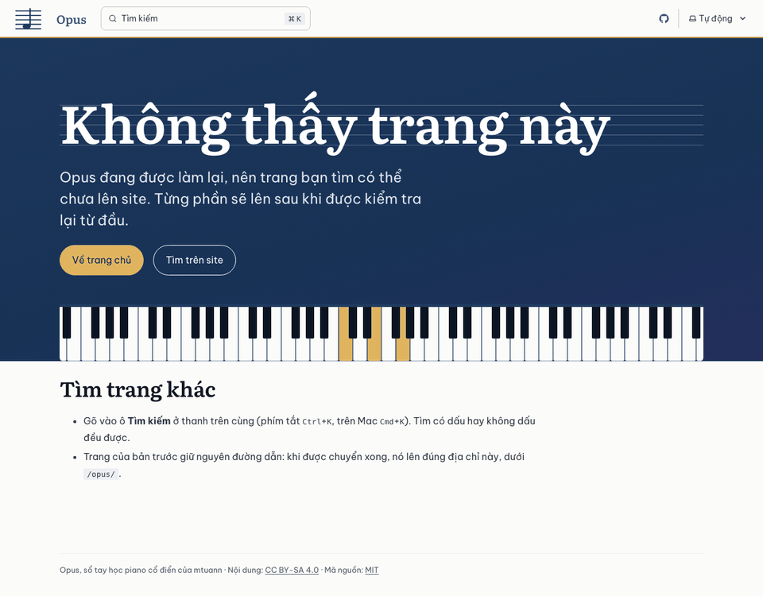
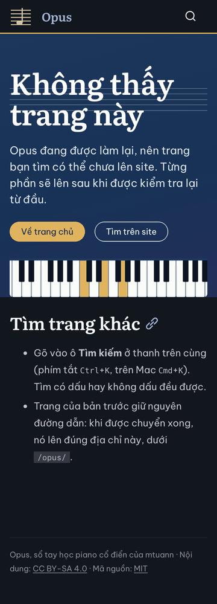
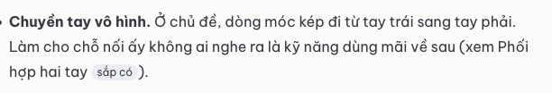
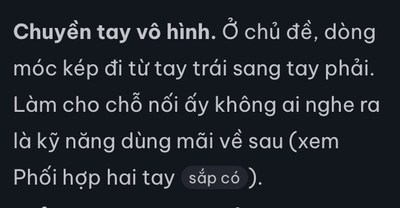

# Báo cáo D1.5: Link và 404

Nhánh `moi/d1-5-link-404`, làm trên `moi/d1-4-chuyen-cu-phap`, nên gộp sau D1.3 và D1.4. Sau khi D1.3 sửa theo review, nhánh được đặt lại lên trên bản D1.3 mới. Làm ngày 23/10/2026 bằng Claude Code (Claude Opus 5.5), trong git worktree riêng.

## Kết quả

- `npm ci`, `npm run build`, `npm test` đạt trên Node 24.22.1 và Node 26.8.2: 57/57 (sau khi đặt lại lên D1.3 đã sửa). Có 6 kiểm thử mới trong `tests/link.test.mjs`.
- **Link "sắp có".** Thử với ba trang thử của D1.8 cùng `bach-prelude-do`, đều chuyển bằng `tools/chuyen/` (không commit):
  - Trang Für Elise có 16 link nội bộ: 15 link tới trang chưa chuyển hiện thành chữ thường kèm nhãn "sắp có", link còn lại vẫn là link.
  - Chuyển thêm `bach-prelude-do` rồi `npm run build` thường (không `--force`): cả 3 link tới nó trong Für Elise tự thành link.
  - Chữ của ba trang thử vẫn giống hệt bản cũ (`tools/chuyen/so-chu.mjs` bỏ qua nhãn "sắp có").
  - Link trong HTML thô cũng được xét: HTML do chỉ thị dựng từ dữ liệu, và khối HTML viết trong trang. Review D1.3 giao việc này cho D1.5. Thử với một trang tạm dùng `::hop-tac-pham` và `::hoc-tiep` của `bach-prelude-fugue-do-thu`: link "Prelude Đô trưởng BWV 846", "lộ trình" (trong `thong_tin`), "chặng 6", "chặng 7" (trong "Học tiếp") đều thành "sắp có"; kiểm thử link trên bản build đạt.
- **Kiểm link:** kiểm thử mới đòi mọi link nội bộ trong nội dung các trang của bản build tới trang có thật và `#mục` có thật. Ở bản thử 232 trang của D1.4, phép kiểm tương tự cho thấy 3.597 link đều đúng, trừ 2 link tới file của đợt 6.
- **Trang 404:** tiếng Việt, báo site đang được làm lại, có nút về trang chủ và nút mở ô tìm kiếm.
  - Ba trình duyệt, 1280 px sáng và 360 px tối: không tràn ngang, không lỗi JavaScript; bấm "Tìm trên site" thì hộp tìm kiếm mở.
  - axe: không vi phạm, cả hai chế độ, cả trang 404 lẫn trang có link "sắp có".
  - Trang 404 không có trong menu tự sinh (`sidebar: { hidden: true }`), nên nút "Trước", "Tiếp" của trang khác không trỏ tới `/opus/404/` (địa chỉ không có). Lỗi này lộ ra khi làm D1.6, lúc build bản xem có trang thường; đã sửa trên nhánh này, kèm kiểm thử.
- Lighthouse (điện thoại, 3 lần):

| Trang | Hiệu năng | Trợ năng | Thực hành tốt | SEO | FCP | LCP | TBT | CLS | Tổng tải |
|---|---|---|---|---|---|---|---|---|---|
| Trang 404 | 100 (100/100/100) | 100 | 100 | 100 | 1,1 s | 1,5 s | 0 ms | 0 | 113 KiB |
| Bài học thử có link "sắp có" | 100 (100/100/100) | 100 | 100 | 100 | 0,9 s | 1,5 s | 0 ms | 0,001 | 145 KiB |

Ở lượt đo đầu của bài học thử, một lần đạt 91 vì TBT 369 ms trong khi hai lần kia 0–4 ms. Lúc đó máy đang chạy song song bài review D1.3. Đo lại ba lần: 100, 100, 100.

| Trang 404, 1280 px, sáng | Trang 404, 360 px, tối |
|---|---|
|  |  |

## Việc đã làm và file đã chạm

| File | Nội dung |
|---|---|
| `src/ban-build.mjs` (mới) | Danh sách trang trong bản build hiện tại; tìm trang mà một địa chỉ `/opus/…/` trỏ tới |
| `src/plugins/sap-co.mjs` (mới) | Plugin hast: link tới trang không có trong bản build thành `chữsắp có`, cả link trong nút HTML thô |
| `astro.config.mjs` | Đăng ký plugin "sắp có" sau plugin id kiểu cũ |
| `src/du-lieu.mjs` | Dấu vết của `dungLaiKhiDoi` thêm danh sách trang và `src/ban-build.mjs`: thêm hay bớt trang thì mọi trang dựng lại, link "sắp có" tự đổi |
| `src/styles/thanh-phan.css` | Nhãn "sắp có": chữ nhỏ trong nền xám nhạt, đủ tương phản ở hai chế độ |
| `src/content/docs/404.md` (mới) | Trang 404 |
| `src/components/Hero.astro` | Script nhỏ cho nút "Tìm trên site": mở hộp tìm kiếm của Starlight |
| `tools/chuyen/so-chu.mjs` | Bỏ qua nhãn "sắp có" khi so chữ |
| `tests/link.test.mjs` (mới), `tests/du-lieu.test.mjs` | Kiểm thử link, "sắp có", trang 404; trang 404 không cần tầng trong `trang.yml` |
| `AGENTS.md` | Mục "Link nội bộ": link "sắp có" tự đổi, kiểm thử link |

## Chọn gì, vì sao

- **"Sắp có" làm lúc dựng Markdown, bằng plugin hast.** Plugin nhìn từng link `/opus/…/`, hỏi `trangTrongBan()` xem trang đích có trong bản build không. Trang lên thì chính bản build sau tự đổi lại, không phải sửa trang nào. HTML của trang được Astro giữ giữa các lần build, nên danh sách trang được đưa vào dấu vết của `dungLaiKhiDoi`; đã thử ở mục Kết quả. Link ngoài, `#mục` trong trang và link tới file tĩnh (có đuôi như `.txt`) giữ nguyên.
- **Nhãn "sắp có" là chữ thật**, để người đọc và máy đọc màn hình đều biết vì sao chữ không bấm được. Có `title` giải thích; có `data-pagefind-ignore` để không vào chỉ mục tìm kiếm. Chữ không gạch chân, để không trông như link.
- **D1.6 chỉ cần sửa một chỗ:** `trangTrongBan()` trả về trang đã khóa cho bản thật, mọi trang cho bản xem. Plugin "sắp có", kiểm thử link và dấu vết dựng lại đều đọc từ hàm này.
- **Trang 404 là `src/content/docs/404.md`**, cách Starlight hướng dẫn, nên dùng chung khung và phần đầu (dải mực) với trang chủ. Starlight vẫn thử dựng thêm `/404` bằng route chung rồi bỏ qua, và in cảnh báo "Could not render `/404`… conflicts with higher priority route". Cảnh báo này thay cho cảnh báo "Entry docs → 404 was not found" có từ D1.1.
- **Nút "Tìm trên site"** gọi nút tìm kiếm của Starlight. Phải chặn cú bấm lan lên `window`: Starlight đóng hộp tìm kiếm khi có cú bấm ra ngoài hộp, và cú bấm vừa mở hộp cũng bị tính. Lần thử đầu, hộp mở rồi đóng ngay trên cả ba trình duyệt. Không có JavaScript thì nút là link tới mục "Tìm trang khác" ngay dưới.

## Chỗ chưa chắc và việc cho bước sau

- **D1.6:** sửa `trangTrongBan()` theo bản thật và bản xem; khóa trang 404 (hồ sơ không có nhận định).
- **Đợt 2:** trang sinh từ dữ liệu ở `src/pages/` (7 trang chặng, danh mục…) phải được thêm vào `trangTrongBan()`, không thì link tới chúng thành "sắp có".
- Link trong HTML thô được xét bằng biểu thức chính quy trên từng nút HTML thô của Sätteri. Thẻ `<a>` mở ở một khối HTML và đóng ở khối khác (có Markdown ở giữa) thì không được xét. Hiện không trang cũ nào viết link như vậy, và kiểm thử link vẫn bắt link hỏng loại này.
- Kiểm thử link chỉ xét phần `<main>` của trang, không xét thanh bên và chân trang do Starlight dựng.

## Kiểm thử đã chạy

- `npm ci && npm run build && npm test` trên Node 24.22.1; `npm run build && npm test` trên Node 26.8.2: 49/49.
- `tests/link.test.mjs`:
  - tìm trang từ địa chỉ (trang thường, mục lục, trang chủ, file, link ngoài);
  - plugin "sắp có" trên đoạn Markdown mẫu (link tới trang có và chưa có, chữ nghiêng trong link, trang chủ, link ngoài, file, `#mục`);
  - link trong HTML thô và link do `::hoc-tiep` dựng;
  - mọi link và `#mục` trong bản build;
  - trang 404 (tiếng Việt, nút về trang chủ, nút tìm kiếm, không có link "Trước", "Tiếp");
  - trang 404 ẩn khỏi menu, không trang nào link tới `/opus/404/`.
- Trong worktree, không commit: dựng ba trang thử và `bach-prelude-do` bằng `tools/chuyen/`, kiểm như ở mục Kết quả. Dùng Playwright trên ba trình duyệt, axe, Lighthouse.
