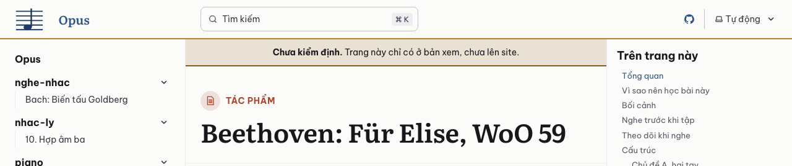
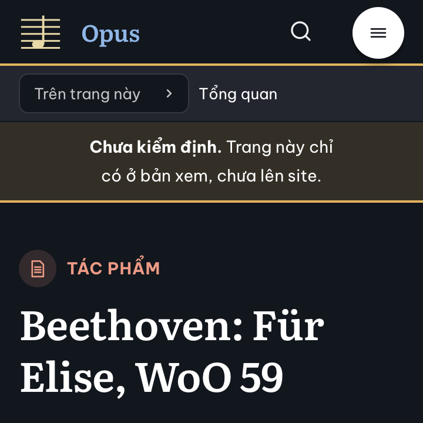

# Báo cáo D1.6: Khóa, phạm vi, bản thật và bản xem

Nhánh `moi/d1-6-khoa`, làm trên `moi/d1-5-link-404`, nên gộp sau D1.3, D1.4 và D1.5. Sau khi D1.3 sửa theo review, cả chồng nhánh được đặt lại lên trên bản D1.3 mới; các số dưới đây đo lại sau đó. Làm ngày 23/10/2026 bằng Claude Code (Claude Opus 5.5), trong git worktree riêng.

## Kết quả

- `npm ci`, `npm run build`, `npm run build:xem`, `npm test` đạt trên Node 24.22.1 và Node 26.8.2: 71 kiểm thử, 70 đạt, 1 bỏ qua khi nhánh nằm trên `main` có D1.4 và D1.5 (lúc làm: 66, 65, 1); sau khi sửa theo review: 73, 72, 1. Kiểm thử bị bỏ qua là kiểm thử phạm vi của nhánh đang làm: nó chỉ chạy trên nhánh lô `moi/d<đợt>-l<lô>`.
- **Bản thật và bản xem.** Thử với ba trang thử của D1.8 (`nhac-ly/10-hop-am-ba`, `piano/tac-pham/fur-elise`, `nghe-nhac/bach-goldberg`), chuyển bằng `tools/chuyen/`, không commit:
  - `npm run build` dựng 2 trang (trang chủ, 404); sitemap chỉ có trang chủ; ba trang thử không có trong `dist/`, link tới chúng hiện "sắp có".
  - `npm run build:xem` dựng 5 trang; ba trang thử có dải "Chưa kiểm định", trang chủ và 404 thì không. `tools/chuyen/so-chu.mjs` vẫn thấy chữ ba trang thử giống hệt trang cũ: dải không nằm trong phần nội dung được so.
  - `npm run dev` chạy bản xem: dải hiện ở trang thử.
- **Khóa.** Trang chủ tạm và trang 404 đã khóa; hồ sơ không có nhận định. Thêm một dòng vào `404.md` thì cả `npm run build` lẫn `npm run build:xem` đều hỏng:
  > Khóa trong kiem-dinh/khoa.json không khớp (1 lỗi): trang 404 đã khóa mà nội dung đã đổi (mã băm lệch); sửa theo thủ tục mở khóa: node tools/khoa.mjs mo 404 --ly-do "…" (plans/ben-vung/chuan-kiem-dinh.md mục 7).

  Trả lại file thì `node tools/khoa.mjs tinh` báo "khớp".
- **Dải "Chưa kiểm định"** ở ba trình duyệt, 1280 px sáng và 360 px tối: không tràn ngang, không lỗi JavaScript. axe không báo vi phạm ở hai trang thử, cả hai chế độ, cả hai cỡ. Lighthouse (điện thoại, 3 lần, bản xem):

| Trang | Hiệu năng | Trợ năng | Thực hành tốt | SEO | FCP | LCP | TBT | CLS | Tổng tải |
|---|---|---|---|---|---|---|---|---|---|
| Bài học thử có dải "Chưa kiểm định" | 100 (100/100/100) | 100 | 100 | 100 | 0,9 s | 1,5 s | 0 ms | 0,001 | 145 KiB |
| Trang chủ | 100 (100/100/100) | 100 | 100 | 100 | 1,1 s | 1,5 s | 0 ms | 0 | 114 KiB |





- **Sửa một lỗi của D1.5** (một commit riêng trên nhánh D1.5, kèm kiểm thử): trang 404 nằm trong menu tự sinh, nên nút "Trước" của trang kế bên trỏ tới `/opus/404/`, địa chỉ không có. Lỗi lộ ra khi build bản xem có trang thường. Đã ẩn trang 404 khỏi menu (`sidebar: { hidden: true }`).

## Việc đã làm và file đã chạm

| File | Nội dung |
|---|---|
| `src/khoa.mjs` (mới) | Bản build đang dựng (`ban()`: `OPUS_BAN=xem` là bản xem); chuẩn hóa và băm trang; JSON chuẩn và băm bản ghi; đọc `khoa.json`; `kiemKhoa()` kiểm mọi mục đã khóa |
| `src/ban-build.mjs` | `trangTrongBan()` theo bản build: bản thật chỉ trang đã khóa; `locTheoBan` bỏ trang chưa khóa khỏi bộ trang ở bản thật |
| `src/content.config.ts` | Gọi `kiemKhoa()` lúc nạp cấu hình (lệch thì build hỏng); bọc bộ nạp trang bằng `locTheoBan` |
| `src/du-lieu.mjs` | Dấu vết của `dungLaiKhiDoi` thêm bản build, `khoa.json` và `src/khoa.mjs`: khóa trang hay đổi bản thì mọi trang dựng lại |
| `src/components/Banner.astro` (mới), `astro.config.mjs`, `src/styles/thanh-phan.css` | Dải "Chưa kiểm định" ở trang chưa khóa của bản xem |
| `package.json` | `build:xem`; `dev` chạy bản xem |
| `tools/khoa.mjs` (mới) | Công cụ khóa: `mau`, `khoa`, `tinh`, `mo`, `xuat` |
| `kiem-dinh/khoa.json`, `kiem-dinh/index.yml`, `kiem-dinh/404.yml` (mới) | Khóa trang chủ tạm và trang 404 |
| `tests/khoa.test.mjs` (mới) | Kiểm thử khóa |
| `tests/pham-vi.test.mjs` (mới) | Kiểm thử phạm vi lô |
| `tests/chuyen.test.mjs` | Bỏ kiểm thử "bản build không có ô chưa chuyển": nay chỉ chặn ở trang đã khóa (`tests/khoa.test.mjs`), để bản xem vẫn hiện được trang chưa có đủ thành phần |
| `tools/chuyen/chuyen.mjs` | Dùng `jsonChuan` của `src/khoa.mjs` thay cho bản riêng |
| `src/plugins/sap-co.mjs`, `src/kiem-dinh.mjs` | Chú thích |
| `AGENTS.md` | Lệnh (`build:xem`, `dev`); mục "Khóa" mới; ô "chưa chuyển"; bước 3 khi chuyển trang dùng `build:xem` |
| `plans/lam-lai/cong-nghe.md` | Mục 4 (thêm `src/khoa.mjs`, `src/ban-build.mjs`, `tools/khoa.mjs`); mục 7 ghi cách làm đã chọn |
| `plans/lam-lai/README.md`, `plans/ben-vung/chuan-kiem-dinh.md`, `plans/ben-vung/them-tac-pham.md` | `tools/khoa.py` thành `node tools/khoa.mjs`; câu phạm vi lô ở "Quy tắc chung" ghi thêm chỗ đăng ký thành phần (xem dưới) |

## Chọn gì, vì sao

- **Lọc trang chưa khóa ở bộ nạp**, không dùng `draft`. Ở bản thật, `locTheoBan` xóa trang chưa khóa khỏi bộ trang ngay sau khi nạp. Starlight không biết trang đó: không dựng, không đưa vào menu, nút Trước và Tiếp, tìm kiếm, sitemap. `draft` của Starlight phải ghi vào frontmatter, làm đổi mã băm của trang. Trang 404 cũng theo luật này: chưa khóa thì Starlight dùng trang 404 mặc định.
- **Kiểm khóa lúc nạp cấu hình**, ở cả hai bản: không ai xem được bản nào có trang đã khóa bị sửa mà chưa qua thủ tục mở khóa.
- **Công cụ viết bằng Node** (`tools/khoa.mjs`), không phải `tools/khoa.py` như kế hoạch. Mã băm chỉ có một chỗ tính (`src/khoa.mjs`), dùng chung cho bản build và công cụ. Hai bản ở hai ngôn ngữ dễ lệch nhau ở JSON của bản ghi: cách viết số, thoát ký tự Unicode. Đã sửa mọi chỗ kế hoạch ghi `tools/khoa.py`; lý do ghi ở `cong-nghe.md` mục 7.
- **Mã băm của trang** tính trên cả file sau khi chuẩn hóa như `chuan-kiem-dinh.md` mục 6 (xuống dòng `\n`, bỏ khoảng trắng cuối dòng), cộng thêm một luật: đúng một `\n` ở cuối file. Trình soạn thảo hay thêm hay bớt dòng trống cuối file, mà người đọc không thấy khác. **Bản ghi** băm trên JSON của bản ghi đọc thẳng từ YAML (chưa qua schema), khóa xếp theo chữ cái ở mọi cấp.
- **Điều kiện khóa** (`khoa` từ chối khi thiếu, in từng chỗ thiếu), theo `chuan-kiem-dinh.md` mục 3–5:
  - mọi nhận định có `ket_qua` hợp lệ, có `luot_2` (`dung`, `sai`, `khong-chac`); nguồn có trong danh sách nguồn; `da-sua`, `da-bo` có ghi chú; `khong-can-nguon` chỉ cho `khuyen-tap`; lượt 2 cho `sai` hay `khong-chac` mà kết quả `dung` thì cần ghi chú cách đã giải quyết;
  - số mục `khuong_nhac` bằng số khối ```` ```abc ```` trong trang, mỗi mục có kết quả;
  - lần cuối trong `lan` ghi đủ người: `luot_1`, `luot_2`, `review`, `kiem_mau`;
  - lần cuối trong `lan` chưa có mã băm. Trang đã khóa thì phải `mo` trước.

  Đòi `luot_2` và đủ người là chặt hơn câu chữ của mục 3 ("không còn chỗ hai lượt khác nhau chưa giải quyết"), vì thiếu lượt 2 thì không biết hai lượt có khác nhau không.
- **Khóa từng phần bản ghi** (thêm sau review kế hoạch đổi thứ tự đợt, cùng ngày). Đợt 2 chỉ khóa vài trường của bản ghi tác phẩm (tên, tác giả, số danh mục, chặng…), đợt 6 khóa nốt. Khóa cả bản ghi sẽ khóa luôn các trường chưa kiểm định, nên cần cách khóa riêng từng trường:
  - khóa dạng `tac-pham/<slug>#<trường>,<trường>`, mã băm tính trên các trường ấy;
  - trường chưa khóa sửa tự do; sửa trường đã khóa thì build hỏng;
  - khóa cả bản ghi thì thay các khóa từng phần của bản ghi đó;
  - hồ sơ vẫn một file cho mỗi bản ghi, mỗi lần khóa một mục trong `lan` (có `truong`); `mau` trên hồ sơ đã có thì thêm lần kiểm định mới.
- **Mở khóa** (`mo`): gỡ dòng trong `khoa.json`, ghi lý do vào `mo_khoa` của hồ sơ, thêm một lần mới (rỗng) vào `lan` để người sửa điền; `khoa` ghi ngày, nhánh, mã băm vào lần đó. Cờ `--nguoi` dự tính lúc đầu bị bỏ: người ghi thẳng trong hồ sơ, theo cấu trúc `nguoi` của mục 5.
- **`xuat`** nhận mã lô (`D3-L2`, lấy trang từ `anh-xa.md`) hay đường dẫn trang. Theo lô thì ghi vào `plans/lam-lai/bao-cao/d3-l2-nhan-dinh.yml`, đúng tên file lời giao lượt 2 dùng (`chuan-kiem-dinh.md` mục 8); `--mau 10` ghi `d3-l2-kiem-mau.yml`, có nguồn và kết quả lượt 1 để chủ repo kiểm.
- **Kiểm thử phạm vi** (`tests/pham-vi.test.mjs`):
  - Trên nhánh `moi/d<đợt>-l<lô>`, so với điểm tách khỏi `main` (hay `origin/main`), tính cả file chưa commit và file mới.
  - File phải thuộc phạm vi của lô theo "Quy tắc chung": trang của lô, `src/data/`, `src/components/`, `src/scripts/`, `public/`, `kiem-dinh/`, báo cáo của lô (`d3-l2.md`, `d3-l2/`, `d3-l2-*.yml`).
  - Thêm ba chỗ mà `AGENTS.md` (D1.3, D1.4) đã giao cho lô làm thành phần: đăng ký trong `src/plugins/thanh-phan.mjs`, CSS trong `src/styles/thanh-phan.css`, kiểm thử trong `tests/` (trừ `khoa.test.mjs` và `pham-vi.test.mjs`, để lô không tự nới cổng). Câu phạm vi ở "Quy tắc chung" của kế hoạch ghi thêm các chỗ này.
  - Việc kế hoạch giao riêng cho một lô nằm ngoài các thư mục trên thì ghi trong `THEM` của file kiểm thử. Hiện có D2-L1 (trang chủ thật, 7 trang chặng ở `src/pages/`, menu 9 nhóm: `astro.config.mjs`, `src/nhom.mjs`, `src/styles/opus.css`, `src/ban-build.mjs`) và D3-L5 (trang Từ điển sinh từ dữ liệu).
  - Trang bị khóa, đổi mã băm hay mở khóa trong `khoa.json` phải là trang của lô.
  - Bài blog của D7-L3 đổi đường dẫn nên mọi file trong `src/content/docs/blog/` thuộc lô đó.
- **Ô "chưa chuyển"** chỉ bị chặn ở trang đã khóa: bản xem cần hiện được trang của lô trước khi lô làm xong thành phần, và trang chưa khóa không lên bản thật.
- **Dải "Chưa kiểm định"** là thành phần Banner của Starlight được thay, đặt ở đầu phần nội dung, ngay dưới thanh trên. Dải có `role="note"` và `data-pagefind-ignore`; màu lấy từ `--oz-warn` trộn với nền, đủ tương phản ở hai chế độ (axe).

## Chỗ chưa chắc và việc cho bước sau

- **D1.7:** kiểm thử phạm vi cần nhánh `main` để so. Trong `test.yml`, `actions/checkout` cần `fetch-depth: 0`; thiếu thì kiểm thử báo lỗi rõ, không lặng lẽ bỏ qua. `test.yml` chạy `npm run build:xem`, `deploy.yml` chạy `npm run build`.
- **Nhánh `them/<slug>`** (`them-tac-pham.md` mục 4): kiểm thử phạm vi chưa mở rộng cho nhánh này; cần trước nhánh `them/` đầu tiên, tức sau đợt 6. Bảng file ở mục đó chưa có hồ sơ của bản ghi (`kiem-dinh/du-lieu/tac-pham/<slug>.yml`), trong khi `chuan-kiem-dinh.md` mục 5 đòi bản ghi có hồ sơ riêng. Chủ repo chọn: thêm hồ sơ bản ghi vào bảng, hay cho hồ sơ của trang tính cả bản ghi.
- **Kết quả lượt 2** (`d<đợt>-l<lô>-luot-2.yml`) hiện phải chép tay vào `luot_2` của từng nhận định trong hồ sơ. Lô đầu tiên thấy cần thì thêm lệnh `nhap` vào `tools/khoa.mjs` (việc riêng).
- **`THEM` của D2-L1, D3-L5** đọc từ mục của đợt trong kế hoạch; chủ repo sửa nếu muốn lô làm ít hay nhiều hơn. Gọn hơn nữa: D2-L1 cho `trangTrongBan()` tự đọc trang trong `src/pages/`, để lô sau không phải chạm `src/ban-build.mjs`.
- **Hồ sơ của trang chủ tạm và trang 404** ghi `review` là agent review D1.5, D1.6 (trước khi gộp): người review D1.6 xem hai hồ sơ này.
- **Mức kiểm định chưa chọn** (`README.md`, mục "Quyết định"). Công cụ khóa theo mức kế hoạch đang giả định: hai lượt agent, review, chủ repo kiểm mẫu. Vì vậy nó đòi `luot_2` ở mọi nhận định, và đòi đủ bốn người trong `nguoi`. Nếu chủ repo chọn một lượt agent và review, thì bỏ hai điều đó trong `loiHoSo` (`tools/khoa.mjs`) và sửa kiểm thử theo.
- **Windows:** script `dev`, `build:xem` đặt biến môi trường kiểu `OPUS_BAN=xem astro …`, không chạy trong `cmd.exe`. macOS, Linux và GitHub Actions không sao; cần Windows thì thêm `cross-env`.
- **Menu ở bản xem** hiện tên thư mục (`nghe-nhac`, `nhac-ly`, `piano`) vì menu còn tự sinh; menu đủ 9 nhóm là việc của D2-L1.

## Kiểm thử đã chạy

- `npm ci && npm run build && npm test` và `npm run build:xem && npm test` trên Node 24.22.1; `npm run build && npm test` trên Node 26.8.2: đạt, 1 bỏ qua (phạm vi, vì đây không phải nhánh lô); số kiểm thử ở mục Kết quả.
- `tests/khoa.test.mjs`:
  - mã băm không đổi theo kiểu xuống dòng, khoảng trắng cuối dòng, dòng trống cuối file; JSON chuẩn không đổi theo thứ tự khóa;
  - mọi mục trong `khoa.json` khớp mã băm, có hồ sơ đủ, lần cuối trong hồ sơ ghi đúng mã băm đang khóa; trang chủ và 404 đã khóa;
  - công cụ trên một repo nhỏ dựng tạm:
    - `mau` tạo hồ sơ mẫu;
    - `khoa` từ chối hồ sơ thiếu: thiếu người, khuông nhạc chưa kiểm, `da-sua` thiếu ghi chú, thiếu lượt 2, `khong-chac` chưa giải quyết;
    - khóa, rồi `tinh` khớp; sửa trang thì `tinh` lệch; không khóa lại được khi chưa mở;
    - `mo` ghi lý do và thêm lần mới; khóa lại;
    - `xuat` theo trang, theo lô, `--mau`;
    - hồ sơ và khóa của bản ghi; `kiemKhoa` bắt bản ghi đã khóa bị sửa và trang đã khóa bị xóa;
  - `locTheoBan` ở bản thật và bản xem;
  - trên `dist/`: trang đã khóa không có dải và không có ô "chưa chuyển"; trang chưa khóa có dải.
- `tests/pham-vi.test.mjs`:
  - `anh-xa.md` đọc ra 31 lô, 233 trang, mỗi trang một lô, đúng số ghi ở tiêu đề lô;
  - file trong và ngoài phạm vi của D3-L2, D2-L1, D3-L5, D7-L3;
  - trên một repo git dựng tạm có nhánh `main` và `moi/d3-l2`: bắt file ngoài phạm vi đã commit, chưa commit và file mới; bắt trang của lô khác bị khóa hay mở khóa; nhánh khác thì bỏ qua;
  - nhánh đang làm (bỏ qua nếu không phải nhánh lô).
- Trong worktree, không commit: ba trang thử chuyển bằng `tools/chuyen/`. Đã kiểm bằng hai bản build, `npm run dev`, Playwright trên ba trình duyệt, axe, Lighthouse; sửa `404.md` đã khóa để thấy build hỏng.

## Review

Claude Code (Claude Sonnet 5.5), ngày 23/10/2026, nhánh `moi/d1-6-khoa` ở commit `718fb72` (làm trên nhánh `review/d1-6`, tách từ commit đó). Chỉ xét phần của D1.6: `git diff moi/d1-5-link-404..HEAD`, hai commit `6424aec` và `718fb72`. Người review không làm D1.6. D1.5 đang được review riêng, không xét ở đây.

Cách làm:

- Trong worktree review chỉ chạy `npm ci`, `npm run build`, `npm run build:xem`, `npm test` (Node 24.22.1; thêm `build` và `test` trên Node 26.8.2). Không tạo file nào trong worktree.
- Mọi phép thử đổi file làm trên bản chép trong thư mục tạm, mỗi phép một bản chép có repo git riêng: chuyển trang bằng `tools/chuyen/` (`nhac-ly/09-quang`, `nhac-ly/10-hop-am-ba`, `piano/tac-pham/fur-elise`, `nghe-nhac/bach-goldberg`; cả 232 trang bằng `--ra`), sửa trang đã khóa, `src/data/`, hồ sơ, `khoa.json`, và các nhánh tạm `moi/d3-l1`, `moi/d2-l1`, `moi/d3-l5` (chỉ có trong repo của bản chép, không tạo nhánh nào ở repo thật). Đã xóa các bản chép khi xong.
- Trình duyệt: Playwright (Chromium, WebKit, Firefox) qua `npm run preview -- --port 4361`; axe-core 4.13. Không chạy lại Lighthouse: repo chưa có công cụ này (D1.7 thêm).
- Script đo, log và ảnh chụp để ở thư mục tạm, không commit.

### Phải sửa

1. **Trang hay bản ghi đã khóa vẫn khóa lại được mà không qua `mo`.**
   - `tools/khoa.mjs` dòng 170–179: `mau` thêm lần kiểm định mới vào hồ sơ đã khóa, cả hồ sơ của trang. Dòng 186–204: `khoa` chỉ chặn khi lần cuối trong `lan` đã có mã băm, không xét trang hay khóa đã có sẵn trong `khoa.json` (dòng 198 chỉ chặn khóa từng phần khi bản ghi đã khóa cả bản ghi); dòng 199–201 ghi đè dòng khóa và gỡ các khóa từng phần cũ mà không kiểm chúng còn khớp.
   - Hậu quả: `mau` rồi `khoa` nhận bản đã sửa. Không có `mo_khoa`, không có lý do; build, `tinh` và `npm test` đều qua. Mục 7 của chuẩn kiểm định (chỉ ba trường hợp, có lý do) và luật "không sửa trang đã khóa" của kế hoạch bị bỏ qua được. Báo cáo dòng 60 ("Trang đã khóa thì phải `mo` trước") chỉ đúng khi không ai gọi `mau`.
   - Thử lại trên bản chép của nhánh, với trang đã khóa thật:

     ```bash
     echo "chữ chèn lén" >> src/content/docs/index.md
     node tools/khoa.mjs khoa index   # từ chối: lần cuối trong lan đã có mã băm
     node tools/khoa.mjs mau index    # thêm lần 2 vào kiem-dinh/index.yml
     # điền bốn mục nguoi của lần 2 trong kiem-dinh/index.yml
     node tools/khoa.mjs khoa index   # qua; khoa.json đổi mã băm; hồ sơ không có mo_khoa
     npm run build && npm test        # qua: 71 kiểm thử, 70 đạt, 1 bỏ qua
     ```

     Bản ghi: khóa `du-lieu/tac-pham/fur-elise#loai,ten`; sửa `ten` (`tinh` báo LỆCH); `mau`; điền `nguoi`; `khoa du-lieu/tac-pham/fur-elise`. Qua, và khóa từng phần bị thay mà không ai mở.
   - Cách sửa: `khoa` từ chối khi `<mục>` đã có trong `khoa.trang` hay `khoa.ban_ghi` (chỉ dẫn `mo`); `mau` từ chối trang đã khóa; khóa cả bản ghi thay các khóa từng phần thì từng khóa cũ phải còn khớp, không thì chỉ dẫn `mo` khóa đó. Thêm kiểm thử cho hai đường này vào `tests/khoa.test.mjs` (hiện chỉ thử đường `khoa` trực tiếp, dòng 92 và 139).

### Nên sửa

1. **Khóa từng phần không kiểm tên trường.**
   - `src/khoa.mjs` dòng 61 (`phanKhoa` bỏ qua trường bản ghi không có), `tools/khoa.mjs` dòng 197–201.
   - `node tools/khoa.mjs khoa 'du-lieu/tac-pham/fur-elise#ten,tac_gia,danh_muc,chnag,loai,goi_y'` qua. `khoa.json` ghi `tac-pham/fur-elise#chnag,danh_muc,goi_y,loai,tac_gia,ten`; `chang` không được khóa và không có cảnh báo nào.
   - Sửa: từ chối tên không có trong schema của bộ (`src/du-lieu.mjs`), cảnh báo tên mà bản ghi chưa có. Làm trước D2-L1: lô đó khóa sáu đến bảy trường của 73 bản ghi.
2. **Kiểm thử phạm vi không canh khóa bản ghi và hồ sơ của trang khác.**
   - `tests/pham-vi.test.mjs` dòng 25 (cả thư mục `kiem-dinh/`) và dòng 79–85 (chỉ so `trang` trong `khoa.json`).
   - Thử trên nhánh `moi/d3-l1` của bản chép, khi `main` có khóa `tac-pham/fur-elise#…`: sửa `ten` rồi tính lại mã băm bằng tay trong `khoa.json`; sau đó gỡ hẳn dòng khóa. Cả hai lần kiểm thử phạm vi đều qua. Thêm một dòng vào `kiem-dinh/index.yml` và xóa `kiem-dinh/404.yml` (hồ sơ của trang không thuộc lô) cũng không bị bắt.
   - Sửa: so `ban_ghi` như `trang` (khóa đã có ở `main` mà đổi mã băm hay bị gỡ thì lỗi trên nhánh lô, khóa mới thì cho); `kiem-dinh/` chỉ nhận hồ sơ của trang trong lô, `kiem-dinh/du-lieu/` và `khoa.json`. Làm trước D2-L1, lô đầu tiên khóa bản ghi.
3. **`THEM` chưa đủ cho các việc kế hoạch giao riêng.**
   - `tests/pham-vi.test.mjs` dòng 32–37. D2-L1 (`astro.config.mjs`, `src/nhom.mjs`, `src/styles/opus.css`, `src/pages/`, `src/ban-build.mjs`) và D3-L5 (`src/pages/`, `src/ban-build.mjs`) đúng với việc kế hoạch giao: nhánh thử `moi/d2-l1` qua với các file đó và hỏng với `.github/`, `tools/`, `.gitignore`; `moi/d3-l5` qua với `src/pages/` và `src/ban-build.mjs`, hỏng với `astro.config.mjs`.
   - Còn thiếu: D2-L1 phải làm "kiểm thử hỏng nếu trang đã khóa hiện một trường chưa khóa", cần đọc ra trường mà chỉ thị, trang chặng và ô gợi ý dùng, nhiều khả năng chạm `src/du-lieu.mjs` hay `src/plugins/` ngoài `thanh-phan.mjs` (nhánh thử `moi/d2-l1` chạm các file này thì hỏng). Danh mục tác phẩm (đợt 6), sách in, nhật ký Cập nhật và service worker (đợt 7: `src/pages/`, `astro.config.mjs`, `tools/`), workflow hằng tuần (đợt 8: `.github/workflows/`) cũng ngoài phạm vi chung. Kế hoạch chưa nói lô nào làm các việc này, nên chưa ghi được.
   - Chủ repo chọn: ghi vào kế hoạch lô nào làm rồi thêm vào `THEM`; hay để lô ghi chỗ vượt phạm vi vào báo cáo và thêm khi gặp.
4. **Kế hoạch và tài liệu chưa khớp.**
   - `AGENTS.md` mô tả đúng `tools/khoa.mjs`, kể cả khóa từng phần. `plans/lam-lai/README.md` dòng 98 (dòng D1.6) và `plans/lam-lai/cong-nghe.md` mục 7 (dòng 99–106) chưa ghi khóa từng phần `du-lieu/<bộ>/<id>#<trường>,…`; chỉ `chuan-kiem-dinh.md` mục 6 có.
   - `plans/ben-vung/chuan-kiem-dinh.md` dòng 96 chưa ghi luật thứ ba của mã băm trang (đúng một `\n` ở cuối file, `src/khoa.mjs` dòng 27).
   - Ngoài D1.6: kế hoạch ghi "79 bản ghi" ở `plans/lam-lai/README.md` dòng 108, 116, 169. `src/data/tac-pham.yml` có 73 bản ghi (34 bài học, 39 hướng dẫn nghe); 79 là số trang (34 + 45). D2-L1 và đợt 6 nên đếm theo 73.
5. **Báo cáo.** Dòng 7 và 93 ghi "66 kiểm thử, 65 đạt, 1 bỏ qua"; đo lại ra 71, 70, 1 (Node 24.22.1 và 26.8.2, cả bản thật và bản xem). Dòng 60 chỉ đúng sau khi sửa Phải sửa 1.
6. **Ngày ghi theo UTC.** `tools/khoa.mjs` dòng 33: `homNay()` dùng `toISOString()`. Lúc 20:12 ngày 23/10 giờ máy (UTC−5), `khoa` ghi `ngay: 2026-10-24`. Ở Việt Nam (UTC+7), từ 0 giờ đến 7 giờ sáng sẽ ghi ngày hôm trước. Ngày này hiện ở huy hiệu "Đã kiểm định ngày …" (`src/kiem-dinh.mjs`). Sửa: lấy ngày theo giờ máy.
7. **CLI im lặng khi đường dẫn script đi qua liên kết tượng trưng.** `tools/khoa.mjs` dòng 288 (cùng cách bảo vệ ở `tools/chuyen/chuyen.mjs` dòng 337 và `tools/chuyen/so-chu.mjs` dòng 249, của D1.4). `node /tmp/…/tools/khoa.mjs tinh` (trên macOS `/tmp` là liên kết tới `/private/tmp`) không in gì và thoát 0, vì `import.meta.url` là đường dẫn thật còn `process.argv[1]` thì không. `tinh` thoát 1 khi lệch, nên dùng làm cổng kiểm sẽ qua suông. Sửa: `import.meta.main` (chạy đúng với liên kết, thử trên Node 24.22.1 và 26.8.2) hay `fs.realpathSync(process.argv[1])`.
8. **Bốn chỗ hở nhỏ của công cụ khóa.**
   - Hồ sơ không có nhận định vẫn khóa được. `nhac-ly/09-quang` (tầng lõi, chuyển từ site cũ) khóa được với `nhan_dinh: []`, `nguon: []` và `nguoi` là `a`, `b`, `c`, `d`. Chỉ hai trang khung cần hồ sơ rỗng. Sửa: đòi ít nhất một nhận định khi tầng không phải `khung`, hay đòi `ghi_chu` giải thích.
   - `tools/khoa.mjs` dòng 66 đếm khối `abc` bằng regex `^```abc\s*$`, còn plugin (`src/plugins/opus-markdown.mjs` dòng 65, `node.lang === 'abc'`) dựng cả khối thụt trong danh sách, hàng rào `~~~abc` và bốn dấu huyền. Trang thử có 4 khối được dựng, `mau` tạo 1 mục `khuong_nhac`. 232 trang chuyển từ site cũ có 361 khối, hai cách đếm trùng nhau, nên chỉ ảnh hưởng trang viết mới. Sửa: đếm từ cây Markdown, hay cấm các kiểu hàng rào khác bằng kiểm thử.
   - `src/khoa.mjs` dòng 21–27 bỏ khoảng trắng cuối dòng, nên hai dấu cách ngắt dòng cứng không còn trong mã băm: `maBamTrang('A  \nB')` bằng `maBamTrang('A\nB')`, mà Sätteri dựng `<p>A<br>\nB</p>` và `<p>A\nB</p>`. Chuẩn kiểm định mục 6 viết đúng như vậy. Site cũ không có dòng nào kết thúc bằng khoảng trắng (`grep` trên 233 trang), nên chưa gây hại. Sửa: giữ đúng hai dấu cách khi dòng có chữ, hay thêm kiểm thử cấm khoảng trắng cuối dòng trong trang.
   - Trang `.mdx`: `src/ban-build.mjs` dòng 14 nhận `.md` và `.mdx`, còn `fileTrang` (`src/khoa.mjs` dòng 38) chỉ tìm `.md`. Trang `x.mdx` dựng được ở bản xem, nhưng `khoa` báo "không có trang …/x.md", nên không bao giờ lên bản thật. Sửa: cấm `.mdx` bằng kiểm thử, hay cho `fileTrang` tìm cả hai.
9. **Bốn chỗ nhỏ khác.**
   - Hiệu năng: `src/khoa.mjs` dòng 71–77 đọc và parse lại file YAML cho từng khóa. Với 376 khóa bản ghi (tạo bằng script trên bản chép), `kiemKhoa()` mất 2,1 s và `npm run build` mất 3,4 s thay vì 1,1 s. Sửa: nhớ kết quả parse theo file trong một lần gọi.
   - `src/khoa.mjs` dòng 80–84: `khoa.json` hỏng (ví dụ xung đột git; file này chung cho mọi lô) báo `Expected double-quoted property name in JSON at position 105 (line 4 column 5)`, không ghi tên file, kèm gợi ý "Check your src/content.config.ts". Sửa: bọc `JSON.parse` và ghi `kiem-dinh/khoa.json không đọc được`.
   - `npm run dev` chỉ kiểm khóa lúc nạp cấu hình. Sửa trang đã khóa lúc dev đang chạy thì không bị chặn; khởi động lại (chạy ngoài terminal tương tác) thì mọi trang 404 và lỗi khóa chỉ có ở `astro dev logs`. Nên ghi một câu vào mục "Khóa" của `AGENTS.md`.
   - `tools/khoa.mjs` dòng 226–234: `mo` khi không có hồ sơ vẫn gỡ khóa, in "đã mở khóa" và làm mất lý do (đã thử: xóa `kiem-dinh/404.yml` rồi `mo 404 --ly-do "…"`). Sửa: từ chối.
10. **Thứ tự gộp với D1.5.** `kiem-dinh/404.yml` ghi `review: Claude, agent review D1.5 và D1.6`, mà `d1-5.md` chưa có mục Review. Mã băm của `404.md` và `index.md` khóa ở D1.6; nếu review D1.5 hay D1.2b buộc sửa hai trang này thì phải `mo` rồi `khoa` lại trên nhánh D1.6 (có lý do), và `node tools/khoa.mjs tinh` phải khớp trước khi gộp. Gộp D1.6 sau khi review D1.5 xong.

### Đã đối chiếu

- `npm ci`, `npm run build`, `npm test`, `npm run build:xem`, `npm test` đạt trên Node 24.22.1: 71 kiểm thử, 70 đạt, 1 bỏ qua (kiểm thử phạm vi của nhánh đang làm, vì `review/d1-6` không phải nhánh lô), ở cả hai bản. `npm run build` và `npm test` trên Node 26.8.2: cùng số. Cảnh báo `Could not render /404 from route /[...slug]` có từ D1.5 (build nhánh D1.5 cũng in), không do D1.6.
- Ba trang thử của D1.8, chuyển trong bản chép: `npm run build` dựng 2 trang (`/opus/`, `/opus/404/`), sitemap chỉ có trang chủ; `npm run build:xem` dựng 5 trang, dải ở ba trang thử, không ở trang chủ và 404; `so-chu` báo chữ giống nhau ở cả ba. Khớp báo cáo.
- Bản thật với một trang đã khóa (`nhac-ly/09-quang`, thêm hai link) và ba trang chưa khóa: `dist/` có `404.html`, trang chủ và trang đã khóa; sitemap có 2 địa chỉ; Pagefind `page_count` 2, tìm "Elise" ra 0 kết quả; menu bên chỉ có `/opus/` và trang đã khóa; nút Trước trỏ `/opus/`, không có nút Tiếp; hai link tới trang chưa khóa hiện "sắp có"; không có `sha256:` trong `dist/`. Đổi qua lại `build:xem` và `build` ba lượt: 6 trang rồi 3 trang, không sót.
- Bản xem: Pagefind tìm ra trang chưa khóa (`hop am ba` ra bài 10 đầu tiên); chữ của dải và nhãn "sắp có" không vào chỉ mục (`data-pagefind-ignore`).
- Mã băm trang (`index.md`): sửa một chữ, sửa frontmatter, thêm dòng trống giữa trang, đổi dấu cách thành NBSP, thêm BOM, đổi một chữ sang NFD, thêm dấu cách đầu dòng, xóa file: đều làm `kiemKhoa()` báo lỗi (build gọi hàm này lúc nạp cấu hình). Sửa một chữ thử thật ở `npm run build`, `npm run build:xem` và `astro sync`: build hỏng, thoát 1, lỗi ghi tên trang, lệnh `node tools/khoa.mjs mo index --ly-do "…"` và `chuan-kiem-dinh.md` mục 7. CRLF, CR đơn, dấu cách và tab cuối dòng, thêm hay bớt dòng trống cuối file: mã băm giữ nguyên.
- Mã băm bản ghi (`fur-elise`): đảo thứ tự khóa, `4` thành `4.0` hay `0x4`, kiểu trích dẫn YAML, `\u00fc` thay cho `ü`, `true` thành `True`, chú thích YAML, trường chưa khóa: mã băm giữ nguyên. `"4"` (chuỗi), `ü` dạng NFD, `yes`, trường đã khóa: đổi. Build với khóa từng phần: đổi `giong` (chưa khóa) qua; đổi `ten` (đã khóa) hỏng, lệnh gợi ý đúng khóa `mo du-lieu/tac-pham/fur-elise#loai,ten`.
- `tools/khoa.mjs`: `mau` tạo hồ sơ đúng mục 5, có đủ số mục `khuong_nhac`. `khoa` từ chối hồ sơ thiếu từng người (`luot_1`, `luot_2`, `review`, `kiem_mau`), nhận định thiếu lượt 2, nguồn lạ, `da-bo` thiếu ghi chú, `khong-can-nguon` sai loại, lượt 2 `sai` mà kết quả `dung` không ghi chú, số khuông khác số khối; thông báo liệt kê từng chỗ thiếu. `mo` không có `--ly-do` thì từ chối; có thì ghi `mo_khoa` (ngày, nhánh, lý do) và thêm lần mới. `tinh` thoát 1 khi lệch. `xuat` đúng với trang, với `--mau`; lô không có trong `anh-xa.md` hay lô thiếu hồ sơ thì báo lỗi.
- Phạm vi, nhánh tạm `moi/d3-l1` trong bản chép: trang của lô, hồ sơ, `d3-l1.md`, `d3-l1/`, `d3-l1-nhan-dinh.yml` qua. `README.md`, `astro.config.mjs`, `package.json`, `src/plugins/sap-co.mjs`, `src/styles/opus.css`, `tools/`, trang của D3-L2, `tests/khoa.test.mjs`, `tests/pham-vi.test.mjs` hỏng, ghi từng file. File chưa commit và file mới bị bắt khi thử; file đã commit do kiểm thử "nhánh lô trong repo thử" của D1.6 lo, chạy đạt.
- `npm run dev` (cổng 4362) chạy bản xem: dải ở ba trang chưa khóa, không ở trang chủ và trang đã khóa. Khớp báo cáo.
- Dải "Chưa kiểm định" ở Chromium, WebKit, Firefox, 360, 768 và 1280 px, sáng và tối, năm trang (90 phép đo): không tràn ngang, không lỗi JavaScript hay request hỏng, không cắt chữ; dải chỉ ở ba trang chưa khóa. Tương phản chữ và nền 13,3 đến 13,7:1; chữ 14 px; dải cao 69 px (hai dòng) ở 360 px, 44 px từ 768 px. axe (WCAG 2.2 AA và best-practice), ba trình duyệt, hai chế độ, hai cỡ: không vi phạm ở `fur-elise`, `09-quang` và trang chủ. `nhac-ly/10-hop-am-ba` còn `scrollable-region-focusable` ở 360 px (3 bảng): đã ghi ở review D1.4, không do D1.6.
- HTML bản thật của trang chủ và 404 so với D1.5: sau khi bỏ mã băm lớp `astro-…` và mã băm tên file, HTML của hai trang giống hệt D1.5; CSS gộp thêm 267 byte (86.059 lên 86.326). D1.6 không làm lùi luật 7 ở bản thật.
- Hồ sơ `kiem-dinh/index.yml` và `404.yml`: đã đọc cả hai. Đúng cấu trúc mục 5; mã băm khớp `khoa.json`; không có nhận định. Trang chủ chỉ có câu thông báo và thẻ nhóm tả cấu trúc site; thẻ khớp `cap-do.yml` ("Sau Grade 8") và `anh-xa.md` (nhạc cụ, opera, nhạc Việt Nam ở Đọc thêm). Chỗ `review` của 404: xem Nên sửa 10.
- File đã chạm khớp bảng của báo cáo (26 file). Không còn `tools/khoa.py` ngoài chỗ ghi lý do đổi.
- `git -C ../opus-zero status --short` lúc đầu và lúc cuối giống nhau (`?? _to_delete/`, có từ trước).

### Kết luận

Chưa gộp được. Sửa Phải sửa 1, kiểm lại bằng chuỗi lệnh ở đó và `node --test tests/khoa.test.mjs`, rồi gộp. Phần còn lại của D1.6 đạt: bản thật và bản xem, bộ lọc ở bộ nạp, dải, mã băm, khóa từng phần, kiểm thử phạm vi chạy đúng như báo cáo mô tả. Nên sửa 1 và 2 làm trước D2-L1; các mục khác làm cùng hay sau. Gộp sau khi review D1.5 xong (Nên sửa 10).

## Sửa theo review

Claude Code (Claude Opus 5.5), người làm D1.6, ngày 23/10/2026, trên commit review `0fb2b4d`. Nhánh đã nằm trên D1.5 đã sửa theo review.

### Phải sửa

1. **Không khóa đè được nữa.** `tools/khoa.mjs`:
   - `khoa` từ chối trang đã khóa, bản ghi đã khóa cả bản ghi, và khóa từng phần đã có; lỗi chỉ lệnh `mo`.
   - `mau` từ chối trang đang khóa và bản ghi đang khóa cả bản ghi. Chỉ bản ghi đang khóa từng phần được thêm lần kiểm định mới, để khóa thêm trường hay khóa cả bản ghi.
   - Khóa cả bản ghi, hay khóa nhiều trường hơn, chỉ được khi mọi khóa từng phần cũ của bản ghi còn khớp; khóa cũ nằm trọn trong khóa mới thì được thay.
   - Thử lại đúng chuỗi lệnh của review trên trang chủ và trên bản ghi: `mau` và `khoa` đều bị chặn, kèm lệnh `mo`. `tests/khoa.test.mjs` thêm các đường này: `mau` trang đang khóa; `khoa` khóa đã có; khóa cả bản ghi khi một trường đã khóa bị sửa; khóa thêm trường thay khóa cũ.

### Nên sửa: đã làm

- **Số 1, tên trường:** khóa từng phần từ chối tên không có trong schema của bộ (`src/du-lieu.mjs`), ví dụ `chnag`; tên có trong schema mà bản ghi chưa có thì in chú ý. Kiểm thử: khóa trong `khoa.json` chỉ dùng tên có trong schema.
- **Số 2, phạm vi:** `tests/pham-vi.test.mjs`:
  - trên nhánh lô, khóa bản ghi đã có ở `main` không được đổi mã băm hay bị gỡ; được thay bằng khóa rộng hơn của cùng bản ghi khi các trường đã khóa không đổi;
  - `kiem-dinh/` chỉ nhận hồ sơ của trang trong lô, `kiem-dinh/du-lieu/` và `khoa.json`.

  Repo thử trong kiểm thử có đủ ba trường hợp của review: sửa trường rồi tính lại mã băm; gỡ khóa; sửa hồ sơ trang ngoài lô.
- **Số 4, tài liệu:**
  - dòng D1.6 của kế hoạch và `cong-nghe.md` mục 7 ghi khóa từng phần và luật không khóa đè;
  - `chuan-kiem-dinh.md` mục 6 ghi luật "đúng một `\n` ở cuối file" và cấm khoảng trắng cuối dòng;
  - kế hoạch sửa "79 bản ghi" thành 73 ở ba chỗ (`tac-pham.yml` có 73 bản ghi: 34 bài học, 39 hướng dẫn nghe; 79 là số trang).
- **Số 5:** số kiểm thử trong báo cáo đã sửa.
- **Số 6:** ngày trong hồ sơ lấy theo giờ máy, không theo UTC.
- **Số 7:** `tools/khoa.mjs` nhận biết chạy trực tiếp bằng `import.meta.main`. Thử qua `/tmp` (liên kết tới `/private/tmp`): `tinh` in đủ và thoát đúng mã. Hai script cùng lỗi của D1.4 (`tools/chuyen/chuyen.mjs`, `so-chu.mjs`) sửa luôn.
- **Số 8, bốn chỗ hở:**
  - hồ sơ không có nhận định chỉ khóa được ở trang khung, hay khi có `ghi_chu` giải thích;
  - kiểm thử mới chặn trang `.mdx`, khoảng trắng cuối dòng, và khối abc không mở bằng ` ```abc ` ở đầu dòng. Chọn cấm thay vì đổi cách băm hay cách đếm: trang cũ không có trường hợp nào, và cách viết một kiểu dễ đọc hơn.
- **Số 9:**
  - `kiemKhoa()` đọc mỗi bộ dữ liệu một lần cho mọi khóa;
  - `khoa.json` hỏng báo "kiem-dinh/khoa.json không đọc được (…)";
  - `mo` từ chối khi không có hồ sơ, giữ nguyên khóa;
  - `AGENTS.md` ghi `npm run dev` chỉ kiểm khóa lúc khởi động.
- **Số 10:** D1.5 sửa theo review có đổi `404.md` (nút "Tìm trên site" thêm `aria-haspopup`), nên khóa của trang 404 lệch. Đã mở khóa bằng `mo` (lý do ghi trong `kiem-dinh/404.yml`), điền lần kiểm định 2, khóa lại; `tinh` khớp. Đây cũng là lần thử thủ tục mở khóa trên trang thật.

### Nên sửa: chờ chủ repo

- **Số 3, `THEM`:** các việc kế hoạch giao mà còn ngoài phạm vi chung: kiểm thử "trang đã khóa hiện trường chưa khóa" của D2-L1 (có thể chạm `src/du-lieu.mjs` hay `src/plugins/`), danh mục tác phẩm (đợt 6), sách in, nhật ký Cập nhật, service worker (đợt 7), workflow hằng tuần (đợt 8). Hai cách: ghi vào kế hoạch lô nào làm rồi thêm vào `THEM`; hay để lô ghi chỗ vượt phạm vi vào báo cáo và thêm khi gặp.

### Kiểm thử

- `npm run build`, `npm test`; `npm run build:xem`, `npm test` trên Node 24.22.1: 73 kiểm thử, 72 đạt, 1 bỏ qua (phạm vi).
- `node tools/khoa.mjs tinh`: hai trang khớp.

### Kiểm lại

Claude Code (Claude Sonnet 5.5), người kiểm lại, ngày 23/10/2026, ở commit `f382d9a`. Không làm D1.6 và không làm review lần đầu.

Cách làm:

- Trong worktree chỉ chạy `npm run build`, `npm run build:xem`, `npm test` và `node tools/khoa.mjs tinh` (Node 24.22.1; thêm `node --test` trên Node 22.23.4, bản tối thiểu theo `engines`, và Node 26.8.2). `dist/` được dựng lại (git bỏ qua). Không sửa file nào ngoài mục này.
- Mọi phép thử đổi file làm trên bản chép trong thư mục tạm. Công cụ chạy từ worktree với `--goc <bản chép>`. Phép thử nhánh lô `moi/d3-l1` và phép thử gộp `origin/main` làm trong repo git riêng ở thư mục tạm; không tạo nhánh nào ở repo thật. Đã xóa mọi bản chép.
- Script đo và log để ở thư mục tạm, không commit.

**1. Build và kiểm thử: đạt.**

- `npm run build` (2 trang) rồi `npm test`; `npm run build:xem` (2 trang: repo chưa có trang chưa khóa) rồi `npm test`. Mỗi lần: 73 kiểm thử, 72 đạt, 0 hỏng, 1 bỏ qua (kiểm thử phạm vi: `moi/d1-6-khoa` không phải nhánh lô). Node 22.23.4 và Node 26.8.2, `node --test` toàn bộ: cùng số.
- `node tools/khoa.mjs tinh`: `404` và `index` khớp, thoát 0. Chạy qua `/tmp/claude-501/…/tools/khoa.mjs` (liên kết tới `/private/tmp`): in đủ hai dòng, thoát 0 (lỗi cũ: im lặng), ở cả Node 22.23.4, 24.22.1 và 26.8.2.
- Thử gộp `origin/main` (`323ba4a`, có D1.5 đã gộp: thêm `cec70c5` và `323ba4a`) vào nhánh, trong một bản clone riêng: gộp sạch (`tools/chuyen/so-chu.mjs` tự gộp, hai chỗ sửa ở hai đoạn khác nhau), `tinh` khớp (`404.md` không đổi nên khóa còn đúng), `build`, `build:xem`, `npm test` cùng số như trên. Nhánh chưa chứa hai commit đó: gộp `main` vào nhánh (hay đặt lại) trước khi gộp vào `main`.

**2. Phải sửa 1 (khóa đè): đã sửa đúng.** Làm lại chuỗi lệnh của review trên bản chép.

- **Trang `index`.** Thêm "chữ chèn lén" vào `index.md`; `tinh` báo `LỆCH`.
  - `khoa index` bị từ chối: `index: trang đã khóa. Muốn sửa thì mở khóa trước: node tools/khoa.mjs mo index --ly-do "…"`.
  - `mau index` bị từ chối, cũng chỉ lệnh `mo`.
  - Thêm tay lần 2 vào `kiem-dinh/index.yml` với đủ bốn người rồi `khoa index`: vẫn bị từ chối. `khoa ./index` (đường dẫn viết lệch để qua mặt kiểm tra khóa): bị `loiHoSo` chặn (`trang phải là "src/content/docs/./index.md"`). `khoa.json` không đổi.
- **Bản ghi `fur-elise`.** `mau`, điền hồ sơ, `khoa du-lieu/tac-pham/fur-elise#loai,ten`; sửa `ten` (`tinh` báo `LỆCH`); `mau` (được phép vì bản ghi đang khóa từng phần) thêm lần 2; điền bốn người. Năm lệnh khóa đều bị từ chối, `khoa.json` giữ mã băm cũ:
  - cả bản ghi, `#chang,loai,ten`, `#chang`, `#ten`: `khóa du-lieu/tac-pham/fur-elise#loai,ten đã lệch (trường đã khóa bị sửa). Mở khóa trước: node tools/khoa.mjs mo du-lieu/tac-pham/fur-elise#loai,ten --ly-do "…"`;
  - `#loai,ten` (đúng khóa cũ): `khóa này đã có. Muốn sửa thì mở khóa trước: … mo …`.
- **Đường hợp lệ, trang.** `mo index` thiếu `--ly-do`: từ chối. Có lý do: gỡ khóa, ghi `mo_khoa`, thêm lần 2 rỗng. Sửa trang rồi `khoa index` khi chưa điền: liệt kê bốn người thiếu. Điền xong: `khoa` qua, `tinh` khớp, ngày ghi theo giờ máy. `khoa index` và `mau index` lại: bị chặn.
- **Đường hợp lệ, bản ghi.**
  - `mo du-lieu/tac-pham/fur-elise#loai,ten --ly-do "…"`, sửa `ten`, điền, `khoa …#loai,ten`: qua.
  - `mau`, điền, `khoa …#chang,loai,ten`: qua, thay khóa cũ.
  - `mau`, điền, `khoa du-lieu/tac-pham/fur-elise`: qua; `khoa.json` chỉ còn một khóa cả bản ghi; `tinh` khớp.
  - Sau đó `khoa`, `mau`, `khoa …#ten` đều bị chặn, chỉ lệnh `mo du-lieu/tac-pham/fur-elise`. `mo` cả bản ghi rồi `khoa …#chang,ten`: qua.
- **Hồ sơ không có nhận định.** Trang lõi `nhac-ly/09-quang` dựng tạm, hồ sơ không nhận định, không `ghi_chu`: `khoa` từ chối (`chưa có nhận định nào: trang tầng loi …`). Thêm `ghi_chu`: qua. Trang chủ (tầng khung) và trang 404 (không có tầng) đã khóa vẫn qua `loiHoSo` (kiểm thử khóa đạt).

**3. Các mục nên sửa đã làm: đạt; kiểm thử còn hở ba nhánh phạm vi và hai chỗ của kiểm thử khóa (Chỗ nên sửa 1, 2).**

- **Số 1, tên trường.** `khoa 'du-lieu/tac-pham/fur-elise#ten,chnag'`: `bộ tac-pham không có trường chnag (trường có: slug, loai, tac_gia, …)`, `khoa.json` không đổi. `#ten,them_ngay` (có trong schema, bản ghi chưa có): qua, kèm `chú ý: bản ghi tac-pham/fur-elise chưa có trường them_ngay`.
- **Số 2, phạm vi.** Đọc `tests/pham-vi.test.mjs`, rồi thử trên repo git riêng (nhánh `moi/d3-l1`, `main` có bốn khóa bản ghi), mỗi phép một lần chạy `node --test tests/pham-vi.test.mjs`:
  - bị bắt: sửa `ten` của `fur-elise` rồi tính lại mã băm bằng tay (`đã khóa ở main mà đổi mã băm`); gỡ dòng khóa (`bị gỡ`); thêm một dòng vào `kiem-dinh/index.yml`, hay xóa `kiem-dinh/404.yml` (`ngoài phạm vi của lô D3-L1`); thay khóa từng phần bằng khóa cả bản ghi mà sửa trường đã khóa; thu hẹp `#chang,ten` thành `#ten` (`bị gỡ`);
  - cho qua: khóa bản ghi mới kèm hồ sơ bản ghi; khóa và hồ sơ của trang trong lô; thay bằng khóa cả bản ghi hay nhiều trường hơn khi dữ liệu không đổi; sửa trường chưa khóa; sửa hồ sơ của một bản ghi.
  - Phá logic trên bản chép của file kiểm thử, mười đột biến, mỗi lần chạy lại file. Bảy làm kiểm thử hỏng: bỏ nhánh "đổi mã băm", chấp nhận mọi phép thay, bỏ dòng hồ sơ trang, cho cả `kiem-dinh/` vào phạm vi chung, bỏ cả vòng so khóa bản ghi, coi hồ sơ trang nào cũng thuộc lô, so với `HEAD` thay vì `main`. Ba không làm hỏng: xem Chỗ nên sửa 1.
- **Số 4, tài liệu.** Đã đọc diff: dòng D1.6 của kế hoạch và `cong-nghe.md` mục 7 ghi khóa từng phần và luật không khóa đè; chuẩn mục 6 ghi "đúng một `\n` ở cuối file" và cấm khoảng trắng cuối dòng; "79 bản ghi" thành 73 ở ba chỗ đã nêu. Còn "79 bản ghi" ở `plans/ben-vung/README.md` dòng 50 và `plans/lam-lai/so-do.md` dòng 56 (`d1-2.md` đã ghi hai chỗ này nên sửa).
- **Số 5.** Số kiểm thử trong báo cáo đúng (73, 72, 1).
- **Số 6, ngày.** `date` báo 20:47 CDT, `date -u` đã là 24/10; hồ sơ ghi `ngay: 2026-10-23`.
- **Số 7, liên kết tượng trưng.** Qua `/tmp/…`: `khoa.mjs tinh` in đủ (Node 22.23.4, 24 và 26); `chuyen.mjs` không đối số in hướng dẫn, thoát 2 (cả ba bản Node); `so-chu.mjs <trang>` in `KHÔNG SO ĐƯỢC …`, thoát 1 (Node 24).
- **Số 8, bốn chỗ hở.**
  - Hồ sơ không nhận định: xem số 2 ở trên.
  - Kiểm thử nguồn trang, thử với ba trang vi phạm đặt tạm: `.mdx`, hai dấu cách cuối dòng, khối `~~~abc`, ` ```abc ` thụt trong danh sách, ` ````abc `. Báo đủ năm chỗ, khối ` ```abc ` chuẩn không bị báo.
  - Chuyển 232 trang từ site cũ bằng `tools/chuyen --ra` vào thư mục tạm: 0 dòng khoảng trắng cuối, 0 file `.mdx`, 0 khối abc kiểu khác. Kiểm thử mới không báo nhầm trang đã chuyển.
- **Số 9.**
  - Hiệu năng: 365 khóa từng phần (73 bản ghi, 5 trường mỗi bản ghi), `kiemKhoa()` mất 5.952 ms ở `0fb2b4d`, 18 ms ở `f382d9a`.
  - `khoa.json` có dấu xung đột git: `tinh` và `npm run build` đều báo `kiem-dinh/khoa.json không đọc được (…)`.
  - `mo` khi xóa hồ sơ: từ chối (`không có hồ sơ kiem-dinh/index.yml để ghi lý do mở khóa`), `khoa.json` không đổi.
  - `AGENTS.md` có câu về `npm run dev`.
- **Số 10, trang 404:** xem số 4 dưới đây.

**4. Trang 404: đạt.**

- `kiem-dinh/404.yml` có `mo_khoa` (ngày, nhánh, lý do: nút "Tìm trên site" thêm `aria-haspopup="dialog"`, chữ không đổi) và lần 2 có `ma_bam` `sha256:2869…`, bằng mã băm trong `khoa.json`.
- Tính lại mã băm `404.md` theo từng commit: `83e905b` (trước sửa D1.5) ra `7299…`, đúng `ma_bam` lần 1; `4fe0e93` (D1.5 sửa theo review), `0fb2b4d` và `f382d9a` ra `2869…`, đúng lần 2. Diff `404.md` giữa `83e905b` và `4fe0e93` chỉ thêm `aria-haspopup: dialog`, đúng lý do ghi.
- Dòng `review` của lần 2 ghi người kiểm lại D1.5 (sửa theo review): mục Kiểm lại của `d1-5.md` ở `main` có kiểm `aria-haspopup` trong `dist/404.html`, nên dòng này có chỗ dựa.

**5. Đọc `git show f382d9a`: hợp lý, không làm hỏng đường hợp lệ nào.**

- Đã thử bốn đường hợp lệ: khóa lần đầu (trang, bản ghi, trang lõi có `ghi_chu`); khóa thêm trường; khóa cả bản ghi sau khóa từng phần; mở rồi khóa lại (trang, một khóa từng phần, cả bản ghi). Đều qua (số 2 ở trên).
- `khoa` và `mau` cùng chặn khóa đè, hai lớp độc lập; kiểm thử khóa bắt được khi gỡ từng lớp (mười hai đột biến của `tools/khoa.mjs`, chín bị bắt; ba sống sót: xóa mọi khóa cũ và `import.meta.main`, ở Chỗ nên sửa 2; ngày theo UTC, không kiểm thử được vì phụ thuộc giờ máy, đã thử tay ở số 6).
- Khóa từng phần cũ phải còn khớp: một khóa lệch chặn mọi khóa mới của bản ghi đó, kể cả khóa rời. Đúng ý, vì bản ghi ấy vốn đã làm build hỏng cho tới khi `mo`.
- `import.meta.main` (`@types/node` ghi `@since v24.2.0`, thử nghiệm) chạy ở cả ba bản Node đã thử, kể cả Node 22.23.4, bản tối thiểu của `engines`: `typeof import.meta.main` là `boolean`, `tinh` qua `/tmp` in đủ, toàn bộ kiểm thử 73, 72, 0 hỏng, 1 bỏ qua.

**Chỗ còn phải sửa:** không có.

**Chỗ nên sửa** (không chặn gộp):

1. **Kiểm thử phạm vi còn hở ba nhánh** (`kiemPhamVi` và repo thử trong `tests/pham-vi.test.mjs`). Ba đột biến không làm kiểm thử hỏng: bỏ kiểm "trường đã khóa không đổi" khi khóa được thay bằng khóa rộng hơn (dòng 106); chấp nhận thu hẹp khóa (`every`, dòng 103); bỏ `continue` cho khóa không đổi (dòng 95). Mã đúng (các phép thử tay ở điểm 3, mục "Số 2, phạm vi", đều đúng), nhưng sửa mã về sau có thể làm hỏng mà không ai biết. Thêm vào repo thử ba bản ghi: khóa rộng hơn mà `ten` bị sửa (phải báo); `#chang,ten` thu thành `#ten` (phải báo); một khóa không đổi (không được báo).
2. **Kiểm thử khóa còn hở hai chỗ** (`tests/khoa.test.mjs`).
   - Khóa rộng hơn chỉ thay khóa nằm trọn: đột biến "xóa mọi khóa từng phần cũ" của bản ghi không làm hỏng kiểm thử. Thêm ca có một khóa rời (như `#grade` cạnh `#loai,ten`) phải còn nguyên sau khi khóa `#chang,loai,ten`.
   - Không kiểm thử nào chạy công cụ như tiến trình: đổi `import.meta.main` về so sánh đường dẫn thì kiểm thử vẫn đạt, còn `node /tmp/…/khoa.mjs tinh` thoát 0 mà không in gì. Thêm kiểm thử tạo liên kết tới thư mục repo trong thư mục tạm, chạy `node <liên kết>/tools/khoa.mjs tinh`, kiểm có in.
3. **`mo` gỡ khóa trước khi đọc hồ sơ.** Hồ sơ có nhưng hỏng (thiếu `lan`, do sửa tay): `khoa.json` mất khóa, lệnh thoát với `Cannot read properties of undefined (reading 'add')`, không có `mo_khoa`. Công cụ không tạo được hồ sơ như vậy (`khoa` đòi `lan`), nên nhỏ. Sửa: dựng nội dung hồ sơ mới và kiểm `lan` trước, ghi hồ sơ rồi mới gỡ khóa.
4. **Câu chữ.**
   - `mo du-lieu/<bộ>/<id>#<trường>` khi cả bản ghi đang khóa báo `chưa khóa`, không chỉ `mo du-lieu/<bộ>/<id>` (`khoa` thì chỉ đúng).
   - `AGENTS.md`, mục Khóa, câu "Mục đang khóa thì `khoa` và `mau` từ chối" chưa nói ngoại lệ của `mau` với bản ghi đang khóa từng phần (dòng chú thích của lệnh `mau` ngay trên có nói).
   - Hai chỗ còn "79 bản ghi" (số 4 ở trên).

**Kiểm thử:**

- Worktree: `npm run build`, `npm test`; `npm run build:xem`, `npm test` trên Node 24.22.1: 73 kiểm thử, 72 đạt, 1 bỏ qua; `tinh` khớp. Node 22.23.4 và 26.8.2: cùng số.
- Trước khi thêm mục này `git status` của worktree sạch. `git -C ../opus-zero status --short` lúc cuối vẫn là `?? _to_delete/` như lúc đầu (HEAD `5d08189`, nhánh `main`). Đã xóa mọi bản chép và clone.

**Kết luận: gộp được.** "Phải sửa 1" đã sửa đúng, trên cả trang và bản ghi, đường hợp lệ vẫn chạy; các mục nên sửa đã làm đạt. Không còn chỗ nào phải sửa trong mã. Bốn chỗ nên sửa ở trên là kiểm thử, một chỗ hở nhỏ của `mo` và câu chữ, làm cùng hay sau; các chỗ 1 và 2 nên làm trước D2-L1, lô đầu tiên khóa bản ghi và dùng kiểm thử phạm vi. Trước khi gộp vào `main`: gộp `main` (`323ba4a`) vào nhánh, rồi chạy lại `npm run build`, `npm test` (đã thử ở bản clone, sạch).

### Sửa thêm sau kiểm lại

Claude Code (Claude Opus 5.5), người làm D1.6, ngày 23/10/2026. Làm bốn việc nhỏ kiểm lại ghi, vì nên có trước D2-L1:

1. `tests/pham-vi.test.mjs`: repo thử thêm ba trường hợp mà đột biến còn sống: khóa giữ nguyên (không báo), thu hẹp khóa (`#loai,ten` thành `#ten`: báo gỡ), sửa trường đã khóa rồi thay bằng khóa cả bản ghi (báo).
2. `tests/khoa.test.mjs`: khóa rời (`#grade` khi đã có `#loai,ten`) không thay khóa cũ; chạy `tools/khoa.mjs tinh` qua đường dẫn có liên kết tượng trưng phải in kết quả.
3. `mo` đọc hồ sơ trước khi gỡ khóa: hồ sơ hỏng (YAML lỗi hay thiếu `lan`) thì từ chối, khóa còn nguyên; có kiểm thử. `mo du-lieu/<bộ>/<id>#<trường>` khi cả bản ghi đang khóa thì chỉ lệnh mở cả bản ghi.
4. `AGENTS.md` ghi ngoại lệ của `mau` với bản ghi đang khóa từng phần; "79 bản ghi" còn ở `plans/ben-vung/README.md` và `plans/lam-lai/so-do.md` sửa thành 73.
