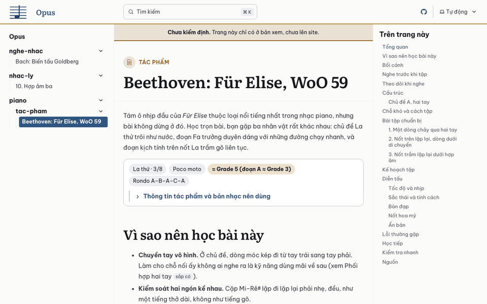
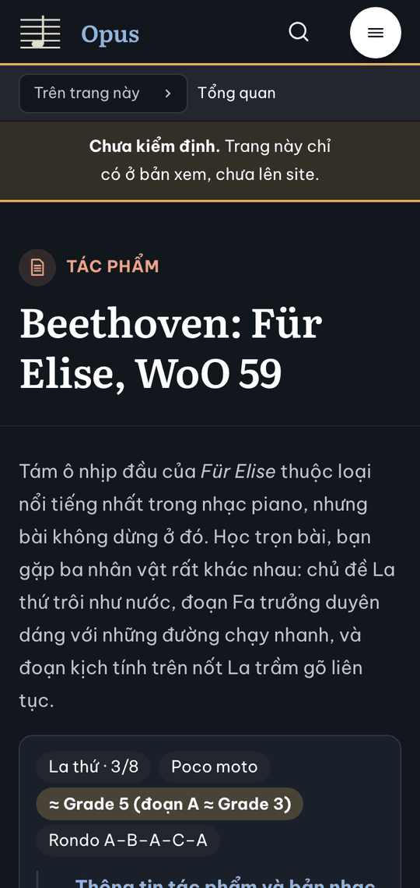
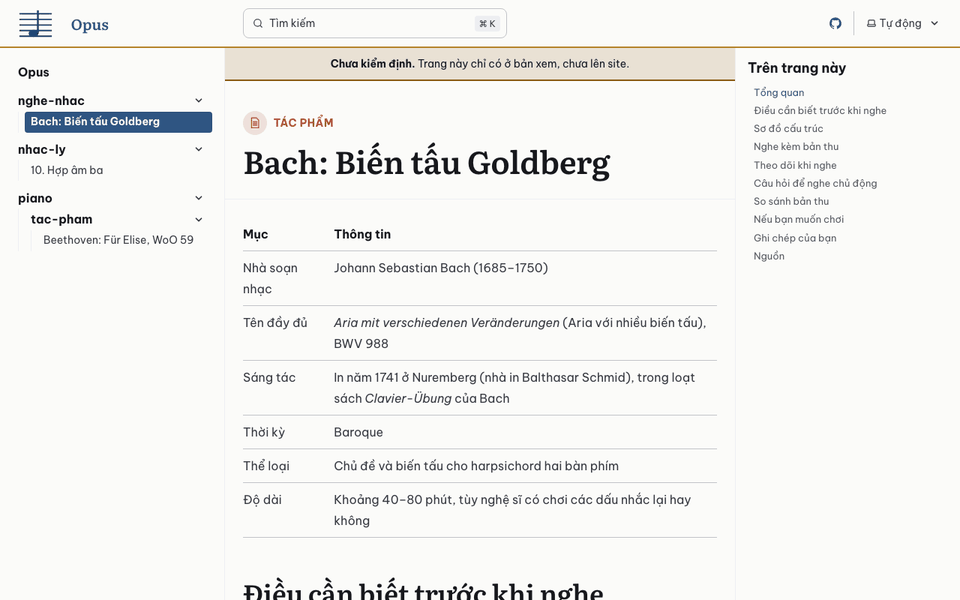
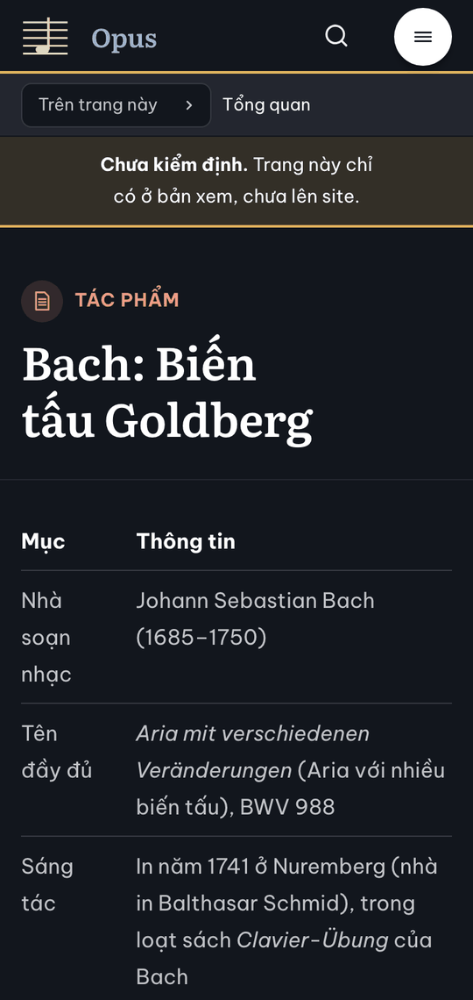
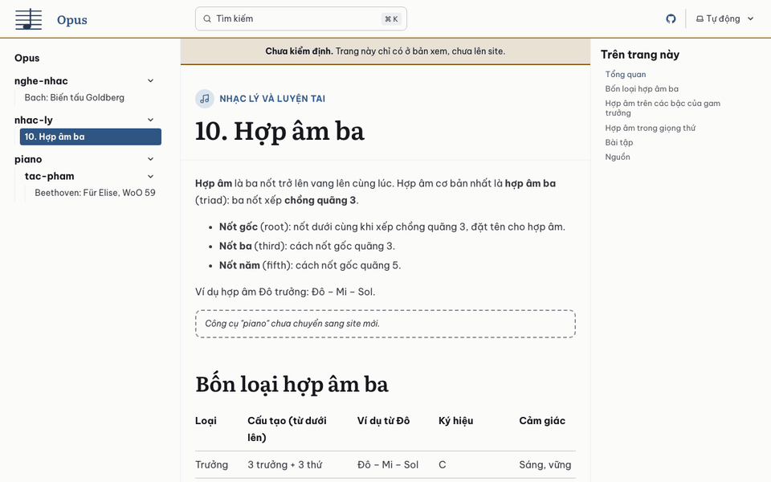
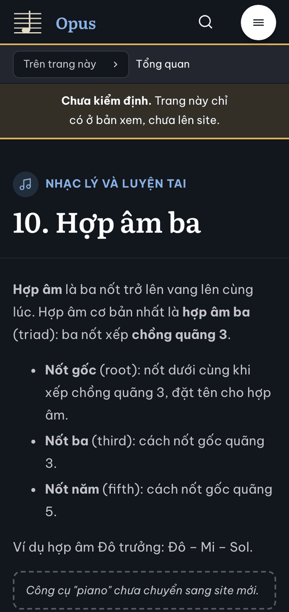
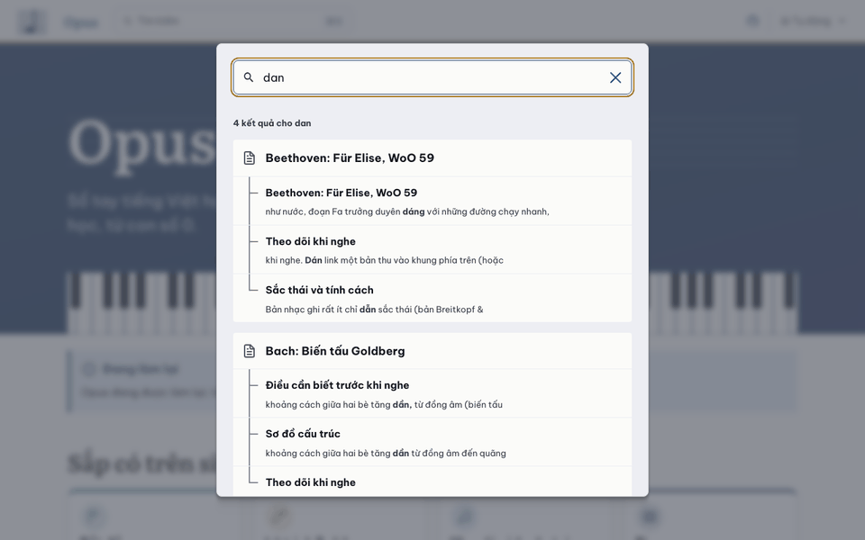
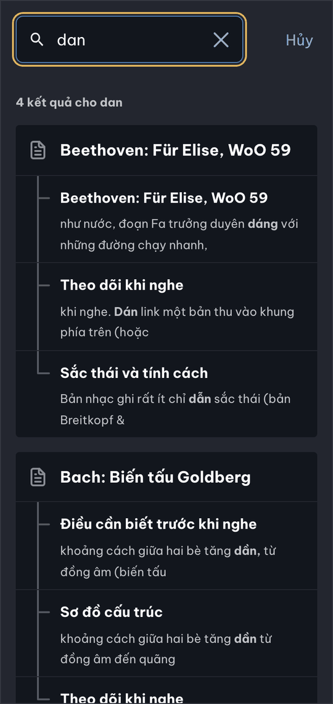

# Báo cáo D1.8: Thử ba trang

Nhánh `moi/d1-8-thu`, làm trên `moi/d1-7-ci`, nên gộp sau D1.5 đến D1.7. Khi D1.4 đã sửa theo review và gộp vào `main`, cả chuỗi D1.5 đến D1.8 được đặt lại lên `main`. Ba trang thử được chuyển lại bằng script đã sửa và giống hệt bản đã commit. Các số dưới đây đo sau khi đặt lại. Làm ngày 23/10/2026 bằng Claude Code (Claude Opus 5.5), trong git worktree riêng.

## Kết quả

Ba trang thử chuyển bằng `tools/chuyen/chuyen.mjs`, không sửa tay chữ nào: `nhac-ly/10-hop-am-ba`, `piano/tac-pham/fur-elise`, `nghe-nhac/bach-goldberg`. Chưa kiểm định, chưa khóa.

| Điều kiện "Xong khi" của đợt 1 | Kết quả |
|---|---|
| Ba trang thử hiện đúng ở bản xem, ảnh 360 px và 1280 px | Đạt. Ảnh ở dưới. Kiểm thử trình duyệt ở 360, 768, 1280 px trên Chromium, WebKit, Firefox: 87/87 đạt |
| Đạt chuẩn ở luật 7 | Đạt. Lighthouse cả ba trang: hiệu năng 98 đến 100 (trung vị 100), trợ năng, thực hành tốt, SEO 100 (bảng dưới); axe không báo vi phạm |
| Không có trong bản thật | Đạt. `npm run build` chỉ dựng trang chủ tạm và trang 404; link tới ba trang hiện "sắp có" |
| Bộ dữ liệu hỏng làm build hỏng | Đạt. `OPUS_DU_LIEU=tests/du-lieu-hong npm run build` thoát 1, báo 29 lỗi; `tests/du-lieu.test.mjs` giữ điều này |
| Tìm "hop am ba" ra bài 10, tìm "dan" ra trang có chữ "đàn" | Đạt, qua `pagefind.js` và qua ô tìm kiếm trên Chromium, WebKit, Firefox (ảnh dưới) |
| https://mtuann.github.io/opus/ hiện trang chủ tạm, địa chỉ không có ra trang 404 mới | Chưa. Site đăng lần đầu khi D1.7 gộp vào `main`; kiểm ngay sau lần đó |

- `so-chu`: chữ cả ba trang giống hệt bản cũ (chữ, mô tả, trọn mã ABC, từng câu hỏi, id tiêu đề).
- `npm test`: 75 kiểm thử, 74 đạt, 1 bỏ qua (kiểm thử phạm vi, chỉ chạy trên nhánh lô), lúc làm; sau khi đặt lại lên D1.7 đã sửa và sửa theo review: 81 kiểm thử, 80 đạt, 1 bỏ qua. Đạt trên cả bản thật lẫn bản xem.
- Trang `10-hop-am-ba` có một ô "chưa chuyển" ở chỗ bàn phím (`::cong-cu{ten="piano"}`), như kế hoạch cho phép. Bàn phím làm ở D3-L1.

### Ảnh chụp (bản xem)

| 1280 px, sáng | 360 px, tối |
|---|---|
|  |  |
|  |  |
|  |  |
|  |  |

### Lighthouse

Lighthouse 13.5.0, chế độ điện thoại, máy chủ HTTP/2 (`tools/may-chu.mjs`), 3 lần mỗi trang, bản xem:

| Trang | Hiệu năng | Trợ năng | Thực hành tốt | SEO | FCP | LCP | TBT | CLS | Tổng tải |
|---|---|---|---|---|---|---|---|---|---|
| Bài 10, Hợp âm ba | 100 (98/100/100) | 100 | 100 | 100 | 1,2 s | 1,5 s | 0 ms | 0,001 | 288 KiB |
| Bài học Für Elise | 100 (100/100/99) | 100 | 100 | 100 | 1,4 s | 1,5 s | 0 ms | 0,001 | 301 KiB |
| Hướng dẫn nghe Goldberg | 100 (100/100/100) | 100 | 100 | 100 | 1,2 s | 1,4 s | 0 ms | 0,039 | 296 KiB |

## Việc đã làm và file đã chạm

| File | Nội dung |
|---|---|
| `src/content/docs/nhac-ly/10-hop-am-ba.md`, `piano/tac-pham/fur-elise.md`, `nghe-nhac/bach-goldberg.md` (mới) | Ba trang thử, ra thẳng từ `tools/chuyen/chuyen.mjs` |
| `src/tim-kiem/bien-the.js`, `pagefind.js`, `tich-hop.mjs` (mới); `astro.config.mjs` | Tìm kiếm gõ "d" ra cả "đ": lúc build, sau Starlight, đổi tên `dist/pagefind/pagefind.js` thành `pagefind-goc.js` và đặt bản bọc vào chỗ đó |
| `src/components/BangCuon.astro` (mới), `src/components/MarkdownContent.astro` | Bảng tràn khung (cuộn ngang) nhận focus bàn phím; chỉ trang có bảng mới tải script này |
| `src/styles/thanh-phan.css` | Mọi dòng `summary` trong bài cao 44 px trên màn hình cảm ứng (trước chỉ hộp thông tin tác phẩm); chỗ giữ của khối nghe có bản thu theo số đo |
| `tests/tim-kiem.test.mjs`, `tests/trinh-duyet/kiem-tim-kiem.mjs` (mới) | Biến thể "đ"; bản build có bản bọc; bộ truy vấn của site cũ; gõ "dan" qua API và qua ô tìm kiếm |
| `AGENTS.md` (mục Tìm kiếm), `plans/lam-lai/cong-nghe.md` (mục 9) | Cách tìm kiếm chạy, kiểm thử nào thay `tests/search.mjs` cũ |
| `plans/lam-lai/bao-cao/d1-8.md`, `d1-8/` | Báo cáo, 8 ảnh (đã thu nhỏ, 256 màu) |

Không chạm `../opus-zero/`: chỉ đọc `tests/search.mjs` và bản build cũ trong `.cache/site-cu/`.

## Chọn gì, vì sao

- **Tìm kiếm: bọc `pagefind.js`, không đổi chỉ mục.** Pagefind bỏ dấu khi so, nên "hop am ba" ra "Hợp âm ba". Nhưng "đ" là một chữ riêng chứ không phải "d" có dấu, nên "dan" không ra "đàn". Site cũ (lunr) không gặp chuyện này.
  - Bản bọc tìm thêm bản "đ" của mỗi từ bắt đầu bằng "d" (tối đa 3 từ, tức 8 biến thể), rồi gộp kết quả theo trang, giữ điểm cao nhất. Câu gốc luôn được tìm, nên kết quả cũ không mất.
  - Đoạn trích vẫn lấy từ chữ thật của trang.
  - Cách khác là sửa chỉ mục (thêm bản bỏ "đ" của mọi từ): phải can thiệp vào bước Starlight dựng chỉ mục, và chỉ mục to thêm. Bản bọc ngắn và chỉ thay vài hàm: search, debouncedSearch, preload tìm thêm biến thể; options, destroy, createInstance luôn kèm `basePath`; các hàm khác giữ nguyên. Nâng Pagefind thì xem lại cách hàm `options` của bản mới (cong-nghe.md mục 3).
  - Bản gốc tự tìm thư mục chỉ mục từ tên file của nó (`pagefind.js`); đổi tên rồi thì phải đưa `basePath`. Trước khi Pagefind khởi tạo, `options()` thay hết tùy chọn cũ, và ô tìm kiếm gọi `options({ excerptLength })` ngay khi mở. Vì vậy bản bọc lần nào gọi `options()` cũng kèm `basePath`; chỉ đặt một lần lúc nạp thì ô tìm kiếm không ra gì.
- **Bảng cuộn ngang:** chỉ bảng đang tràn khung mới nhận focus (`tabindex="0"`), tính lại khi đổi cỡ cửa sổ. Bảng vừa khung không thành điểm dừng Tab thừa.
- **Khối thu gọn 44 px:** luật áp cho mọi `summary` trong phần nội dung trên màn hình cảm ứng. `display: flex` giữ mũi tên của Starlight cạnh chữ.
- **Chỗ giữ của khối nghe** đo ở hai trang thật: khối có bản thu gợi ý cao 24,6 rem (39,6 rem dưới 40 rem bề ngang), cao hơn khối không có bản thu. Số đo khớp ở 360 px và 1280 px; ở cỡ khác lệch đến vài trăm px (review D1.8 đo), nhưng khối nằm ngoài màn hình đầu nên CLS đo được vẫn rất nhỏ (tới 0,006).

## Chỗ chưa chắc và việc cho bước sau

- **Site thật chưa kiểm.** Điều kiện cuối của đợt 1 (trang chủ tạm và trang 404 trên https://mtuann.github.io/opus/) kiểm được sau khi D1.7 gộp và `deploy.yml` chạy lần đầu.
- **CLS** (D1.3 ghi cho D1.8: đo trên trang thật): 0,001 ở hai bài học, 0,039 ở Goldberg, đều dưới ngưỡng "tốt" 0,1. Ở Goldberg, lần xô duy nhất xảy ra lúc font web tải xong (khoảng 0,67 s, giả lập điện thoại): bảng thông tin đầu trang ngắt dòng khác, các dòng bảng xô xuống 28 px. Khối nghe không gây xô: chỗ giữ đủ cao, và khối nằm ngoài màn hình đầu. Muốn bỏ hẳn lần xô này thì chỉnh số đo của font dự phòng (`size-adjust`, `ascent-override`) cho khớp font web; chưa cần.
- **Mục "Học tiếp"** của bài học chuyển giữ nguyên danh sách viết tay của trang cũ (script không đổi chữ). Chỉ thị `::hoc-tiep` (sinh từ dữ liệu) chưa dùng ở trang nào; lô của trang (đợt 6) quyết khi kiểm định.
- **Menu của bản xem** hiện tên thư mục (`nghe-nhac`, `nhac-ly`, `piano`, `tac-pham`), vì Starlight tự sinh menu theo thư mục. Menu đủ 9 nhóm làm ở D2-L1, như kế hoạch.
- **Bộ truy vấn của site cũ:** 26 truy vấn. Bản xem hiện chỉ có trang đích của 3 truy vấn ("hợp âm ba", "hop am ba", "Goldberg"); các truy vấn khác tự chạy khi trang đích lên bản build.
- **Thành phần trên ba trang:** 7 khuông nhạc (4 ở `fur-elise`, 2 ở `10-hop-am-ba`, 1 ở `bach-goldberg`); câu hỏi ở hai bài học; hộp thông tin ở `fur-elise`; hình cấu trúc và khối nghe có bản thu ở `fur-elise` và `bach-goldberg`; ô "chưa chuyển" ở `10-hop-am-ba`. Chưa trang nào dùng `::hoc-tiep` hay khối nghe không có bản thu; hai thứ này mới được thử trên trang mẫu của D1.3.

## Kiểm thử đã chạy

- Node 24.22.1: `npm ci`; `npm run build` rồi `npm test`; `npm run build:xem` rồi `npm test`: 75 kiểm thử, 74 đạt, 1 bỏ qua, ở cả hai bản (lúc làm; nay 81, 80, 1).
- `npm run test:trinh-duyet` trên bản xem: 87/87 đạt. Bộ truy vấn của site cũ chạy 3/26 truy vấn (chỉ 3 có trang đích trong bản build).
- `node tools/chuyen/so-chu.mjs` cho ba trang: giống hệt.
- Lighthouse trên ba trang thử (bảng trên).
- Thử kiểm thử tìm kiếm có bắt lỗi không, trên bản chép của `dist/pagefind/pagefind.js`:
  - bỏ bản bọc (đặt lại `pagefind.js` gốc): phép "dan ra trang chỉ có chữ đàn" hỏng;
  - bỏ hẳn `basePath`: mọi phép tìm kiếm hỏng;
  - chỉ đặt `basePath` một lần lúc nạp: lúc đầu kiểm thử ô tìm kiếm vẫn đạt, vì nó gọi `pagefind.js` trước, làm Pagefind khởi tạo đúng trước khi ô tìm kiếm gọi `options()`. Đã sửa kiểm thử cho ô tìm kiếm chạy trước, như với người đọc thật: nay phép này hỏng, báo "ô tìm kiếm không ra kết quả". Phép qua ô tìm kiếm cũng chạy trên cả ba trình duyệt (trước chỉ Chromium).

## Nguồn

- `../opus-zero/tests/search.mjs`: bộ 26 truy vấn.
- Pagefind 1.5.2: `node_modules/pagefind/` (`options`, `search`, `debouncedSearch` của `pagefind.js`); Starlight 0.42.7: `node_modules/@astrojs/starlight/` (ô tìm kiếm gọi `options({ excerptLength })`).

## Review

Claude Code (Claude Sonnet 5.5), ngày 23/10/2026, nhánh `moi/d1-8-thu` ở commit `07a852a` (review làm trên nhánh `review/d1-8`). Chỉ xét phần của D1.8 (`git diff moi/d1-7-ci..HEAD`, một commit). Người review không làm D1.8.

Cách làm:

- Node 24.22.1. `npm ci`; `npm run build` rồi `npm test`; `npm run build:xem` rồi `npm test`; `npm run test:trinh-duyet`; `npm run lighthouse` với `LH_TRANG` là ba trang thử.
- Phép thử phải đổi file làm trên bản chép trong thư mục tạm: bản chép của `dist/` (đột biến bản bọc, bỏ script bảng, hạ `summary`) và bản chép của repo (thêm trang thử, khóa lại trang chủ để thử link "sắp có" ở bản thật, dữ liệu hỏng).
- Thử tìm kiếm trên một chỉ mục đủ lớn: `pagefind` dựng từ 233 trang HTML của site cũ (`.cache/site-cu/`), rồi áp đúng hook `src/tim-kiem/tich-hop.mjs`. Đây là bản đại diện cho bản build đủ trang, không phải bản build thật. Mã đã đọc: phần API của `pagefind-goc.js`, `@pagefind/default-ui/svelte/ui.svelte`, `Search.astro` và `schemas/pagefind.js` của Starlight.
- Máy bận (ba review khác chạy song song), nên số đo thời gian chỉ dùng để so bản bọc với bản gốc trong cùng một lần chạy.
- Script đo, log và ảnh để ở thư mục tạm, không commit. `git status` của worktree sạch trước khi ghi mục này; `git -C ../opus-zero status --short` lúc đầu và lúc cuối giống nhau (chỉ có `?? _to_delete/`).

### Phải sửa

Không có. Ba trang thử hiện đúng ở ba trình duyệt, bản thật không có chúng, luật 7 đạt, bản bọc chạy đúng với ô tìm kiếm của Starlight. Các lỗi tìm được đều nằm ở kiểm thử, ở hai quy tắc CSS và ở chỗ báo cáo nói quá; xếp vào "Nên sửa". Mục 1 đến 3 và mục 5 nên làm trước lô đầu của đợt 2.

### Nên sửa

1. **Kiểm thử tìm kiếm không bắt được lỗi ở phần gộp kết quả.**
   - File: `tests/tim-kiem.test.mjs`, `tests/trinh-duyet/kiem-tim-kiem.mjs`. Mã bị thử: `src/tim-kiem/pagefind.js` dòng 16–33.
   - Thử 15 đột biến trên bản chép của `dist/pagefind/`, mỗi lần chạy hai file kiểm thử:

     | Đột biến | `tim-kiem.test.mjs` | `kiem-tim-kiem.mjs` |
     |---|---|---|
     | Bỏ bản bọc (đặt lại `pagefind.js` gốc) | hỏng | hỏng |
     | Bỏ `basePath` khỏi `options` | đạt | hỏng |
     | `basePath` chỉ đặt một lần lúc nạp | đạt | hỏng (ô tìm kiếm, cả ba trình duyệt) |
     | `bienThe` không sinh biến thể | đạt | hỏng |
     | Bỏ `export * from './pagefind-goc.js'` | đạt | hỏng |
     | Hook không chép `bien-the.js` | hỏng | hỏng |
     | Không loại trùng theo `id` | đạt | đạt |
     | Sắp điểm tăng dần | đạt | đạt |
     | Bỏ kết quả của câu gốc khi có biến thể | đạt | đạt |
     | Giữ điểm thấp nhất thay vì cao nhất | đạt | đạt |
     | `debouncedSearch` luôn trả `null` | đạt | đạt |
     | `debouncedSearch` không hủy lần cũ | đạt | đạt |
     | `options` bỏ tùy chọn của người gọi (`excerptLength`…) | đạt | đạt |
     | `search` chỉ trả `{ results }`, thiếu `filters`, `unfilteredResultCount` | đạt | đạt |

     Ba phép thử đầu khớp với báo cáo. Đột biến thứ 15 (không có trong bảng: chữ "D" hoa thành "đ" thường) làm ở `src/tim-kiem/bien-the.js` thì kiểm thử Node bắt được; đổi giới hạn 3 từ cũng vậy.
   - Tám đột biến lọt qua, gồm cả điều báo cáo khẳng định ("Câu gốc luôn được tìm, nên kết quả cũ không mất"). Chỉ có cấu hình và đường nhập được kiểm, phần gộp thì không: bản xem chỉ có 5 trang, "dan" ra tối đa 4 kết quả, nên trùng và thứ tự không lộ. Ô tìm kiếm so số kết quả với chính API, nên cùng sai thì vẫn khớp.
   - Cách sửa: tách phần gộp thành hàm thuần (ví dụ `gop(kq)` trong `bien-the.js`) và kiểm bằng Node với kết quả giả (trùng `id` khác điểm, thứ tự, câu gốc còn, rỗng, `null`). Thêm hai phép thử trình duyệt: ba lần `debouncedSearch` liền nhau trả hai `null` và một kết quả; `options({ excerptLength: 5 })` làm đoạn trích ngắn đi.
   - Thử lại: sửa `dist/pagefind/pagefind.js` (không commit), ví dụ đổi `b.score - a.score` thành `a.score - b.score`, chạy `node --test tests/tim-kiem.test.mjs tests/trinh-duyet/kiem-tim-kiem.mjs`, rồi `npm run build:xem` lại. Phải hỏng.

2. **Kiểm thử gọi API không kèm tùy chọn xếp hạng của Starlight, nên thứ hạng khác với thứ hạng người đọc thấy.**
   - `tests/trinh-duyet/kiem-tim-kiem.mjs` dòng 52–58 (`tim()`): `pf.search(cau)` ngay, không `pf.options(...)`.
   - Ô tìm kiếm của Starlight gọi `options({ ...pagefindUserConfig, baseUrl, excerptLength })` trước khi tìm (`Search.astro` dòng 141–156, `ui.svelte` dòng 156). `pagefindUserConfig` mang `ranking: { pageLength: 0.1, termFrequency: 0.1, termSaturation: 2, termSimilarity: 9, diacriticSimilarity: 0.8 }` (`schemas/pagefind.js`; có trong `dist/_astro/Search.astro_astro_type_script_index_0_lang.*.js` sau khi build).
   - Trên chỉ mục 233 trang, "lay tren lay duoi" phải ra `piano/not-hoa-my/` trong 5 kết quả đầu. Qua API không tùy chọn: hạng 8 ở bản bọc (hạng 1 ở bản gốc). Qua ô tìm kiếm thật: hạng 1 ở cả hai. Khi `piano/not-hoa-my` vào bản build, phép thử này sẽ đỏ dù người đọc thấy đúng. Lý do: điểm của hai biến thể là điểm của hai truy vấn khác nhau, không so thẳng được ("lay tren lay đuoi" chỉ có 11 trang, điểm cao nhất 6,9; câu gốc 71 trang, điểm cao nhất 4,4 khi không có tùy chọn). Gộp theo điểm thô nhạy với cấu hình xếp hạng; với cấu hình của Starlight thì đúng cả 26 truy vấn (bảng dưới).
   - Cách sửa: gọi `pf.options({ ranking: { pageLength: 0.1, termFrequency: 0.1, termSaturation: 2, termSimilarity: 9, diacriticSimilarity: 0.8 }, baseUrl: '/opus/', excerptLength: 12 })` trước khi tìm, hay chạy bộ truy vấn qua ô tìm kiếm thật.
   - Số liệu cùng chỉ mục, 26 truy vấn cũ, tùy chọn như Starlight, trong 5 kết quả đầu:

     | | Bản gốc | Bản bọc |
     |---|---|---|
     | Qua API | 23/26 | 26/26 |
     | Qua ô tìm kiếm thật (Chromium) | 23/26 | 26/26 |

     Bản gốc hỏng đúng ba truy vấn cần chữ "đ": `dieu thuc`, `doc not`, `ban dap`. Đây là bằng chứng bản bọc làm được việc D1.8 giao; báo cáo mới chạy được 3/26 vì chỉ ba trang đích có trong bản build.

3. **Phép "dan ra cả trang chỉ có chữ đàn" sẽ hỏng khi bản build lớn.**
   - `tests/trinh-duyet/kiem-tim-kiem.mjs` dòng 56 (`slice(0, 20)`) và dòng 73–76 (đòi mọi trang trong 20 kết quả đầu).
   - Trên chỉ mục 233 trang có 33 trang chỉ có "đan" mà không có "dan"; 30 trang nằm ngoài 20 kết quả đầu (32 khi có tùy chọn xếp hạng). Bản xem hiện có 5 trang nên chưa lộ.
   - Cách sửa: lấy tất cả `kq.results` (không `slice`), hay chỉ đòi một số trang trong đó.
   - Thử lại: build bản xem với vài chục trang thử, hay dùng chỉ mục thử như ở mục "Cách làm".

4. **Bản bọc không giữ nguyên mọi hàm như báo cáo nói** (dòng 60 của báo cáo). File `src/tim-kiem/pagefind.js`. Ô tìm kiếm của Starlight chỉ dùng `options`, `filters`, `preload`, `search`, nên trong bốn điểm dưới đây chỉ `preload` có ảnh hưởng thực tế.
   - `destroy()` rồi `search()` lỗi `Failed to load Pagefind metadata`. Bản gốc chạy được. Lý do: `destroy()` của Pagefind xóa `initial_options`, kể cả `basePath` mà dòng 14 đặt.
   - `createInstance({})` không có `basePath` tìm ở `/pagefind/` và lỗi 404; bản gốc tự suy ra `/opus/pagefind/`. Ngoài ra không có biến thể "đ".
   - `preload()` (qua `export *`, dòng 8) chỉ tải chunk của câu gốc. Ô tìm kiếm gọi `preload` mỗi lần gõ rồi `search` sau 300 ms, nên `search` phải tải thêm chunk "đ": đo ở "dan", "dieu thuc", "do dan dau" đều thêm một chunk, bản gốc không thêm gì. Thêm một vòng yêu cầu sau 300 ms.
   - Khi có `filters` hay `sort`, kết quả gộp sai: `unfilteredResultCount` dòng 23 bằng số kết quả đã lọc, `filters`, `totalFilters`, `timings` chỉ của câu gốc, `sort` bị xếp lại theo điểm. Thử trên chỉ mục nhỏ có một bộ lọc `loai`: "dan" lọc `loai=b`, `unfilteredResultCount` ra 2, đáng ra 4. Chỉ mục của Starlight không có bộ lọc.
   - Cách sửa: bọc thêm `preload` (tải mọi biến thể), `destroy` (gọi `goc.destroy()` rồi `options()`) và `createInstance` (thêm `basePath`); khi có `filters` hay `sort` thì tìm câu gốc thôi, hay ghi hạn chế vào chú thích đầu file.
   - Thử lại (trong console của trang bản xem): `const pf = await import('/opus/pagefind/pagefind.js'); await pf.search('hop am'); await pf.destroy(); await pf.search('hop am')`. Lần tìm thứ hai phải chạy được, như ở bản gốc.

5. **`summary` mất khoảng trắng quanh chữ có thẻ trong, trên màn hình cảm ứng.**
   - `src/styles/thanh-phan.css` dòng 254–258, trong `@media (pointer: coarse)`.
   - `display: flex` đặt cho mọi `summary` trong bài: mỗi đoạn chữ và mỗi thẻ thành một phần tử flex, khoảng trắng giữa chúng mất. `
Xem <strong>đáp án</strong> bài <em>1</em> và <code>Cm7</code> nhé
` hiện "Xemđáp ánbài1và Cm7nhé" khi chạm, đúng khi dùng chuột. Bề rộng chữ 231 px (chuột) thành 209 px (cảm ứng), đo ở cả ba trình duyệt.
   - Hiện chưa trang nào dính: 81 khối `???` của site cũ đều có tiêu đề chữ thường, không có `
` HTML tay chứa thẻ, và `summary` của hộp thông tin tác phẩm cũng chữ thường. Nhưng cú pháp `
…
` trong `AGENTS.md` cho phép thẻ trong.
   - Cách sửa: bỏ `display: flex` khỏi quy tắc; giữ cao 44 px bằng `padding-block` (hay đặt mũi tên `::before` bằng `position: absolute`).
   - Thử lại: thêm vào một trang thử `

Xem <strong>đáp án</strong> bài <em>1</em>
` và nội dung, build bản xem, mở ở 360 px có cảm ứng (ba trình duyệt như nhau). Không trang nào của bản build có `summary` chứa thẻ, nên kiểm thử hiện có không thấy; nên có một phép thử riêng (ví dụ một trang dựng trong kiểm thử).

6. **Bảng nhận focus không có tên.**
   - `src/components/BangCuon.astro` dòng 10.
   - `ariaSnapshot` ở Chromium, WebKit, Firefox: `table` không tên. Review D1.4 (`d1-4.md` dòng 199) đề nghị `tabindex="0"` và nhãn; D1.8 mới làm `tabindex`. axe không đòi tên, nhưng người dùng đọc màn hình nghe "bảng" mà không biết bảng nào.
   - Cách sửa: đặt `aria-label` từ tiêu đề gần nhất phía trên (hay "Bảng, cuộn ngang được"). Không đặt `role="region"` lên `<table>`, vì làm mất vai trò bảng; muốn vậy thì bọc bảng bằng `div` ở plugin hast.

7. **Chỗ giữ của khối nghe chỉ khớp ở hai cỡ.**
   - `src/styles/thanh-phan.css` dòng 363–377; báo cáo dòng 64 và 69.
   - Chiều cao giữ là hằng: 634 px (39,6 rem) khi ≤ 640 px, 394 px (24,6 rem) khi ≥ 641 px. Chiều cao thật đổi theo bề ngang (như nhau ở ba trình duyệt, hai trang):

     | Bề ngang | 320 | 360 | 412 | 480 | 560 | 640 | 641 | 768 | 820 | 900 | 1280 |
     |---|---|---|---|---|---|---|---|---|---|---|---|
     | Giữ (px) | 634 | 634 | 634 | 634 | 634 | 634 | 394 | 394 | 394 | 394 | 394 |
     | Thật (px) | 693 | 577–602 | 553 | 461 | 437 | 388–412 | 388–412 | 363 | 461 | 412 | 388 |

     Lệch từ −246 đến +67 px.
   - CLS đo được vẫn nhỏ: cuộn dần và cuộn nhanh, 320 đến 900 px, Chromium: tối đa 0,006, vì khối dựng khi còn ngoài màn hình. Vậy "trang không xô" đúng với phép đo; chỉ lý do "chỗ giữ đủ cao" mới đúng ở 360 và 1280 px.
   - Cách sửa: sửa câu trong báo cáo; muốn giữ chỗ đúng thì cho chiều cao giữ theo bề ngang khung (container query).

8. **Hai ảnh của bài 10 chụp trước khi ô "chưa chuyển" có khung.**
   - `bao-cao/d1-8/hop-am-ba-1280-sang.png`, `hop-am-ba-360-toi.png`; báo cáo dòng 28.
   - Trong ảnh, "Công cụ "piano" chưa chuyển sang site mới." là đoạn chữ thường, đúng chỗ review D1.4 đã nêu (`d1-4.md` dòng 200). Bản hiện tại (D1.4 sửa theo review) vẽ hộp viền đứt, chữ nghiêng. Ảnh Für Elise và Goldberg khớp bản hiện tại. Chú thích của ảnh 360 px ghi "ô 'chưa chuyển' ở chỗ bàn phím", nhưng trong ảnh chỉ thấy một dòng chữ thường.
   - Cách sửa: chụp lại hai ảnh. Thử lại: build bản xem, mở `/opus/nhac-ly/10-hop-am-ba/` ở 1280 px, so với ảnh.

9. **Tài liệu chưa ghi kết quả D1.8.**
   - `plans/lam-lai/cong-nghe.md`: mục 2, điểm 2 (dòng 20) vẫn là câu hỏi, không có "Kết quả (D1.8)" như điểm 1, và còn gợi ý "một trường ẩn chứa chữ đã bỏ dấu" trong khi D1.8 chọn bản bọc; mục 4 (Thư mục, từ dòng 29) không có `src/tim-kiem/`; mục 3 không ghi Pagefind 1.5.2 (Starlight kéo `pagefind ^1.5.2`, khóa ở `package-lock.json`), mà bản bọc phụ thuộc cấu trúc `pagefind.js` của nó.
   - `AGENTS.md`, mục Tìm kiếm, không nói giới hạn 3 từ bắt đầu bằng "d" (8 biến thể).

10. **Ba câu trong báo cáo hơi quá.**
    - Dòng 12: "Lighthouse 100 ở cả bốn mục, cả ba trang". Hiệu năng là trung vị và dao động: lần đo của người review ra 100, 99, 100 (Für Elise 100/99/99), báo cáo cũng có lần 98. Đạt luật 7 (từ 95), nhưng nên ghi "hiệu năng 98 đến 100; trợ năng, thực hành tốt, SEO đều 100".
    - Dòng 60: "mọi hàm khác giữ nguyên": xem mục 4.
    - Dòng 64: "Nhờ vậy trang không xô": xem mục 7.

11. **Ngoài D1.8, thấy ở ba trang thử (ghi cho lô sau).**
    - **Bảng ở 360 px bị ép cột.** Starlight không đặt bề rộng tối thiểu cho ô; Material cũ đặt và cho cuộn ngang. Bảng 4 cột "Cấu trúc" của Für Elise (7 dòng) cao 2947 px, cột 67–94 px (site cũ 1677 px, 100 px mỗi cột); bảng 3 cột "Chỗ khó và cách tập" (10 dòng) cao 2578 px (cũ 2165 px); bảng 5 cột đầu của bài 10 cao 785 px (cũ 365 px). Mỗi dòng một hai chữ. Gợi ý: `min-width` cho `th`, `td` trong `.sl-markdown-content`, ở `src/styles/opus.css`.
    - **Khung Starlight dưới 44 px trên cảm ứng** (360 px, ba trình duyệt như nhau): chín phần tử bấm được của menu bên (mở bằng nút menu) cao 32–36 px; các liên kết của mục lục di động "Trên trang này" cao 34–35 px (6 liên kết ở bài 10, 23 ở Für Elise); neo cạnh tiêu đề `a.sl-anchor-link` 24×36 và 20×30 px, cộng 4 px dọc và 8 px ngang vùng giả `::after`. Neo luôn hiện trên thiết bị không có chuột (Starlight chỉ ẩn khi `hover: hover`); Chromium giả lập cảm ứng vẫn ẩn chúng, WebKit và Firefox hiện. `nhoHon44` trong `kiem-hien-thi.mjs` bỏ qua thẻ `a` và không tính menu đang đóng, nên không bắt. Menu làm lại ở D2-L1; mục lục và neo thì chưa lô nào nhận.
    - **CLS ở 1280 px của Für Elise: 0,064 đến 0,086** (mười lần đo, Chromium). Hàng chip cao 31 px với font dự phòng, 63 px với font web (ngắt hai dòng), nên `ul` và `h2` sau hàng chip xô 31–32 px. Chỉ ở khoảng 1280 px: 1024, 1100, 1440 px ra 0,002 đến 0,003. Dưới 0,1 và ngoài phạm vi Lighthouse điện thoại, nhưng báo cáo chỉ ghi 0,001.
    - **Trình phát abcjs** ở 360 px ngắt thành hai hàng trên WebKit và Firefox (ô tốc độ có nút tăng giảm), một hàng trên Chromium. Không sai.

### Đã đối chiếu

- **Build và kiểm thử.**
  - `npm run build` ra 2 trang (trang chủ, 404); `npm run build:xem` ra 5 trang. `npm test` ở cả hai bản: 75 kiểm thử, 74 đạt, 1 bỏ qua (kiểm thử phạm vi: nhánh `review/d1-8` không phải nhánh lô). Khớp báo cáo.
  - `npm run test:trinh-duyet` trên bản xem: 87/87 đạt (92 s). `kiem-tim-kiem.mjs` chạy 5 lần liền: 8/8 mỗi lần, không chập chờn.
  - Chạy cả bộ trình duyệt trên bản thật, như bước deploy: 45 kiểm thử, 34 đạt, 11 bỏ qua (không có khuông, câu hỏi; phép "dan" bỏ vì không có trang chỉ có "đàn"), 0 hỏng.
  - Bỏ script `BangCuon` khỏi HTML bản chép: axe hỏng ở 360 px (sáng, tối) trên bài 10. Hạ `summary` còn 20 px: `kiem-hien-thi.mjs` hỏng ở Chromium, WebKit, Firefox. Hai thay đổi giao diện của D1.8 đều có kiểm thử giữ.
- **Lighthouse** (13.5.0, điện thoại, HTTP/2, 3 lần mỗi trang, bản xem, `LH_TRANG` ba trang thử):

  | Trang | Hiệu năng | Trợ năng | Thực hành tốt | SEO | FCP | LCP | TBT | CLS | Tổng tải |
  |---|---|---|---|---|---|---|---|---|---|
  | Bài 10 | 100 (98/100/100) | 100 | 100 | 100 | 1,2 s | 1,4 s | 0 ms | 0,001 | 288 KiB |
  | Für Elise | 99 (100/99/99) | 100 | 100 | 100 | 1,4 s | 1,6 s | 2 ms | 0,001 | 301 KiB |
  | Goldberg | 100 (100/100/100) | 100 | 100 | 100 | 0,9 s | 1,4 s | 0 ms | 0,039 | 296 KiB |

  Khớp báo cáo (khác nhau trong nhiễu). Hiệu năng từ 95 ở cả ba trang, nên không chạy lại với `LH_LAN=5`. CLS 0,039 của Goldberg do `table > tbody > tr` ở đầu trang, đúng như báo cáo mô tả.
- **Chuyển lại ba trang** bằng `chuyen.mjs --ghi-de`: `git diff` trống. `so-chu.mjs` báo "chữ giống nhau" cả ba. So độc lập ở mức nguồn Markdown (bỏ cú pháp, so từng từ): bài 10 giống hệt (762 từ); Für Elise và Goldberg chỉ khác ở đoạn HTML tay của chip và hình, nay do `::hop-tac-pham` và `::hinh-cau-truc` dựng từ dữ liệu.
- **Bản thật không có ba trang.** `dist/` chỉ có `index.html`, `404.html`; `sitemap-0.xml` chỉ có trang chủ; chỉ mục tìm kiếm chỉ có "Opus" ("Goldberg", "Elise", "Beethoven" không ra gì); `trangTrongBan()` ở bản thật ra `["index"]`, ở bản xem thêm ba trang. Link tới ba trang: thêm một đoạn link vào trang chủ trong bản chép, khóa lại, build bản thật thì cả ba thành "sắp có" và không có thẻ `<a>`; build bản xem thì là link thường. Menu bản xem hiện tên thư mục (D2-L1, không tính).
- **Dữ liệu hỏng:** `OPUS_DU_LIEU=tests/du-lieu-hong npm run build` thoát 1, báo 29 lỗi, `dist/` không đổi.
- **Ba trang ở Chromium, WebKit, Firefox; 360, 768, 1280 px; sáng và tối.**
  - Không tràn ngang; không phần tử nào vượt mép mà không nằm trong vùng cuộn; không lỗi JavaScript (Firefox có một cảnh báo AudioContext, không phải lỗi).
  - Trên cảm ứng (360, 768 px), mọi nút, `summary`, ô nhập, nhãn trong bài đều từ 44 px (kể cả khi mở hết `
`). Liên kết ngoài bài dưới 44 px là của khung Starlight (mục 11); liên kết "nhảy tới nội dung" chỉ hiện khi focus.
  - axe (WCAG 2.2 AA và best-practice): 0 vi phạm ở ba trình duyệt, ba cỡ, hai chế độ màu, ba trang, cả khi mở hết `
`. Ca đối chứng (bỏ `tabindex` của bảng ở 360 px): `scrollable-region-focusable`, mức serious, 3 nút, ở cả ba trình duyệt. Vậy `BangCuon` đúng là thứ chặn lỗi này.
  - Bảng: chỉ ba bảng của bài 10 ở 360 px (357, 551, 410 px trong khung 328 px) có `tabindex="0"`; ở 768 và 1280 px không bảng nào. Bảng trong `
` đóng vẫn đo được và nhận `tabindex`. 150 ca (bề ngang 320 đến 800 px, font nhanh và chậm 2,5 s): `tabindex` luôn khớp hình học. Tab tới bảng, mũi tên cuộn (Chromium, Firefox); vòng focus nhựa thông 2 px, thấy rõ ở sáng và tối. WebKit của Playwright không cuộn được bằng mũi tên cả với một `div tabindex="0"` thường, nên không kết luận được về Safari.
  - `summary` cao 44 px (56 px khi hai dòng) trên cảm ứng ở cả ba trình duyệt; chạm, Enter, Space đều mở; mọi điểm trong hộp đều thuộc `summary`; mũi tên và chữ cùng dòng.
  - Chiều cao trang gần nhau giữa ba trình duyệt (ví dụ bài 10 ở 360 px: 6006, 6005, 6012 px).
- **Ảnh trong báo cáo.** Đúng trang và đúng cỡ (960×600 là 1280×800 thu 0,75; 540×1140 là 360×760 ở 1,5 lần; 256 màu), trừ hai ảnh bài 10 ở mục 8.
- **Tìm kiếm trong bản xem.** Qua ô tìm kiếm thật, ba trình duyệt: "hop am ba" ra bài 10 đầu tiên; "hợp âm ba" như vậy; "Goldberg" một kết quả; "dan" bốn kết quả (Für Elise, Goldberg, trang chủ, bài 10; bài 10 có "đánh", "đàn"); "Đàn", "DAN", "do truong" đều ra. Gõ từng ký tự ("do dan dau", mạng 800 ms hay 1,5 s, gõ 100 đến 350 ms mỗi ký tự): kết quả cuối khớp API, kết quả cũ không đè kết quả mới (ô tìm kiếm có `search_id`).
- **Bản bọc so với bản gốc**, chỉ mục 233 trang, đọc cả mã lẫn chạy:
  - Mỗi lần `options()` trước khi khởi tạo thay hết tùy chọn cũ (`initial_options = new_options`), nên bản bọc phải kèm `basePath` mỗi lần như báo cáo nói. Đúng.
  - `options()` sau khi khởi tạo, `init()`, `filters()`, `search(null)`, `search('')`, `search('   ')`, `search(undefined)`: cùng kết quả với bản gốc. "Đàn" ra như "đan" (199); "Dan", "DAN" ra như "dan" (226); không trùng `id`; điểm giảm dần.
  - `debouncedSearch`: cùng hành vi với bản gốc (ba lần liền trả `null`, `null`, kết quả; mặc định 300 ms, đo 330 ms và 312 ms). Ô tìm kiếm của Starlight không gọi hàm này; nó dùng `options`, `filters`, `preload`, `search` (`ui.svelte` dòng 156, 172, 206, 235) và tự hoãn bằng `setTimeout`. Bản gốc gọi `preload` trong `debouncedSearch`, bản bọc thì không.
  - Tốc độ, chỉ mục 233 trang, đo trên máy đang bận: câu 3 từ "d" (8 biến thể) 45 ms lạnh và 43 ms ấm trong worker (bản gốc 5 ms); ở luồng chính với CPU chậm 6 lần, 232 ms và 221 ms (bản gốc 18 ms và 13 ms). "dan": 15 ms và 5 ms (gốc 12 và 3). Chấp nhận được vì Pagefind chạy trong worker và ô tìm kiếm hoãn 300 ms.
  - `tich-hop.mjs`: chạy sau bước dựng chỉ mục của Starlight (thứ tự trong log build: `starlight:pagefind`, `sitemap`, `opus-tim-kiem`); `pagefind.js` thành bản bọc, bản gốc thành `pagefind-goc.js`.
- **Site cũ.** `git -C ../opus-zero status --short` giống lúc đầu; `diff --stat` trống.
- **Site thật.** `https://mtuann.github.io/opus/` trả 404 lúc review (chưa đăng): khớp dòng "Chưa" ở bảng "Xong khi".

### Kết luận

Gộp được, theo thứ tự D1.5 đến D1.8. Không có mục phải sửa. D1.8 đạt "Xong khi" của đợt, trừ dòng site thật, chỉ kiểm được sau lần deploy đầu. Bản bọc làm đúng việc: trên chỉ mục đại diện 233 trang, bộ 26 truy vấn của site cũ ra 26/26 qua ô tìm kiếm thật (bản gốc 23/26), và gõ "dan" ra "đàn" ở cả ba trình duyệt.

Nên sửa trước lô đầu của đợt 2: mục 1 đến 3 (kiểm thử tìm kiếm yếu và sẽ đỏ giả khi bản build lớn), mục 5 (`summary` mất khoảng trắng trước khi các lô sau chuyển hàng trăm khối thu gọn), mục 8 (hai ảnh). Các mục 4, 6, 7, 9, 10 làm cùng lúc cũng được. Mục 11 ghi cho D2-L1 và các lô sau. Sửa xong thì trả về agent trên cùng nhánh.

## Sửa theo review

Claude Code (Claude Opus 5.5), người làm D1.8, ngày 23/10/2026, trên commit review `32f6592`. Nhánh đã đặt lại lên D1.7 đã sửa theo review, nên có thêm các phép kiểm trình duyệt mới của D1.7 (vùng bấm của link, lỗi console, file tải hỏng, `#mục` trên mọi trang có khuông nhạc); ba trang thử đạt cả.

### Nên sửa: đã làm

- **Số 1, 4, kiểm thử phần bọc:** tách phần bọc thành `src/tim-kiem/boc.js`, một hàm nhận module gốc của Pagefind; `pagefind.js` chỉ còn gọi hàm ấy. `tests/tim-kiem.test.mjs` thử với một bản gốc giả:
  - gộp kết quả: mỗi trang một lần, giữ điểm cao nhất, xếp theo điểm, cùng điểm thì kết quả của câu gốc trước;
  - mọi lần gọi `options` đều kèm `basePath`;
  - `debouncedSearch` trả `null` cho lần gõ đã bị lần sau thay, kể cả khi lần sau đến lúc đang tìm;
  - `preload` tải trước cả biến thể; `destroy` đặt lại `basePath`; `createInstance` kèm `basePath`;
  - tìm có bộ lọc hay sắp xếp thì tìm như bản gốc (số đếm theo bộ lọc của nhiều lần tìm không gộp đúng được; site không dùng).

  Kiểm thử trình duyệt bắt được một lỗi lúc sửa: ô tìm kiếm của Pagefind luôn gửi `filters: {}` rỗng, nên bản sửa đầu bỏ qua biến thể. Nay bộ lọc rỗng không tính; có kiểm thử.
- **Số 2:** kiểm thử API dùng đúng tùy chọn xếp hạng của ô tìm kiếm (mặc định của Starlight, đọc từ schema của Starlight, vì `astro.config.mjs` không đặt `pagefind`).
- **Số 3:** phép "dan ra trang chỉ có chữ đàn" xét mọi kết quả, không chỉ 20 kết quả đầu.
- **Số 5:** dòng `summary` trên cảm ứng dùng đệm trên dưới (`padding-block: calc((44px - 1lh) / 2)`) thay cho flex. Thử `
Xem <strong>đáp án</strong> bài
` ở 360 px có cảm ứng: chữ giữ dấu cách, cao 44 px, trên Chromium, WebKit, Firefox.
- **Số 6:** bảng nhận focus có tên "Bảng ở mục <tiêu đề gần nhất phía trên>"; bảng hết tràn thì bỏ cả focus lẫn tên đã thêm.
- **Số 7, 10:** ba câu nói quá trong báo cáo đã sửa (Lighthouse, các hàm của bản bọc, chỗ giữ của khối nghe).
- **Số 8:** chụp lại hai ảnh bài 10: ô "chưa chuyển" có khung viền đứt.
- **Số 9:** `cong-nghe.md` mục 2 ghi kết quả của D1.8, mục 3 ghi Pagefind 1.5.2, mục 4 có `src/tim-kiem/`.

### Nên sửa: ghi cho lô sau (số 11)

- Bảng nhiều cột ở 360 px bị ép cột: bảng 4 cột của Für Elise cao 2947 px (site cũ 1677 px). Lô của trang (đợt 6) xem lại bảng, hay thêm luật CSS chung cho bảng hẹp.
- Khung Starlight có link dưới 44 px trên cảm ứng khi mở: menu bên 32–36 px, mục lục trên điện thoại 34–35 px. D2-L1 làm menu 9 nhóm: làm luôn vùng bấm. Link neo cạnh tiêu đề đã nới ở D1.7.
- CLS 0,064–0,086 ở 1280 px của Für Elise: hàng chip ngắt dòng lại khi font tải xong (dưới 0,1). Cùng gốc với CLS 0,039 của Goldberg ở điện thoại: chỉnh số đo của font dự phòng cho khớp font web, khi cần.

### Kiểm thử

- Node 24.22.1, bản xem: `npm test` 81 kiểm thử, 80 đạt, 1 bỏ qua; `npm run test:trinh-duyet` 87/87.
