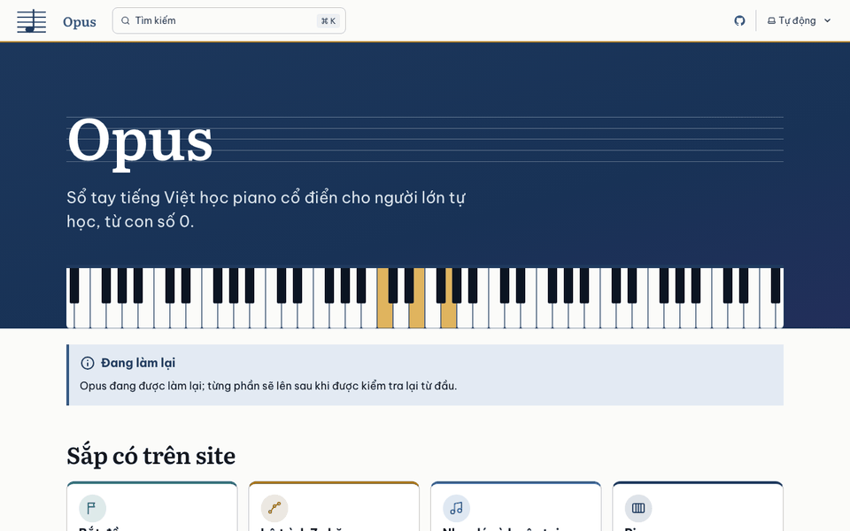
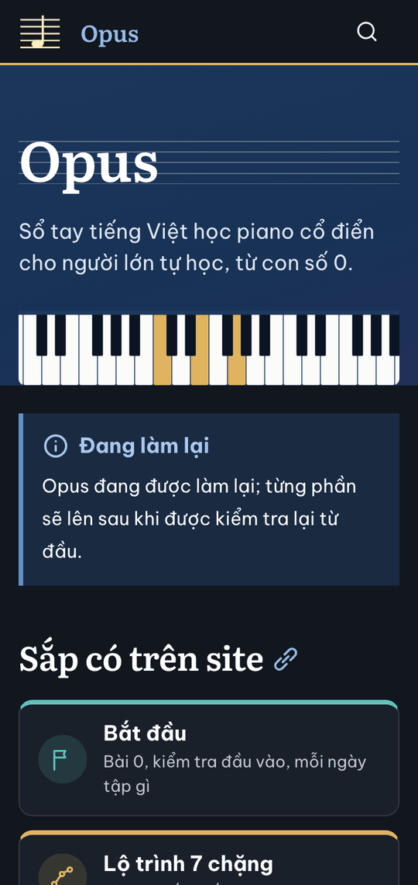
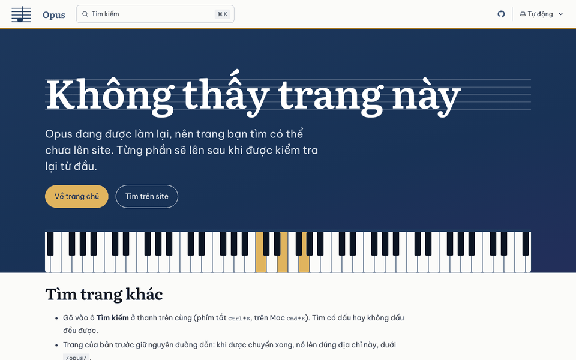
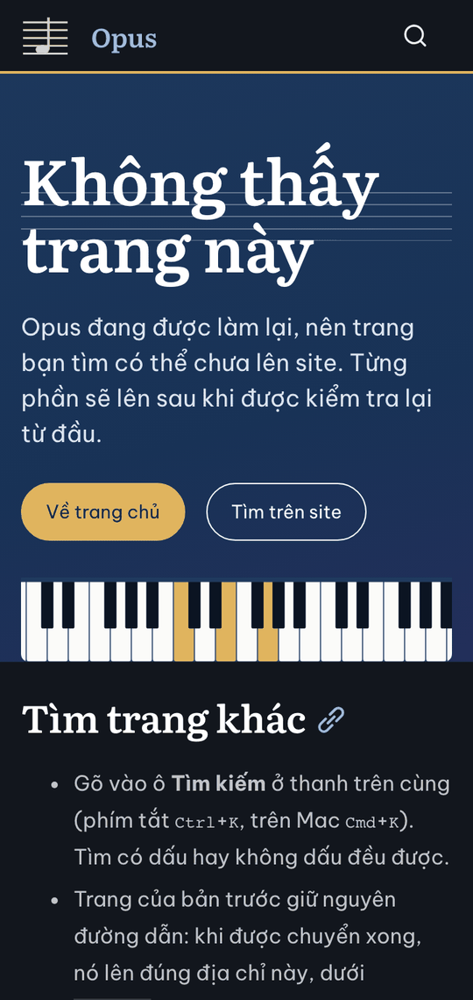
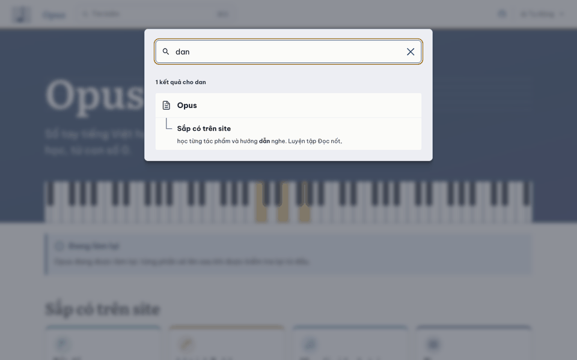
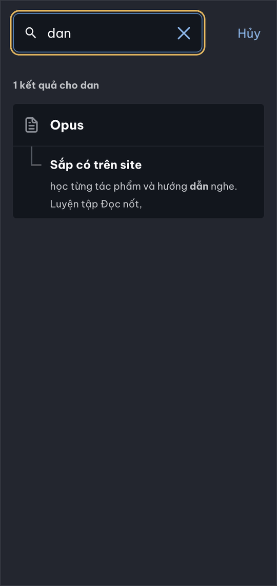
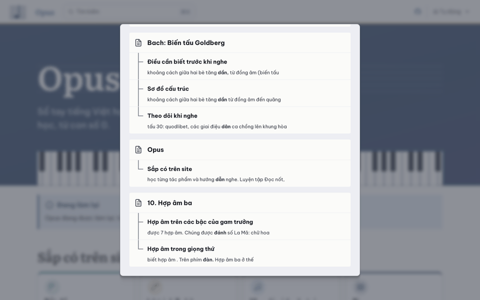

# Báo cáo đợt 1: Nền kỹ thuật (review cuối đợt)

Claude Code (Claude Sonnet 5.5), ngày 24/10/2026, nhánh `moi/d1-cuoi-dot`, xét `main` ở commit `18ce6cf` (D1.1 đến D1.8 đã gộp, cùng nhánh sửa nhỏ D1.3; `main` trên GitHub cũng ở `18ce6cf`). Người review không làm việc nào của đợt 1 và không review việc nào trước đây. Chưa push.

**Kết luận ngắn:** đợt 1 xong. Sáu điều kiện "Xong khi" đều đạt, ba lần đăng site đều thành công. Còn một chỗ phải sửa: hai link GitHub trên site thật trả 404 vì repo `mtuann/opus` đang riêng tư. Chủ repo chọn cách xử lý (mục "Chỗ phải sửa").

## Cách làm

- Node 24.22.1 (đúng `.nvmrc`), macOS 26.6.2. Playwright 1.64.1 (Chromium 156, WebKit 27.2, Firefox 157), Lighthouse 13.5.0, axe-core 4.13.0, Astro 7.4.2, Starlight 0.42.7, Pagefind 1.5.2.
- Mọi lệnh chạy trong một bản clone sạch của nhánh (`git clone`, rồi `npm ci`) ở thư mục tạm, như máy của GitHub. Cạnh nó có liên kết `opus-zero` (chỉ đọc) và `.cache/site-cu/` chép từ worktree, cho các kiểm thử cần site cũ. Lý do không chạy ngay trong worktree: giữ nguyên `dist/` và `node_modules/` mà chủ repo đang xem ở cổng 4322. Máy chủ riêng chỉ ở cổng 4395 (đã tắt); cổng 4322 vẫn chạy.
- Phép thử đổi file (sửa trang đã khóa, thêm link vào trang chủ, làm hỏng một trang chưa khóa, chèn CSS thử) làm trên bản clone, đã hoàn lại. Worktree chỉ có thêm báo cáo này, ảnh trong `d1/` và dòng đợt 1 của bảng Tiến độ.
- Thêm một phép thử ở quy mô cả site: chuyển 232 trang cũ vào bản clone (không commit), dựng, chạy lại kiểm thử, quét mọi trang, axe, Lighthouse ở 8 trang; xong xóa (mục "Thử cả site").
- `git -C ../opus-zero status --short` lúc đầu và lúc cuối giống nhau (`?? _to_delete/`, có từ trước); HEAD vẫn `5d08189`; `git diff --stat` trống; không có stash mới.

## Kết quả theo "Xong khi"

| # | Điều kiện (README, đợt 1) | Kết quả | Bằng chứng |
|---|---|---|---|
| 1 | Ba trang thử hiện đúng ở bản xem (ảnh chụp 360 px và 1280 px) | Đạt | `npm run build:xem` dựng 5 trang. 18 lượt đo (Chromium, WebKit, Firefox, mỗi trình duyệt 1280 px sáng và 360 px tối cảm ứng, 3 trang): không tràn ngang, không lỗi JavaScript, không tài nguyên hỏng. Vẽ đủ 7 khuông nhạc (2, 4, 1), có câu hỏi, khối nghe, nhãn nhóm đúng, dải "Chưa kiểm định". Ô "chưa chuyển" chỉ ở bài 10, chỗ bàn phím (kế hoạch cho phép). 90/90 kiểm thử trình duyệt. Ảnh: `d1-8/` (chụp lại ở `18ce6cf` cho ảnh giống, mục "Site thật"). Chưa tốt ở 360 px: bảng nhiều cột bị ép cột (mục "Việc còn mở") |
| 2 | Đạt chuẩn ở luật 7 | Đạt | Lighthouse điện thoại, 3 lần mỗi trang: hiệu năng 100; trợ năng, thực hành tốt, SEO đều 100. Đúng cho ba trang thử (bản xem), hai trang của bản thật và hai trang của site thật (bảng ở mục "Kiểm thử đã chạy"). axe không vi phạm ở cả hai bản, hai chế độ màu, 360 px và 1280 px |
| 3 | Không có trong bản thật | Đạt | `dist/` của bản thật chỉ có `index.html` và `404.html`; `sitemap-0.xml` chỉ có trang chủ; chỉ mục Pagefind có 1 trang; tìm tên ba trang (Elise, Goldberg, hợp âm ba, Beethoven, Bach) trong `dist/` không ra file nào. Site thật trả 404 cho ba địa chỉ. Thử trên bản chép: thêm vào trang chủ link tới ba trang thử và một địa chỉ không có, rồi tính lại mã băm khóa của trang chủ. Bản thật cho cả bốn thành chữ "sắp có"; bản xem chỉ có địa chỉ không có là "sắp có", ba link kia là link thường |
| 4 | Bộ dữ liệu hỏng làm build hỏng | Đạt | `OPUS_DU_LIEU=tests/du-lieu-hong npm run build` thoát 1, báo 29 lỗi bằng tiếng Việt (id trùng, thiếu năm mất, trường lạ, chặng ngoài khoảng, YAML hỏng, tầng sai, `cap` lệch…). `dist/` không đổi (mã băm cả cây trước và sau giống nhau). `tests/du-lieu.test.mjs` giữ điều này |
| 5 | Tìm "hop am ba" ra bài 10, tìm "dan" ra trang có chữ "đàn" | Đạt | Ô tìm kiếm của Starlight trên Chromium, WebKit, Firefox (`kiem-tim-kiem.mjs`, nằm trong 90/90) và chạy lại bằng tay trên Chromium: "hop am ba" ra 4 kết quả, bài 10 đứng đầu; "dan" ra 4 kết quả, ở bài 10 các chữ "đánh" và "đàn." được tô (`d1/xem-tim-dan-bai10-1280-sang.png`). Phép "dan ra trang chỉ có chữ đàn" tìm thấy 1 trang (bài 10). Trên site thật chỉ có trang chủ, nên "dan" ra trang chủ nhờ chữ "dẫn" (không có chữ "đàn" ở đó) |
| 6 | https://mtuann.github.io/opus/ hiện trang chủ tạm, địa chỉ không có ra trang 404 mới | Đạt | Trang chủ 200. Địa chỉ không có (`/opus/khong-co-trang-nay/`, `/opus/a/b/c/d/`, `/opus/piano/gam/`) trả 404 kèm trang "Không thấy trang này" mới. 60 trong 61 file của site thật giống từng byte bản dựng sạch của `18ce6cf`; file thứ 61 (`pagefind/wasm.unknown.pagefind`) chỉ khác phần đầu gzip do dựng trên máy khác. Ba lần chạy `deploy.yml` gần nhất đều success |

Các mục khác của "Review những gì" (đợt 1 và cuối đợt):

| Mục | Kết quả |
|---|---|
| Chạy lại build và kiểm thử | Đạt, bảng ở mục "Kiểm thử đã chạy" |
| Đọc schema, plugin, script chuyển | Đã đọc `src/du-lieu.mjs`, `src/khoa.mjs`, `src/ban-build.mjs`, `src/plugins/*`, `tools/chuyen/*`, `astro.config.mjs`, `content.config.ts`, hai workflow và action; đọc lướt `tools/khoa.mjs`. Không thấy lỗi mới. Schema chặt (trường lạ là lỗi), kiểm chéo đủ (chặng liền, Grade hợp chặng, chip khớp `grade`, năm sinh–mất, `cap` hai chiều, hình theo loại trang). Không đường nào ghi vào `../opus-zero/` (quét mọi lệnh ghi file trong `src/`, `tools/`, `astro.config.mjs`, `tools/du_lieu/tach.py`, `plans/lam-lai/anh_xa.py`); script chuyển chỉ đọc `../opus-zero/docs/` và ghi `src/content/docs/`, không ghi đè khi thiếu `--ghi-de`. Một điều nên biết: bản thật vẫn chạy plugin Markdown cho trang chưa khóa (mục "Việc còn mở") |
| So chữ ba trang thử với site cũ | `node tools/chuyen/so-chu.mjs nhac-ly/10-hop-am-ba piano/tac-pham/fur-elise nghe-nhac/bach-goldberg`: cả ba "chữ giống nhau" (chữ, mô tả, mã ABC, câu hỏi, id tiêu đề). So thêm ở mức nguồn Markdown (`git diff --no-index --word-diff`): chỉ khác cú pháp (frontmatter, `:::`, `<details>`, link `/opus/…/`, chỉ thị `::…`), không đổi chữ |
| Link "sắp có" | Đạt. Bản xem: bài 10 có 6 nhãn, Für Elise 15, Goldberg 10; `link.test.mjs` bắt link gõ sai (`data-href` phải là trang trong kế hoạch). Thử hai chiều trên bản chép (mục 3 ở trên) |
| Trang 404 | Đạt, cả ở bản dựng lẫn site thật: tiếng Việt, ẩn khỏi menu và sitemap, không vào chỉ mục tìm kiếm; "Tìm trên site" mở hộp tìm kiếm (focus vào ô nhập, Esc đóng); "Về trang chủ" về `/opus/`; nút cao 44 px trên cảm ứng; địa chỉ sâu vẫn nạp đủ CSS, font. Chạy trên Chromium, WebKit, Firefox, 1280 px và 360 px cảm ứng: không tràn ngang, không lỗi JavaScript, không tài nguyên hỏng |
| Số trang đã khóa so với kế hoạch | Khớp. `kiem-dinh/khoa.json` có 2 trang (`index` tạm, `404`) và 0 bản ghi: đúng điều D1.6 giao ("khóa trang chủ tạm và trang 404, hồ sơ không có nhận định"). `node tools/khoa.mjs tinh`: cả hai khớp. Không trang nào trong 233 trang chuyển của `anh-xa.md` đã khóa. Lưu ý: `index` trùng đường dẫn với trang `index` của D2-L1 (trang chủ cũ), nhưng nội dung là trang chủ tạm viết mới (hồ sơ ghi rõ); D2-L1 thay bằng trang thật theo thủ tục mở khóa, và `pham-vi.test` cho phép vì `index` thuộc lô đó |
| Site thật hiện đúng, không link chết | Hiện đúng; có hai link chết (mục "Chỗ phải sửa") |

## Kiểm thử đã chạy

Bản clone sạch, Node 24.22.1:

| Lệnh | Bản | Kết quả |
|---|---|---|
| `npm ci` | | 382 gói, 0 lỗ hổng, 2 giây; cảnh báo `fsevents` (script cài đặt, đã biết, không ảnh hưởng) |
| `npm run build` | thật | 2 trang (trang chủ, 404), thoát 0, 1,6 giây |
| `npm test` | thật | 81 kiểm thử: 80 đạt, 0 hỏng, 1 bỏ qua (phạm vi lô: chỉ chạy trên nhánh `moi/d<đợt>-l<lô>`) |
| `npm run build:xem` | xem | 5 trang |
| `npm test` | xem | 81 kiểm thử: 80 đạt, 0 hỏng, 1 bỏ qua (như trên) |
| `npm run test:trinh-duyet` | xem | 90/90 đạt, 150 giây |
| `npm run test:trinh-duyet` | thật | 48 kiểm thử: 34 đạt, 0 hỏng, 14 bỏ qua (phép thử thành phần cần trang có khuông nhạc hay câu hỏi, và phép "dan ra trang chỉ có đàn": bản thật chưa có trang nào như vậy) |
| `npm run lighthouse` | xem, ba trang thử | bảng dưới |
| `npm run lighthouse` | thật | bảng dưới |
| `OPUS_DU_LIEU=tests/du-lieu-hong npm run build` | | thoát 1, 29 lỗi, `dist/` không đổi |
| `so-chu.mjs`, ba trang thử | xem | 3/3 "chữ giống nhau" |
| `node tools/khoa.mjs tinh` | | `404`, `index` khớp |
| Sửa `404.md` (đã khóa), `npm run build` và `OPUS_BAN=xem astro build` | | cả hai thoát 1, báo "mã băm lệch" kèm lệnh `mo`; hoàn lại thì `tinh` khớp |
| Thêm `::khong-co-chi-thi` vào `fur-elise.md` (chưa khóa), `npm run build` | thật | thoát 1: plugin vẫn chạy ở trang chưa khóa (mục "Việc còn mở"); hoàn lại |
| `npm run dev` (bản xem, cổng 4395) | xem | trang chủ, ba trang thử 200, 404 trả 404; đã tắt |

Lighthouse 13.5.0, điện thoại, máy chủ HTTP/2 (`tools/may-chu.mjs`), 3 lần mỗi trang:

| Trang | Bản | Hiệu năng | Trợ năng | Thực hành tốt | SEO | FCP | LCP | TBT | CLS | Tổng tải |
|---|---|---|---|---|---|---|---|---|---|---|
| `nhac-ly/10-hop-am-ba/` | xem | 100 (100/100/100) | 100 | 100 | 100 | 1,2 s | 1,4 s | 0 ms | 0,001 | 289 KiB |
| `piano/tac-pham/fur-elise/` | xem | 100 (100/100/100) | 100 | 100 | 100 | 1,2 s | 1,5 s | 0 ms | 0,001 | 301 KiB |
| `nghe-nhac/bach-goldberg/` | xem | 100 (100/100/100) | 100 | 100 | 100 | 1,1 s | 1,4 s | 0 ms | 0,039 | 297 KiB |
| (trang chủ) | thật | 100 (100/100/100) | 100 | 100 | 100 | 1,1 s | 1,5 s | 0 ms | 0,000 | 115 KiB |
| `404.html` | thật | 100 (100/100/100) | 100 | 100 | 100 | 1,1 s | 1,5 s | 0 ms | 0,000 | 114 KiB |
| `/opus/` | site thật, mạng thật | 100 (100/100/100) | 100 | 100 | 100 | 1,1 s | 1,2 s | 0 ms | 0,000 | |
| `/opus/404.html` | site thật, mạng thật | 100 (100/100/100) | 100 | 100 | 100 | 1,1 s | 1,2 s | 0 ms | 0,000 | |

Luật 7 (hiệu năng từ 95; trợ năng, thực hành tốt, SEO đều 100) đạt ở mọi dòng.

Ghi chú: `dist/` trong worktree (cổng 4322) được dựng khi chưa có chỗ sửa của commit `74d6d9c` (D1.3, "không kéo về đích cũ khi bấm mục lục lúc khối đang tải"). Nó khác bản dựng sạch của `18ce6cf` ở đúng một file script (`_astro/TaiThanhPhan…js`) mà trang chủ và trang 404 không tải, nên hai trang giống hệt. Muốn xem đúng `18ce6cf` thì chạy lại `npm run build`.

### Thử cả site (bản chép, đã hoàn lại)

Trên `main` mới có ba trang thử. Để biết nền kỹ thuật chịu được cả site, tôi chuyển 232 trang cũ (danh sách lấy từ `anh-xa.md`, trừ `index`) vào `src/content/docs/` của bản clone bằng `tools/chuyen/chuyen.mjs`, dựng bản xem rồi chạy lại các phép thử. Xong xóa đúng các file đã chuyển; `git status` của bản clone sạch.

| Phép thử | Kết quả |
|---|---|
| Chuyển | 232/232 trang, thoát 0; 31 dòng cảnh báo ở 16 trang, như D1.4; ba trang thử chuyển lại giống hệt bản đã commit |
| `npm run build:xem` | 234 trang trong 2,6 giây; 123 ô "chưa chuyển" (30 chỗ cho 26 loại hình, 93 chỗ cho 42 loại công cụ), như D1.4 |
| `so-chu.mjs`, 229 trang có ở bản build cũ | 221 giống hệt. 7 khác đúng như bảng của D1.4 (`cap-nhat`, `piano/nha-soan-nhac`, `piano/tieng-dan`, `bach-prelude-do`, `chopin-ballade-1`, `chopin-nocturne-op9-2`, `debussy-clair-de-lune`). `blog/index` và 3 bài blog không so được |
| `npm test` | 81 kiểm thử: 78 đạt, 1 bỏ qua, 2 hỏng đúng như dự kiến (chữ của 7 trang trên; 9 link hỏng: 2 `NGUON.txt`, 7 `../../sach/*.html`). Đạt: khuông nhạc (mọi khối ` ```abc ` của 232 trang, abcjs không cảnh báo, ô nhịp đủ độ dài), link "sắp có" (đích đều là trang trong kế hoạch), tầng và nhóm của 233 trang |
| Tràn ngang, lỗi JavaScript, tài nguyên hỏng | 233 trang, ở Chromium (360, 768, 1280 px), WebKit (360 px), Firefox (360 px): 0 trang tràn ngang, 0 lỗi, 0 tài nguyên hỏng |
| axe (WCAG 2.2 AA và best-practice), 233 trang, Chromium, 360 px và 1280 px, sáng và tối | Bốn cấu hình cho cùng kết quả: 33 trang vi phạm. `label` (critical): 31 trang, 264 ô, là ô đánh dấu của danh sách việc `- [ ]`. `empty-table-header` (minor): 2 trang (`bat-dau/sach-in`, `piano/choi-cung-nguoi-khac`). `heading-order`: 1 trang (`bat-dau/tom-tat`). Không có lỗi tương phản ở trang nào |
| Lighthouse, 8 trang đại diện | Bảng dưới: 5 trang đạt luật 7; 3 trang chỉ hụt trợ năng (95, 95, 98) |
| `npm run test:trinh-duyet` | 165 phép thử: 141 đạt, 24 hỏng. Bộ 26 truy vấn tìm kiếm của site cũ: 26/26 trang đích có trong bản build và đạt. Hỏng: `bat-dau/kiem-tra-dau-vao` (ô đánh dấu 13×13 px dưới 44 px; axe `label`), `bat-dau/tom-tat` (axe `heading-order`), và 6 phép thử link `#mục` (3 trình duyệt × 2) báo `TypeError` vì giả định trang có tiêu đề `h2` (`kiem-thanh-phan.mjs` dòng 58 và 92) mà `tom-tat` chỉ có `h3`. Lỗi của phép thử, không phải của trang |

Lighthouse ở 8 trang đại diện của bản xem 234 trang (cùng cách đo, 3 lần):

| Trang | Hiệu năng | Trợ năng | Thực hành tốt | SEO | FCP | LCP | TBT | CLS | Tổng tải |
|---|---|---|---|---|---|---|---|---|---|
| `bat-dau/kiem-tra-dau-vao/` | 100 (99/100/100) | **95** | 100 | 100 | 1,4 s | 1,5 s | 0 ms | 0,001 | 142 KiB |
| `bat-dau/tom-tat/` | 99 (97/99/100) | **98** | 100 | 100 | 1,2 s | 1,5 s | 83 ms | 0,001 | 291 KiB |
| `piano/lo-trinh/` | 100 (100/100/100) | **95** | 100 | 100 | 1,2 s | 1,5 s | 2 ms | 0,000 | 151 KiB |
| `nghe-nhac/` | 100 (100/100/100) | 100 | 100 | 100 | 1,3 s | 1,5 s | 0 ms | 0,000 | 147 KiB |
| `lich-su/dong-thoi-gian/` | 100 (100/100/100) | 100 | 100 | 100 | 1,2 s | 1,5 s | 0 ms | 0,000 | 151 KiB |
| `hinh-thuc/sonata/` | 100 (99/100/100) | 100 | 100 | 100 | 1,2 s | 1,5 s | 0 ms | 0,001 | 153 KiB |
| `nhac-ly/01-cao-do-ten-not/` | 100 (100/100/100) | 100 | 100 | 100 | 1,3 s | 1,5 s | 59 ms | 0,003 | 296 KiB |
| `piano/tac-pham/beethoven-op49-2/` | 100 (100/100/99) | 100 | 100 | 100 | 1,4 s | 1,7 s | 0 ms | 0,004 | 312 KiB |

Hai chỗ vướng thấy ở quy mô này, cả hai chạm D2-L1 (5 trong 9 trang của lô):

- **Danh sách việc `- [ ]`** (31 trang, 264 ô). Site mới dựng ô trần `<input type="checkbox" disabled>`, không nhãn, 13×13 px. Site cũ bọc trong `<label class="task-list-control" aria-hidden="true">`, và `practice.js` lưu trạng thái. Kết quả: axe `label` (critical) và vùng bấm dưới 44 px, trợ năng của Lighthouse 95. D2-L1 có 4 trang như vậy (`piano/lo-trinh`, `bat-dau/lo-trinh-nghe`, `bat-dau/kiem-tra-dau-vao`, `bat-dau/lo-trinh-choi`, 110 ô). D1.4 ghi việc này cho "đợt 6, 7"; thực tế cần từ D2-L1.
- **Trang chỉ có tiêu đề `h3`** (`bat-dau/tom-tat`, site cũ cũng vậy): axe `heading-order`, trợ năng 98, và làm hỏng các phép thử `#mục` khi trang này là trang mẫu có khuông nhạc đầu tiên (xếp theo chữ cái, `tools/trang-mau.mjs`).

## Site thật

Ba lần chạy `deploy.yml` gần nhất (`gh run list`, `gh run view`, chỉ đọc):

| Lần chạy | Bắt đầu (UTC, 24/10) | Commit | Kết quả | Thời gian |
|---|---|---|---|---|
| `40054787705` | 02:35 | `ee52ec0` D1.7 sửa sau kiểm lại | success | 3 phút 45 giây |
| `40055615268` | 02:47 | `38d1bda` D1.8 sửa sau kiểm lại | success | 3 phút 48 giây |
| `40057806198` | 03:19 | `18ce6cf` D1.3 sửa nhỏ | success | 3 phút 17 giây |

- Lần cuối chạy trên Linux của GitHub cho cùng kết quả như trên máy: `npm test` 81 kiểm thử (79 đạt, 0 hỏng, 2 bỏ qua: so chữ với site cũ và phạm vi lô), kiểm thử trình duyệt 48 (34 đạt, 0 hỏng, 14 bỏ qua), Lighthouse 100 ở hai trang. Thời gian thực khoảng 3 đến 4 phút, ngắn hơn nhiều so với "6–10 phút" mà D1.7 ước.
- Pages: nguồn GitHub Actions, công khai, bắt buộc HTTPS. Chỉ có nhánh `main` trên GitHub. `test.yml` chưa chạy lần nào (nó chỉ chạy khi có nhánh `moi/**`, `mo/**`, `them/**` hay pull request).
- Site cũ `https://mtuann.github.io/opus-zero/` vẫn chạy (200), đúng kế hoạch (tắt sau đợt 6).
- Playwright mở site thật: 36 lượt (Chromium, WebKit, Firefox × 360, 768, 1280 px × sáng, tối × trang chủ, 404): không tràn ngang, không lỗi JavaScript, không tài nguyên hỏng, đúng font (Literata cho tiêu đề, Be Vietnam Pro cho chữ thường). Mọi yêu cầu mạng (đo trên Chromium, kể cả lúc tìm kiếm) chỉ tới `mtuann.github.io`, không có nguồn ngoài.
- Ô tìm kiếm trên site thật: gõ "dan" ra 1 kết quả (trang chủ, chữ "dẫn" được tô); "lam lai" ra trang chủ; "hop am ba" ra trang chủ vì có chữ "hợp âm" ở thẻ nhóm (chưa có bài 10 ở site thật). Giao diện tìm kiếm bằng tiếng Việt.
- Link: 9 địa chỉ khác nhau trên trang chủ và 404. Các neo `#_top`, `#tim-trang-khac`, `#sap-co-tren-site`, `#tung-phan-len-site-the-nao` đều có id; link tới `/opus/` và giấy phép CC đều 200. Hai link hỏng: xem "Chỗ phải sửa".

| Trang chủ, 1280 px, sáng | Trang chủ, 360 px, tối |
|---|---|
|  |  |

| Địa chỉ không có, 1280 px, sáng | Địa chỉ không có, 360 px, tối |
|---|---|
|  |  |

| Tìm "dan" ở site thật, 1280 px, sáng | Tìm "dan" ở site thật, 360 px, tối |
|---|---|
|  |  |

Ba trang thử ở bản xem: chụp lại ở `18ce6cf` (1280 px sáng, 360 px tối, Chromium) và so với ảnh của D1.8. Ba ảnh trùng từng byte sau khi nén (bài 10 ở hai cỡ, Goldberg ở 360 px); ba ảnh còn lại khác ở vài chỗ nhỏ (ví dụ thanh bên ở Für Elise, 1280 px, xuống dòng khác đi). Vì vậy không chép lại ảnh: dùng `d1-8/hop-am-ba-*.png`, `d1-8/fur-elise-*.png`, `d1-8/goldberg-*.png`. Chỉ thêm một ảnh mới: ảnh tìm kiếm của D1.8 chụp phần đầu danh sách (Für Elise, Goldberg), chưa thấy kết quả bài 10. Ảnh dưới cuộn tới bài 10, nơi "dan" khớp chữ "đánh" và "đàn.":



## Việc còn mở

Gom từ phần "việc cho bước sau", "nên sửa: ghi thành việc" và "chỗ còn phải sửa" của các báo cáo D1.1 đến D1.8, đã loại những việc về sau đã làm. Cột nguồn ghi báo cáo, "mới" là việc review này thấy.

| Việc | Lô nhận | Nguồn |
|---|---|---|
| `THEM` của `tests/pham-vi.test.mjs` chỉ có D2-L1 và D3-L5. Chưa ghi lô cho: kiểm thử "trang đã khóa chỉ hiện trường đã khóa" (D2-L1, có thể chạm `src/du-lieu.mjs`, `src/khoa.mjs`, `src/plugins/opus-markdown.mjs`), danh mục tác phẩm, sách in, nhật ký Cập nhật, service worker, workflow hằng tuần. Thành phần danh sách việc của D2-L1 (hàng dưới) cần plugin: `src/plugins/thanh-phan.mjs` và `astro.config.mjs` thuộc phạm vi D2-L1, các file plugin khác thì không | Chủ repo, trước D2-L1 | d1-6 |
| Năm sinh–mất viết tay trong trang (khoảng 240 chỗ): chưa có chỉ thị lấy từ `nha-soan-nhac.yml`, build chưa kiểm chéo, `AGENTS.md` lại ghi "lấy từ dữ liệu". Chọn chỉ thị trong dòng hay kiểm chéo lúc build | Chủ repo, trước D3 hay D5 | d1-2 |
| Danh sách việc `- [ ]` (31 trang, 264 ô; D2-L1 có 4 trang, 110 ô): ô đánh dấu không nhãn, 13×13 px; axe `label` (critical), Lighthouse trợ năng 95, vùng bấm dưới 44 px. Cần thành phần: nhãn, vùng bấm 44 px, lưu trạng thái như `practice.js` | D2-L1 (cần cho luật 7) | mới, d1-4 |
| Nút của `practice.js` ở hộp tác phẩm ("Tôi đang tập bài này", "Hôm nay đã tập", "Đã chơi được trọn bài", 34 bài học): chưa lô nào nhận, script chuyển chưa cảnh báo | Chủ repo gán lô (D6 hay D7-L1) | d1-3, d1-4 |
| `plans/ben-vung/them-tac-pham.md` mục 4 thiếu `src/data/trang.yml` và hồ sơ của bản ghi; phạm vi cho nhánh `them/` | Chủ repo, trước nhánh `them/` đầu | d1-2, d1-6 |
| Tên "Opus Zero" còn ở hai tài liệu Claude Docs (`giao-viec.md` dòng 9–10, `README.md` dòng 5, `plans/ben-vung/README.md` dòng 3) | Chủ repo (tùy) | d1-2b |
| Kiểm tay trên Safari và iPhone thật: menu Popover (iOS từ 17), bảng cuộn nhận focus (WebKit của Playwright không cuộn được bằng mũi tên), in, thoát giá nhạc | Chủ repo, trước khi mở D2-L1 | d1-1, d1-8 |
| Trang chủ tạm chưa dẫn sang bản cũ `/opus-zero/`: người vào site mới chưa đọc được bài | Chủ repo; D2-L1 | mới |
| Menu 9 nhóm: thanh bên ghi tên thư mục; link menu bên (32–36 px) và mục lục "Trên trang này" (34–35 px) dưới 44 px trên cảm ứng; Popover API; trang `splash` không có nút đổi sáng, tối ở điện thoại | D2-L1 | d1-1, d1-2b, d1-8 |
| Trang chủ thật: `{ .md-button }`, `oz-home-*`, `og:image` (chưa có), bài kiểm tra đầu vào (`placement`, `piano-level`) | D2-L1 | d1-1, d1-4 |
| 7 trang chặng ở `src/pages/`: thêm vào `trangTrongBan()` và `trangKeHoach` của `tests/link.test.mjs` | D2-L1 | d1-5 |
| Cách hiện tên tác phẩm trong danh sách (`ten` còn kèm số danh mục ở 35 trong 64 bản ghi có số danh mục) | D2-L1 | d1-2 |
| Bảng nhiều cột ở 360 px bị ép: Für Elise có bảng 4 cột cao 2947 px (1280 px: 875 px; site cũ 1677 px), cột 55–88 px. `min-width` 6, 7, 8 rem cho `th`, `td` chưa đủ | Trước D2-L1 (mọi lô có bảng) | d1-8 |
| Hai kiểm thử thiếu: trang tác phẩm phải có `tac_pham`; nhãn nhóm hiện trên trang | D2-L1 | d1-2, d1-2b |
| Trang chỉ có tiêu đề `h3` (`bat-dau/tom-tat`; site cũ cũng vậy): axe `heading-order`, trợ năng 98. Và 6 phép thử `#mục` của `tests/trinh-duyet/kiem-thanh-phan.mjs` (dòng 58, 92) giả định có `h2`, nên báo `TypeError` ở trang này. Sửa phép thử (lấy `h2` đến `h4`) và cấp tiêu đề của trang (ghi lý do vào hồ sơ) | D2-L1 | mới |
| Lệnh `nhap` đưa kết quả lượt 2 vào hồ sơ | D2-L1 | d1-6 |
| `test.yml` chưa chạy lần nào; chú thích "6–10 phút" ở `deploy.yml` dòng 26 và `test.yml` dòng 24 nên là khoảng 4 phút | Chủ repo khi push | d1-7 |
| Thành phần của hình và công cụ (`HINH`, `CONG_CU` rỗng; bản thử 232 trang có 123 ô "chưa chuyển": 30 chỗ cho 26 loại hình, 93 chỗ cho 42 loại công cụ). Bàn phím, `audio.js`, mẫu âm piano ở D3-L1; `lesson-status` ở D3-L5; `piano-level`, `placement` ở D2-L1; `print.js` ở đợt 3 | Lô đầu dùng | d1-3, d1-4 |
| `so-chu` bỏ chữ trong vùng hình (30 vùng có chữ thật) và chỉ so `data-quiz` | Lô làm thành phần hình | d1-4 |
| 10 lớp `oz-` chưa có CSS; `id-cu` khác Python-Markdown ở hai trường hợp; dạng chưa gặp: chú thích có link, hộp lồng nhau, `++phím++` trong mã. axe còn thấy `empty-table-header` ở `piano/choi-cung-nguoi-khac` (D4-L3) và `bat-dau/sach-in` (D7-L3) | Lô gặp thì xử lý | d1-4 |
| 5 sơ đồ mermaid hiện thành khối mã (`hinh-thuc/concerto`, `fugue`, `rondo`, `sonata`; `nhan-dien/the-loai`) | D5-L2, D5-L3 | d1-4 |
| `/opus/audio/NGUON.txt` (link ở `tai-lieu-tham-khao`, `cap-nhat`) làm `link.test` hỏng tới khi file có | D5-L3, D7-L3 | d1-4, d1-5 |
| Trường để trống của bản ghi (`nam`, `an_ban`, `doi_chieu`, `thuoc`, `ky_nang`; `giong`, `nhip` của hướng dẫn nghe); `thoi_ky` là chữ tự do (10 giá trị); *Ánh trăng* có hai nguồn ghi khác nhau | D6 | d1-2 |
| `::hoc-tiep` chưa dùng ở trang nào; đoạn "Chỉ muốn nghe?" đổi chỗ ở `bach-prelude-do`, `chopin-nocturne-op9-2`, `debussy-clair-de-lune`; hình `bolero` | D6-L3, D6-L5, D6-L11 | d1-3, d1-4, d1-8 |
| Danh mục `tac-pham`: nhãn nhóm ở `src/nhom.mjs`, đường dẫn vào `trangKeHoach` | D6-L11 | d1-2b, d1-5 |
| Bộ 26 truy vấn của site cũ: bản xem chỉ có trang đích của 3 truy vấn | Mỗi lô | d1-8 |
| Dùng khi mất mạng: service worker, manifest, icon PWA, tự lưu mẫu âm của abcjs (đang tải từ `paulrosen.github.io`), kiểm thử ngoại tuyến | D7 | d1-1, d1-3, d1-7 |
| Sách in (7 link `../../sach/*.html` ở `bat-dau/sach-in`); blog (3 bài chưa có mô tả, địa chỉ cũ theo ngày đăng) | D7-L3 | d1-4, d1-5 |
| Workflow kiểm link ra ngoài hằng tuần (`link-check.yml`, lychee) | D8 hay D9 | d1-7 |
| Bản thật vẫn chạy plugin Markdown cho trang chưa khóa (`locTheoBan` lọc sau khi nạp): lỗi cú pháp ở trang chưa khóa làm hỏng `deploy.yml`; log bản thật in cảnh báo `[opus]` của trang không đăng. Hiện chỉ ba trang thử chưa khóa nằm trên `main`, nên chấp nhận được | D2-L1 chọn | mới |
| Giới hạn đã biết: kéo thanh cuộn lúc khuông đang tải vẫn bị kéo về đích cũ; `::khoi-nghe{moc}` không bắt được khi trang hết mà chưa gặp bảng; link "sắp có" chỉ nhận `<a href="…">` nháy kép; không đặt link trong tiêu đề; CLS 0,039 (Goldberg) và 0,064–0,086 (Für Elise, 1280 px) | Khi gặp | d1-3, d1-5, d1-8 |
| `astro check` chưa thêm (`@astrojs/check` chưa nhận TypeScript 7); `dev`, `build:xem` không chạy trong `cmd.exe`; Pagefind UI không tự dùng bản dịch tiếng Việt; lỗi frontmatter do Astro báo bằng tiếng Anh | Khi cần | d1-1, d1-2, d1-6 |

## Chỗ phải sửa

**1. Hai link trên site thật trả 404 với người chưa đăng nhập GitHub.**

- File, dòng: `astro.config.mjs` dòng 59 (biểu tượng GitHub ở thanh trên, `https://github.com/mtuann/opus`) và `src/components/Footer.astro` dòng 10 (chữ "MIT", `https://github.com/mtuann/opus/blob/main/LICENSE`). Cả hai ở mọi trang, kể cả 404.
- Lý do: repo `mtuann/opus` đang riêng tư (`gh repo view mtuann/opus --json visibility` ra `PRIVATE`), trong khi Pages công khai (`gh api repos/mtuann/opus/pages`: `public: true`). Repo cũ `mtuann/opus-zero` công khai.
- Thử lại: `curl -s -o /dev/null -w "%{http_code}\n" https://github.com/mtuann/opus` ra 404 (và `…/blob/main/LICENSE` cũng 404). Duyệt link trên trang chủ và trang 404 thật: chỉ hai link này hỏng.
- Chọn một cách: (a) chuyển repo sang công khai, hai link tự sống; cần xem trước vì `plans/` và báo cáo cũng thành công khai; (b) bỏ hai link tạm thời: bỏ `social` ở `astro.config.mjs` và dòng "Mã nguồn: MIT" ở `Footer.astro` (hai file này không nằm trong mã băm của trang nên không phải mở khóa). Sau khi sửa: `grep -c "github.com/mtuann/opus" dist/index.html` ra 0, hay `curl` ra 200.
- Không chặn các điều kiện "Xong khi" của đợt, nhưng site đã công khai nên nên xử lý trước khi D2-L1 lên.

## Nên sửa

Mục 1 và 2 là điều thử cả site (mục "Kiểm thử đã chạy") cho thấy sẽ làm hỏng CI của D2-L1 ngay lần push đầu; nên làm trước khi giao lô.

1. **Danh sách việc `- [ ]` không có nhãn** (`src/plugins/thanh-phan.mjs` và `astro.config.mjs`, đều trong phạm vi D2-L1; CSS ở `src/styles/thanh-phan.css`). Thử lại: chuyển `bat-dau/kiem-tra-dau-vao` (`node tools/chuyen/chuyen.mjs bat-dau/kiem-tra-dau-vao`), `npm run build:xem`, `LH_TRANG="bat-dau/kiem-tra-dau-vao/" npm run lighthouse`: trợ năng 95; axe báo `label` ở 18 ô; kiểm thử vùng bấm báo ô 13×13 px. Xong thì xóa trang chuyển.
2. **Phép thử `#mục` giả định trang có `h2`** (`tests/trinh-duyet/kiem-thanh-phan.mjs` dòng 58 và 92) và trang `bat-dau/tom-tat` chỉ có `h3` (axe `heading-order`, trợ năng 98). Thử lại: chuyển `bat-dau/tom-tat`, `npm run build:xem`, `npm run test:trinh-duyet`: sáu phép thử `#mục` báo `TypeError`.
3. **Bảng ở 360 px** (`src/styles/opus.css`, luật cho bảng hẹp). Thử lại: `npm run build:xem`, mở `/opus/piano/tac-pham/fur-elise/` ở 360 px có cảm ứng, đo chiều cao các bảng (2947, 2578, 1083, 819 px). Mọi lô sau đều có bảng, nên làm trước D2-L1. Một luật `min-width` chung chưa đủ (đã thử).
4. **Hai kiểm thử** trong `tests/` (trang tác phẩm phải khai `tac_pham`; nhãn nhóm hiện trên trang). Hiện chỉ trang dùng chỉ thị cần bản ghi (`::hop-tac-pham`, `::hinh-cau-truc`, `::hoc-tiep`, `::khoi-nghe{moc}`) bị bắt khi thiếu `tac_pham`. Trang hướng dẫn nghe chỉ có `::khoi-nghe` trần (14 hướng dẫn nghe cũ không có hình cấu trúc) thì vẫn build, khối nghe hiện không có bản thu gợi ý, không ai báo. Thử lại: trên bản chép của `nghe-nhac/bach-goldberg.md`, bỏ dòng `tac_pham`, dòng `::hinh-cau-truc` và phần `{moc="…"}` của `::khoi-nghe`, rồi `npm run build:xem`: thoát 0, trang không còn `data-rec`.
5. **Đẩy nhánh `moi/d1-cuoi-dot` lên GitHub một lần** (không cần gộp): nhánh khớp `moi/**` nên `test.yml` chạy lần đầu trên bản xem với ba trang thử ở Linux. Đây là phần CI duy nhất chưa được thử trên máy GitHub. Nhánh này chỉ đổi `plans/`, nên khi gộp vào `main`, `deploy.yml` không chạy (`paths-ignore`).
6. **Chú thích "6–10 phút"** ở `.github/workflows/deploy.yml` dòng 26 và `test.yml` dòng 24: thực tế khoảng 3 đến 4 phút.
7. **Trang chủ tạm thêm link sang bản cũ** (sửa `src/content/docs/index.md`: `mo`, sửa, khóa lại; hồ sơ `kiem-dinh/index.yml` ghi lý do).
8. **Bản thật bỏ qua plugin ở trang chưa khóa** (`src/ban-build.mjs`, `locTheoBan`, dòng 45–58): xem mục "Việc còn mở". Thử lại: thêm `::khong-co-chi-thi` vào `src/content/docs/piano/tac-pham/fur-elise.md`, `npm run build` thoát 1 (hiện); hoàn lại file.

## Ba quyết định đang chờ chủ repo trước đợt 2

Chữ lấy đúng từ mục "Quyết định" của `plans/lam-lai/README.md` (dòng 36–38). Chỉ liệt kê, không quyết.

- [ ] Mức kiểm định: hai lượt agent, review, bạn kiểm khoảng 10 nhận định mỗi lô (khuyên dùng); hay một lượt agent và review.
- [ ] Nguồn chính cho nhạc lý: giáo trình bạn có (ghi tên và lần in), hay giáo trình mở Open Music Theory (https://viva.pressbooks.pub/openmusictheory/).
- [ ] Bảng tầng: duyệt `../ben-vung/kiem-ke.md`, nhất là các trang tham chiếu có hạn và ngày rà lại.

Điều cần biết khi quyết (không phải quyết định): công cụ khóa hiện theo mức "hai lượt agent, review, chủ repo kiểm mẫu", nên đòi `luot_2` ở mọi nhận định và đủ bốn người trong `nguoi`; chọn mức thấp hơn thì sửa `loiHoSo` trong `tools/khoa.mjs` và kiểm thử theo (d1-6). `src/data/trang.yml` chép bảng tầng chưa duyệt; ba trang `nghe-nhac/doc-ten-tac-pham`, `mau`, `nghe-gi-tiep` đang ở tầng tác phẩm nhưng không viết về một tác phẩm nào, nên có thể chuyển sang tầng khung khi duyệt (d1-2).

## Kết luận

**Đợt 1 xong.**

- Cả sáu điều kiện "Xong khi" đạt: ba trang thử đúng ở bản xem trên ba trình duyệt và ba cỡ màn hình, luật 7 đạt (Lighthouse 100 ở bản xem, bản thật và site thật), bản thật không có trang chưa khóa, dữ liệu hỏng làm build hỏng, tìm kiếm "hop am ba" và "dan" đúng, site thật hiện trang chủ tạm và trang 404 mới.
- Cổng kỹ thuật chạy được thật: `deploy.yml` đã đăng ba lần liền, mỗi lần chạy đủ `npm test`, kiểm thử trình duyệt và Lighthouse trên Linux. Site thật giống bản dựng sạch của `18ce6cf` (60 trong 61 file giống từng byte, file còn lại chỉ khác phần đầu gzip).
- Số trang đã khóa khớp kế hoạch: 2 trang (trang chủ tạm, trang 404), 0 bản ghi; chưa trang nào của `anh-xa.md`.
- Thử cả 232 trang trên bản chép: nền chịu được. Dựng 234 trang trong 2,6 giây; 233 trang không tràn ngang ở 5 cấu hình trình duyệt và cỡ màn hình, không lỗi JavaScript, không lỗi tương phản; 221 trên 229 trang chữ giống hệt site cũ (7 trang còn lại đã biết lý do); tìm kiếm 26/26 truy vấn. Hai chỗ vướng đã đo: danh sách việc không nhãn và trang chỉ có tiêu đề `h3`. Cả hai chạm 5 trong 9 trang của D2-L1 và sẽ làm hỏng CI của lô đó nếu không xử lý trước.
- Còn một chỗ phải sửa (hai link GitHub chết, chủ repo chọn cách) và các việc ở bảng "Việc còn mở"; không việc nào chặn việc đóng đợt.
- Trước khi giao D2-L1: chủ repo chốt ba quyết định ở trên và xử lý hai link GitHub. Nên làm sớm: thành phần danh sách việc, sửa phép thử `#mục`, luật CSS cho bảng hẹp, và đẩy một nhánh `moi/**` để `test.yml` chạy lần đầu.

## Cập nhật sau review cuối đợt

Ngày 24/10/2026, sau khi báo cáo này viết xong, chủ repo đã chốt ba quyết định ở trên: mức kiểm định theo tầng, nguồn chính cho nhạc lý là Open Music Theory, và bảng tầng đã duyệt (5 trang đổi tầng). Chủ repo cũng chốt thêm: thuật ngữ khóa dần theo lô; push nhánh lô để `test.yml` chạy trước khi gộp; bỏ tạm hai link GitHub chết. Chi tiết ở mục Quyết định của `plans/lam-lai/README.md`; báo cáo bảng tầng: `d2-bang-tang.md`.

Hai link GitHub chết (mục "Chỗ phải sửa" 1) đã bỏ cùng ngày, ở nhánh `moi/bo-link-github`, theo cách (b):

- `astro.config.mjs`: bỏ `social` (biểu tượng GitHub ở thanh trên), để lại chú thích cách thêm lại.
- `src/components/Footer.astro`: chữ "MIT" còn, nhưng không còn là link. Người đọc vẫn biết giấy phép của mã nguồn.
- `tests/khung.test.mjs`: thêm kiểm thử "không link tới repo trên GitHub". Kiểm thử này hỏng nếu trang nào trong bản build có link tới `https://github.com/mtuann/opus`.
- Khi repo công khai: thêm lại hai link và bỏ kiểm thử này.
