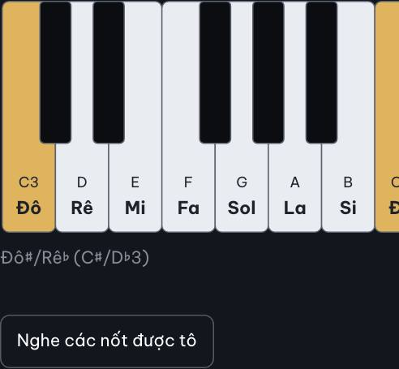
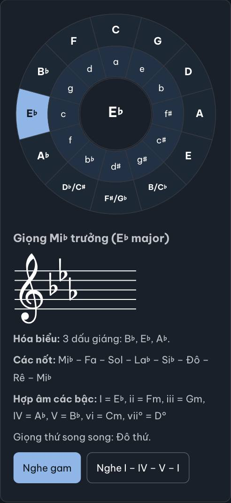
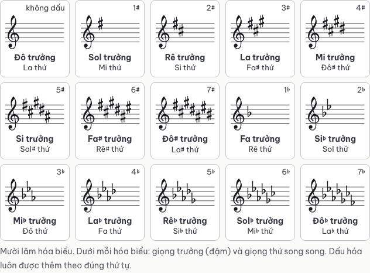
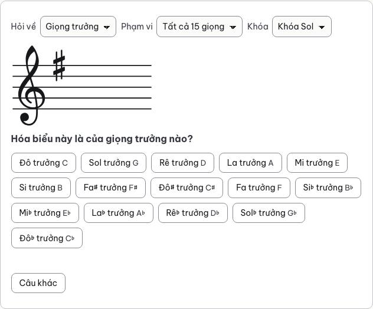

# Báo cáo lô D3-L1: tám bài nhạc lý đầu và các thành phần dùng chung

Claude Code (Claude Opus 5.5), ngày 24/10/2026, nhánh `moi/d3-l1` từ `main` (`a21c285`). Đây là lô thử của đợt 3 (kế hoạch, mục Đợt 3): làm trước các thành phần dùng chung và thử cách làm mới, để D3-L2 đến D3-L6 làm theo. Lượt 1 của tám trang do hai agent con (Claude Sonnet 5.5) làm song song, mỗi agent bốn trang. Agent làm lô viết thành phần, lập hồ sơ thuật ngữ, ghi `doi_chu`, soát lại các chỗ sửa và viết báo cáo này.

**Trạng thái:** xong. Đã qua lượt 1, lượt 2 (cả lượt bổ sung sau review), review mã (ba vòng), review nội dung, kiểm mẫu của chủ repo (5/5 đúng). Đã khóa 8 trang và 24 bản ghi thuật ngữ (khóa từng phần). Chi tiết ở mục cuối.

## Việc đã làm

| Việc | File | Kiểm thử |
|---|---|---|
| Chuyển 8 trang bằng `tools/chuyen/` (commit `386e2df`: so chữ giống bản cũ cả 8 trang) | `src/content/docs/nhac-ly/01-…` đến `08-…` | `tests/chuyen.test.mjs` |
| Lõi nhạc lý (`theory.js` cũ): tên nốt hai hệ, số MIDI, gam, hợp âm ba, 15 giọng, hóa biểu, tên phím. Module thuần, dùng chung lúc build và trên trình duyệt | `src/scripts/nhac-ly.js` | `tests/ban-phim.test.mjs` |
| Hình SVG dùng chung lúc build và trên trình duyệt: bàn phím, hóa biểu trên khuông, vòng quãng năm. Khóa Sol, khóa Fa, dấu thăng, dấu giáng lấy đường viền từ abcjs 6.7.1 (MIT), vẽ một lần cho cả trang (`<use>`) | `src/scripts/ve.js`, `src/components/MarkdownContent.astro` | `tests/ban-phim.test.mjs`, `tests/hoa-bieu.test.mjs` |
| Âm thanh dùng chung (`audio.js` cũ): mẫu âm piano, âm tổng hợp khi chưa tải xong hay khi người dùng chọn, tiếng gõ nhịp cho máy đếm nhịp sau này; lựa chọn lưu cùng khóa với site cũ (`opus-zero:sound`) | `src/scripts/am-thanh.js` | như trên; trình duyệt |
| Mẫu âm Salamander Grand Piano (CC BY 3.0): 30 file mp3 và nguyên `LICENSE.txt` của thư mục cũ, giống hệt từng byte (2,0 MB). Trang có công cụ phát tiếng piano ghi nguồn một dòng ở cuối bài, cạnh mục Nguồn | `public/mau-am/piano/`, `MarkdownContent.astro` | `tests/ban-phim.test.mjs` |
| Bàn phím `::cong-cu{ten="piano" range="C3-C5" notes="C3 C4 C5" play="chord"}` (`piano.js` cũ) | `banPhim` trong `src/plugins/thanh-phan.mjs`, `src/scripts/ban-phim.js` | `tests/ban-phim.test.mjs`, `tests/trinh-duyet/kiem-ban-phim.mjs` |
| Hình 15 hóa biểu `::hinh{ten="keysigs"}` | `hinhHoaBieu` | `tests/hoa-bieu.test.mjs` |
| Vòng quãng năm tĩnh `::hinh{ten="circle"}` | `hinhVongQuangNam`, `veVongQuangNam` | như trên |
| Vòng quãng năm bấm được `::cong-cu{ten="circle"}` (`circle.js` cũ) | `congCuVongQuangNam`, `src/scripts/vong-quang-nam.js` | như trên; trình duyệt |
| Luyện đọc hóa biểu `::cong-cu{ten="keysig-quiz"}` (`circle.js` cũ); lưu kỹ năng như `progress.js` cũ | `congCuLuyenHoaBieu`, `src/scripts/luyen-hoa-bieu.js`, `kyNang` trong `src/scripts/tien-do.js` | như trên |
| Bộ tải thành phần nạp ba script mới; trang có bàn phím, vòng quãng năm, luyện hóa biểu tải bộ tải | `src/scripts/tai.js`, `canTaiScript` | `tests/ban-phim.test.mjs` |
| CSS: bàn phím, hóa biểu, 15 hóa biểu, vòng quãng năm, luyện hóa biểu; sáng, tối, in | `src/styles/thanh-phan.css` | trình duyệt, axe |
| Kiểm thử trình duyệt chờ cả ba thành phần mới gắn xong; kiểm thử hiển thị miễn phím đen khỏi luật 44 px (mục "Cần chủ repo quyết") | `tests/trinh-duyet/chung.mjs`, `kiem-thanh-phan.mjs`, `kiem-hien-thi.mjs` | |
| Phép thử ô "chưa chuyển" đổi sang tên hình, công cụ chưa lô nào làm (`functions`, `metronome`) | `tests/thanh-phan.test.mjs` | |
| Lượt 1 của 8 trang: hồ sơ, sửa chữ có nguồn, `doi_chu` | `kiem-dinh/nhac-ly/0[1-8]-*.yml`, 8 trang | `tests/chuyen.test.mjs`, `node tools/khoa.mjs xuat` |
| Lượt 1 của 24 bản ghi thuật ngữ mà 8 trang dùng | `kiem-dinh/du-lieu/thuat-ngu/*.yml` | `loiHoSo` (trừ phần chưa tới) |

Trang thử `nhac-ly/10-hop-am-ba` (D1.8) hết ô "chưa chuyển": bàn phím thật (hợp âm Đô trưởng, nút "Nghe hợp âm"). Bản xem không còn cảnh báo `[opus]` nào.

## Thành phần mới

**Bàn phím.** Hình dựng sẵn lúc build, nên hiện ngay, in được, không xô bố cục; `ban-phim.js` chỉ thêm phần bấm khi trang chạy JavaScript (tắt JavaScript thì hiện lời nhắc).
- Phím trắng ghi tên hai hệ (Đô, C); phím Đô ghi cả số quãng tám (C3, C4, C5), để câu "ba nốt Đô (C3, C4, C5)" của bài 1 khớp với hình.
- Bấm phím: phát tiếng, phím nháy, dòng dưới đọc tên như bàn phím cũ ("Đô♯/Rê♭ (C♯/D♭4)"). Bàn phím máy tính: một điểm dừng Tab, mũi tên chọn phím, Enter hay Space để nghe.
- Cảm ứng: phím phát khi chạm (sự kiện click), không phát khi vừa đặt ngón, nên vuốt để cuộn trang hay cuộn bàn phím không làm phím kêu. Chuột và bút phát ngay khi nhấn. Kiểm thử đếm: một lần bấm, đúng một nốt.
- Phím trắng rộng 44–52 px trên cảm ứng, 30–48 px với chuột. Bàn phím rộng hơn khung (bài 1 ở 360 px: 15 phím trắng) thì cuộn ngang trong khung, trang không tràn; khung tự cuộn tới các phím được tô, dòng nhắc thêm "Kéo ngang để xem thêm phím".
- Nút "Nghe các nốt được tô" (hay "Nghe hợp âm" với `play="chord"`) chờ tải mẫu âm tối đa 2 giây, nên lần đầu đã có tiếng piano.
- Thông số đọc lúc build: `range`, `notes`, `play`. Nốt sai, nốt ngoài khoảng, thông số lạ thì build hỏng.

**Âm thanh.** Khác bản cũ: chỉ tải các mẫu cần cho những nốt sắp phát (bài 1: 9 mẫu, khoảng 640 KB), không tải cả 30 mẫu (2 MB) ở lần bấm đầu. Chưa làm ô chọn âm thanh (`.oz-sound-setting` cũ, ở trang Luyện tập): lô có trang ấy làm, `am-thanh.js` đã có `cheDo`, `datCheDo`. Chưa nối đàn MIDI (`midi.js` cũ): ở bài nhạc lý, bàn phím cũ không tự kết nối MIDI; trang Kết nối MIDI (đợt 7) làm.

**Hóa biểu, 15 hóa biểu, vòng quãng năm.** Vẽ bằng SVG của site, không cần abcjs: trang 8 còn 82 KB HTML (nguồn Markdown cũ 151 KB vì 15 hình abcjs chép thẳng vào trang). Vị trí các dấu theo thứ tự quen dùng ở khóa Sol và khóa Fa (kiểm thử đối chiếu tên nốt của từng vị trí). Chữ trong hình là chữ thật; ô hóa biểu đọc số dấu bằng chữ cho máy đọc màn hình ("3 dấu thăng"). Ô đồng âm của vòng tĩnh ghi "d♯/e♭", cùng thứ tự với "F♯/G♭" (hình cũ ghi "e♭/d♯"; lô D2-L1 đã sửa như vậy ở tờ tóm tắt).

**Vòng quãng năm bấm được.** 24 ô hình quạt (ở 360 px ô nhỏ nhất vẫn từ 44 px), là một nhóm lựa chọn: mũi tên trái, phải đi quanh vòng, lên, xuống đổi vòng ngoài, vòng trong. Thông tin của giọng như bản cũ: hóa biểu (hình và chữ), các nốt, hợp âm các bậc (giọng trưởng), giọng song song, giọng đồng âm cùng vị trí, nghe gam, nghe I – IV – V – I. Đô trưởng dựng sẵn lúc build.

**Luyện hóa biểu.** Như bản cũ: hỏi giọng trưởng, giọng thứ hay cả hai; đến 4 dấu hóa hay cả 15 giọng; khóa Sol hay khóa Fa; lưu kỹ năng `keysig` và số hóa biểu đọc đúng trong ngày như site cũ. Câu hỏi mặc định dựng sẵn lúc build, nên khi script chạy, ô không đổi chiều cao. Mẹo khi trả lời sai đã sửa theo lượt 1 (bài 8, n45, n46): mẹo cũ chỉ đúng cho giọng trưởng mà hiện cả khi hỏi giọng thứ; nay nói rõ giọng trưởng, hỏi giọng thứ thì nhắc thêm bước sang giọng thứ song song. Ô chọn tự vẽ (`appearance: none`): ô chọn gốc của WebKit trên điện thoại giữ cao khoảng 23 px, không theo `min-height`.

## Kiểm định lượt 1

Số trong bảng tính cả các chỗ sửa theo review (mục "Sửa theo review lần 2").

| Trang | Nhận định | dung | da-sua | da-bo | khong-can-nguon | ve-site | Khuông | Nguồn | `doi_chu` |
|---|---|---|---|---|---|---|---|---|---|
| `nhac-ly/01-cao-do-ten-not` | 43 | 35 | 3 | 0 | 5 | 6 | 1 | 16 | 4 |
| `nhac-ly/02-khuong-nhac-khoa` | 39 | 34 | 1 | 0 | 4 | 4 | 5 | 12 | 2 |
| `nhac-ly/03-truong-do` | 33 | 28 | 0 | 0 | 5 | 5 | 4 | 8 | 1 |
| `nhac-ly/04-nhip` | 45 | 36 | 4 | 0 | 5 | 4 | 3 | 23 | 5 |
| `nhac-ly/05-dau-hoa` | 34 | 29 | 4 | 0 | 1 | 5 | 2 | 12 | 5 |
| `nhac-ly/06-gam-truong` | 33 | 26 | 3 | 1 | 3 | 4 | 2 | 12 | 4 |
| `nhac-ly/07-gam-thu` | 40 | 31 | 6 | 0 | 3 | 4 | 3 | 15 | 5 |
| `nhac-ly/08-hoa-bieu` | 57 | 48 | 6 | 1 | 2 | 6 | 0 | 12 | 5 |
| **Cộng** | **324** | 267 | 27 | 2 | 28 | **38** | 20 | 110 | 31 |

(Cột `dung` tính cả 37 câu `ve-site` có kết quả `dung`; câu thứ 38, bài 8 n41, là `da-sua`.)

- **Theo loại:** định nghĩa 168, quy tắc 62, lời khuyên tập 30, câu về chính site (`ve-site`) 38, số liệu 10, cấu trúc 8, tên 4, lịch sử 3, số danh mục 1.
- **Câu `ve-site`** (38): link sang bài khác và điều trang ấy có, hộp "Luyện tập kèm theo", câu nói về bàn phím hay công cụ ngay trên trang. Mỗi câu có `ghi_chu` ghi đã kiểm ở đâu. Trang đích chưa chuyển thì kiểm trên trang cũ và JavaScript cũ, ghi rõ "trang đích chưa chuyển". Các trang đích ấy thuộc D3-L6 (`luyen-tai/nghe-quang`, `nghe-gam`), D4-L1 (`piano/ban-do-ban-phim`), D4-L2 (`piano/gam`, `nam-ngon`, `thi-tau`), D7-L1, D7-L2 (`luyen-tap/ban-phim`, `doc-not`, `hoa-bieu`, `metronome`, `tiet-tau`, `phieu-bai-tap`, `xay-hop-am`, `thi-tau`): lô ấy giữ những điều các câu này nói (tên bộ, ô chọn, cấp độ), hay sửa câu ở bài này.
- **Lời khuyên tập** (30) đều đã so với trang lõi cũ cùng chủ đề. Không câu nào dính tới sức khỏe.
- **Khuông nhạc** (20 khối): 19 ví dụ soạn cho trang, kiểm cao độ, trường độ, giọng, đủ phách; 1 trích đoạn tác phẩm thật (*Ode to Joy*, bài 4), đối chiếu từng nốt với ba bản phổ công cộng (Breitkopf khoảng 1864, Schott 1826, bản in lại E.E. 3611). `node tools/khuong-nhac.mjs`: 37 khối, 0 lỗi.
- **Nội dung thành phần** hiện trên trang (bàn phím, 15 hóa biểu, vòng quãng năm, mẹo của luyện hóa biểu) có nhận định trong hồ sơ trang. Thành phần không nằm trong khóa của trang, nên `tests/hoa-bieu.test.mjs` và `tests/ban-phim.test.mjs` giữ đúng chính những điều ấy (vị trí từng dấu, 15 giọng, nhãn vòng quãng năm, hợp âm các bậc của 15 giọng trưởng, câu mẹo).

### Chỗ đổi chữ

Mỗi chỗ có nguồn trong nhận định và một mục `doi_chu` trong hồ sơ (`tests/chuyen.test.mjs` bắt chỗ đổi chưa ghi).

- **Bài 1:** "Mỗi âm thanh có một cao độ" thành "Mỗi **nốt nhạc** có một cao độ" (tiếng gõ, tiếng ồn không có cao độ xác định; mô tả trang sửa theo); La 440 Hz là cao độ lên dây "thường" dùng (ISO 16:1975 là chuẩn, nhưng không dàn nhạc nào cũng đúng 440 Hz); bỏ "trên phần mềm" và "phần lớn tài liệu tốt bằng tiếng Anh" (không kiểm được).
- **Bài 2:** "giúp đọc nhanh hơn hẳn" thành cách làm cụ thể: đếm từ nốt mốc gần nhất. Lượt 1 đề nghị thu hẹp "giọng nữ" thành "giọng nữ cao (soprano)"; agent làm lô giữ chữ cũ, vì OMT (*Chords in SATB Style*) viết cả soprano lẫn alto ở khóa Sol.
- **Bài 4:** thêm dòng "Riêng 6/8…" (quy tắc "số trên là số phách" chỉ đúng với nhịp đơn, trái với dòng 6/8 của bảng; như D2-L1 sửa ở tờ tóm tắt); *Ode to Joy* ghi rõ "8 ô nhịp đầu, chuyển sang Đô trưởng, viết ở nhịp 4/4 (bản gốc ở Rê trưởng)"; bài tập nghe: "khi bè cello và contrabass trình bày nó đầy đủ lần đầu" (trước ô 92 kèn gỗ đã gợi hai ô).
- **Bài 5:** dấu hóa nhắc đặt ở nốt Fa đầu ô nhịp sau, câu và ví dụ ABC sửa cùng nhau (ví dụ cũ đặt dấu bình ở Fa thứ hai, sau một Fa không dấu, dễ nhầm).
- **Bài 6:** "Ba bậc quan trọng nhất" thành "Ba bậc cần nhớ trước".
- **Bài 7:** câu mở đầu theo OMT ("thường được dùng để diễn tả nỗi buồn"), thêm giọng của ba tác phẩm (Sol thứ, Đô thứ, Rê thứ BWV 565); bỏ "chính bậc 3 tạo nên màu tối" (cả bậc 3, 6, 7) và "nghe hơi phương Đông" (không nguồn).
- **Bài 8:** nhận biết giọng thứ bằng nốt đầu và nốt cuối (bỏ "hợp âm cuối": bản giọng thứ có thể kết bằng hợp âm trưởng); chủ đề 2 ở giọng át là của sonata **giọng trưởng**; "cách nhanh nhất để tay nhớ hóa biểu" thành lời khuyên không so sánh.
- **Theo review** (mục "Sửa theo review lần 2"): bài 4 (số chỉ nhịp đứng sau hóa biểu, nếu có), bài 5 (dấu thăng kép, giáng kép; bỏ "và hợp âm"), bài 6 (bậc đánh số 1 đến 7; lời giải thích câu hỏi không dựa vào vị trí lựa chọn; luồn ngón cái, vắt ngón 3 nói đúng cho cả hai tay), bài 7 (bỏ "xem bảng so sánh bên dưới"), bài 8 (bỏ "Đó là một lý do"; "hợp âm các bậc (ở giọng trưởng)").
- **Mục Nguồn** cả 8 trang: link chung tới Open Music Theory thành link tới đúng các chương đã đọc, thêm giáo trình mở và bản nhạc đã dùng; bỏ musictheory.net (bài giảng chạy bằng JavaScript, không đọc được chữ để kiểm).

Danh sách cho lượt 2: `d3-l1-nhan-dinh.yml`, 274 nhận định (`node tools/khoa.mjs xuat D3-L1`: bỏ 37 câu `ve-site`; lời khuyên tập lấy mẫu 3 câu mỗi trang, còn 22 trong 33).

## Thuật ngữ

24 bản ghi của `src/data/thuat-ngu.yml` mà 8 trang dùng, 33 nhận định, hồ sơ ở `kiem-dinh/du-lieu/thuat-ngu/` (lượt 1, chưa khóa): `pitch`, `staff`, `clef`, `ledger-line`, `time-signature`, `measure`, `beat`, `interval`, `semitone`, `tone`, `scale`, `key`, `key-signature`, `accidental`, `tonic`, `dominant`, `leading-tone`, `chord`, `legato`, `minuet`, `sonata-form`, `movement`, `symphony`, `fingering`. Danh sách cho lượt 2: `d3-l1-thuat-ngu.yml` (33 nhận định).

- Mỗi bản ghi: khái niệm của thuật ngữ tiếng Anh khớp khái niệm trang gọi bằng tên tiếng Việt (Open Music Theory; khi OMT không nói: giáo trình mở LibreTexts, Baylor Piano Basics, MyMusicTheory cho cách gọi tiếng Anh–Anh), và các điều ở trường `ghi_chu` (stave, bar, half step, whole step, khóa Sol là G clef, bậc I, V, VII, ký hiệu legato, minuet ba phách, ba phần của hình thức sonata, giao hưởng thường bốn chương, số ngón).
- **Tên tiếng Việt** (trường `nghia`) ghi là lựa chọn của site, không phải nhận định: chưa có giáo trình nhạc lý tiếng Việt bậc 1–2 đọc được trên mạng. D3-L5 chốt. Một giáo trình tiếng Việt dạng PDF không ghi tác giả (novaspro.vn, lượt 1 bài 1 dùng làm nguồn bậc 3) có thể giúp D3-L5 tìm nguồn tốt hơn.

**Ghi cho D3-L5** (gom từ hai agent lượt 1 và hồ sơ thuật ngữ):
- Chưa có trong `thuat-ngu.yml` mà 8 bài dùng: quãng tám (octave), Đô giữa (middle C), ký hiệu khoa học (scientific pitch notation; OMT gọi ASPN), khuông kép (grand staff), dấu lặng (rest), chấm dôi (dot), dấu nối (tie), dấu luyến (slur; bản ghi `legato` nhắc tới), vạch nhịp, vạch kép, nhịp đơn, nhịp kép, nửa cung tự nhiên, dấu thăng, giáng, bình, dấu thăng kép, dấu giáng kép, đồng âm khác tên (enharmonic), dấu hóa nhắc (courtesy accidental), bậc (scale degree), giọng thứ song song (relative, cùng hóa biểu), giọng thứ cùng tên (parallel, cùng chủ âm), gam thứ tự nhiên, hòa âm, giai điệu, vòng quãng năm, quãng 5 đúng, tính chất quãng (trưởng, thứ, đúng, tăng, giảm), tên các hình nốt (tròn, trắng, đen, móc đơn, móc kép) kèm tên Anh–Mỹ, Anh–Anh, thế năm ngón.
- **"dấu hóa" và "dấu hóa bất thường":** bản ghi `accidental` chỉ có nghĩa hẹp (dấu viết trước nốt trong bài); OMT dùng "accidental" cho các ký hiệu ♯ ♭ ♮ nói chung, và bài 5 dùng "dấu hóa" theo nghĩa chung ("Ba dấu hóa"). Có thể cần thêm mục "dấu hóa".
- **Ký hiệu dấu kép:** bài 5 viết × và ♭♭; OMT, MT21C và trang cũ `piano/ban-do-ban-phim` dùng 𝄪 và 𝄫. Chọn một.
- **"hòa âm" hay "hòa thanh":** bài 7 và công cụ viết "gam thứ hòa âm"; trang cũ `luyen-tai/nghe-gam` viết "thứ hòa thanh".
- **Số bậc:** bài 6 và `thuat-ngu.yml` dùng số La Mã (bậc I–VII), bài 7, 8 viết "bậc 3, 6, 7"; OMT dùng 1̂–7̂ cho bậc, số La Mã cho hợp âm.
- **Anh–Anh:** "leading note" (Anh–Mỹ "leading tone", tên bản ghi); "tone" (cung) dễ lẫn với nghĩa "âm, âm sắc": "whole tone" rõ hơn.
- **Sol hay Son:** site viết "Sol"; sách giáo khoa phổ thông Việt Nam thường viết "Son". D3-L5 nên ghi cách viết đã chọn.
- **Nhịp đơn, nhịp kép:** bài 4 theo OMT (chia phách: nhịp đơn 2/4, 3/4, 4/4 chia đôi; nhịp kép 6/8, 9/8, 12/8 chia ba). Giáo trình tiếng Việt (novaspro.vn) gọi "nhịp đơn" là nhịp một trọng âm (1–3 phách) và "nhịp phức" (bảng thuật ngữ: *compound time* = "nhịp kép, nhịp phức") là nhịp ghép từ hai nhịp đơn, gồm cả 4/4. Trang giữ cách của OMT (chuẩn kiểm định mục 2); D3-L5 quyết có thêm một câu cho người học gặp sách tiếng Việt không (hồ sơ bài 4, n27, n28).
- **Tên quãng tám:** site dùng ký hiệu khoa học (C4 là Đô giữa); sách tiếng Việt hay gọi quãng tám 1, 2, 3… (c1 là Đô giữa). Đề xuất một câu ở Từ điển.
- **Tên các phần của nốt:** "khe" (space), "đuôi" (stem), "móc" (flag), "gạch ngang" (beam; sách Việt viết "vạch nối đuôi nốt nhạc"; chữ "gạch ngang" lại trùng mô tả tenuto "gạch ngang ngắn trên nốt" trong `thuat-ngu.yml`), "nốt mốc" (landmark note), "vạch kép" (sách Việt: "vạch nhịp đôi").
- **"Si" cố định:** OMT nói "ti" khi dùng do di động; site giữ "Si" theo solfège cố định.
- **Bài 1, n8:** "Ở Việt Nam… gọi tên nốt là Đô, Rê, Mi": phần Việt Nam mới có nguồn bậc 3 (giáo trình không tác giả ở trên); lượt 2 hay D3-L5 nên tìm sách giáo khoa Âm nhạc (NXB Giáo dục Việt Nam) hay giáo trình nhạc viện.

## Chỗ chưa chắc

- **Bài 8, n18 và n19** (vị trí bảy dấu thăng, bảy dấu giáng trên khóa Sol): không nguồn đọc được nào nêu đủ bảy vị trí bằng chữ; lượt 1 suy từ Mount 8.3, OMT (*Major Scales*), UMass Unit 7 và hình. Thành phần vẽ đúng các vị trí ấy (`tests/hoa-bieu.test.mjs` đối chiếu tên nốt từng vị trí). Lượt 2 có thể cần nguồn khác.
- **Bài 7, n9** ("điểm khác quyết định là bậc 3"): hiểu theo OMT (*Minor Scales*, ví dụ 10): bậc 3 là bậc duy nhất hạ ở cả ba dạng gam thứ.
- **Bài 5, n11** (dấu kép dùng khi nào): có bằng chứng bằng ví dụ (UMass, OMT *Seventh Chords*), không có câu phát biểu quy tắc.
- **Bài 6, n22, n23** (ngón bấm gam Đô trưởng, "ngón cái luồn dưới"): xếp lời khuyên tập. "Ngón cái luồn dưới" đúng với tay phải đi lên và tay trái đi xuống; tay trái đi lên thì ngón 3 vắt qua ngón cái. Review có thể xếp lại thành quy tắc cần nguồn và nói đủ hai chiều.
- **Bài 4, n10, n13, n20** (polka, minuet, barcarolle, gigue đi với số chỉ nhịp nào): theo từ điển (Britannica 1911 trên Wikisource, Dolmetsch, Lumen), là cách dùng thường gặp, không phải mọi bản; gigue ở 6/8 chỉ có nguồn gián tiếp (jig, "compound meter").
- **Câu `ve-site` trỏ tới trang chưa chuyển** (mục Kiểm định): đúng với trang cũ; lô của trang đích phải giữ hay báo lại.
- **Ghi nguồn mẫu âm** (CC BY 3.0) bằng một dòng ở cuối bài có công cụ phát tiếng: trang Tài liệu tham khảo cũ có dòng ghi nguồn đầy đủ nhưng trang ấy lên site sau.

## Chỗ vướng với cách làm mới

- **`ve-site`:** dùng tốt, 37 câu (11% số nhận định), lượt 2 bớt được chừng ấy câu. Hai chỗ cần quy ước:
  - Câu nói về trang chưa chuyển chỉ kiểm được trên trang cũ. Khi trang đích lên, nội dung có thể khác. Đề xuất: lô chuyển trang đích chạy lại phép thử link, và đọc các câu `ve-site` trỏ tới trang mình (tìm `ghi_chu` có "trang đích chưa chuyển" và tên trang).
  - Nội dung do thành phần sinh (hình, công cụ) không nằm trong khóa của trang. Lô này ghi nhận định cho nội dung ấy trong hồ sơ trang (như D2-L1 ở hình của tờ tóm tắt), và kiểm thử của thành phần giữ đúng chính những điều đó. Nên ghi quy ước này vào `chuan-kiem-dinh.md`.
- **Mẫu lời khuyên tập:** không vướng. 33 câu, lượt 2 lấy 3 câu mỗi trang. Một trường hợp ở ranh giới: ngón bấm gam (bài 6) là lời khuyên hay quy tắc.
- **Lời giao mẫu (`loi-giao/`):**
  - Chưa có lời giao lượt 1 cho trang khi agent làm lô giao lượt 1 cho agent con. Lô này viết lời giao riêng (dựa trên `luot-1-du-lieu.md` và mục Việc của `lo.md`). Nên thêm `loi-giao/luot-1-trang.md`.
  - Agent con không build, nên không tự ghi được `doi_chu` (cần chữ đã dựng của từng khối). Agent làm lô ghi sau khi build, bằng script đọc khối khác nhau như `tests/chuyen.test.mjs`. Nên có lệnh in sẵn khung `doi_chu`, ví dụ `node tools/chuyen/so-chu.mjs <trang> --doi-chu` (`tools/` ngoài phạm vi lô). `so-chu.mjs` dòng lệnh cũng chưa bỏ phần `data-sinh` như phép thử, nên báo chữ của hình mới là "khác".
  - Lô có thành phần dùng chung cần chạm chỗ ngoài phạm vi chung: `AGENTS.md` (cú pháp mới), `tools/trang-mau.mjs` (trang mẫu cho CI). Kiểm thử phạm vi chặn, nên lô này để nguyên và ghi ở mục dưới.
- **Trang mẫu của CI:** `tools/trang-mau.mjs` lấy tối đa 6 trang đã đổi của nhánh; lô có 8 trang, nên bài 7, 8 không vào kiểm thử hiển thị, trợ năng, `#mục` của CI, và các loại khối mới chưa có trong `KHOI`. Lô này bù bằng `tests/trinh-duyet/kiem-ban-phim.mjs`: lấy thẳng mọi trang có thành phần mới từ bản build (cả axe ở 360 và 1280 px), và đã chạy đủ kiểm thử trình duyệt với `OPUS_TRANG` cho cả 9 trang.

## Kết quả kiểm thử

Máy macOS, Node 24.22.1, Playwright 1.64.1, Lighthouse 13.5.0, `.cache/site-cu/` có (phép so chữ chạy).

| Lệnh | Bản | Kết quả |
|---|---|---|
| `npm run build:xem` | xem | 28 trang, thoát 0, không cảnh báo `[opus]` (hết mọi ô "chưa chuyển") |
| `npm test` | xem | 131/131 đạt (thêm `tests/ban-phim.test.mjs` 10 phép thử, `tests/hoa-bieu.test.mjs` 6) |
| So chữ với bản cũ (`tests/chuyen.test.mjs`) | xem | đạt: mọi khối khác bản cũ đều có trong `doi_chu`, không thừa |
| `node tools/khuong-nhac.mjs` | | 37 khối, 0 lỗi |
| `npm run test:trinh-duyet` với `OPUS_TRANG` = 8 trang của lô và bài 10 | xem | 296/296 đạt (4 phút 35 giây, chạy lại sau lần sửa cuối): hiển thị ở ba trình duyệt, ba cỡ màn hình (không tràn ngang, không lỗi, vùng bấm 44 px), axe, thành phần, tìm kiếm |
| `node --test tests/trinh-duyet/kiem-ban-phim.mjs` | xem | 28/28 đạt: bàn phím (chạm ở 360 px, chuột, phím mũi tên, nút nghe, một lần bấm một nốt, tải mẫu âm), vòng quãng năm (chạm, mũi tên, ô từ 44 px, nghe gam), luyện hóa biểu (sai có mẹo, đúng lưu kỹ năng, khóa Fa) ở Chromium, WebKit, Firefox; axe ở 6 trang có thành phần mới, 360 px tối và 1280 px sáng |
| `npm run lighthouse`, `LH_TRANG` = bài 8, 1, 4 (bài 6 ở lần chạy trước) | xem | cả ba trang: hiệu năng 100, trợ năng 100, thực hành tốt 100, SEO 100; CLS ≤ 0,003; tải 155–292 KiB |
| `loiHoSo` của 8 hồ sơ trang và 24 hồ sơ thuật ngữ | | đạt, trừ phần chưa tới (lượt 2, review, kiểm mẫu) |
| Phạm vi lô (`tests/pham-vi.test.mjs`) | | đạt |
| `git -C ../opus-zero diff --stat` | | trống |

## Nguồn đã dùng

101 nguồn ở 8 hồ sơ trang (tính lặp giữa các trang), 20 ở hồ sơ thuật ngữ, đều đã mở. Chính:
- **Nhạc lý:** Open Music Theory (35 lần, mở từng chương bằng curl; công cụ đọc web bị trả 403), Andre Mount *Fundamentals, Function, and Form* (Milne Open Textbooks), Robert Hutchinson *Music Theory for the 21st-Century Classroom* (Puget Sound), Christopher White *Fundamentals of Theory* (UMass), *Yet Another Guide to Music Theory* (University of Queensland), Dolmetsch Online, MyMusicTheory (cách gọi tiếng Anh–Anh), LibreTexts và Lumen (giáo trình mở về thể loại), Baylor Piano Basics (số ngón).
- **Bản nhạc và tác phẩm:** Beethoven Giao hưởng số 9 (Breitkopf, Schott 1826, bản in lại E.E. 3611), Chopin Valse Op. 64 số 2 (Ditson 1903), trang IMSLP của các tác phẩm nêu giọng.
- **Âm học:** ISO 16:1975 (mục lục tiêu chuẩn), UNSW Music Acoustics, bài giảng Weinreich về dây đàn piano.
- Nguồn bậc 3 chỉ để tìm nguồn: The Conversation (lên dây dàn nhạc), giáo trình tiếng Việt không tác giả (novaspro.vn).

## Ảnh

Bốn ảnh tiêu biểu của các thành phần mới (bản xem, Chromium). Ảnh đủ các trang do CI chụp khi push nhánh.

| Bàn phím, bài 1, 360 px, tối: vừa bấm Đô♯3 | Vòng quãng năm bấm được, 360 px, tối: chọn Mi♭ trưởng |
|---|---|
|  |  |

| Mười lăm hóa biểu, bài 8, 1280 px, sáng | Luyện đọc hóa biểu, 1280 px, sáng |
|---|---|
|  |  |

## Cần chủ repo quyết

1. **Vùng bấm 44 px và phím đen** (đã quyết: chủ repo chấp nhận phím đen từ 24 px, xem mục Sửa theo review mã). Phím trắng từ 44 px trên cảm ứng; phím đen chỉ khoảng 26 px. Muốn phím đen 44 px thì phím trắng phải 75 px, hay phím đen gần như che hết phím trắng. WCAG cho ngoại lệ "thiết yếu" (2.5.5, 2.5.8) khi hình dạng là chính thông tin. Lô này cho kiểm thử hiển thị miễn phím đen khỏi luật 44 px (`tests/trinh-duyet/kiem-hien-thi.mjs`), và `kiem-ban-phim.mjs` vẫn đòi phím đen từ 24 px (mức AA). Đồng ý thì nên ghi ngoại lệ này vào mục Giao diện của `AGENTS.md`.
2. **Việc ngoài phạm vi lô**, nên làm trên một nhánh nhỏ trước khi gom D3-L2 đến D3-L6:
   - `tools/trang-mau.mjs`: thêm loại khối mới vào `KHOI` (`oz-ban-phim`, `oz-vong`, `oz-lhb`, `oz-ks-hinh`), và nâng giới hạn 6 trang đã đổi lên 8, vì một lô có 8 trang;
   - `AGENTS.md`, mục Khối đặc biệt: ghi thông số của `::cong-cu{ten="piano"}`, hai hình và hai công cụ mới, `public/mau-am/piano/`, `src/scripts/am-thanh.js` (âm thanh dùng chung), `src/scripts/ve.js` và `nhac-ly.js` (dùng chung lúc build và trên trình duyệt);
   - `tools/chuyen/so-chu.mjs`: bỏ phần `data-sinh` như phép thử, và in sẵn khung `doi_chu`;
   - `loi-giao/luot-1-trang.md`: lời giao lượt 1 khi agent làm lô giao cho agent con.
3. **Ghi nguồn mẫu âm** một dòng ở cuối bài có công cụ phát tiếng piano (đã quyết: chủ repo chấp nhận cách này).
4. **Tên tiếng Việt trong `thuat-ngu.yml`** là lựa chọn của site, hồ sơ thuật ngữ chỉ kiểm khái niệm: đồng ý thì D3-L5 chốt danh sách ở mục Thuật ngữ.
5. **Nhịp đơn, nhịp kép** (bài 4): site theo Open Music Theory, khác cách chia của giáo trình tiếng Việt (4/4 là "nhịp phức"). Chuẩn kiểm định đã chọn OMT khi các sách khác nhau; chủ repo xem có muốn D3-L5 thêm một câu đối chiếu cho người học dùng sách tiếng Việt không.

## Sửa theo review mã

Review mã của nhánh (Claude Sonnet, mức lớn) không có chỗ phải sửa, có 7 chỗ nên sửa. Đã sửa cả 7, vì D3-L2 đến D3-L6 dùng lại các module này. Không đổi trang hay hồ sơ. Chủ repo chấp nhận hai điều: phím đen từ 24 px (miễn luật 44 px), và ghi nguồn mẫu âm một dòng ở cuối bài.

1. Nút "Nghe các nốt được tô" (và nút nghe của vòng quãng năm) không bị khóa trong lúc chờ mẫu âm, vì khóa thì tiêu điểm rơi về `body`. Nay nút báo `aria-busy`, bấm thêm thì bỏ qua (`src/scripts/ban-phim.js`, `vong-quang-nam.js`). Không có âm thanh thì phím vẫn nháy.
2. Phím bổ trợ (Alt, Ctrl, Cmd) đi kèm mũi tên hay Enter để cho trình duyệt (lùi, tiến trang). Giữ Enter hay Space không phát lặp (`e.repeat`).
3. `am-thanh.js`:
   - đánh thức AudioContext ở mọi trạng thái khác `running` (iOS có thêm `interrupted`);
   - `new AudioContext()` lỗi thì trả null: bấm phím vẫn hiện tên nốt, vẫn nháy;
   - đặt `navigator.audioSession.type = 'playback'` khi trình duyệt có, để công tắc im lặng của iPhone không tắt tiếng.
4. `decodeAudioData` bắt cả promise trả về, nên file hỏng không còn thành "unhandled rejection".
5. Bộ nhớ: mẫu đã giải mã chỉ giữ 4 giây đầu, 50 ms cuối nhỏ dần (`catMau`); mỗi lần bấm chỉ tải mẫu của nốt ấy, không tải cả khoảng phím. (Phần sau đã thay ở lần 2: tải theo vùng.)
6. Kiểm thử:
   - vuốt qua phím (chạm rồi trình duyệt hủy) phải ra 0 nốt; bỏ phần chặn chạm thì phép thử hỏng (đã thử);
   - một lần chạm tải đúng một mẫu mp3 (lần 2 đổi thành: tải vùng quanh phím, tối đa 9 mẫu);
   - giữ Enter chỉ phát một nốt; Alt, Cmd + mũi tên không bị chặn;
   - tiêu điểm ở lại trên nút nghe;
   - mức 24 px của phím đen nằm trong `nhoHon44` (`tests/trinh-duyet/kiem-hien-thi.mjs`);
   - `catMau` và chữ trên phím có `aria-hidden` (`tests/ban-phim.test.mjs`).
7. Chữ trên phím có `aria-hidden` (tên phím đã ở `aria-label` của nút). Độ rộng tối thiểu của bàn phím cộng 4 px cho lề của `viewBox`, nên phím trắng đủ 44 px chứ không chỉ 43,75 px.

Kiểm thử sau khi sửa:
- `npm test`: 132/132;
- `kiem-ban-phim.mjs`: 31/31, ba trình duyệt;
- `kiem-hien-thi.mjs` với `OPUS_TRANG` cho 9 trang: 156/156;
- `kiem-tro-nang.mjs` ở 4 trang có thành phần: 65/65.

## Sửa theo review lần 2

Review mã kiểm lại `f7d22fe` thấy một lỗi phải sửa và hai chỗ nên sửa; review nội dung quyết năm chỗ sửa chữ và một chỗ đổi loại nhận định.

**Mã.**

1. **Phải sửa: lần bấm đầu ở mỗi vùng mẫu ra âm tổng hợp.** Sau khi bỏ tải cả khoảng phím, mỗi mẫu chỉ tải khi có người bấm nốt của nó, nên nốt nào dùng mẫu mới đều phát âm tổng hợp. Review đo: bấm 15 phím trắng đi lên, Đô3–Đô5, mỗi lần cách 350 ms, thì 9/15 lần ra âm tổng hợp; mạng trễ 400 ms thì 15/15. Nút "Nghe" thì vẫn ra tiếng piano. Cách sửa:
   - khi người học bắt đầu dùng bàn phím (rê chuột vào lần đầu, phím nhận tiêu điểm, đặt ngón, bấm), tải trước mẫu của các phím trong khoảng ±12 nửa cung quanh phím ấy, tối đa 9 mẫu (`vungQuanh`, `src/scripts/ban-phim.js`);
   - bấm sang vùng khác thì vùng tải mở rộng theo; lần gọi sau, và mẫu gần phím đang bấm, giải mã trước (`taiTruoc`, `src/scripts/am-thanh.js`);
   - bộ nhớ có giới hạn, kể cả với đàn 88 phím: giữ tối đa 12 mẫu đã giải mã (khoảng 17 MB), bỏ mẫu lâu không dùng nhất; giải mã tối đa 2 mẫu một lúc, vì mẫu đầy đủ (16 giây, khoảng 6 MB) chỉ tồn tại trong lúc giải mã;
   - giải mã bằng `OfflineAudioContext`: ngữ cảnh này không phát tiếng, nên trình duyệt không đòi thao tác của người dùng như với `AudioContext`; nhờ vậy tải trước được cả lúc rê chuột hay khi ngón vừa chạm.

   Đo lại cùng kịch bản (`tests/trinh-duyet/kiem-ban-phim.mjs`, Chromium, WebKit, Firefox): 1/15 lần âm tổng hợp; mạng trễ 400 ms: 2/15. Cả hai lần tải 9 mẫu, mỗi mẫu một lần. Bỏ phần tải trước theo vùng thì phép thử hỏng, đo được 9/15 như review.
2. Phép thử `catMau`: bộ đệm giả nay toàn số 0 như của trình duyệt, mẫu nguồn là dốc riêng cho từng kênh; phép thử kiểm từng giá trị đã chép, 50 ms nhỏ dần, và mẫu nguồn không bị sửa. Bỏ dòng chép trong `catMau` thì phép thử hỏng (đã thử). Phép thử mới cho phần tải theo vùng: thứ tự giải mã, tối đa 2 mẫu một lúc, giữ tối đa 12 mẫu và bỏ mẫu lâu không dùng, tải hỏng thì thử lại, không có lỗi "unhandled rejection". Bỏ từng phần ấy thì phép thử hỏng (đã thử).
3. Nút đang chờ mẫu âm (`aria-busy`) có vạch chạy qua lại ở đáy nút, nhìn thấy được cả trên màn hình cảm ứng. Vạch vẽ đè lên nút, nên nút không đổi cỡ, chữ không mờ đi. Người dùng chọn giảm chuyển động thì vạch đứng yên, dài hết nút, và viền nút thành nét đứt (`src/styles/thanh-phan.css`). Phép thử trình duyệt kiểm cả hai chế độ ở ba trình duyệt.

**Nội dung** (trang, `cau`, `ket_qua`, `ghi_chu` có "(review D3-L1 yêu cầu)", nguồn, `doi_chu`; không đổi trường `luot_2*`).

| Trang | Nhận định | Chữ mới | Nguồn |
|---|---|---|---|
| Bài 4 | n4 | "Ở đầu bản nhạc, sau khóa (và sau hóa biểu, nếu có), có hai con số xếp chồng…" | OMT *Major Scales* ("clef, key, time"), Dolmetsch bài 9 (thêm vào hồ sơ) |
| Bài 4 | n40 | không đổi chữ; đổi loại `khuyen-tap` thành `lich-su`, `dung`, cùng nguồn với n39 (ba bản phổ) | |
| Bài 5 | n10, n11 | "…(×, nâng nốt lên một cung: Fa× nghe như Sol)… Chúng hay gặp khi một nốt đã mang dấu hóa cần nâng hay hạ thêm nửa cung (như Fa♯ lên Fa×)…" | OMT *Half Steps* (dấu kép đổi nốt hai nửa cung), UMass, OMT *Seventh Chords* |
| Bài 6 | n14 | "…đánh số từ 1 đến 7 (nhiều sách viết bằng số La Mã, I đến VII, như bảng dưới)." | OMT *Major Scales* (số Ả Rập), teoría (số La Mã), giáo trình tiếng Việt novaspro.vn (bậc 3, chứng thực cách gọi "bậc III") |
| Bài 6 | n30 | lời giải thích câu hỏi 1: "Cung – Nửa – Cung – Cung – Nửa – Cung – Cung là công thức của gam thứ tự nhiên." (site trộn thứ tự lựa chọn mỗi lần) | OMT *Major Scales*, *Minor Scales* |
| Bài 8 | n44 | "Chẳng hạn, chủ đề 2 trong hình thức sonata giọng trưởng thường ở giọng át…" (bỏ quan hệ nhân quả) | OMT *Sonata Form*, FFF 10 và 28 |

Đã rà mọi khối câu hỏi của 8 trang: chỉ lời giải thích ở bài 6 dựa vào vị trí lựa chọn.

**Bổ sung: soát nhãn, câu về site, dọn hồ sơ** (review D3-L1 yêu cầu; không đổi trường `luot_2*`):

- Ngón bấm là sự kiện, không phải lời khuyên. Nguồn mới: Hanon, *The Virtuoso Pianist* (G. Schirmer, bản in 1928, bản scan trên Internet Archive), số 39 (gam Đô trưởng và La thứ có ghi ngón, đọc từ ảnh) và số 32–36 ("Turning the thumb under"); *Baylor Piano Basics* 114 (giáo trình mở; "the C major scale fingering applies to … A … harmonic minor").
  - Bài 6 n22 (ngón bấm gam Đô trưởng): `khuyen-tap` thành `quy-tac`, `dung`.
  - Bài 6 n23: "ngón cái luồn dưới để nối liền" chỉ đúng với tay phải đi lên, tay trái đi xuống. Chữ mới: "Đi lên, tay phải luồn ngón cái dưới ngón 3 (Mi sang Fa), tay trái vắt ngón 3 qua ngón cái (Sol sang La); đi xuống thì ngược lại." `quy-tac`, `da-sua`.
  - Bài 7 n29 tách đôi: "Gam La thứ hòa âm dùng cùng ngón bấm với Đô trưởng" (`quy-tac`, `dung`) và n40 mới "Chỉ cần nhớ Sol♯ ở bậc 7" (`khuyen-tap`, `khong-can-nguon`). Chữ trang không đổi.
- Bài 5 n5: bỏ "và hợp âm" ("chìa khóa để hiểu gam sau này"): bài 10 không nhắc hai cặp nửa cung này, bài 6 thì có. `da-sua`, thêm nguồn OMT *Major Scales*.
- Bài 7 n10: bỏ "(xem bảng so sánh bên dưới)", vì bảng ấy không chỉ ra bậc 3.
- Bài 8: n57 mới (`ve-site`) cho cụm "(bài 7)" trong n15; n41: "hợp âm các bậc (ở giọng trưởng)", vì giọng thứ trên vòng quãng năm không hiện hợp âm (`da-sua`).
- Dọn hồ sơ: bài 2 (ghi chú chung còn nói n8 đã thu hẹp thành "giọng nữ cao", trong khi trang giữ "giọng nữ"); bài 8 (bỏ "CHƯA QUYẾT: n45, n46"; ghi chú của n45, n46 chỉ còn chữ cũ, chữ mới, lý do và nguồn).

**Cho lượt 2.**
- Đổi `loai`: bài 4 n40 (`khuyen-tap` thành `lich-su`), bài 6 n22 và n23, bài 7 n29 (`khuyen-tap` thành `quy-tac`).
- Mới: bài 7 n40 (`khuyen-tap`), bài 8 n57 (`ve-site`, không qua lượt 2, chờ review).
- `node tools/khoa.mjs xuat D3-L1 --con-lai` hiện xuất 4 câu:
  - bài 6 n23 (chưa có lượt 2);
  - để đủ mẫu 3 lời khuyên tập: bài 4 một câu (script chọn ngẫu nhiên, như n26 hay n31), bài 6 n20, bài 7 n40.
- Bài 6 n22 và bài 7 n29 đã có `luot_2` từ khi còn là lời khuyên tập, nên script không xuất lại: cần đưa thêm bằng tay nếu muốn lượt 2 kiểm như câu cần nguồn.

Kiểm thử sau khi sửa (bản xem, không cảnh báo `[opus]`):
- `npm test`: 133/133;
- `node tools/chuyen/so-chu.mjs` cho bài 4 đến 8: mọi chỗ khác bản cũ đều có trong `doi_chu` (`tests/chuyen.test.mjs` đạt);
- `kiem-ban-phim.mjs`: 37/37, ba trình duyệt;
- `kiem-hien-thi.mjs` với `OPUS_TRANG`: bài 4, 5, 6, 8 (138/138), rồi bài 5 đến 8 sau phần bổ sung (147/147);
- `tests/pham-vi.test.mjs`: đạt.

## Lượt 2 bổ sung, review, kiểm mẫu và khóa

Người gộp (Claude Opus 5.5, phiên điều phối), ngày 24/10/2026.

- **Lượt 2**: hai agent Claude Opus 5.5, độc lập với lượt 1.
  - 307 nhận định: 274 của trang, 33 của thuật ngữ.
  - Kết quả: 301 `dung`, 0 `sai`, 6 `khong-chac` (`d3-l1-luot-2.yml`).
  - OMT trả 403 cho công cụ: phần A mở bằng User-Agent trình duyệt phổ thông, phần B đọc bản lưu Wayback Machine.
- **Lượt 2 bổ sung sau review**: một agent Claude Sonnet 5.5, độc lập. 9 câu: 6 câu có chữ mới hay vừa đổi sang loại cần nguồn, và 3 lời khuyên tập cho đủ mẫu. Kết quả: 9 `dung` (`d3-l1-luot-2-bo-sung.yml`).
- **Review nội dung**: Claude Opus 5.5. 38 câu `ve-site` do Claude Sonnet 5.5 kiểm trên trang, thành phần và bản xem; 24 câu có trang đích chưa chuyển thì kiểm trên site cũ.
  - 6 câu `khong-chac`:
    - 04 n12 giữ: mọi nguồn đồng ý phách 1 mạnh nhất, và mạnh–nhẹ–nhẹ là cách dạy phổ biến;
    - 05 n11, 06 n14, 08 n44 viết lại theo gợi ý của lượt 2;
    - 06 n15, 08 n49 lượt 1 đã bỏ.
  - 04 n23: khối *Ode to Joy* đối chiếu đúng. Giữ "viết ở nhịp 4/4 cho dễ đọc": bản gốc ghi alla breve ở bản Schott 1826 và Breitkopf; lượt 2 dựa vào một bản OpenScore mà chính lượt 2 thấy lệch.
  - Các chỗ sửa khác của review ở hai mục trên: lời giải thích câu hỏi dựa vào vị trí lựa chọn, nhãn ngón bấm, câu về site trỏ sai bảng, câu "ngón cái luồn dưới" chỉ đúng một tay.
  - 38 câu `ve-site`: cả 38 `dung` (08 n41 sửa chữ cho khớp công cụ).
  - 24 câu `ve-site` dựa vào trang chưa chuyển. Lô chuyển các trang ấy phải giữ đúng điều câu nói; trang và điều cần giữ ghi ở `ghi_chu` của từng câu: bản đồ bàn phím, công cụ luyện tai, máy đếm nhịp, đọc nốt, phiếu bài tập, gam, năm ngón.
- **Review mã**: ba vòng, Claude Sonnet 5.5.
  - Vòng đầu: 7 chỗ nên sửa.
  - Kiểm lại `f7d22fe`: một chỗ phải sửa (âm tổng hợp ở lần bấm đầu mỗi vùng).
  - Kiểm lại `54d73a6`: đạt.
  - Ngưỡng âm tổng hợp trong kiểm thử nới lên 3 (đo được 2) cho máy CI chậm.
- **Kiểm mẫu**: chủ repo kiểm 5 nhận định ngẫu nhiên (`d3-l1-kiem-mau.yml`): cả 5 đúng.
- **Khóa**:
  - 8 trang;
  - 24 bản ghi thuật ngữ, khóa từng phần: `thuat_ngu` ở 10 bản ghi, `ghi_chu,thuat_ngu` ở 14 bản ghi có nhận định về ghi chú.
  - `nghia` (tên tiếng Việt, lựa chọn của site) và `nhom` (cách xếp của trang Từ điển) để D3-L5 chốt và khóa.
- Trước khi khóa đã gộp `main` (`527313a`: nút của thanh phát khuông nhạc thẳng hàng; ô sơ đồ cấu trúc) vào nhánh.

### Việc cho nhánh sau (trước D3-L2)

Ngoài mục 2 của "Cần chủ repo quyết":

- `tools/khoa.mjs nhap` ghi `luot_2_nguon` dạng `[a, b]` không nháy. Link có `?` thì PyYAML (YAML 1.1) không đọc được, dù thư viện `yaml` của repo (1.2) đọc đúng. Nên ghi link trong nháy kép. Lời giao lượt 2 bảo kiểm file bằng PyYAML: đổi sang Node.
- Giữ chỗ cho khuông chưa vẽ (`thanh-phan.css`): hằng số chỉ đo ở Für Elise. Ở 360 px cảm ứng, khuông ngắn giữ chỗ dư khoảng 200 px (tờ tóm tắt, bài 4). Nên đo lại với các bài nhạc lý.
- Lighthouse chập chờn ở trang nhiều khuông. Cùng commit `527313a`, tờ tóm tắt (10 khuông) đạt 98 ở `test.yml` mà chỉ 93 khi đăng (TBT 318 ms), nên phải chạy lại job đăng. Nên giảm việc dài của abcjs (tải sẵn lúc rảnh, chia nhỏ việc vẽ) trước khi đợt 3 thêm nhiều khuông.
- Trước D4-L1 (đàn 88 phím), theo review mã:
  - bỏ mẫu âm có dấu yêu cầu cũ nhất, thay vì theo thứ tự giải mã xong (`giuMau`, `am-thanh.js`);
  - chờ lâu dần khi tải hỏng liên tục.
- Công cụ dùng micro (luyện tai, sau này) phải đặt `audioSession` là `play-and-record`, không phải `playback`.
- Ghi vào chuẩn hay `AGENTS.md`: lời giải thích câu hỏi không dựa vào vị trí lựa chọn, vì thứ tự trộn mỗi lần.
- "Nguồn và cách mở" (`chuan-kiem-dinh.md`):
  - OMT trả 403 cho công cụ; Britannica, ISO, Carleton bị Cloudflare chặn;
  - IMSLP tải được qua link `s9.imslp.org/files/imglnks/…`;
  - PDF trên archive.org tải được;
  - WebSearch hết lượt thì dùng tạm `html.duckduckgo.com/html/`.
