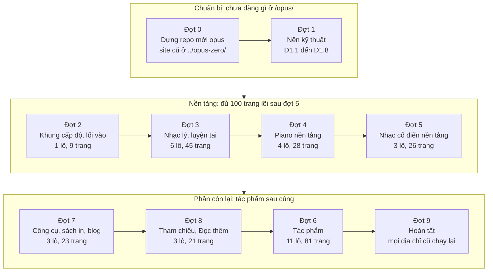
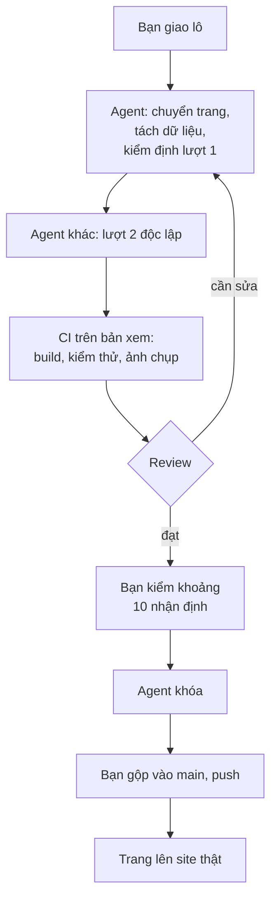
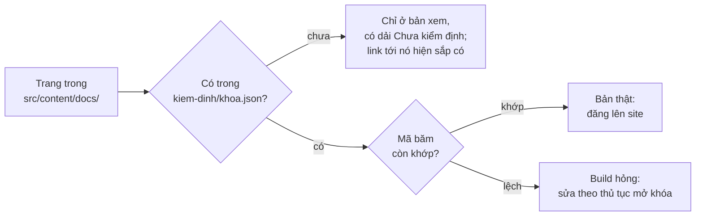
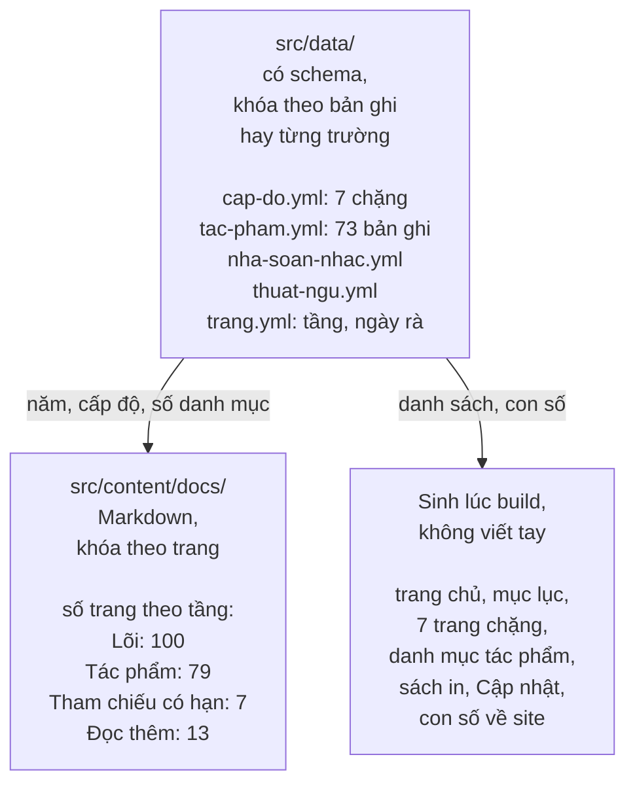
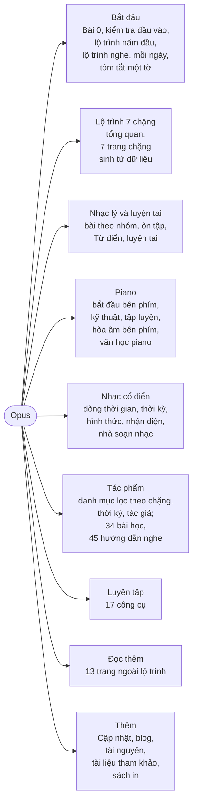
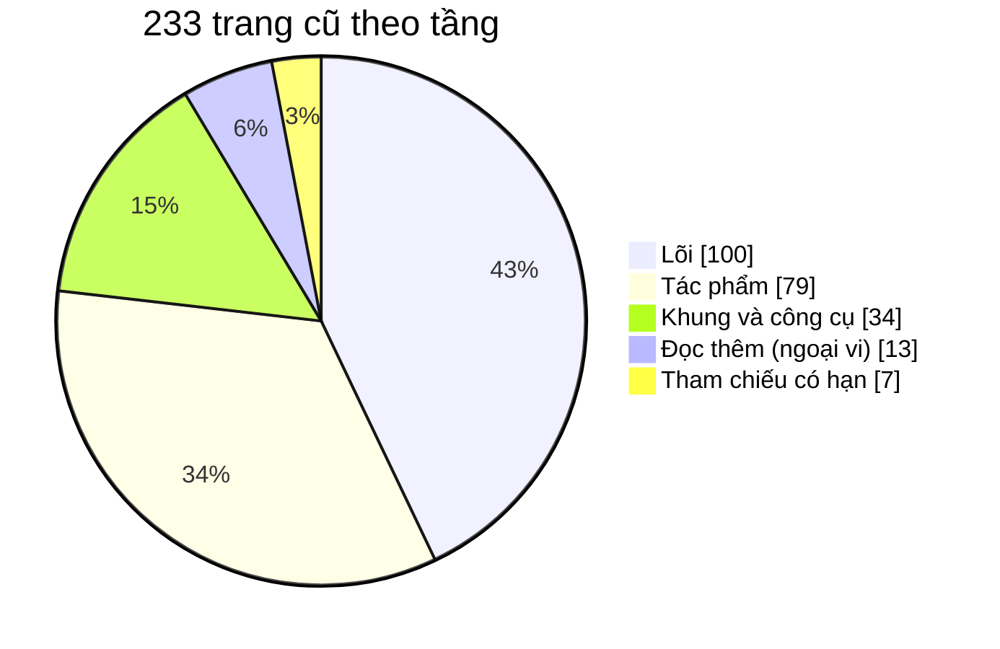

# Sơ đồ kế hoạch làm lại

Bản vẽ để nắm nhanh kế hoạch. Chữ trong `README.md` là chuẩn: sơ đồ khác chữ thì sửa sơ đồ. GitHub tự vẽ các khối `mermaid` dưới đây; sửa chúng như sửa chữ.

## 1. Mười đợt, làm lần lượt (tác phẩm sau cùng)

Từ đợt 2, mỗi lô gộp vào `main` là trang của lô lên https://mtuann.github.io/opus/. Đợt 6 (tác phẩm) làm sau đợt 8; số đợt giữ nguyên để tên lô và nhánh không đổi. Số trang tính cả trang mục lục; tổng 31 lô, 233 trang cũ.

## 2. Một lô đi qua những bước nào

## 3. Trang nào lên site

## 4. Lớp dữ liệu và các tầng

Trang tác phẩm dẫn link về trang lõi để giải thích khái niệm, không giải thích lại. Thêm một tác phẩm chỉ thêm một bản ghi, một trang và một hồ sơ; mọi danh sách và con số tự cập nhật lúc build (`../ben-vung/them-tac-pham.md`).

## 5. Menu của site mới

## 6. Trang cũ theo tầng

Lõi kiểm định một lần rồi khóa; tác phẩm kiểm từng trang, sau đó chỉ thêm; tham chiếu rà theo ngày; khung sinh từ dữ liệu và kiểm tự động. Chi tiết: `../ben-vung/README.md`, `../ben-vung/kiem-ke.md`.
