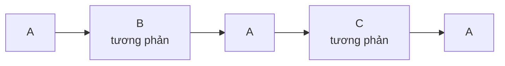

**Rondo** là hình thức có một đoạn chính (A) **quay lại nhiều lần**, xen giữa là các đoạn tương phản: **A – B – A – C – A**, có khi dài hơn. Đoạn A quay về giống như điệp khúc của một bài hát, nên tai dễ nhận ra. Nó hay dùng cho **chương cuối** của sonata, concerto và giao hưởng thời Cổ điển.



## Đi qua một tác phẩm: Beethoven, Für Elise (WoO 59)

*Bagatelle cung La thứ*, khoảng 1810, xuất bản sau khi Beethoven mất. Bản nhạc ngắn nhưng có đủ hình thức rondo năm đoạn.

| Phần | Giọng | Điều cần nghe |
|---|---|---|
| **A** | La thứ | Giai điệu quen thuộc: Mi – Rê♯ – Mi – Rê♯… (xem [bài học Für Elise](/opus/piano/tac-pham/fur-elise/)) |
| **B** | Fa trưởng, rồi Đô trưởng | Giai điệu mới, sáng hơn (giọng trưởng), rồi chuỗi nốt nhanh |
| **A** | La thứ | Giai điệu chính trở lại, nguyên vẹn |
| **C** | La thứ, trên **âm nền La** ở bè trầm | Nốt La lặp lại dồn dập ở tay trái; đoạn không rời giọng chính |
| **A** | La thứ | Trở lại lần cuối, rồi bài kết thúc |

**Cách nghe:** mỗi khi giai điệu "Mi – Rê♯" quay lại, giơ một ngón tay. Bạn sẽ đếm được hai lần quay lại, tức ba lần A kể cả lần đầu.

## Nghe thêm

- Mozart, chương 3 Sonata piano K. 331, *Rondo alla Turca*: mô phỏng âm nhạc quân đội Ottoman (Janissary), một ví dụ nổi tiếng của thể loại *alla turca*.
- Chương cuối của nhiều concerto thời Cổ điển, như concerto của Mozart: thường là rondo hoặc sonata – rondo.
- [Vivaldi *Mùa xuân*](/opus/nghe-nhac/vivaldi-mua-xuan/): hình thức ritornello của concerto Baroque cũng dựa trên ý tưởng "một đoạn quay lại nhiều lần" (ritornello xen với các đoạn độc tấu), xem [Concerto và ritornello](/opus/hinh-thuc/concerto/).

```quiz
? Sơ đồ của rondo năm đoạn là gì?
+ A – B – A – C – A
- A – B – A
- A – A' – A'' – A'''
> A – B – A là hình thức ba đoạn; A – A' – A'' là biến tấu.
? Rondo thường dùng cho chương nào?
- Chương đầu
- Chương chậm
+ Chương cuối
> Rondo là hình thức quen thuộc cho chương cuối của sonata và concerto thời Cổ điển.
? Đoạn C của Für Elise có gì đặc biệt?
+ Bè trầm giữ nốt La làm âm nền
- Chuyển sang nhịp 3/4
- Chuyển hẳn sang giọng trưởng
> Đoạn C ở La thứ, trên âm nền La; bài vẫn ở nhịp 3/8.
```

## Nguồn

- Open Music Theory, chương [Rondo](https://viva.pressbooks.pub/openmusictheory/chapter/rondo/): đoạn chính quay lại xen các đoạn tương phản; rondo năm đoạn ABACA, rondo sonata ABACABA.
- *Concise Oxford Dictionary of Music* và *Encyclopaedia Britannica*, mục [Rondo](https://www.britannica.com/art/rondo): rondo là hình thức chương cuối quen thuộc của sonata, giao hưởng, concerto từ cuối thế kỷ 18.
- *Für Elise* trên [IMSLP](https://imslp.org/wiki/F%C3%BCr_Elise%2C_WoO_59_%28Beethoven%2C_Ludwig_van%29) (1810, in lần đầu 1867) và bản dàn trang của [Mutopia](https://www.mutopiaproject.org/cgibin/piece-info.cgi?id=931). Xem [tài liệu tham khảo](/opus/tai-lieu-tham-khao/).
